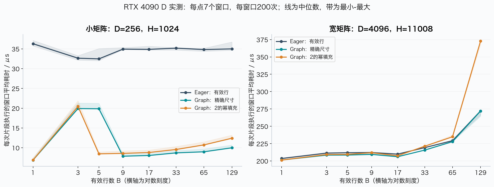
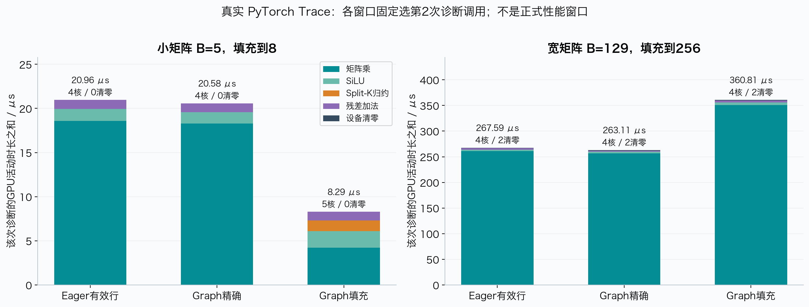
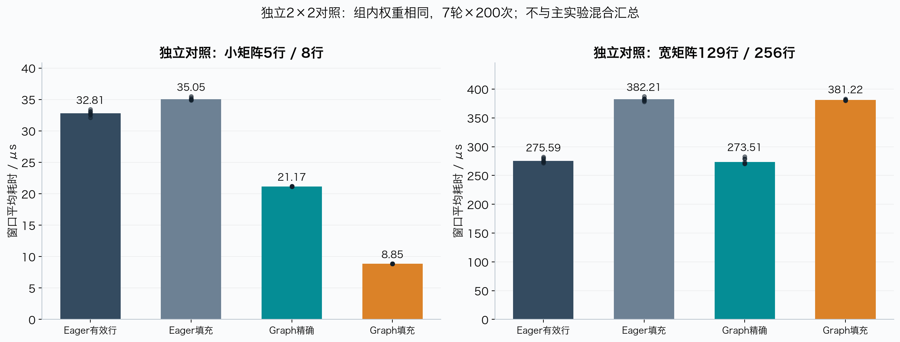
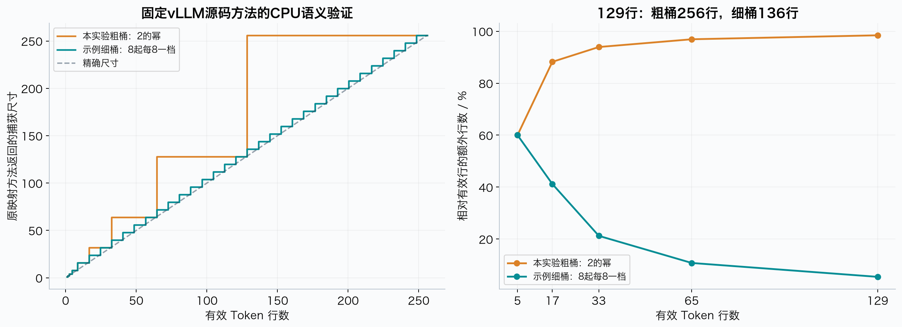

在一张 RTX 4090 D 上测两次投影时，我把小矩阵的有效输入从 5 行补成 8 行。主项 FLOP 增了 60%，实际执行却从 **32.47 μs 降到 8.47 μs**。用更宽的矩阵做同样的事，从 129 行补到 256 行，又比 Eager **慢约 37.1%**。

要弄清差异从哪里来，先拿同一形状走 Eager 和 CUDA Graph，再保持 Graph 不变去改填充形状。最后用 Trace 看矩阵库实际选了哪条路径。这些时间都来自单卡上的同一个推理片段。

CUDA Graph 预先捕获 GPU 操作及依赖，重放时可以一次提交整张图。图中仍可包含多个 Kernel，各自的设备执行开销仍在。对推理服务来说，捕获尺寸的选择同时影响提交次数、填充量和图缓冲占用，最后还要看留给 KV Cache 的空间。[CUDA Graph 重放与内存管理](https://docs.pytorch.org/docs/2.14/notes/cuda.html#cuda-graphs)

## 把完整推理缩成一个可对照的片段 {#一先把实验缩到能解释清楚的执行路径}

实验环境记在这里。RTX 4090 D，设备查询 24564 MiB、计算能力 8.9。PyTorch 2.14.1+cu130，CUDA 13.0，驱动 580.173.02，Python 3.12.16。虚拟机呈现 24 个 vCPU，CPU 显示 Intel Xeon Icelake，PyTorch 用一个 CPU 线程。

本次只使用其中一张 GPU。测试前、正式轮次边界和测试后查询均未发现其他计算进程；这些是离散检查，不是持续的整机负载审计。没有调整设备时钟或功率限制。输入和权重预先放在显存里，因此下面测量的是设备计算片段的重复执行，不含 HTTP、分词、请求排队和跨卡通信。

选择的片段包含两次矩阵投影、中间 SiLU 和残差加法。设有效输入 X 为 B×D，第一份权重为 D×H，第二份为 H×D，执行关系为：

```text
H₁ = X × W₁
H₂ = SiLU(H₁)
Y  = H₂ × W₂ + X
```

它抽出了推理中常见的投影与逐元素操作，但不是某个完整模型：没有注意力、KV Cache、归一化或门控分支。本文只讨论这个执行路径的测量，不把结果写成某个 LLM 服务的 Token/s，也不以它替代完整模型验证。

使用两组宽度。小矩阵的 D=256、H=1024，两份 FP16 权重合计 1 MiB；宽矩阵的 D=4096、H=11008，合计 172 MiB。权重按同一方式随机初始化并缩放，组内各执行方式共享权重与有效输入。改变宽度，是为了观察较短的内核和较长的矩阵工作，对提交方式是否有不同敏感度。

有效行数取 1、3、5、9、17、33、65、129。这里的行数是稠密算子的输入规模；只有在每序列贡献一个 Decode Token 等特定条件下，才可以把它对应到序列数。它不自动等于 HTTP 并发，更不等于包含 Prefill 或投机验证时的请求数。

每个形状按三条路径跑。Eager 直接执行有效行，精确图捕获相同形状，填充图将行数向上补到二次幂并把额外行置零。三条路径都预分配输入、中间缓冲和输出，使用 out 参数。

捕获前先在侧流预热，建立依赖后再捕获；正式测量另行预热。每个条件有七个计时窗口，每窗口连续执行二百次，窗口前后同步，墙钟耗时除以二百得到该窗口的平均值。图中报告七个窗口的中位数，并保留最小、最大范围；没有把二百次循环当成二百个独立统计样本。

每轮会打乱条件顺序，减少总是先测某种模式的次序影响。两种宽度、八种行数、三种路径，共四十八个条件、三百三十六个正式窗口。计时期间关闭 Profiler，捕获与缓冲准备不进入该窗口。独立的诊断轨迹随后采集，每个条件只保留三次调用，不与正式窗口混算。

这种重复静态输入的测量更接近热态执行能力。它省去了输入更新和输出交付，也可能形成稳定的缓存与库调用状态。因此，用它判断单个计算片段的提交和选核很合适，用它预测真实请求端到端延迟则还缺其他阶段的数据。

## Eager、精确图和填充图分别有多快 {#二主实验节省的提交时间能否覆盖额外设备工作}

先看七个计时窗口的中位数。表里用微秒，算的是热态下这个片段平均执行一次的时间。后面再拿单独采的 Trace 对照。

| 片段与有效行数 | Eager有效行 | 精确尺寸Graph | 填充Graph | 填充尺寸 |
|---|---:|---:|---:|---:|
| 小矩阵，B=5 | 32.470 | 19.858 | 8.470 | 8 |
| 宽矩阵，B=5 | 211.868 | 208.510 | 209.528 | 8 |
| 宽矩阵，B=129 | 272.053 | 272.009 | 372.916 | 256 |

小矩阵 B=5 时，精确图已经把执行时间降到约十九点九微秒，说明相同形状下改变提交方式确实有收益。但补到八行以后又降到约八点五微秒，这部分差异不能继续归到“少做了 Python 调用”：两边已经都是图重放，必须检查设备执行本身发生了什么变化。

宽矩阵 B=5 时，三种路径都在二百一十微秒附近。精确图相对 Eager 的差额只有几微秒。即使主机提交成本有所下降，它在这个片段的总耗时中占比也不大。该点不能支持“图重放会让所有推理算子获得数倍提升”的说法。

到了宽矩阵 B=129，精确图与 Eager 的中位数几乎相同；补到二百五十六行却多出约一百零一微秒。七轮里，Eager 为 265.93—273.90 μs，填充图为 367.83—373.83 μs，两组范围没有交叠。这里观察到的是明显的填充代价，不能为了展示图优化而只保留小矩阵结果。



图 1：真实 RTX 4090 D 测量。每点七个窗口，每窗口二百次；线是窗口平均耗时的中位数，淡色范围是七轮最小至最大值。横轴使用对数刻度。计时不含输入复制、捕获和 Profiler。

理论运算量也需要选对分母。两次矩阵乘的主项约为 4BDH FLOP。小矩阵五行是 5242880 FLOP，八行是 8388608，增加六成；若以捕获尺寸为分母，三条虚拟行占八行的百分之三十七点五。额外运算比例与槽位浪费比例不同，不能互换。

宽矩阵从一百二十九行补到二百五十六行，主项从约二十三点二七 GFLOP 增到四十六点一七 GFLOP，行数增加约百分之九十八点四五，墙钟却增加约百分之三十七点一。这说明不能把 FLOP 比例直接当成时间比例，仍需考虑权重访问、执行并行度和库实现。

两种宽度读到的是同一个工程判断：填充只规定输入形状，不保证耗时按行数线性变化。较小的行数增加可能没有显著增加某个 Kernel 的执行成本，也可能跨过矩阵库的实现选择边界；较大的填充则可能把原本占比不高的额外工作放大到主导总时间。

还可以做一个资源数量级估算：若两份 FP16 权重在一次片段执行中各读取一遍，仅权重字节数为 4DH，矩阵乘运算量为 4BDH，两者之比就是 B FLOP／字节。这个简化比值忽略激活读写、工作区和缓存命中，但说明了为什么增加行数可能复用同一套权重，而不是让所有成本一起同比增长。

它不能用来宣称本机已经达到某个显存带宽。要验证实际流量，还需要设备性能计数；本次只有执行轨迹和窗口计时。正确的用途是提出可检验的资源模型：当权重与启动成本占比较高时，少量行数变化的时间效应可能较小；当新增矩阵计算或逐元素工作开始显著增长时，填充成本会暴露出来。

可以用一个条件式整理取舍：填充后的设备临界路径与额外数据准备成本，小于省下的未被覆盖提交成本时，图路径才更快。如果形状变化使设备内核本身变快，前一项甚至可能下降。这里的提交成本必须按暴露在关键路径上的部分计算，不能把 CPU 提交总时间与 GPU 执行总时间简单相加。

本实验还记录了主机完成提交的时间和 CUDA Event 跨度，但没有将两者相减解释为某一层的精确开销。主机可能受到队列背压，设备流内也可能包含等待主机继续提交形成的空隙。正式结论使用完整窗口墙钟，机制解释再回到具体事件。

## 在 Trace 里找换掉的矩阵核 {#三trace-显示填充后-kernel-更多矩阵计算却更短}

打开小矩阵五行的 Trace，先数 Kernel。Eager 有第一投影、SiLU、第二投影和残差四个。精确图仍能找到这四个，主机端只记录一次 `cudaGraphLaunch`。这是相同形状下的提交方式变化。

填充到八行后，轨迹中反而有五个 Kernel：矩阵库对第二投影采用带 Split-K 归约的执行方案，增加了一次归约。尽管内核数量更多，矩阵部分累计驻留时间却明显下降。因此，“数 Kernel，少的就快”在这个例子中也不成立。

为了避免挑选最漂亮的一次，下面统一展示每份诊断轨迹的第二次调用。精确五行图里，第一矩阵核约 3.008 μs，第二矩阵核约 15.298 μs；八行图分别约 2.272 与 1.953 μs，另有约 1.248 μs 的 Split-K 归约。SiLU 和残差仍然单独存在。

这里能直接确认的是：输入形状改变后，实际记录的矩阵核名、分块模板和辅助归约发生了变化，执行时长也发生变化。它支持“形状选核是收益的一部分”，但还不足以精确分摊寄存器、占用率或显存事务分别贡献了多少；本次没有这些硬件计数。



图 2：真实 PyTorch Trace，每份固定选择第二次诊断调用。柱子累计该调用内记录到的 GPU Kernel 与设备清零时长，未画成正式性能窗口。小矩阵填充后从四核变成五核；宽矩阵一百二十九行各路径还记录到两次设备清零。

宽矩阵提供了另一个方向的证据。B=129 的精确图中，两次矩阵核约为 127.171、129.763 μs；填充到二百五十六行后变为约 178.180、172.516 μs。逐元素工作也变长，额外设备工作没有被图重放消除。这与主实验中填充路径显著变慢的方向一致。

但两种证据不能混成同一套时间账。诊断调用带 Profiler，还在每次执行后同步，用于把 CPU 标记与 GPU 活动明确关联；正式窗口则连续执行二百次后才同步。图二不能拿来重算图一的速度倍数，更不能把诊断标记包含的主机时间当作无分析器延迟。

为什么矩阵库会因为几行输入而换实现？矩阵乘要把行、列和归约维度切成线程块，形状会影响块数量、边界处理与归约组织。不同实现的启动、分块和后处理成本不同；理论 FLOP 少，不代表每个硬件执行单元都工作得更有效率。这是需要用实际内核选择验证的机制，不应仅从矩阵大小猜测。

还要避免过度阅读核名。本次一些矩阵实现的名称包含 gemm_relu 字样，但逻辑程序调用的是独立 SiLU，且正确性对照通过。不能据这个模板名字宣称运行时把 SiLU 换成了 ReLU。执行语义应由程序、输入输出检查和必要的实现细节共同确认，名字只是检索线索。

只做三组对照仍可能让人疑惑：收益是否来自某一次捕获状态，或者大小变化与提交方式存在交互？因此另开一个独立窗口，补齐“有效形状／填充形状”与“Eager／Graph”的四组组合。该窗口重新生成权重，组内共享；每组仍为七轮、每轮二百次，不与主实验合并统计。



图 3：独立 GPU 对照，柱为七个窗口的中位数，点为每轮值。两种因素在组内组合，使用相同权重和有效输入；权重随机种子与主实验不同，因此只在本图内部作因果对照。

小矩阵独立对照中，Eager 五行为 32.808 μs，Eager 八行为 35.046 μs；精确图为 21.170 μs，填充图为 8.846 μs。也就是说，只改成八行并没有让 Eager 更快，减少重复提交后，形状选核带来的短设备路径才更充分地反映在墙钟上。

宽矩阵独立对照的结果则为 275.592、382.205、273.512、381.219 μs，顺序对应 Eager 有效、Eager 填充、精确图、填充图。两种提交方式下，补到二百五十六行都很贵。这为“该点主要受额外设备工作影响”提供了组内控制，而不是仅凭两份独立 Trace 作归因。

## 回到 vLLM 看实际捕获档位 {#四vllm-怎样把动态-token-数变成固定图尺寸}

回到服务端时，先抄部署实际启用的捕获档位。前面的二次幂是实验里自己设的。为了看到真实分派逻辑，我固定检查 vLLM v0.33.0 的 4ba787e 提交，沿捕获尺寸表和批次描述往后追。

该版本的分派器先构造有效尺寸到捕获尺寸的映射。若尺寸已经在捕获表内，就保留该值；若落在两个相邻档位之间，则向上取到可用档位。这个映射解决的是“形状对应哪张候选图”，还没有证明这张图对本轮批次一定兼容。[尺寸映射源码](https://github.com/vllm-project/vllm/blob/4ba787ec9959e566d3b587a796dff07673324da5/vllm/v1/cudagraph_dispatcher.py#L71)

本地直接提取该原方法执行，给它两份显式尺寸表。一份是本实验使用的二次幂粗桶；另一份在一到二百五十六范围采用一、二、四，以及从八起每八一档的细表。后者与此版本配置文档在该范围描述的模式一致，但不代表任何一台服务已经采用了这份有效配置。

两份表各核验一到二百五十六，共五百一十二个映射。五行在两份表里都到八行；十七行分别到三十二和二十四；一百二十九行分别到二百五十六和一百三十六。填充比例因此不仅取决于当前负载，也取决于部署时捕获了哪些档位。



图 4：固定 vLLM 源码方法的 CPU 语义执行，不是完整模型性能测试。粗桶和细桶均为本次显式输入的配置表。图只展示映射和额外行数，没有声称一百三十六行在目标服务上已经测得某个延迟。

一百二十九行若落到一百三十六，额外行数约百分之五点四三；若落到二百五十六，约百分之九十八点四五。这个数量级差异足以改变下一步实验优先级。但不能因此直接宣布细表一定最优：它需要更多捕获项，可能增加启动、元数据和缓冲管理成本，还要验证对应模式能否复用。

继续沿执行路径看，填充后的 Token 数会进入批次描述，还会结合请求数、是否均匀 Decode、LoRA 等信息检查可用键。完整图与分段图的候选条件不同；没有兼容键时，可以回退到无图执行。单独记录“尺寸命中”无法代表整个图路径已经生效。[批次描述与分派](https://github.com/vllm-project/vllm/blob/4ba787ec9959e566d3b587a796dff07673324da5/vllm/v1/cudagraph_dispatcher.py#L130)

例如，五个单 Token Decode 序列通常贡献五行模型输入，但一个序列可能在投机验证里贡献多个查询 Token，混合 Prefill 又有另一种布局。把捕获尺寸八统一解释为“同时服务八位用户”，会把模型输入粒度和调度序列粒度混在一起，后面的填充开销估算也会失真。

源码还检查显式编译尺寸是否会被图填充改变。本次给定捕获表一、二、四、八，却要求编译尺寸五，原方法按预期抛出不匹配错误。这是 CPU 语义验证：它说明两个尺寸配置需要一致，不证明完整运行时的所有图组合都已测试。

因此，调参前应从实际批次直方图和有效捕获表出发，计算每个常见输入会落到哪里，再对重点档位做真实执行对照。不要看到二次幂容易理解，就把它当成通用最优表；也不要为避免所有填充而给每个偶发行数都捕获一张图。

## 补齐后的缓冲与输出怎么验证 {#五形状补齐之前先守住数据和地址契约}

改完形状后，先喂一份新输入确认重放真的使用了新数据。新数据要写入捕获时约定的缓冲，复制、重放和消费输出都要按流依赖排序。捕获时使用的地址、布局和操作关系仍需有效。 [PyTorch 2.14 的重放与输入更新约定](https://docs.pytorch.org/docs/2.14/notes/cuda.html#cuda-graphs)

所以，主实验之外又做了十六组目标 GPU 正确性检查：两种宽度乘八种有效行数。捕获后先记录输出，再将新的随机有效输入复制到相同地址、把虚拟行清零，重放后与相同新输入的 Eager 结果比较。输入、输出地址保持不变，输出确实改变；存在虚拟行时，虚拟输出仍为零。

主实验中，精确尺寸图与相同形状 Eager 的输出逐位一致；填充图与有效形状结果在指定容差内一致，检查使用 rtol=0.02、atol=0.03。所有形状的最大绝对差为 0.00390625，最大相对 L2 差约 0.000278。这个误差范围是当前随机输入和精度下的观察，不是任意模型质量不变的证明。

之所以允许小误差，是因为不同矩阵形状可能触发不同归约组织，浮点运算的顺序变化就可能改变舍入。正确做法是先定义误差度量与业务容差，保留实测偏差；不能为了显示“同样的数学公式”就默认所有路径必须逐位相等，也不能忽略实际偏差。

该片段能安全补零，是因为两次投影和逐元素操作都按行独立，虚拟行不会被有效行读取，最后只消费前 B 行。带偏置时虚拟行未必输出零，但只要它不污染有效行、也不进入有效输出，仍有可能正确。是否安全取决于数据依赖，而不只是填充值。

数学上，需要保证填充后结果的前 B 行，与只执行有效输入时的结果相同。当前投影对每行使用相同权重，SiLU 与残差也逐行作用，因此可以沿四个操作逐步证明这一性质。性能测试中的输出比较，则检查当前数值实现是否在预设容差内满足这个契约。

一个简单反例是沿行方向做 softmax：只有一个分数零时，输出为一；再补一个零参与相同归一化，原位置就变成二分之一。虚拟值即使为零，也可能改变有效结果。这个数学反例不是本实验包含的算子，而是说明“填零总是无害”的通用规则并不存在，必须检查归约与掩码的作用范围。

完整推理有更强约束：注意力的有效长度和 mask、KV 写入位置、采样范围、请求元数据都可能跨越“有效行／虚拟行”的边界。若虚拟槽位被当成真实序列写缓存，或者参与有效 Token 的归约，输出可能被污染。本文没有用这段按行独立的证明替代完整 vLLM 正确性验证。

输出生命周期同样重要。图下一次重放通常继续写相同输出地址，保留一个 Python 张量引用，不代表保留了旧结果。若下游尚未消费完就重放，需要正确的依赖或复制策略；额外复制是否抵消执行收益，要放进实际服务路径计时，而不能藏在测量窗口外。

静态缓冲也有可计算的容量成本。本程序显式保留输入、输出、第一投影和激活四份缓冲，FP16 下合计为 4B(D+H) 字节，不含权重与库工作区。宽矩阵从一百二十九补到二百五十六，仅这四份缓冲增加 7672832 字节，约 7.32 MiB。这是按张量布局计算的容量，不是测得的完整图私有池增量。

多档图的资源也不能用“图数乘模型权重”粗暴估算。本实验共享权重，部分缓冲分别持有；真实运行时还可能复用内存池，但要满足地址和执行顺序约束。图数量、活跃缓冲与峰值占用必须分别核对。PyTorch 的图内存管理说明了地址保留的原因，不能从本实验的预分配方式推出所有服务都没有额外内存成本。

## 把微实验接回模型服务 {#六怎样把微实验变成服务里的优化判断}

带回完整模型后，我会先抓各档的实际有效 Token 数、捕获尺寸和选核，再决定复测哪个形状。五行补八行和一百二十九行补到二百五十六行的结果方向相反，单看填充比例做不了决定。

第一步是采集真实模型步的有效 Token 数、请求数、所选模式和捕获尺寸。在单 Token Decode 的短窗口里，先确认有效行数究竟是多少；遇到混合 Prefill 或投机验证，再分别处理不同形态。记录需要与实际选择的图键对应，只看启动时打印过哪些尺寸不够。

第二步是做相同形状下的提交对照。尽可能固定权重、精度、Attention 后端、输入上下文与批次，比较 Eager 与兼容的精确图，观察关键路径中还有多少主机暴露成本。若本来就是长 Kernel 主导，减少提交可能只能得到较小改善；这时不应把所有优化预算都投入图命中率。

第三步才改变档位，把填充比例与设备实际成本连接。既看矩阵内核是否变化，也看逐元素、Attention、缓存更新和额外清零。相同 FLOP 比例可能对应不同耗时曲线；在本例中，宽矩阵 B=5 与 B=129 已经展示出不同趋势。因此应按重要批次区间验证，而不是由一个点外推全区间。

需要特别警惕的是，精确尺寸图也未必具有最快的设备路径。小矩阵五行图仍使用较慢的第二投影实现，八行图换了方案才明显缩短。这里的工程目标应是最小化整条可正确执行的路径，而不是机械追求零填充、最少 Kernel 或最高图命中率中的某一项。

捕获成本还要摊销。只有每次使用的净节省为正，才存在靠重复次数回收捕获开销的可能；若运行时切换形状很频繁，某张图实际使用次数很少，热态执行快也不保证整体划算。本次记录的捕获 API 段不含预热与缓冲准备，不能作为完整模型启动时间，更不能替代滚动发布和冷启动的实测。

服务验收应把输入更新、元数据准备和输出消费放回时间窗，再观察请求延迟与受约束吞吐。若图执行省了二十微秒，却增加更多复制或迫使其他请求排队，用户端可能没有收益。反之，稳定的小收益在大量 Decode 步里也可能有价值，需要结合每请求实际步数与服务负载累积，而不是凭微秒量级就忽略。

这也要求计时与分析器分工明确。无分析器窗口提供交付性能，Trace 解释执行路径；CPU 提交时长、CUDA Event 跨度、Kernel 累计时长和请求墙钟分别保留自己的边界。只要其中一列更好就宣布总体加速，会把未覆盖的等待、并行重叠或额外数据搬运漏掉。

最后，换驱动、矩阵库或编译策略后，应重新核对关键形状。本例的优势部分来自特定环境记录到的选核变化；另一个版本可能选择不同模板，原先值得填充的边界也可能移动。可复跑程序、原始轮次和真实核名比一个孤立的倍数更有用，它们让结论能被复核，也让版本升级后的变化有比较基准。

## 这次测量可以说明什么 {#结论}

这次对照看到两条可分开的变化。小矩阵精确图已经省下一部分重复提交时间，八行填充又选到了更短的矩阵执行路径。宽矩阵补到 256 行以后，额外设备工作超过了提交端的节省。

下次验收记录有效行数、捕获档位、提交方式和实际内核，先过正确性，再量包含输入更新与输出消费的完整成本。生产是否值得切换，留给同负载的请求级测量。

## 资料来源

- [PyTorch 2.14：CUDA Graph 的输入更新、捕获约束与内存管理](https://docs.pytorch.org/docs/2.14/notes/cuda.html#cuda-graphs)
- [vLLM v0.33.0：尺寸映射、批次描述与模式分派，固定提交 4ba787e](https://github.com/vllm-project/vllm/blob/4ba787ec9959e566d3b587a796dff07673324da5/vllm/v1/cudagraph_dispatcher.py)
- [vLLM v0.33.0：捕获尺寸配置及自动生成模式](https://github.com/vllm-project/vllm/blob/4ba787ec9959e566d3b587a796dff07673324da5/vllm/config/compilation.py#L695)
- [vLLM v0.33.0：图包装器、捕获与重放路径](https://github.com/vllm-project/vllm/blob/4ba787ec9959e566d3b587a796dff07673324da5/vllm/compilation/cuda_graph.py#L235)
