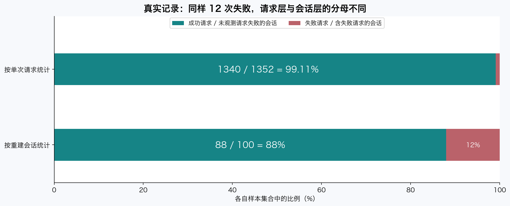
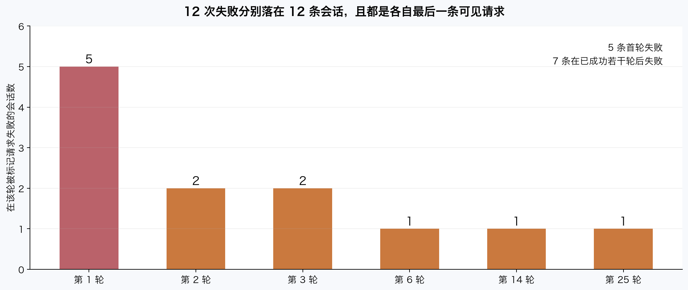
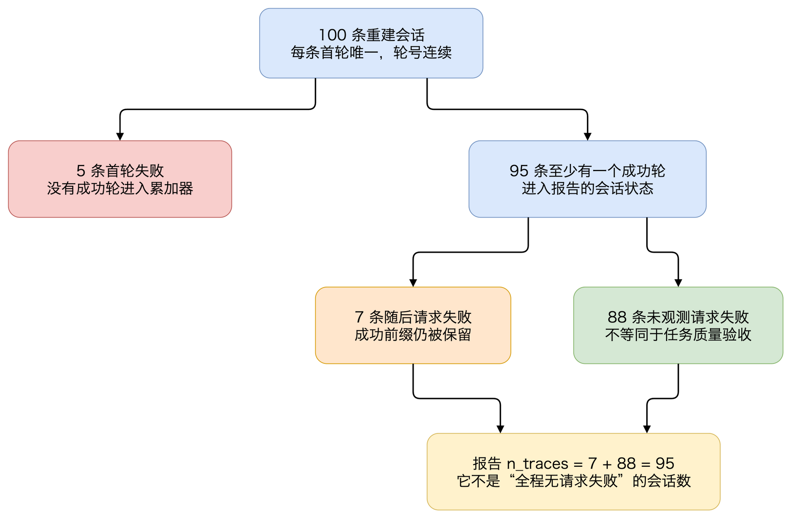
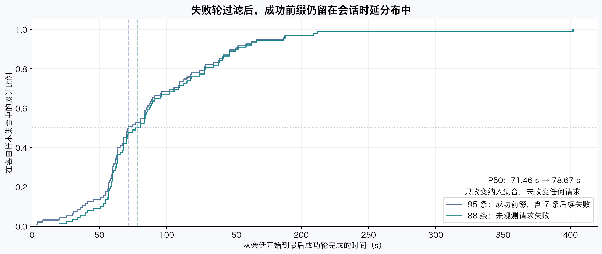
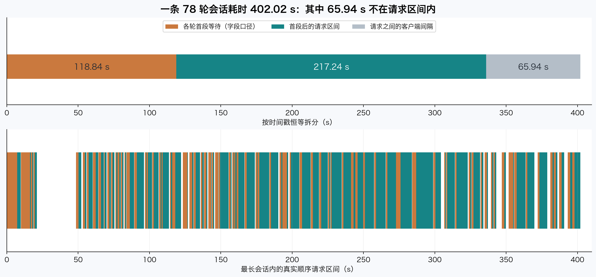

一份 EvalScope 多轮推理压测记录里，1,352 次请求有 1,340 次成功，成功率约为 99.11%。但把同一批记录还原成 100 条多轮会话后，有 12 条会话包含失败请求，而且失败之后都没有继续推进。请求层看起来只失败了不到百分之一，会话层却有百分之十二遇到了中断。

更容易被忽略的是，报告另外展示了 95 条会话的时延统计。这个 95 既不是总共开始的会话数，也不是全程没有请求失败的会话数：它由 88 条未观测到请求失败的会话，加上 7 条随后失败、但仍保留了成功前缀的会话组成。

这不是把同一个百分比算了两遍。**请求成功、会话未中断、任务正确完成，是三种不同的验收条件。** 如果先不固定分母和终止语义，首段、吞吐和高分位时延都可能被解释成另一件事。



图：依据数据库逐行复算。上行统计 1,352 次请求，下行统计 100 条重建会话；下行绿色仅表示未观测请求失败，不代表业务任务或模型答案通过质量验收。

## 一、从单次请求还原会话：先证明这些行确实属于同一条链

这份记录来自一个使用 DeepSeek Flash 服务标记的推理端点，使用 EvalScope 的 trie_agentic_coding 负载重放。参数记录为 parallel=16、number=100、流式输出、temperature=0、ignore_eos=true，采用闭环方式而非固定到达率的开环发流。正式记录的时间窗口约为 642.32 秒，数据库与汇总表都记录了 1,352 次请求、1,340 次成功和 12 次失败。

这里的会话负载是按轨迹中的长度和等待元数据合成输入，目的是衡量推理服务面对多轮依赖、变化的输入输出规模以及轮间等待时的行为。它不是执行了一百次真实编程任务，也没有据此验证模型修复代码的正确率。对 AI Infra 来说，真正要观察的是服务如何承接这些依赖链，以及单轮失败怎样影响后续请求的推进。

归档中没有完整记录服务器 GPU 型号、数量、张量并行配置、推理引擎版本和模型权重提交；EvalScope 的安装版本也没有保留。因此本文定位为客户端压测记录与统计口径的复核，不从服务名称猜测实际硬件，不用客户端等待时间替代设备瓶颈证据。公开源码固定到提交 9f011a552311a56147d3984f368274ddc2c0ae3f，用于解释并复跑与报告一致的聚合行为。

原数据库的 request_id 字段没有提供可直接分组的会话标识。重建时，先对每条请求第一条用户消息的完整规范化内容生成指纹，再用消息列表的长度还原当前轮号：一条消息对应第一轮，三条对应第二轮，依此类推。这个办法只适用于当前数据的组织方式，不能不加验证地拿去合并生产环境中内容相同的两个独立会话。

为此，复算加入了四个约束。每一组只能有一条第一轮请求；轮号必须从一开始连续且不重复；后一轮的既有消息前缀必须与前一轮一致；同组相邻请求在时间上不能重叠。当前一百组全部通过这些检查。导出的分析数据只保留匿名编号、轮号、时间和计数，没有把提示词、模型回复、内部服务地址或凭证放进文章材料。

检查后的结果是，一百条会话中有十二条各出现一次失败，而且失败请求都是该组最后一条可见记录。五条在第一轮就失败，另七条已经成功完成若干轮后才失败。剩余八十八条的已保存请求没有失败标记。后一种状态比“单轮成功”更强，但仍缺少计划轮数、终止原因和业务结果判定，不能被直接命名为任务成功。

这一点非常重要：记录结束可能意味着数据集自然结束，也可能意味着达到轮数限制、被取消或者被预算截断。即使没有失败请求，若没有终止状态，也未必能证明计划中的最后一轮已经执行。本文能够确认的是已观测请求链的失败分布；涉及完整业务完成的结论，应另有明确的终止记录和结果验收。

## 二、同样十二次失败，为什么两个成功率相差这么大

请求层成功率的分子是成功请求数，分母是实际发出的请求数。当前就是 1,340 除以 1,352，得到约 99.11%。它回答的是随机取出一条已发出的请求，有多大比例被压测程序标记为成功，并不回答一个用户需要的整个多轮过程能否走完。

会话层的失败条件则是链上存在一次失败。当前十二次失败恰好分布在十二条不同会话，因此含失败请求的会话比例是 12/100，也就是 12%。如果同样十二次失败集中在一条会话里，这个比例会不同；不能只凭失败请求总数推导失败会话总数。先做关联，才知道失败是散落在许多用户之间，还是集中在少数重试链里。

即使每一轮的成功概率很高，串联依赖仍会放大整条链的风险。作为独立同分布的数学算例，若单轮成功概率为 p，连续 n 轮全部成功的概率是 p 的 n 次方。代入本次请求成功比例作为一个示意值，二十轮全部成功约为 83.67%。这个算例说明串联风险的数量级，不是用独立性假设拟合本次十二条中断会话。

实际系统未必满足独立同分布。更长上下文、较大输出、某个共享故障窗口或者不同类型请求，都可能改变每一轮的风险。本次重放还在失败后放弃当前会话，后续计划请求不再发出。于是请求层分母本身会被失败截短：已经中断的会话，不会继续贡献原本可能出现的后续请求。只看最终发出的请求集合，无法完整表达计划负载的暴露机会。

失败落在哪一轮也有工程意义。当前五条首轮失败之外，后续失败分布在第二、第三、第六、第十四和第二十五轮。最晚的一条在第二十五轮被标记失败，此前已经有二十四轮成功记录。对需要串联完成的调用链来说，这与一开始就没有进入服务是不同的交付后果；但它也不自动证明前二十四轮工作全部可以从业务上判定为浪费。



图：十二条含失败请求会话的最后可见轮号。横轴是实际轮号类别，不是等间隔连续时间。数据库未保留失败的具体状态码和完整错误原因，因此图中不区分超时、服务错误或客户端解析失败。

固定公开代码中的多轮执行策略，与这里的终止模式相符：一次请求失败后，当前会话被标记为终止并退出后续轮次。它是压测客户端的策略，不等于任何真实应用遇到一次失败都必然放弃。生产应用若增加重试、回退或者状态恢复，就会改变会话成功率、请求数量、尾延迟和资源成本，不能只把重试后的成功数字加回来而不记录额外工作。[多轮执行策略](https://github.com/modelscope/evalscope/blob/9f011a552311a56147d3984f368274ddc2c0ae3f/evalscope/perf/core/strategies/multi_turn.py)

对可靠性验收，应该把这几个层次并排摆放：单次请求的成功比例、会话中是否发生失败、会话是否按预期终止，以及最终结果是否正确。前三者解释服务交付链条，最后一个需要业务质量评测。把它们统称为“成功率”，会让一个看上去漂亮的请求数字，替另一种尚未测量的结果作担保。

## 三、报告中的九十五条，为什么包含失败会话的成功前缀

会话时延表写着 n_traces=95，很容易让读者理解成“九十五条会话完整完成”。但数据库里是一百条重建会话，只有八十八条未观测请求失败，这三个数量不能靠猜测对齐。复核需要沿累加器看哪些记录进入了统计状态，以及遇到失败时是否撤销先前已经进入的轮次。

固定源码的 TraceAccumulator.feed 会跳过预热记录、失败记录和没有 trace_id 的记录。对通过条件的一轮，它取得或者新建该会话状态，再追加这个成功轮。因此首轮失败不会创建会话状态；先成功、后失败的会话则已经创建了状态，失败轮被跳过，并不会删除先前成功的部分。[会话指标累加器](https://github.com/modelscope/evalscope/blob/9f011a552311a56147d3984f368274ddc2c0ae3f/evalscope/perf/utils/trace_metrics.py)

这就解释了当前样本的构成：一百条中，五条首轮失败完全不进入会话时延表，剩下九十五条至少有一个成功轮；其中七条后来失败，仍以成功前缀留在表里。九十五等于八十八加七，而不是一百减去十二。这个分母本身可以用于描述“有成功轮记录的会话”，但在报告解读中必须把它与“全程无请求失败”区分开。



图：依据真实分组计数与固定源码聚合路径绘制。五条首轮失败没有成功轮状态；七条中途失败保留成功前缀，与八十八条未观测请求失败的会话共同形成九十五条统计状态。

时延字段随之出现语义变化。该实现取最后一个保留轮次的完成时间减去第一个保留轮次的开始时间。对顺利推进的会话，这接近其可见请求链跨度；对中途失败的会话，终点却落在最后一个成功轮，而不是失败被发现的时刻，也不是计划中的最终结果到达时刻。如果不说明保留条件，相同的字段名会让两类终点看起来相同。

TTFAT 通常指从整条会话开始到最终轮首个输出 Token 的时间。这份报告的实现使用最后一个保留轮次的起点加首段等待，再减去会话起点。对于那七条后来失败的会话，字段中的“最后”是最后成功轮，不能直接理解成用户已经等到了计划中最终答案的首个 Token。一个数值被成功计算出来，并不等于对应的业务终点实际发生过。

为了确认这不是仅凭阅读代码提出的怀疑，本文对数据库重新分组，过滤失败轮后，逐条重算九十五个会话状态。所得 Latency、First-Turn TTFT、TTFAT 的均值、最小值、中位数、多个高分位和最大值，与归档 trace_summary.json 逐项一致。同时在 CPU 上执行固定源码的原累加器与状态属性，一千三百五十二行重放得到九十五个状态，其中七个确实来自后来失败的会话。

另用三条合成会话作最小对照：一条两轮成功，一条先成功后失败，一条首轮失败。原累加器保留前两条，并保留第二条的成功前缀，第三条不进入状态。这项验证没有连接服务或运行模型，检验的是统计函数如何选择样本。归档没有安装提交信息，因此不能据此认定公开提交就是当时的安装版本；能够确认的是它复现了当前报告的聚合结果。

这里不必急着给工具贴上“指标错误”的标签。真正需要修正的是验收解释：如果要统计所有开始的会话、所有正常结束的会话，或者仅统计有成功轮的会话，就应明确写出各自的选择规则。一个实现对特定集合计算正确，不代表使用者可以把结果换成另一个集合的名字。

## 四、只改纳入集合，P50 为什么从七十一秒变成七十九秒

原会话时延表的九十五个样本，P50 为 71.46 秒，P99 为 223.61 秒。保持所有请求的原始时间不变，仅改为八十八条未观测请求失败的会话，同样按“最后成功轮完成减起点”的公式计算，P50 变为 78.67 秒，P99 变为 236.89 秒。没有更换模型，没有调整部署，也没有重新压测，数字已经发生变化。

这不是一次性能退化的对照，而是两个不同样本集合的条件分布。那些后来失败的成功前缀，可能在很短的可见链条上结束；将它们与较长的完整可见过程放在一起，会改变时延排序。在本次数据里，移除七条成功前缀后中位数上升，但不能由此推导“移除失败一定让时延变差”的普遍结论，方向取决于被选择或排除的具体记录。



图：两条曲线使用完全相同的原始请求，只改变会话集合。横轴都是从会话起点到最后成功轮完成的时间；并未将未完成会话的值当作正常任务完成时延。

样本量还会改变高分位的插值位置。本次两组数据尾部相邻的两个值同为约 212.22 秒和 402.02 秒。使用线性百分位定义时，九十五个样本的 P99 在这两个值之间取约 6% 的距离，八十八个样本则取约 13% 的距离。因此即使最慢的两条记录都没有变化，P99 也能从 223.61 秒变到 236.89 秒。[NumPy 百分位定义](https://numpy.org/doc/stable/reference/generated/numpy.percentile.html)

这个例子提醒我们，少于一百条会话的 P99 并不意味着有很多个独立尾部事件在支撑它。一个最大值及其相邻值，可能对最终数字有明显影响。报告应同时保存样本量、分位算法、原始最大值及终止分类；不能只放一个小数点后两位的 P99，让精度的外观代替统计证据的厚度。

再把最长的一条单独拆开。它包含七十八轮，未观测请求失败，总跨度为 402.02 秒。将各轮客户端请求的开始到完成区间相加，为 336.08 秒；相邻请求之间的间隔合计为 65.94 秒。两者正好回到总跨度，说明这条链的端到端时间里，有一部分根本不处在任何请求的在途区间内。

继续按记录字段拆请求内部，七十八轮的首段等待合计为 118.84 秒，首段之后到请求完成合计为 217.24 秒，再加 65.94 秒的轮间间隔，得到同一条 402.02 秒时间线。这里的“首段后区间”仍包含客户端可见的生成、传输及处理，不能直接命名为 GPU Decode 时间；轮间间隔也只能叫作未处在请求内的客户端时间，不能全部归因于真实工具执行。



图：一条真实七十八轮会话的恒等拆分。下方保留每轮请求的实际起止与首段字段边界；空白为轮间间隔，不代表 GPU 空闲。全部使用同一客户端时间基准，没有将设备时钟拼入其中。

如果仅盯着最后一轮的首段，前面七十七轮的等待与轮间停顿都会消失；如果把整个四百秒都归为模型计算，又会把请求之外的时间算到服务端头上。要解释最终结果为何迟迟未到，应先明确是哪一条链、哪个终点，再逐段拆开请求区间与客户端间隔，最后才有资格继续向服务队列和设备执行追因。

## 五、并发、轮数和缓存：另外三个容易被字段名误导的地方

多轮重放中的 parallel=16，不应直接读成 GPU 始终在一个十六请求批次中执行。固定公开策略中，一个工作者推进一条会话，等待本轮响应，必要时按轨迹的等待元数据暂停，然后再发下一轮。配置描述的是客户端并行推进的能力；实际 HTTP 请求在途数、服务端运行集合和 GPU 执行批量，仍是不同层面的量。

将一千三百五十二条请求的起止作为区间，对同一客户端时间轴积分，窗口内峰值在途请求数为十六，平均约为 8.745。平均数可以由所有区间时长之和除以窗口长度直接得到，不需要假设系统处于稳态。它表明这个闭环负载没有始终保持十六个 HTTP 请求在途，但不能证明 GPU 利用不足，也不能用来推断服务端始终只有九个请求在运行。

这对容量测试的解释很关键。用户思考、轨迹等待、长短会话的结束和新会话的进入，都会改变闭环请求到达过程。若目标是比较两个部署在同一入口压力下的排队表现，应进一步固定到达计划或记录实际到达曲线；只将两次测试的 parallel 都写成十六，并不能保证它们承受了相同的逐时请求压力。

轮数字段也有一个可复核的例子。汇总表里的 Avg Turns/Request 为 12.0291。将数据库中每个成功请求当时处于第几轮相加，再除以一千三百四十个成功请求，正好得到这个数。它是成功请求样本加权后的当前轮号均值；而按一百条重建会话计算，实际观察到的请求轮数均值为 1,352/100，也就是 13.52。

二者回答的问题不同，不能把 12.03 直接当作每条会话平均完整执行的轮数。较长会话会产生更多较高轮号的请求，在请求加权集合中获得更多权重；失败截断又会改变实际留下的轮号。固定源码的请求累加器，确实将 input_num_turns 加总后除以成功请求数，与本次复算匹配。[请求指标的加权方式](https://github.com/modelscope/evalscope/blob/9f011a552311a56147d3984f368274ddc2c0ae3f/evalscope/perf/utils/benchmark_util.py)

首轮与后续轮的 TTFT 也需要同样的区分。即使报告里的后续轮平均更快，输入长度、输出要求、进入批次与热身状态都可能不同。要把差异解释为缓存收益，需要对应请求的服务端缓存计数及字段覆盖率，或固定输入的受控对照。缺少上报时，汇总里的零值不能给出真实命中量。

这几个例子指向同一个习惯：每次看到一个字段名，都补上它的统计单位、纳入条件和权重。并发按什么对象计，轮数按会话还是按请求加权，缓存字段在多少请求中可见。把这些元数据留在指标旁边，才能让不同报告之间的比较建立在相同含义上。

## 六、怎样把压测报告改成真正可验收的服务契约

首先，应让会话有独立的生命周期记录。开始时生成明确的会话标识，每轮记录它、轮号和父子关系；结束时另外写入终止原因。自然走到数据集末尾、请求失败后放弃、达到轮数限制、用户取消和预算停止，应保持不同状态，不能都只留下一个“最后一轮”的布尔标记。否则后续分析仍要从消息内容和时间关系猜测会话是否完整。

如果停止压测时仍有会话没有结束，也应把它们作为未完成状态保留。它们既不能因为尚未报错就算成功，也不应该从全部开始的会话数中消失；截至停止时已经等待的时间，只是被窗口截断的观测，不是完整完成时延。本文的一百条重建链都有最后一条可见记录，但归档缺少独立的正常终止事件，正说明请求行与会话生命周期仍需分开保存。

请求状态也应比单个 success 更具体。本次十二个失败标记能够支持会话层计数，却没有足够的状态码、错误阶段和响应信息来定位原因。服务返回错误、客户端超时、流解析异常或输出约束未满足，可能需要不同的修复。补齐这些字段之后，再结合队列、服务端日志和设备证据做归因；不能从失败很快结束就宣布一定是某种参数限制或硬件故障。

验收表应分别给出全部开始的会话数、正常结束数、各类失败或取消数，以及是否纳入时延分布。正常完成时延与到失败被发现的时间，都可以有用，但应该分列。若另外展示成功前缀的指标，名称也应包含“成功前缀”这个条件，避免一个早早中断的短前缀被当成快速完成的任务。

对于最终交付，最好保存真正的最后有效输出事件，而不只依赖“最后一个保留轮次”。在多轮任务中，某次中间响应的首段不等于最终答案的首段。要测 TTFAT，应先明确什么事件标记最终答案；如果只是轨迹重放的最后轮，应如实称为重放最终轮的首段，不能进一步解释成模型已经完成真实业务目标。

涉及重试时，还应分开记录逻辑轮与物理尝试。一个逻辑轮可能经历两次失败尝试后成功，若只保存最后一次，就会提高表面成功率并丢掉资源成本；若把每次尝试都当成独立会话，又会错误放大会话数量。使用会话、逻辑轮、尝试三层标识，可以同时检查用户是否得到结果，以及服务为这个结果实际付出了多少请求和 Token。

流式响应的恢复还多一层约束：请求可能已经交付部分文本，之后才被标记失败。若重新从头发起，客户端如何去重、已有上下文是否保留、重复内容是否被后续轮消费，都影响会话是否真正恢复。最终一次尝试返回成功，只证明那次尝试达到了请求层条件；是否接回原来的用户进度，仍需要独立检查。把重试次数和恢复结果分别记录，才能判断可靠性提高是否同时增加了不可见成本。

性能复测也要保持这些契约一致。比较部署前后时，应固定会话轨迹、失败处理策略、并发或到达方式、有效输出终点、预热与缓存条件，再比较正常结束的时延、失败分布和总资源。若一个方案更早放弃困难会话，幸存者的延迟和吞吐可能看起来更好；只对比成功请求的平均时延，无法判断它是否真正改善了用户交付。

在当前这份记录上，已经完成的工作是：从数据库重建一百条可验证的会话链，重算两个层次的失败分布，逐项复现九十五条成功前缀统计，再在 CPU 上运行原累加器语义，并拆开最长会话的时间戳。没有重新运行服务，也没有补做 GPU 或网络实验。下一步若要定位十二次失败的原因，需要原始错误分类和服务端对应证据，而不是继续从聚合表推测。

复算本身也应可以失败。如果会话首轮指纹出现重复、轮号不连续、历史前缀变化、请求在同一链中重叠，脚本应停止并要求更强标识，而非继续强行分组。如果一个时延字段无法与请求时间戳或汇总表对齐，也应保留差异。让数据校验暴露问题，远比生成一张看似完整、却无法回到原始行的图更有价值。

## 结论

这份记录的请求成功率约为 99.11%，同时有 12/100 条重建会话包含失败并停止继续推进；会话时延报告中的九十五条，又包含七条后来失败的成功前缀。三个数字都能被解释，但它们不能互相替代。

模型服务的性能验收，最终需要把一次调用、依赖链的终止和用户结果连接起来。先守住标识、分母、终点与缺失字段的契约，再讨论首段、吞吐和高分位，才能知道一个漂亮数字到底证明了什么，以及它还没有证明什么。

## 附录：最小 CPU 对照

下面的三个合成会话用于展示选择规则，不是生产模型请求。两条会话存在成功轮，其中一条随后失败；全部开始的会话数、累加器保留数和未观测失败数因此不同。

```python
rows = [
    ("A", 1, True), ("A", 2, True),
    ("B", 1, True), ("B", 2, False),
    ("C", 1, False),
]
started = {session for session, _, _ in rows}
failed = {session for session, _, ok in rows if not ok}
retained = {}
for session, turn, ok in rows:
    if ok:
        retained.setdefault(session, []).append(turn)

assert len(started) == 3
assert len(retained) == 2
assert len(started - failed) == 1
assert retained["B"] == [1]  # 失败会话的成功前缀还在
print(len(started), len(retained), len(started - failed))
```

## 资料来源

- 本文实测依据：一份已有 EvalScope 客户端压测归档，包含 SQLite 请求记录、请求和会话汇总、时间序列及参数日志。本文只对归档离线复算，未发起新的服务请求。
- [EvalScope 多轮负载及指标说明](https://github.com/modelscope/evalscope/blob/9f011a552311a56147d3984f368274ddc2c0ae3f/docs/zh/user_guides/stress_test/multi_turn.md)：重放负载、闭环多轮与指标背景。
- [多轮执行与失败后终止](https://github.com/modelscope/evalscope/blob/9f011a552311a56147d3984f368274ddc2c0ae3f/evalscope/perf/core/strategies/multi_turn.py)：每轮等待、元数据与会话终止策略。
- [会话指标状态与聚合](https://github.com/modelscope/evalscope/blob/9f011a552311a56147d3984f368274ddc2c0ae3f/evalscope/perf/utils/trace_metrics.py)：成功轮纳入条件、时延、TTFAT 和分位统计。
- [请求层指标累加](https://github.com/modelscope/evalscope/blob/9f011a552311a56147d3984f368274ddc2c0ae3f/evalscope/perf/utils/benchmark_util.py)：成功请求集合与当前轮号加权。
- [轨迹长度与等待元数据的负载适配](https://github.com/modelscope/evalscope/blob/9f011a552311a56147d3984f368274ddc2c0ae3f/evalscope/perf/plugin/datasets/trie.py)：长度重放与会话输入组织。
- [NumPy percentile](https://numpy.org/doc/stable/reference/generated/numpy.percentile.html)：本次会话分位复算采用的线性百分位定义。

验证缓存字段时，还可以将服务端明确上报的值与工具回退估算分别记账。 [EvalScope 缓存命中率与覆盖率]()
