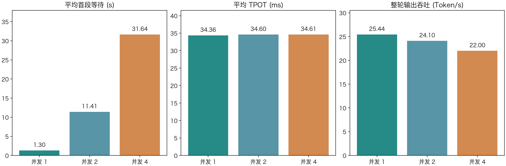
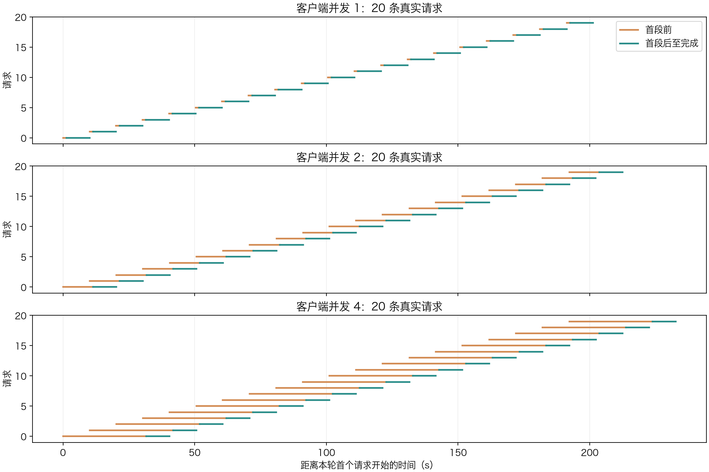

同一台单卡推理服务，客户端并发从 1 调到 4，平均首段等待从 **1.30 秒**涨到 **31.64 秒**。与此同时，首段之后每个输出 Token 的平均耗时只从 **34.36 ms**变为 **34.61 ms**。把请求按完成时间排开，三档都约每 **10.1 秒**完成一条。用户迟迟见不到回答，已经开始输出的请求却仍按原来的节奏生成。

这三个观察来自同一批客户端记录。真正变长的是请求开始到首段抵达的区间。推理服务只有一个 slot，压测工具又允许正式请求与尚未结束的预热请求重叠。把这两处限制放回同一条时间轴，就能解释为什么客户端多开三路会增加等待，也能看清整轮吞吐下降的数字究竟在算什么。

## 一、先区分客户端在途请求和服务端运行序列

历史实验在一台海光 x86 主机和一张厚摩 LQ50 24 GB 加速卡上执行。模型是 Qwen3.6-35B-A3B 的 W4A8 适配产物，运行时为 HLIELLama 2.1.0、TCIM 1.3.0。服务端启动参数（HLIELLama）为 `--parallel 1`，对应这个配置下的一个运行 slot。压测客户端使用 EvalScope 自己的 `--parallel` 参数，分别设为 1、2、4。两套程序使用了同名参数，但控制的是不同对象：前者限制服务运行序列，后者限制客户端在途请求。客户端在服务所在主机上，通过 HTTP 聊天接口读取 SSE 流；该路径没有经过外部业务网关。硬件与部署配置来自历史快照，当前离线复算没有新增设备观测。

三档的自变量是 EvalScope 客户端并发上限 1、2、4。每档 20 条正式请求，实际输入均在 1,025 至 1,028 Token 之间，输出均为 256 Token，全部成功。请求来自 EvalScope 1.14.0 的合成随机文本数据集，目标输入长度为 1,024，聊天模板和服务端分词使实际计数略有不同。测试使用闭环策略：一个客户端请求收到完整响应后，才释放许可发送下一条。请求温度为 0.1，关闭思考，参数中关闭提示词缓存，并通过忽略 EOS 的配置保持输出长度。三组分别预热 1、2、4 条。各档依次运行，没有交错重复。该设计便于比较同一配置下的固定形状请求，少量波动仍可能来自请求内容及运行时状态。

| 客户端并发 | 正式请求 | 平均首段等待 | 平均完整延迟 | 平均 TPOT | 整轮输出吞吐 |
|---:|---:|---:|---:|---:|---:|
| 1 | 20 | 1.30 s | 10.06 s | 34.36 ms | 25.44 Token/s |
| 2 | 20 | 11.41 s | 20.23 s | 34.60 ms | 24.10 Token/s |
| 4 | 20 | 31.64 s | 40.47 s | 34.61 ms | 22.00 Token/s |

图 1｜从三份客户端 SQLite 逐请求复算。每档使用 20 条正式请求。首段等待和 TPOT 取请求算术平均，整轮吞吐以总输出除以从最早正式请求开始到最晚正式请求完成的跨度。

可以把客户端并发理解成一种提交约束。闭环压测最多允许若干 HTTP 调用在途，一个调用结束后，另一个就可以补上。服务端 slot 则表示运行时能够承载的序列状态。这包括已经处理的输入、后续生成所需的上下文以及输出生命周期。客户端增加在途调用，无须同时修改服务端的序列配置。对这台仍配置一个 slot 的设备来说，从 C1 到 C4 增加的是等待被处理的可能性，客户端参数本身不会增加可用 slot。

两个数字之外还要辨识 batch。许多引擎会在一次设备执行中组合来自多个正在服务的请求，以换取更高的资源利用率。本例没有切换至多 slot 或另一个支持连续批处理的服务配置。不能用这组曲线预测支持多序列批处理的部署，但同样可以用时间轴去检验那类部署是否真的把更多请求推进到了输出阶段。

## 二、从单条请求的三个时间戳找增量

对每条正式记录，取三个客户端时间戳：启动 HTTP 请求的开始时间、收到首段的位置、请求完成时间。开始到首段是 TTFT，首段到完成是剩余流式区间。后者包括客户端接收和结束开销。EvalScope 1.14.0 中 `BenchmarkData.finalize()` 使用 `(query_latency - first_chunk_latency) / (completion_tokens - 1)` 计算 TPOT，默认第一个输出位置已经由首段计时。这里所有正式请求都为 256 个输出 Token，因而分母固定为 255。TPOT 是这个区间的 Token 归一化值，不能据此恢复每个 SSE 分块与模型 Token 的精确对应，更不能从中直接读取设备算子耗时。[1]

现在用这三个时间戳把完整延迟展开。C1 档平均首段后区间是 **8.763 秒**，C2 档是 **8.823 秒**，C4 档是 **8.826 秒**。从 C1 到 C4，平均完整延迟增加约 **30.404 秒**，其中约 **30.341 秒**位于首段之前，首段之后只增加约 **0.063 秒**。这两个增量的和与完整延迟增量一致，因为同一批请求在各自时间轴上可以这么拆分，再取算术平均。

这个分解把诊断问题从“整次请求慢了四倍”缩小到“首段之前多花了约三十秒”。首段前可能包含 HTTP 处理、准备输入、等待占用中的 slot、Prefill 和首次生成。现有数据没有同轮逐请求的服务端接纳时间。无法把这三十秒精确分摊给内部各段，不过已经可以检验一些解释是否与客户端观察相符。

比如，如果输出阶段本身整体慢了很多，256 Token 固定输出的首段后区间理应明显变长。三档的区间均值十分接近，因而这种解释无法覆盖观察到的三十秒增量。另一个直觉是四条流同时生成，只是等待首次抢到一点计算资源。如果多条正式流确实在这批测试中同时保持输出，客户端时间轴上应有不少首段后区间重叠。重新按首段排序，三档各 20 条的正式记录中，前一条完成时间都不晚于下一条首段时间。可见的输出区间没有相互重叠。

还可以比较相邻两条正式流的交界。在同一轮中，取前一条请求完成到下一条首段抵达之间的时间，三档共各有 19 个这样的间隔，均值分别为 **1.300、1.292 和 1.291 秒**。这段空白与约 8.8 秒的首段后区间首尾相接，构成大约 10.1 秒的交付周期。这里不要把“1.3 秒没有收到 Token”读作设备闲了 1.3 秒。下一条请求的输入处理、采样前准备和首段传输都可能发生在其中。设备忙不忙需要看设备事件，客户端时间轴能回答的是用户在两条输出之间等了多久。

较长的首段也并非这一档中的少数异常值。C1 的 20 条首段等待范围约为 1.23 至 1.34 秒，C2 为 11.30 至 11.48 秒，C4 为 31.55 至 31.77 秒。这三个区间在本批次内完全分开。区间的上下界是各自 20 条记录的最小和最大值，不能跨时段作为服务承诺。它们能排除一种常见误读：C4 的三十多秒均值并非由一条极端拖尾请求拉高。

这个检查只覆盖可见输出。某条请求在第一条流结束前已经进入服务端、完成模板处理或开始某些 CPU 活动，仍然可能发生。客户端没有看到重叠的正式输出，不能据此声称每个 CPU 和设备事件都串行。它给出的直接证据是输出节奏与单 slot 配置相容，且升高客户端并发没有并行推进这组正式输出。

图 2｜每条线是一条正式请求，按客户端开始时间排序。横轴为相对于本档最早正式请求的时间。橙色从客户端开始到首段，青色从首段到完成。各档共用横轴刻度。预热和服务端接纳事件没有画入。

## 三、为什么第一条正式请求也要等三十多秒

图 2 中有一个容易错过的细节。并发四的前四条正式请求并不是按时间先后发出的。它们的客户端开始时间约为 **0、10.14、20.25、30.38 秒**，各自的首段等待却都在 **31.6 秒**左右。假如把横轴零点看成设备由空闲转为工作、同时送入四条新请求，就很难解释这张图。零点其实是**第一条正式请求**的开始时间，压测系统在它之前已经提交了预热请求。

EvalScope v1.14.0 的 `ClosedLoopStrategy` 在同一调度循环里处理预热和正式请求。客户端用由 `parallel` 控制的信号量限制正在执行的 HTTP 请求，`_send_request()` 获得许可后才执行 `client.post()`。预热和正式请求之间没有等待全部预热完成的屏障。一条预热完成时，就可能释放一个客户端许可给下一条正式请求，其他预热仍可在途。随后，`metrics_consumer.py` 在写正式指标和 SQLite 之前跳过预热记录。这意味着预热可占用服务资源，但其结果不会出现在本次正式请求的统计分子里。[2][3]

用一个简化例子可以读懂这段时间轴。设服务只有一个可运行序列，顺序处理请求，相邻完成约间隔 10 秒，开始处理后约 1.3 秒抵达首段。如果客户端有四个许可，先提交四条预热，当第一条结束时，第一条正式请求可以发出。若其余三条预热仍在前面，而且处理顺序不变，正式请求将在约三个服务周期后开始收到自己的首段，合计约 31.3 秒。同样的逻辑，两个许可对应约一个额外服务周期。这是用于对照的时序算例，实际服务端未留下能定位这些预热入队和离队顺序的日志。

现在把这个算例与数据对起来。把 C1 的平均首段等待 1.30 秒用作固定首段基线，用约 10.1 秒作为一次完成的观察周期，那么 C2 预测约为 11.4 秒，C4 约为 31.6 秒。实测是 11.41 秒与 31.64 秒。这个数量级吻合，且首段和完成间隔随并发变化很小。证据支持这样的解释：闭环允许后续请求进入在途集合，单序列处理节奏没有随客户端并发上升，额外的等待落在首段之前。现有资料既无法指出每条请求在何时进入厂商调度队列，也无法确证所有三十秒都由三条预热直接造成。

客户端在图中的相位也给出了线索。并发四时，首条正式请求在零点发出，但要到约 40.50 秒才完成。此前另外三条正式请求已经陆续发出，第四条的发出时间约是 30.38 秒。前三个新许可不可能来自**已完成的正式请求**，因为那个时候它们都还没有结束。结合配置中的四条预热和源码中的许可释放路径，记录与预热逐个交班的行为一致。由此可以区分两种层次的结论：客户端确实在首条正式请求结束之前发出了多条正式请求，而后台每条预热具体占用了哪个 slot、哪段时间，仍然没有对应记录。

这也解释了为什么三档的首段分布从本轮第一条就较为集中。闭环并发不等同于固定每秒发四条，也不等同于把二十条一次性塞入。按文中的定长算例，先把在途数维持在上限，某条结束释放许可，下一条即补进来。只要服务周期近似不变，后来者看到的前方工作量便会比较接近。真实负载往往有不同输出长度、不同输入成本和取消，前方工作量会不断变化。在这类负载中，提高到同样的并发上限可能形成完全不同的首段分布。

这里还有一个会影响复现的地方。若把测试改为先做完整预热、等所有预热全部结束，然后才让四条正式请求一起出发，第一条正式请求的等待通常会与本例不同。后面几条是否呈台阶上升，还会受入队顺序和实际调度约束影响。两种测试都可能有价值。前者模拟客户端已经保持多路在途时的排队体验，后者测量一台已预热但请求队列为空的设备面对突发提交时的表现。写压测报告时应记录预热是否与正式请求共用客户端并发许可，避免拿两个不同的起点比较首段。

### 复现时要同时记录客户端并发和服务端槽位

这组数据库来自 EvalScope v1.14.0。固定版本的闭环实现用同一个 Semaphore 限制客户端在途请求，预热和正式请求共用调度循环，二者之间没有清空队列的屏障；每次预热请求完成后，释放出的客户端许可可能交给正式请求。指标消费者会把标记为 warmup 的结果排除在正式指标和数据库之外。因此，报告里看不到预热请求的计时，不代表它们没有影响服务端接下来处理正式请求的顺序。[2][3]

官方参数说明建议闭环测试的预热数至少覆盖 `--parallel`，用来吸收客户端启动时的突发。[5] 这个数描述的是客户端并发许可；它不会自动把模型服务的运行槽位扩到相同数量。本次三档的预热数确实分别等于客户端并发 1、2、4，但服务配置仍只有一个 slot。四路客户端请求获得许可时，服务侧不能同时执行四条序列，额外请求可能等待。EvalScope 上游 PR #1641 也讨论过闭环启动突发如何把首段高分位拉离稳定阶段；它保留 warmup 到正式请求的交接，避免中间清空服务占用。该 PR 的目标场景与本次单 slot、客户端 C4 的配置不同，不能用它来证明本次请求的具体入队顺序。[6]

截至 2026-11-28，EvalScope 官方最新发布为 v1.15.1。v1.15.0 增加了可选参数 `--exclude-warmup-overlap`：预热仍有请求在途时发出的过渡请求可单独记录，并从正式统计中排除；默认行为不变。v1.15.1 又更新了预热重叠时替补请求的准备方式。[7][8] 这些版本变化不会改写 v1.14.0 的历史 SQLite，也不会增加服务端 slot。复测时应把 EvalScope 版本、`--parallel`、`--warmup-num`、是否启用该选项和服务端 slot 数一起记录；如果研究的是用户侧等待，就保留并标注过渡期请求，如果要比较稳态阶段，则按该版本的机制单独处理。

## 四、25.44 降到 22.00，是输出能力下降了吗

三档每组完成的输出数相同，都是 5,120 Token。正式窗口从本轮第一条正式请求开始算到最后一条完成，三档跨度分别约 **201.28、212.46 和 232.72 秒**。因此固定分子除以更长的窗口，整轮输出吞吐自然由 25.44 降到 22.00 Token/s。对于这批请求，这个吞吐确实变低。要判断设备处理节奏有没有一起变慢，还须拆开整个窗口。

记第一条完成相对于窗口起点的时间为 F，20 条请求的最后一次完成时间为 T。把正式请求按完成时间排序，第一条和最后一条之间一定有 19 个完成间隔，平均间隔记为 D。于是存在精确的时间恒等式：

`T = F + 19 × D`

| 并发 | 到首次正式完成 F | 后续 19 个完成间隔的均值 D | 整个正式窗口 T | 首次完成后按请求计量的输出速率 |
|---:|---:|---:|---:|---:|
| 1 | 10.09 s | 10.062 s | 201.28 s | 25.44 Token/s |
| 2 | 20.28 s | 10.114 s | 212.46 s | 25.31 Token/s |
| 4 | 40.50 s | 10.117 s | 232.72 s | 25.30 Token/s |

把 C4 与 C1 相减，整个窗口多约 31.44 秒。里头约 30.41 秒出现在从首次正式请求发出到首条正式请求完成的区间，余下 19 个完成间隔合起来只多约 1.03 秒。**整轮数字的主要变化来自首次正式完成前的时间。** 这段时间内设备可以继续处理预热或在途请求，不过分子只记正式结果。等正式请求开始接续完成，后面的完成速率很接近。

最后一列把第一条正式完成作为起点，分子只数随后完成的 19 条，计算方式是 `19 × 256 / (T - F)`。这是从客户端完成事件构造的有限窗口速率，方便对照两条时间轴的始端。它不等于按 SSE 事件统计该区间实际收到了多少 Token，也不等于工具的通用稳态定义。两者恰好接近不能替代各自的计数范围。若需要回答 GPU 计算是否降速，应另选能与同轮请求匹配的设备数据，例如每步 GPU/NPU 时间、进程争用和频率；本例的速率分解已经足以定位**正式窗口**中的差异所在。

如果只想用最少的数据复核这个判断，可以保留每档四个量：第一个正式开始、首个正式完成、最后一个正式完成和每条输出数。拿 C4 与 C1 比较，首个正式完成时间相差 30.41 秒，正式窗口相差 31.44 秒。前者约占后者的 96.7%。这是一个**时间差的算术分解**，它描述了差异落在哪一段。这个比例不是设备资源归因，也不能读成预热带来了 96.7% 的损失，因为初段仍包含第一条正式请求自身的处理与返回。

改用另一种起点会得到另一个有效的问题。以第一次可见输出为起点，可以观察已经开始对外产生内容后的交付表现。但如果分子仍然包含所有请求的 Token，就必须确认在这个区间开始之前是否已经输出过正式内容，以及被计数的预热是否混入。如果按完成事件入账，每条请求的 Token 在结束时一起计入，短窗口可能出现一段时间没有计数、随后一次跳增 256 的现象。若把 SSE 分块作为事件，曲线更能反映内容抵达客户端的时刻，但还需要一套可靠的 Token 计数策略。选择分母之前，先确定统计想回答的是完成工作量还是流式交付。

这个分解也能解释为什么同一设备用不同的压测请求数会报告不同整轮吞吐。设每条结果固定为 O，此时整轮吞吐为 `N × O / (F + (N-1) × D)`。如果 F 比一个常规完成间隔长得多，小批次会受到 F 更强的影响。增加 N 后，在 F 和 D 保持相同的数学假设下，整轮统计会逐步接近 `O / D`。实际运行很久时，设备温度、请求分布或故障重试可以改变 D，因此不能把这条数学趋势当成本设备的长时实测。公平的横向比较要保留相同观察窗口和请求计数方法。

## 五、把实测变成接纳、超时和批处理的判断

从用户视角看，两种体验目标要分开验收。一种是点下发送之后多久看到第一个可见片段，另一种是开始输出以后生成是否连续。在单 slot 固定长度测试里，C4 的后者基本与 C1 持平，前者却明显恶化。如果产品只展示单条流的平均 Decode 速率，等了半分钟的用户会发现实际体验与指标描述得完全不同。首段超时预算应该覆盖接纳和等待，后续流空闲超时则针对已经开始输出的请求。客户端提前取消后是否会释放排队和占用的 slot，也需验证具体引擎，否则重试可能让拥堵加剧。

用已有请求还能直接估计客户端视角的在途程度。每条正式调用从开始到完成期间对在途请求数贡献 1。把这些区间长度相加，再除以正式窗口时长，得到 C1/C2/C4 约 **1.00、1.90、3.48** 条平均在途正式请求。这个计算是有限时间内对同一批区间求和，不要求系统稳态。分子不含预热记录，窗口末尾也会排空，所以数值与并发上限不同。它说明客户端记账看到的多个调用确实共存，与服务端同时执行多少序列属于不同观察对象。

平均在途还可以拆成各状态的持续时间。C4 正式窗口约 232.72 秒，其中有 **171.96 秒**恰好有四条正式请求在途。其余区间分布在一到三条在途状态，包括刚从预热交班的开头以及没有新请求补入的尾部。复算采用开始事件加一、完成事件减一的方式，每相邻事件间用当时的在途数乘其持续时间。从这个结果可以确认闭环确实在长段时间维持多条对外请求，不能因为首段后区间不重叠就误以为客户端实际上仍然只发了一路。反过来，3.48 条平均在途也不能换算成 3.48 个设备执行序列。

可以把这组测量直接放进一个接纳算例。若某业务需要在 5 秒内看到首段，相同固定输入在空闲服务上本来需要约 1.3 秒，剩余的等待预算约 3.7 秒。假如 slot 前方还留有一条同形状请求，且它刚开始一个约 10 秒的服务周期，来者即使不遇到其他开销也可能不满足目标。如果前一条已接近结束，结论又会不同。按队列长度作静态限制可以减少长等，但无法辨认队列中请求的剩余工作量。若要做更细的接纳控制，生产数据应包括预测输出长度、取消情况、正在运行请求的已生成长度和估计剩余时长，并用同一业务负载检查估计误差带来的漏接纳和误拒绝。这个阈值算例只用了本次量级来说明如何设置对照，不是对现网的配置建议。

这种区分有助于选下一轮实验。若目标是保护交互体验，可在同配置下尝试限制入口在途数，同时记录超时、取消、拒绝和最终完成请求数。入口接纳降低等待的代价可能是更多请求被推迟或拒绝，首段变短只有与成功交付率一起才有意义。对长短混合流量，还要观察短请求是否会长时间排在输出很长的请求后面。固定 256 Token 的测试把服务时长压在较窄范围内，无法给出混合长度下的队列分布。

若目标是提高单位时间完成数，另一个候选是增加真正可运行的序列数。它需要模型产物、引擎和设备内存共同支持。更多 slot 会引入多条序列上下文与生成状态，多请求合批也可能改变单步时长。一个经验证可行的对照应保持模型、输入集合与输出限制一致，在隔离环境分别测单 slot 和多 slot，确认实际活动序列、首段后的流重叠、完整吞吐以及各个延迟目标。当前历史记录只有单 slot，无法量化多 slot 在这张卡上的资源需求和性能收益。

前两种实验还要防止混淆同一个参数名称。入口限流的对象可以是租户、设备或模型实例。例如把每台设备的等待限制收紧，可能让调度器把一部分请求送到其他副本。此时某台设备的首段改善不能直接代表系统成本降低，应同时检查请求究竟在哪里排队。若整套系统只有这一台单序列设备，换一个地方存放待处理请求可以改变用户看到的状态和超时，但无法直接提高完成节奏。要评价拒绝策略，应同时报告被拒绝数和完成数，并让用户看得懂重试时机。

同样的理由适用于从闭环切换到开环。闭环下，一条请求慢下来，客户端就较晚释放许可，新请求也会较晚发出。这样形成的到达率由响应速度反向决定。若业务流量独立于服务速度，应使用按给定速率产生请求的试验，并记录目标发出时间和实际发出时间。否则客户端开环发不出去的请求可能被遗漏，服务在结果表上看似满足时延，实际上客户端自身已经积压。用本例约 10.1 秒完成一条的量级估算，单设备在类似长度下每分钟能交付约六条，在更快的持续到达率下是否形成积压，要在独立试验中观测排队或拒绝。混合长度、取消和设备状态都可能改变这个数量级，不能把六条写成通用容量保证。

若业务更关心突发响应，可以另外设计单批到达试验：在确认预热完成且服务没有待处理请求后，按固定时间间隔将四条相同形状的请求送入。首先比较每条请求到达客户端首段的次序，再比较每条结束的次序，同时记录服务端实际接纳。这样才能观察从空队列开始的等待如何累积。本文的闭环档位则回答已运行负载下多路在途的体验。这两个实验用同一组输入时，可以分别测量空闲到突发、长期保持在途两种场景，避免把预热手法本身误认为优化带来的速度变化。

对需要确定根因的测试，最有价值的新增数据是同请求 ID 的入队、slot 接纳、首段生成和请求结束事件。客户端与服务端应先明确时钟能否对齐。只有记录齐全后，才能把首段前的时间拆到等待、输入执行与传输，并比较服务端接纳策略。如果只能加一个观测点，优先记录 slot 接纳时间和关联 ID。这正好切开本次观察中最难区分的两段时间。已有材料已能指导应该采什么，采集结果仍须通过实际运行获得。

## 结论

这次并发调整让第一条正式请求完成的时间从 10.09 秒延长到 40.50 秒，后续完成一条请求的节奏仍约为 10.1 秒。逐请求来看，平均多出的 30.40 秒几乎都发生在首段之前。EvalScope 的闭环预热交接和单 slot 的历史配置可以解释这一数量级，服务端逐请求的等待分解仍需接纳时间戳。对这台设备做交互容量验收时，应同时看首段等待、正式窗口吞吐和首条完成后的交付节奏，并在报告中记录预热交接方式。

## 资料来源

1. [EvalScope v1.14.0，BenchmarkData.finalize 的 TPOT 计算](https://github.com/modelscope/evalscope/blob/v1.14.0/evalscope/perf/utils/benchmark_util.py#L103-L115)
2. [EvalScope v1.14.0，ClosedLoopStrategy 的并发许可与预热交接](https://github.com/modelscope/evalscope/blob/v1.14.0/evalscope/perf/core/strategies/closed_loop.py#L18-L56)
3. [EvalScope v1.14.0，metrics_consumer 跳过预热并写入正式结果](https://github.com/modelscope/evalscope/blob/v1.14.0/evalscope/perf/core/metrics_consumer.py#L92-L119)
4. 实测图表来自三组历史客户端 SQLite 与同批压测配置，均为离线复算。
5. [EvalScope 官方压力测试参数说明](https://github.com/modelscope/evalscope/blob/main/docs/en/user_guides/stress_test/parameters.md)
6. [EvalScope PR #1641：闭环预热交接及启动突发问题](https://github.com/modelscope/evalscope/pull/1641)
7. [EvalScope v1.15.0 发布说明：预热重叠选项](https://github.com/modelscope/evalscope/releases/tag/v1.15.0)
8. [EvalScope v1.15.1 发布说明](https://github.com/modelscope/evalscope/releases/tag/v1.15.1)
