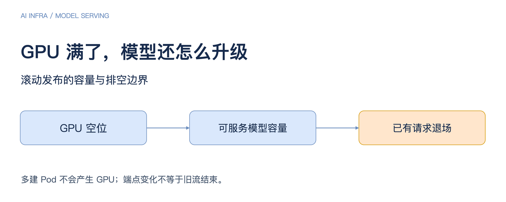
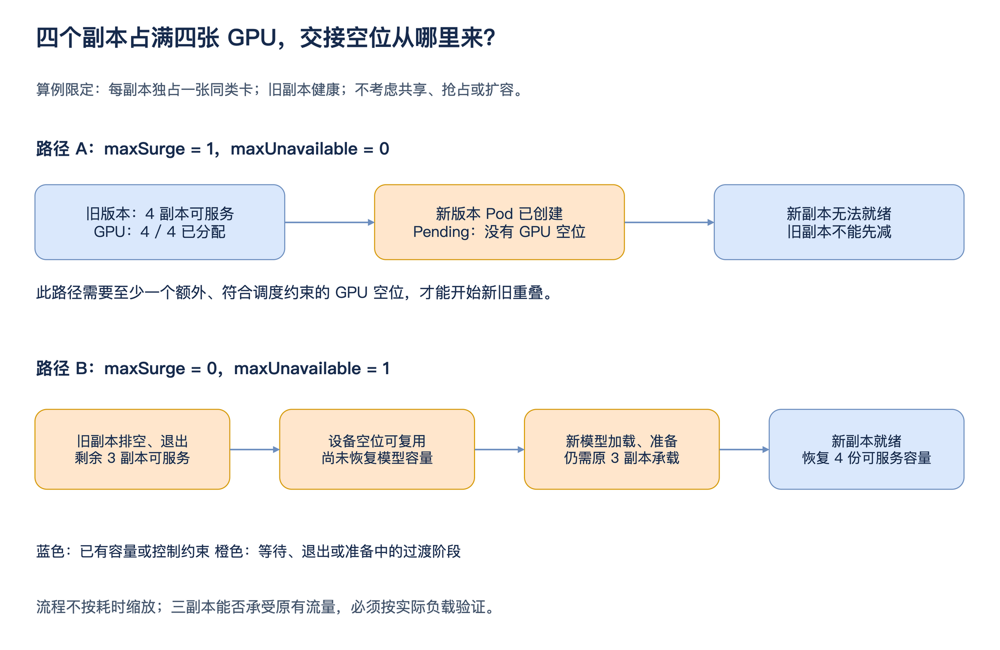
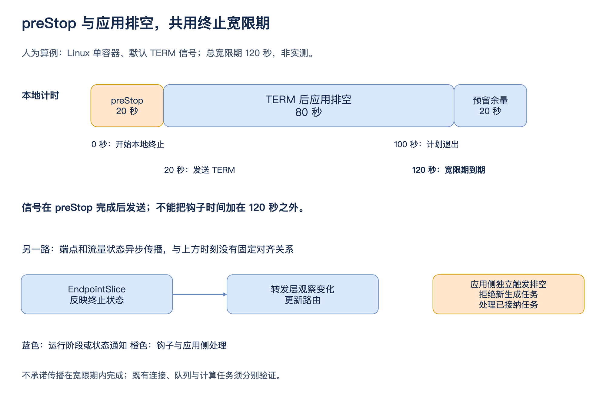

四个模型副本占满四张 GPU，旧版本服务正常，新版本却一直 Pending。这可能不是镜像出错，也不是调度器失灵，而是发布策略要求“新副本先就绪”，集群却没有容纳新旧版本交接的空位。

模型服务的滚动升级，需要同时交接三样东西：可分配的 GPU、真正能承接负载的模型容量，以及尚未结束的请求。只让 Deployment 副本数符合预期，不能证明这三项都完成了交接。

## 一、maxSurge 允许多建 Pod，不负责提供 GPU

Deployment 的 RollingUpdate 用 `maxSurge` 控制额外副本，用 `maxUnavailable` 控制更新期间允许的不可用副本；百分比前者向上取整，后者向下取整。[1] 两个字段约束的是发布推进方式，不是资源供给。

构造一个明确的算例：期望副本四个，每个副本独占一张相同类型 GPU，四张卡全部已分配；设置 `maxSurge: 1`、`maxUnavailable: 0`。不考虑设备共享、抢占或自动扩容，新 Pod 可以创建，却没有卡可分配。旧副本又不能先减少，升级便停在这里。

要让这一交接先启动，至少需要一个符合要求的额外 GPU 空位。注意是“符合要求”：集群另一处有空卡，不等于新副本能够调度过去。GPU 型号、节点亲和性、污点和其他资源都可能限制候选节点。[2][3]

小副本场景还容易被百分比迷惑。一个副本采用默认的两个 25%，计算结果是允许额外创建一个、不允许主动损失可用副本。如果只有一张独占 GPU，也会遇到相同的交接矛盾。

这里没有一个 YAML 技巧能凭空消除容量缺口。选择额外空位，是用资源换重叠；选择先退出旧副本，是接受一段容量下降；完全停机替换，则需要业务明确接受维护窗口。

## 二、旧 Pod 显示 Terminating，空位未必已经回来

在普通设备插件提供的独占整卡场景，调度按申请的 GPU 资源进行。GPU 利用率暂时很低、显存还剩不少，不代表这张卡能再分配给另一个同样申请整卡的 Pod。[2] 本文算例限定这种资源模型，不套用于 MIG 或其他共享方案。

因此，应该区分“停止接新请求”“进程退出”“设备可再次分配”和“新模型可服务”四个时刻。控制面开始删除旧 Pod，并不能证明后面三件事已经发生。

*图 1：四副本、每副本独占一张 GPU 的假设算例。先启动新副本需要额外空位；先退出旧副本会经历容量下降。未模拟真实加载耗时，也不表示各阶段等长。*

如果改成 `maxSurge: 0`、`maxUnavailable: 1`，发布可以先退出一个旧副本，再等待资源释放并启动新副本。但在新副本就绪前，原有四份可服务容量可能只剩三份。这是策略的代价，不是异常。

从四份容量降到三份，也不能直接推出延迟只增加四分之一。若原有流量已经接近服务极限，少一个副本可能让队列持续增长；长输入、长输出与短请求的混合还会改变等待分布。可接受的不可用副本数，需要由实际负载下的服务余量支持。

还要避免把“最多多建一个”理解成运行现场绝不会多占资源。官方提醒，正在终止的 Pod 仍可能消耗资源，使发布期间的总占用超过简单的“期望副本加 Surge”。[1] 容量预留要看实际终止中的实例，而不是只看新旧 ReplicaSet 的目标数。

从这个机制可以作出工程判断：把排空时间拉长，虽然有利于已有请求完成，也会延迟设备交接。旧请求的尾部、GPU 释放速度和新模型加载速度，需要放在同一份发布预算里观察。

## 三、端口打开了，不代表模型容量补上了

对模型服务而言，启动进程、绑定端口、加载权重、准备执行资源和能够稳定生成 Token，是不同阶段。Readiness 应当反映是否能承接约定的推理流量，而不是只证明有一个 HTTP 服务在运行。

Kubernetes 的 Startup Probe 用来覆盖启动阶段；配置后，在它成功之前不会执行 Liveness 和 Readiness Probe。[4] 对加载较慢的模型，这可以避免启动过程被过早当成故障反复重启，但不会让模型加载本身变快。

还要区分 Ready 和业务余量。三个旧副本加一个刚 Ready 的新副本，表面上恢复了四个端点；若新副本的缓存、并发能力或延迟表现尚不稳定，剩余旧副本仍可能承受更高压力。这是容量验收问题，不能只用端点计数代替。

一种工程上的检查方法，是固定代表性输入长度、输出长度与到达速率，观察发布期间的排队、首 Token 延迟、输出速度和失败率。检查应覆盖新模型实际执行路径，避免健康接口成功、真实请求却失败。

如果采用小流量验证，还应记录新旧版本各自的请求量。新版本只承接少量短请求时表现正常，不代表它已经能够替代一个满负荷旧副本。升级验收需要回答的是指定负载下是否可接班，而不只是新版本有没有成功返回过一次。

长时间停在 Pending，与已经运行但迟迟不 Ready，也要分开诊断。前者先看调度事件和资源约束；后者看权重加载、引擎初始化和探针。不断增加探针超时，无法修复根本不存在的 GPU 空位。

一次 Qwen3.5-9B 双卡部署从 PodScheduled 到 Ready 用了 831 秒。其中 454 秒发生在 vLLM 主容器启动之前。做发布预算时，可以把设备释放到新副本完成调度的时间，与调度后副本达到 Ready 的时间分别记录。[双卡 Pod 冷启动实测]()

## 四、摘除端点与完成流式响应，不是同一件事

EndpointSlice 用 `ready`、`serving`、`terminating` 表达端点状态。终止中的端点通常不再作为正常新流量的目标，但 `ready` 还受 Service 配置影响；消费者怎样利用终止和服务状态，也需要核对。[5]

因此，不能把“端点已更新”当成“每一层代理都已收敛”，更不能当成“原有流式响应已经完成”。官方终止流程示例专门区分终止状态与仍可服务的状态，供连接排空使用。[6]

应用层仍需定义排空行为：什么时候停止接纳新生成任务，已经接纳的排队任务是否继续执行，执行中的流能等待多久，超过预算如何结束。这里的“停止接新任务”也不等于立即关闭已有连接。

已有连接上是否还能发送新请求，取决于协议、代理和服务端实现。只让 readiness 返回失败，不能替代请求入口处的接纳控制；仅等待连接数下降，也可能遗漏引擎内部尚在运行的任务。这是需要联调验证的工程边界。

*图 2：假设普通 Linux 单容器使用默认 TERM 停止信号，宽限期 120 秒。preStop 占 20 秒，随后应用排空 80 秒，预留 20 秒。端点传播与本地退出并行，图中不承诺传播耗时。*

特别容易算错的是 `preStop`：终止宽限期在钩子运行前就开始计时，钩子结束后才发送停止信号。[7] 它不是“先睡几十秒，再额外获得完整宽限期”。

在图中的人为算例里，120 秒总预算扣掉 20 秒钩子和 20 秒余量，只剩 80 秒应用处理时间。实际应按请求剩余时间分布、代理收敛和引擎退出行为测量；固定 sleep 只能等待，不能证明排空完成。

预算里还应区分客户端连接与计算任务。客户端提前断开后，服务端是否及时取消对应生成、回收其运行状态，需要单独检查。如果连接已经消失、引擎仍在计算，连接数归零就不能作为进程退出的唯一条件。

## 五、PDB 与进度超时，不能替代发布策略

PDB 主要参与驱逐路径，例如节点维护时通过 Eviction API 发起的驱逐。官方明确说明，Deployment 等工作负载自身的滚动升级不受 PDB 直接限制；升级的可用性约束应在工作负载策略中配置。[8]

所以，给模型服务加上严格 PDB，不能代替 `maxUnavailable`。同样，副本数不下降，也不能证明某个正在终止的请求没有被打断。这些配置分别约束不同层面。

进度截止时间也只是另一层信号。Deployment 出现 `ProgressDeadlineExceeded`，原生控制器会报告推进失败，而不会因此自动回滚；是否回滚，需要更高层编排或明确操作。[1]

对模型发布而言，回滚也要重新做容量判断：旧权重是否仍可获取，旧版本是否还保有可服务实例，退回去是否需要重新加载。只保留了旧 ReplicaSet 记录，不代表保留了已经热起来的模型进程。

还要决定部分流式输出失败后的处理方式。客户端已经收到一段内容，再重新提交并不是透明续传。直接从头重试可能重复展示内容，也可能放大升级期间的排队压力；重试条件需要与应用协议一起设计。

## 六、验收一次发布，要把三条时间线对齐

第一条是资源时间线：何时创建新 Pod、何时分配到卡、旧实例何时真正退出、空位何时可复用。记录新副本等待在哪一层，避免把下载慢、调度失败和设备交接慢混成“启动慢”。

第二条是服务时间线：新实例何时能够生成、何时被路由发现、何时开始承接真实流量。对照旧实例的退出，判断低容量窗口有多长，以及剩余副本是否仍能满足既定负载。

第三条是请求时间线：升级前已经开始的流是否完整结束，升级中进入的请求走到哪里，超时、取消和重试是否符合预期。应分别统计老请求与新请求，不能用整体成功率把少量长请求中断掩盖掉。

演练至少覆盖无额外 GPU、新副本加载失败、排空超过预算三种情况。每一种都应有明确的停止推进条件和恢复动作。先在可控负载下确认状态转换，再扩大流量；不要把生产发布当作第一次终止行为测试。

最后把发布时间与请求标识串起来。只看到发布命令成功退出，无法解释几分钟后出现的尾延迟；只看到一次网关错误，也无法判断是资源不足、模型未就绪还是旧流被终止。三条时间线能对齐，才有机会把问题归到正确的层面。

结论是：GPU 模型升级不是简单地替换镜像。空位决定能否交接，可服务容量决定交接期间能承受多少流量，排空决定旧请求怎样离场。把这三本账算在一起，才能判断一次发布是否真正完成。

## 资料来源

[1] [Kubernetes：Deployments](https://kubernetes.io/docs/concepts/workloads/controllers/deployment/)，滚动更新预算、终止副本与进度失败行为。

[2] [Kubernetes：Schedule GPUs](https://kubernetes.io/docs/tasks/manage-gpus/scheduling-gpus/)，设备插件资源与 GPU 申请规则。

[3] [Kubernetes：Assigning Pods to Nodes](https://kubernetes.io/docs/concepts/scheduling-eviction/assign-pod-node/)，节点选择和亲和性约束。

[4] [Kubernetes：Liveness, Readiness, and Startup Probes](https://kubernetes.io/docs/concepts/workloads/pods/probes/)，启动、健康与接流量的不同职责。

[5] [Kubernetes：EndpointSlices](https://kubernetes.io/docs/concepts/services-networking/endpoint-slices/)，ready、serving、terminating 条件。

[6] [Kubernetes：Explore Termination Behavior for Pods And Their Endpoints](https://kubernetes.io/docs/tutorials/services/pods-and-endpoint-termination-flow/)，终止与连接排空示例。

[7] [Kubernetes：Container Lifecycle Hooks](https://kubernetes.io/docs/concepts/containers/container-lifecycle-hooks/)，preStop 和宽限期的计时关系；[Pod Lifecycle](https://kubernetes.io/docs/concepts/workloads/pods/pod-lifecycle/)，停止信号与终止流程。

[8] [Kubernetes：Disruptions](https://kubernetes.io/docs/concepts/workloads/pods/disruptions/)，PDB、驱逐与工作负载滚动升级的边界。
