开始做双 Pod 共卡对照时，实例数量、批次组成和资源共享都变了。从这组结果里拆不出启用 HAMi vNPU 的单独影响，于是又做了一组单实例实验。两组都在同一颗 Ascend 310P3 上跑同样的工作量，固定 CPU、显存视图、KV 和并发，主要切换是否加载虚拟化库。

Qwen3.5-4B 单实例设 100% 算力额度、显存不限额、客户端并发 4。输入 128／输出 512 的两次独立启动配对，输出吞吐分别下降 **1.36%** 和 **1.87%**。输入 1024／输出 1024、输入 2048／输出 128 的首轮配对，分别下降 **1.02%** 和 **1.47%**。

下文先对单实例日志和正式请求，再换到双实例，分开查同型号和混型号的交付、排队与设备空档。两部分用了不同的部署和统计窗口。

## 先看单实例的四组配对 {#先看等价对照结果}

先定这一页表格的分母。每个形状、每次启动都完成 16 个正式请求，正式计时之前用相同形状和并发完成全长预热，单独留记录。下面全是客户端 C4，用固定输出 Token 数除以从共同起点到整批结束的时间。

| 输入／输出 token | 配对 | 原生独占 | 启用 HAMi vNPU | 吞吐下降 | 整批完成耗时：原生 → vNPU |
|---|---|---:|---:|---:|---:|
| 128／512 | 首对 A1/B1 | 65.368 | 64.479 | **1.36%** | 125.321 → 127.049 s |
| 128／512 | 反向复测 A2/B2 | 65.270 | 64.048 | **1.87%** | 125.509 → 127.904 s |
| 1024／1024 | 首对 A1/B1 | 60.556 | 59.938 | **1.02%** | 270.558 → 273.349 s |
| 2048／128 | 首对 A1/B1 | 29.534 | 29.101 | **1.47%** | 69.343 → 70.377 s |

四个配对点合计 **128 个正式请求，128/128 成功**，输出ID数量、usage、完整结束标记和请求身份均通过核对。128／512关键点每种模式来自两次独立模型启动，各32个成功请求；另外两个形状各有一对、每种模式16个请求。

图 1 只画首对。沿每个形状分别读原生与 vNPU 的差值。128／512 同形状的反向顺序复测放在图 2。

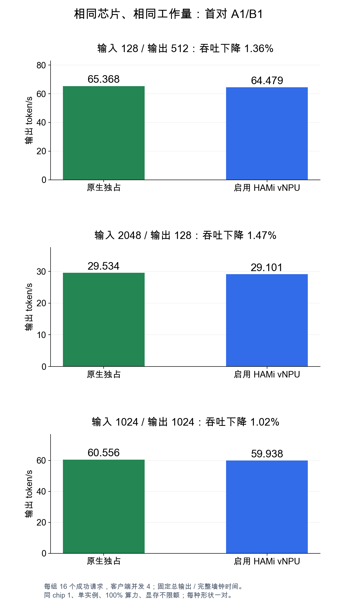

**图 1：首对 A1/B1。** 每根柱子对应16个成功请求的完整工作量吞吐，三个形状分别比较。没有将不同形状合成一个统一损耗率。

不过，首对结果仍可能受到执行顺序和一次启动状态的影响。为此，预先选定的 128／512 代表点按照 A1 → B1 → B2 → A2 的顺序独立重启复测。如图 2 所示，原生组分别位于顺序的两端，vNPU 组位于中间，两次配对都观察到吞吐下降。这个有限重复增强了结果的可检查性，但无法消除所有随时间变化的宿主因素。

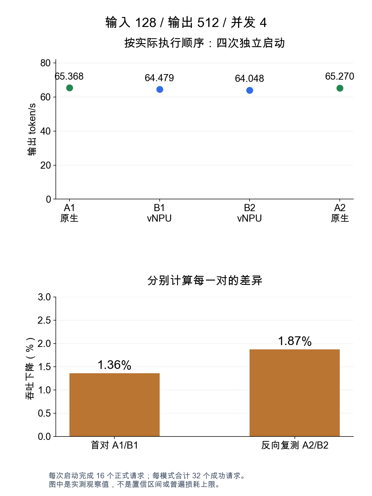

**图 2：独立启动顺序与配对差异。** 顺序为原生A1 → vNPU B1 → vNPU B2 → 原生A2，每次都退出旧模型进程并重新启动。下半部分分别计算A1/B1和A2/B2；这些是实测观察值，不是置信区间。

## 为什么要另外做单实例对照 {#为什么这次可以进行对照}

前一轮把原生单实例 C8 换成双 Pod 各 C4 时，批次归到不同实例，模型也开始争用同一颗芯片。混合模型那组还从独占改成与另一个模型共卡。这些记录留给后面的部署容量比较。

这次主对照固定为**一个原生模型实例与一个启用 HAMi vNPU 的模型实例**。原生组不加载 `libvnpu.so`；启用组加载该库并实际运行调度器。实际测量采用相同的直接容器路径，避免把容器启动方式或服务网络路径混入开关对照。

这两边都用直接容器，把入口与启动方式固定住。单 Pod 的平台部署是另一个需要独立验收的条件。

| 控制项 | 两组共同设置或实测核对 |
|---|---|
| 物理资源 | 同一台x86_64服务器、同一颗Ascend 310P3物理chip 1，分时运行 |
| 模型与数量 | Qwen/Qwen3.5-4B，均为单实例；权重及配置文件SHA-256留档，每次启动核对文件身份 |
| 推理软件 | 相同不可变镜像、相同vLLM Ascend/CANN运行环境及启动兼容处理 |
| 计算方式 | FP16，TP=1，eager，禁用prefix cache，language-model-only，max_model_len=4096 |
| 内部调度上限 | max_num_seqs=4，max_num_batched_tokens=1024 |
| CPU与主机内存 | CPU18–21、NUMA1、4CPU限额、24GiB内存限额；请求端固定CPU0–3 |
| 显存参数 | gpu_memory_utilization=0.65，NPU_MEMORY_LIMIT_MB=0（不限额），两组保留相同物理显存视图 |
| 实际KV | 两组启动日志均为26,214 token；并非仅凭命令行块数推算 |
| 显存启动读数 | 四次启动总量均42.67GiB，空闲读数41.46–41.47GiB；自然状态读数保留，启动前设置差异门槛0.05GiB |
| 算力配置 | NPU_COMPUTE_LIMIT=100，dynamic；原生组无该库，启用组调度日志确认配置生效 |
| 输入与输出 | 同一输入ID文件；每点同样16请求、同一客户端槽位／序号标识集合、固定输出长度 |
| 采样参数 | temperature=0、seed=123、ignore_eos=true、流式输出ID，验证usage与DONE |
| 请求与监测路径 | 相同host网络、本地端口和客户端代码；使用相同采样器，每轮查询完成后等待5秒，实际间隔包含查询与写盘耗时；性能轮次不启动Profiler或50ms探针 |

两组启动参数由同一构造函数生成。容器名、证据输出目录等身份字段规范化后，参数逐项相等；preload文件的内容是有意保留的开关差异。检查器还验证了芯片、CPU绑定或内存利用率参数被改动时会识别为不匹配。

显存不限额的目的，是让两组都看到同样的物理显存，并避免把缩小资源额度造成的变化算成虚拟化额外开销。**因此，本组结果适用于无同卡竞争、100%算力、显存不限额的配置，不代表50/50多实例竞争或紧显存额度下的表现。**

## 启动日志和请求记录怎么对账 {#原始记录怎样证明条件与工作量相同}

要复核这对结果，先拿启动日志和进程映射对账。A1、B1 的物理芯片、CPU 绑定、KV 和显存视图要对得上，再检查哪一边挂了库。

```text
A1 原生：physical_chip=1，CPU=[18,19,20,21]
         KV=26214，memory_view=[41.47,42.67,0.65]
         libvnpu.so mapped_process_count=0
B1 vNPU：physical_chip=1，CPU=[18,19,20,21]
         KV=26214，memory_view=[41.47,42.67,0.65]
         libvnpu.so mapped_process_count=22
```

启用组实际启动日志如下，去掉时间与日志模块前缀，保留配置字段：

```text
[Manager] Global compute slot: Some(0). Compute limit: 100%, Memory limit: 0 MB, Policy: dynamic
```

`memory_view` 依次记录空闲显存 GiB、总显存 GiB 与内存利用率参数。上面的映射记录和调度日志相互补充，确认库加载与运行配置。原生组的空preload与进程映射核对，则支持本轮原生基线未加载该虚拟化库。

本次检查的 `libvnpu.so` SHA-256 为：

```text
ed3d8a7c03670c77e2098dc5e5d7ef95a77b93252d89a9542afa2c39f7ad0ef2
```

输入128／输出512的首对完成记录可以直接核算：

```text
原生A1：requests=16，failed=0，output_ids=8192
        wall_seconds=125.321328038，full_tps=65.3679635243
vNPU B1：requests=16，failed=0，output_ids=8192
        wall_seconds=127.048696427，full_tps=64.4792133283
```

```text
原生吞吐 = 8192 / 125.321328038
vNPU吞吐 = 8192 / 127.048696427
吞吐下降 = 1 - vNPU吞吐 / 原生吞吐 ≈ 1.3596%
整批耗时增加 = 127.048696427 / 125.321328038 - 1 ≈ 1.3784%
```

用同样的 8,192 个输出 ID，可以分别计算吞吐下降和完成时间增加，这两项的分母不同。后面的共卡测试是 60 秒接纳、只计中央 40 秒交付，记到另一张表。

请求发往 `/v1/completions`。下面是请求构造的关键字段，`tokens` 是预先生成、核对长度的输入 ID 数组：

```python
payload = dict(model=model, prompt=tokens, max_tokens=output,
               ignore_eos=True, temperature=0, seed=123, stream=True,
               return_token_ids=True, stream_options={'include_usage': True})
```

每条正式请求都检查输出 ID 数、usage、完整结束标记和请求身份。固定生成长度使两组承担相同的输入和输出长度目标；本实验没有测聊天模板、自然 EOS 停止或回答质量。

## 从每秒输出回到逐请求延迟 {#延迟和设备工具是否支持同样的观察}

看完总吞吐，再把每个形状的 16 个请求拆开。表里是首对 A1/B1 的逐请求中位数，各形状、各次启动保留各自的分布。

| 输入／输出 | 首token-ID P50：原生 → vNPU | TPOT-ID P50：原生 → vNPU | 完整请求P50：原生 → vNPU |
|---|---:|---:|---:|
| 128／512 | 0.771 → 0.799 s | 59.734 → 60.576 ms | 31.300 → 31.754 s |
| 2048／128 | 4.797 → 4.872 s | 99.768 → 101.060 ms | 17.470 → 17.708 s |
| 1024／1024 | 3.650 → 3.720 s | 62.608 → 63.217 ms | 67.707 → 68.396 s |

图 3 将三种形状的客户端延迟分开展示。以 128／512 为例，首 token-ID P50 增加约 28 ms，完整请求 P50 增加约 0.455 s；更长的请求还会累积首 token 之后的交付间隔变化。这里比较的是各自 16 个请求的分布中位数，不能把几个 P50 相加或相减来还原一条具体请求。

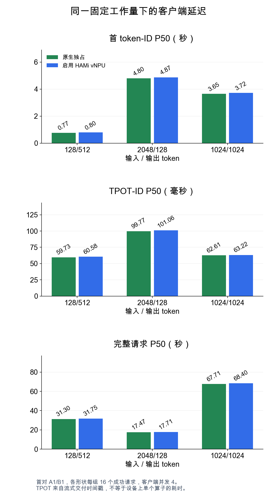

**图 3：首对客户端延迟。** 首token时间从请求开始到第一个含输出ID的chunk到达；TPOT是首末含ID的chunk到达时间差除以输出ID数减一。合并chunk无法还原每个token的独立硬件执行时间。

三个形状中，首对的完整请求P50与TPOT均略有增加，与吞吐观察方向一致。这些指标描述用户侧交付，不将毫秒差直接归因到某个Hook函数。

设备与资源记录还确认：八个正式轮次的容器CPU限流周期增量均为0；209次整芯片快照中，另一颗chip 0均未观察到非零AICore读数。以128／512首对为例，chip 1各22次快照的AICore中位数为90%／89%，物理显存均为15,192–15,193MB。它们补充资源状态证据，离散快照不是时间加权利用率，也不是逐Pod设备份额。

原生模式两次独立启动的吞吐跨度／中位数约0.15%，启用模式约0.67%，均未触发预设2%的追加条件，两次配对的变化方向也一致。本次按登记规则停止；这个阈值用于决定是否继续采样，不是统计显著性标准。C4关键点做了独立重启复测，其他形状目前各一对，尚未覆盖C1/C8或不同模型。

## 单实例结果适用到哪里 {#单实例的结果成立到哪里}

如果要给这次开关对照写一句结论，我会连条件一起写。Qwen3.5-4B、同一芯片、单实例、C4、dynamic 100%、显存不限额，保持 CPU、内存视图、KV 与工作量一致，观测下降 **1.02%–1.87%**。其中 128／512 有两次独立启动配对，观测 1.36% 和 1.87%。其他两个形状各有一对。

这个答案有明确的模型、负载、配置和样本边界，适合说明该条件下的额外影响。它没有证明所有模型或资源切分比例的损耗都小于某个上限。多Pod竞争、显存限额及服务平台路径应另做对应的等价对照。

有了单实例基线，再往机器上加第二个服务。接下来要看的是两个实例同时进请求时，分别还能交付多少。

## 共卡实验换了哪些条件 {#两个实例共卡为什么不能直接套用单实例的损耗率}

换到两个 Pod 后先列改动项。实例数增加，推理批次被分到两边，vNPU 调度开始处理竞争，缓存和服务入口也有各自的配置。先标清这些差异，再看同卡交付。

测试服务器为 x86_64，`npu-smi` 显示 Ascend 310P3 的 chip 0 和 chip 1。本文的“同卡”统一指两个实例共享其中一颗芯片。推理软件为 vLLM Ascend，日志显示 vLLM 版本 0.30.0；模型为 Qwen3.5-4B 和 Qwen3-0.6B，FP16、TP=1、eager，禁用 prefix cache，最大模型长度 4096。

下面是后续部署研究与开篇新对照最重要的区别：

| 项目 | 开篇新等价对照 | 前期共卡部署研究 |
|---|---|---|
| 实例与计算额度 | 单实例，dynamic 100% | 两实例通常各 dynamic 50% |
| 显存视图 | 不限额，核对物理视图一致 | 多数启用组设置虚拟显存额度；原生与启用组参数也有差异 |
| 负载 | 每轮固定 16 个正式请求 | 多数闭环轮次固定接纳 60 秒，代表点追加复测 |
| 吞吐 | 总输出除以完整工作量墙钟时间 | 接纳开始后 10–50 秒的成功请求输出；长轮次另算 |
| 部署路径 | 相同直接容器、相同 chip 1 | 原生／直接容器在 chip 1，双 Pod 在 chip 0 |

普通 4B 实例的上限为 `max-num-seqs=4`、`max-num-batched-tokens=1024`，实际 KV 为 26,214 token；原生宽实例为 8、2048、52,428 token。0.6B 实际 KV 为 16,384 token。启用 vNPU 的异构组合两侧显存额度为 16,384／6,144 MB，双 4B 为每侧 16,384 MB；原生异构双实例使用 `gpu-memory-utilization=0.65`，启用组通常为 0.9。计算配置 50% 是调度参数，实际设备执行份额仍需观测。

下文 60 秒轮次的吞吐统一是中央 40 秒交付；延迟覆盖完整请求及停止接纳后的排空。它们描述部署结果，不能与前面固定工作量的 1% 左右直接相减，分解所谓“平台成本”。

## 双 4B：先拆实例，再换运行方式 {#两个相同-4b总并发相同交付仍有明显差异}

第一组共卡实验只用同一种 4B 模型。固定输入、输出各 1024 Token，先比较单实例 C8 和双实例各 C4，客户端合计并发都是 8。再把双实例的不同运行方式并排看。

图 4 的四根柱子不是只有“原生”和“vNPU”两个开关。它增加了原生双实例与直接容器 vNPU 双实例，目的是检查：差异是否已经在实例拆分时出现，又是否在启用调度后继续变化。

| 部署方式 | 首轮合计输出 | 成功请求 |
|---|---:|---:|
| 原生单实例 C8，chip 1 | 120.4 token/s | 8/8 |
| 原生双实例各 C4，chip 1 | 69.8 token/s | 每侧 4/4 |
| 直接容器 vNPU 双实例各 C4，chip 1 | 64.8 token/s | 每侧 4/4 |
| vNPU 双 Pod 各 C4，chip 0 | 64.1 token/s | 每侧 4/4 |

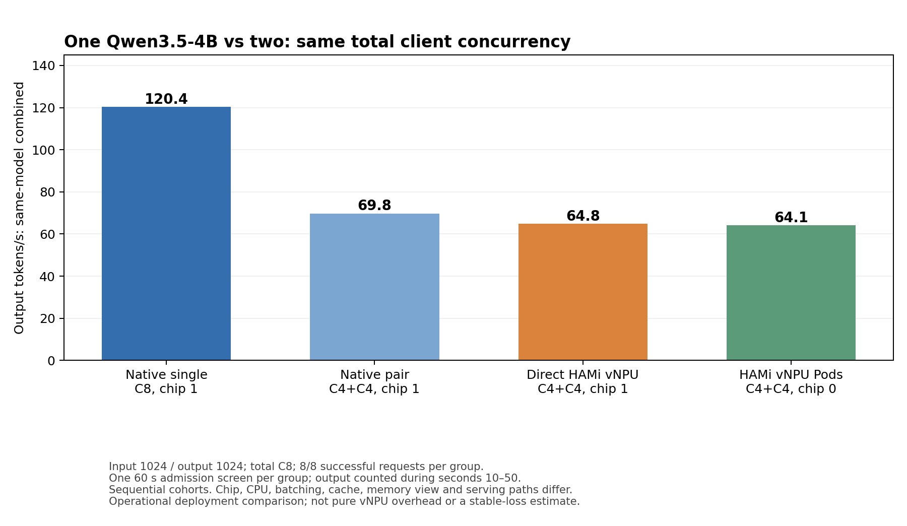

**图 4：相同总客户端并发下，四种部署方式的首轮交付。** 每根柱子来自该组自己的 60 秒接纳轮次。

首先，两个原生实例都没有加载 `libvnpu.so`，合计输出却已经从宽单实例的 120.4 降至 69.8 token/s，观察差异约 42.03%。因此，实例拆分、批处理和运行配置本身就是必须检查的因素。仅用宽单实例对照双 Pod，会把这部分变化一起计入。

其次，在 chip 1 的两个实例之间，原生 69.8 与直接容器 vNPU 64.8 的首轮观察差异约 7.16%。这个参照更接近“双实例下启用 vNPU 的影响”，这个点的原生双实例另两轮为 69.8、69.7，直接容器 vNPU 另两轮均为 64.8 token/s；三轮中位数差异仍约 7.16%。不过，内存参数和视图尚未完全对齐，三轮也各来自一次模型启动，不能替代开篇的独立启动对照。

最后，直接容器 64.8 与双 Pod 64.1 又跨了芯片、CPU 和服务路径。四根柱子帮助定位值得研究的阶段，不能把各段百分比相加为可独立归属的开销。

对原生宽实例和双 Pod 的代表点各做三轮，原始完成结果整理如下：

```text
输入／输出各 1024，总客户端并发 8；中央 40 秒输出
原生单实例：120.4、120.0、120.0 token/s；每轮 8/8 成功
vNPU 双 Pod：64.1、64.1、64.1 token/s；每轮每侧 4/4 成功

三轮中位数：120.0 → 64.1 token/s
部署交付下降：(120.0 - 64.1) / 120.0 = 46.58%
```

这就是 46.58% 的来源。对应完整请求端到端 P50，各轮 P50 再取中位数，原生为 77.59 秒，双 Pod 两侧为 138.28／137.90 秒。该值回答指定部署下业务完成得多快，包含实例拆分与共享条件。

为了选择值得复测的负载，图 5 把三个输入／输出形状与每侧 C1／C4／C8 的首轮筛查放在一起。应比较同一条负载对应的三根柱子，不能把九个负载组合当作九次重复。比如，128／512 从每侧 C1 提升到 C4 时，三种部署的合计交付均明显上升；继续提升至 C8 后，该首轮没有出现同量级增长。这提示需要结合内部并发上限观察，尚不能把这些有限点称为稳定容量上限。

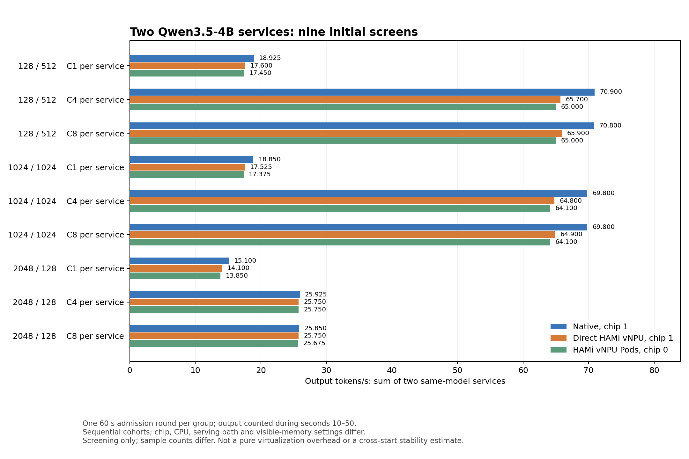

**图 5：双 4B 九点首轮筛查。** 每一行对应输入／输出形状与每侧客户端并发的组合；横轴是两个同模型实例合计的输出 token/s。

另一个已复测的点，输入 2048／输出 128、总 C8，原生宽实例三轮都是 32.225 token/s，双 Pod 三轮都是 25.750 token/s，部署交付差异为 20.09%。同一个部署方案，在不同形状下得到 20.09% 与 46.58%，说明容量评估必须带上请求形状；这些数值尚不能确定差异分别来自预填充、生成还是调度的多少成本。同轮的整芯片读数补充在附录图 A1；利用率快照与业务交付属于不同统计量。

## 4B 和 0.6B：分别看各自的交付 {#换成-4b--06b总吞吐还够用吗}

加进 0.6B 后，两边还是各自做生成。记录表分成 4B、0.6B 两列，各自和自己的独占基线比，避免把不同模型的一枚输出 Token 折成同样的计算量。

图 6 展示异构组合的九点筛查。它最值得关注的不是哪根柱子最高，而是相同负载、相同客户端并发下，两种模型的交付是否同步变化。原生同卡、直接容器 vNPU 同卡和 vNPU 双 Pod 分开展示，避免把“共卡”误写成同一种执行配置。

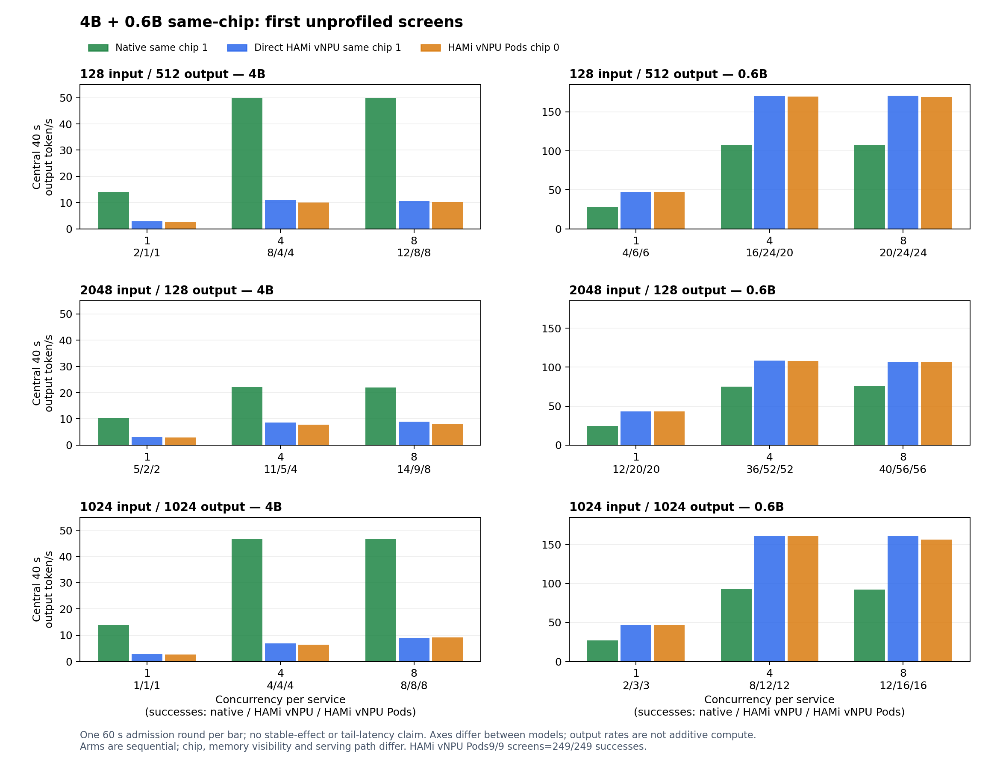

**图 6：异构组合的九点首轮筛查。** 每种模型使用自己的输出 token/s；两侧结果分别解释。

在 128／512 这一行，原生同卡 4B 从 C1 到 C4 的输出增加，而两种启用部署的 4B 仍明显偏低；0.6B 却呈现不同变化。图中请求数也随服务完成速度而变，因而下一步选代表点复测，而不是直接将柱高解释为物理算力份额。整芯片快照见附录图 A2。

在输入 128／输出 512、每侧 C4 的代表点，分别与各自独占参照比较：

| 服务 | 自身原生独占三轮中位数 | vNPU 双 Pod 同卡三轮中位数 | 成功样本 |
|---|---:|---:|---|
| Qwen3.5-4B | 66.2 token/s | 10.3 token/s | 独占 24 个，同卡 12 个 |
| Qwen3-0.6B | 166.7 token/s | 169.6 token/s | 各 60 个 |

4B 的服务交付下降约 84.44%，0.6B 则出现小幅正差。它说明指定共卡部署中两个服务的体验差异很大；没有测出“4B 只得到多少物理算力”，也不能据此认为 0.6B 被普遍加速。

4B 三个短轮次为 10.1、10.4、10.3 token/s，触发预设追加规则；两个 180 秒接纳轮次的中央 10–170 秒为 10.225、10.2 token/s。长短轮次分别报告。0.6B 原生短轮次为 170.9、166.0、166.7 token/s，极差／中位数约 2.94%；追加长窗口为 172.35、173.25 token/s。因此不能把它在双 Pod 表中几 token/s 的正差视为确定收益。

图 7 再检查另一个已复测的长生成代表点——输入／输出各 1024、每侧 C4。4B 独占与双 Pod 的中位数为 65.6／8.875 token/s，0.6B 为 167.5／159.8 token/s。和短输入代表点相比，现象仍表现为两服务交付变化不对称，但具体比例不同。

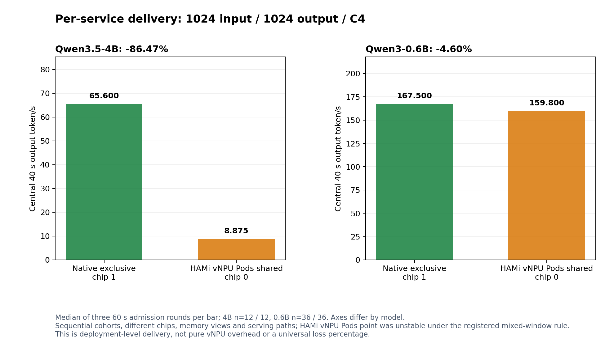

**图 7：长生成代表点，各服务相对自身独占的交付。** 每根柱子是三个 60 秒轮次的中位数；两种模型的纵轴不同。

4B 三个短轮次实际为 6.375、9.05、8.875 token/s，波动较大，8.875 只能作为这三个短窗口的中位数。追加两轮 180 秒接纳后，中央 10–170 秒为 10.49375、10.5125 token/s。长短窗口中都观察到较低交付，但数值并不相同，不能用短窗口的 86.47% 降幅宣称已经测出了长期稳定损耗。

以上闭环轮次中，槽位只有在当前请求结束后才提交下一条。因此两个服务虽然都配置 C4，实际到达的请求数可能不同。要进一步分析排队，必须另用相同到达计划。

## 用同一到达计划看等待和排空 {#相同请求到达计划下等待会怎样积累}

闭环压测是一个请求结束后才补发，快的一边可能拿到更多请求。为对齐负载，我把原生同卡和双 Pod 改为分时回放同一随机种子产生的到达计划和输入。50%、90%、110% 表示相对原生闭环校准率的倍率。

先看异构组合、输入／输出各 128 的 90% 参考率。如图 8 所示，三个种子中 4B 的端到端 P50 均比原生同卡高；0.6B 单独展示。种子间的计划和请求数不同，应当在同一个种子内比较两种部署。

| 种子 | 4B 请求数 | 原生同卡 P50 | vNPU 双 Pod P50 | 本种子两种部署的总成功数 |
|---|---:|---:|---:|---:|
| 0 | 33 | 11.724 s | 91.071 s | 各 139/139，含 0.6B |
| 1 | 43 | 18.968 s | 86.915 s | 各 119/119，含 0.6B |
| 2 | 39 | 13.541 s | 83.669 s | 各 114/114，含 0.6B |

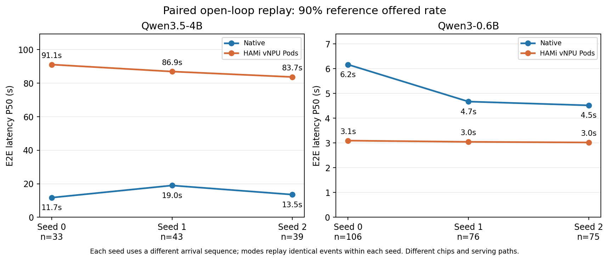

**图 8：相同到达计划下，异构组合三个种子的端到端 P50。** 各点来自完整请求，两个模型分开展示。

延迟变长是否同时出现了服务端等待请求？图 9 使用第二个追加种子的离散快照回答这一点。10–110 秒内，4B 原生运行／等待数的中位数为 3／0，双 Pod 为 4／9，一次双 Pod 采样记录如下：

```text
vllm:num_requests_running{engine="0",model_name="Qwen/Qwen3.5-4B"} 4.0
vllm:num_requests_waiting{engine="0",model_name="Qwen/Qwen3.5-4B"} 23.0
```

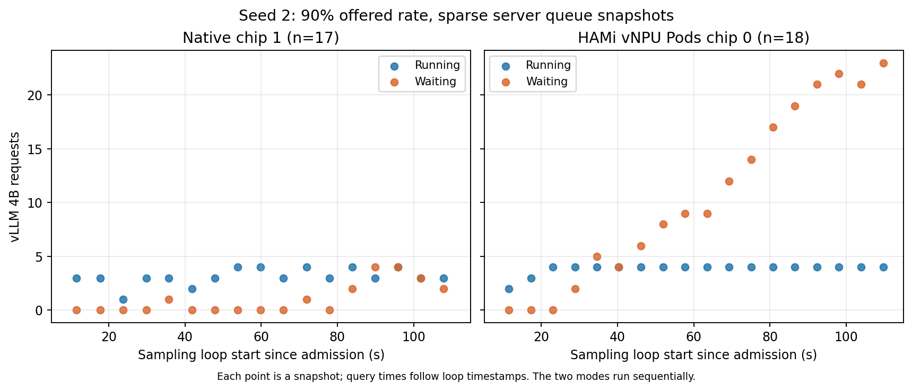

**图 9：与上述种子对应的服务端运行／等待请求快照。** 快照可确认采样时存在等待队列，不能直接积分为请求排队时间。

用户感知的延迟还包括停止接纳后多久才能完成积压。图 10 将 90% 参考率首个种子的 4B 在途请求画成时间线：120 秒停止接纳时，原生仍有 5 个，双 Pod 有 27 个；从逐请求记录看，两组最后一个 4B 请求分别在约 129.232 与 192.531 秒完成。也就是说，停止接纳后，4B 还分别需要约 9.232 与 72.531 秒才完成已提交请求。

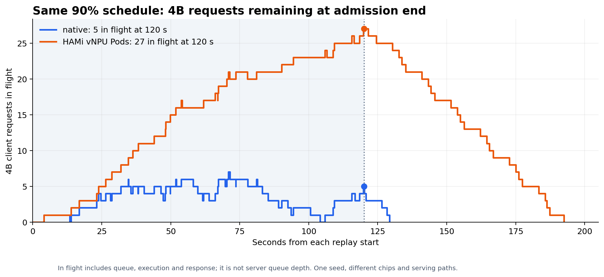

**图 10：90% 参考率首个种子的 4B 在途与排空。** 在途包含网络、排队、执行和响应，不能全部标成服务端等待队列。

当参考率提升至 110%，图 11 中停止接纳时的 4B 在途分别为 10 与 39 个，最后一个 4B 请求分别在约 146.805 与 228.045 秒完成，即停止接纳后约 26.805 与 108.045 秒才完成该服务已提交的请求。两组最终均成功，但相同成功率掩盖不了等待和排空时长的差异。另两个种子的端到端 P50 见附录图 A4；这里的排空数值仍只属于首个种子。

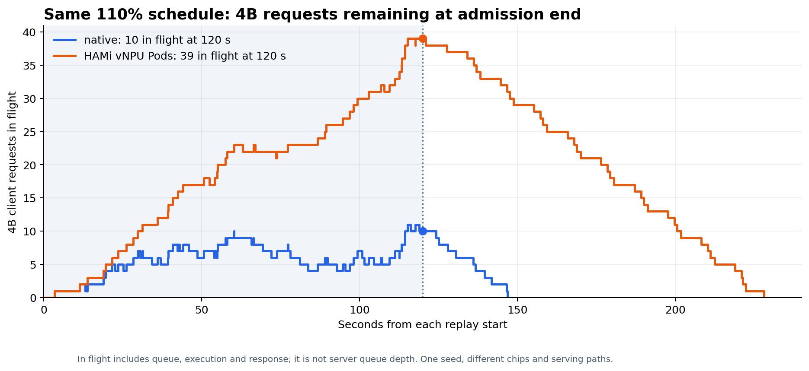

**图 11：110% 参考率首个种子的 4B 在途与排空。** 这与图 10 是不同的到达计划，不能读成同一轮随时间提升负载。

50% 参考率的首个种子也并非完全没有积压：120 秒时原生 4B 仍有 2 个在途，双 Pod 有 10 个。其在途曲线保留在附录图 A3。因此，这组证据支持的是“指定到达计划下两种部署的积压和排空存在差异”，不能凭 50%、90%、110% 三个标签宣称找到了芯片容量拐点。

等待主要发生在首 token 之前，还是生成过程中？图 12 对每个请求分别计算首 token 前、首 token 后到请求结束两个区间，再各自取 P50。首 token 前包括传输、排队、预填充和准入；首 token 后仍包括生成与交付。它能帮助下一步选择观测位置，尚不能将两段直接解释成“排队耗时”和“计算耗时”。

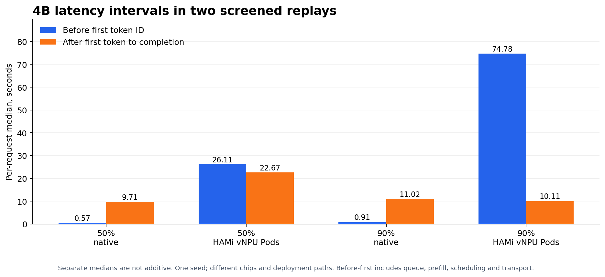

**图 12：4B 请求首 token 前后的客户端区间。** 分别计算的区间 P50 不能相加为端到端 P50。

这张图支持的具体判断是：90% 参考率首个种子中，4B 首 token 前区间的 P50 从原生约 **0.906 秒**变为双 Pod 的 **74.782 秒**，而首 token 后到结束分别约 **11.016／10.106 秒**。此轮两个分布的主要差异集中在首 token 前区间。50% 首个种子则分别为首 token 前 0.571／26.112 秒、首 token 后 9.714／22.669 秒，两段都发生变化。故“慢在首 token 前”是对特定轮次分布的观察，不能推广为所有负载，也尚未将传输、排队、预填充与调度拆开。

本次开放负载中，异构组合 7 组配对，原生与双 Pod 各 915/915 成功；双 4B 的 7 组配对各 375/375 成功。总数只能说明这些轮次的成功记录，代表点之外的完整请求记录单独留档；本文附录选择与正文直接相关的补充图，独立诊断中的失败仍单列。

## 用 Profiler 查进程的计算空档 {#profiler-能把这些差异解释到哪一层}

性能测量都关了 Profiler。下面的诊断是另外采的，每张图都标明样本条件。**开篇等价单实例对照没有 Profiler 采样**，因此先用这些轨迹查双实例的计算空档。

统计时先合并被采样进程所选 Computing tracks 上重叠的事件区间，再取窗口内部相邻区间的空隙。这个“内部间隔”不包含窗口起止边界，也不涵盖其他进程或所有引擎的活动，不能直接称为整颗芯片停算。

先检查与同模型共卡直接相关的三份合格诊断：原生双 4B、直接容器 vNPU 双 4B、vNPU 双 Pod。各自取采样开始后 0.5–3.5 秒；每个诊断轮 12/12 请求成功，双方各有四个同一请求贯穿采样窗口。原始 JSON 统计为：

| 被采样的一侧 | Computing 区间并集 | 最大内部间隔 |
|---|---:|---:|
| 原生双 4B，chip 1 | 2,534.045 ms | 10.439 ms |
| 直接容器 vNPU 双 4B，chip 1 | 1,537.463 ms | 42.038 ms |
| vNPU 双 Pod 的 4B，chip 0 | 1,459.640 ms | 42.322 ms |

这三次独立观察中，后两者的进程计算事件覆盖较少，最长内部间隔更长，支持进一步检查批次交接和准入等待。它们仍是不同采样时刻、不同内存条件的短窗口；区间并集不等于独占设备时间，约 42 ms 也不是已经测定的固定调度时间片。原始浏览器查询的重叠事件导入错误分别为 48,038、43,369、44,226 条；正文使用原始 JSON 统计，并与 CANN CSV 核对。

再看图 13 的异构 `2048／128／每侧 C8` 诊断。原生、直接容器 vNPU 和双 Pod，各分别采 4B 与 0.6B，共六个独立窗口。双 Pod 4B 的其中一份轨迹最大内部间隔约 205.628 ms，说明值得继续定位较长等待，而非只分析单实例的几毫秒差异。

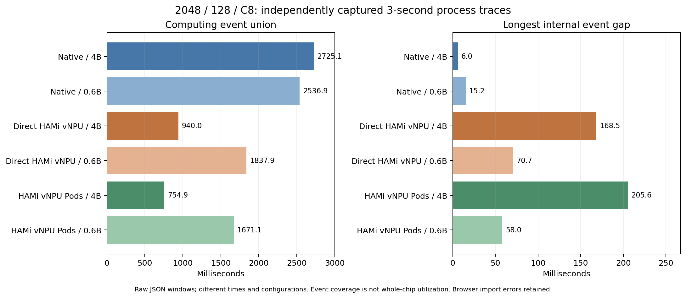

**图 13：异常形状的六份独立进程窗口。** 左侧是 Computing 区间并集，右侧是最长内部间隔；六份不是同步采样。

不同窗口中的事件覆盖率不能相加成整卡利用率，也不能用最长间隔测定固定时间片。六份轨迹当时都在浏览器检查过，但其浏览器画面未单独归档；这里使用原始事件重绘，完整实验档案保留各自的事件统计与导入质量记录。

## 顺着发射函数找准入与等待 {#从发射入口到状态等待代码增加了哪些路径}

看到计算空档以后，沿 `aclrtLaunchKernelWithHostArgs` 去找发射前发生了什么。下面这段来自测试对应的提交 `54f19640c47875bbdae6bf28beaa4736f0761e10`，保留了准入条件，函数签名与随后的转发省略。

```rust
let scope = HostArgsScope::enter();
if scope.outermost {
    let mut capture_status = 0;
    let mut model = 0;
    let result = unsafe {
        limiter::externed_api::rtStreamGetCaptureInfo(
            stream as u64,
            &mut capture_status,
            &mut model,
        )
    };
    if result != 0 || capture_status == 0 {
        crate::npu_limiter().wait_for_token(stream as u64);
    }
}
```

最外层调用在 eager 发射或 capture 查询失败时先申请准入，再转发到真实 CANN 接口；捕获阶段另有处理，避免记录图时重复准入。本文实测为 eager，但不能假设所有算子都经过这同一个 API，其他发射入口也需要各自核对。

接着看 worker 的实际入口：

```rust
pub fn wait_for_token(&self, user_stream: u64) {
    if self.inner.is_stub || !self.inner.sched_policy.is_time_sliced() {
        return;
    }

    let timing = self.context_timing(Self::current_context());
    if self.try_context_stream_token(&timing, user_stream) {
        return;
    }
    // 后续还有 overdraft、批次状态检查、测量与等待分支，此处省略。
}
```

这段代码解释一个关键点：**计算配置 100% 并不等于卸载调度器或自动绕过全部 Hook。** 在时间切分策略中，成功的快路径仍要检查 context、stream、批次状态及令牌。后续根据状态还可能执行事件记录或同步。不过，源码只能说明存在这些工作，无法给出它们分别占开篇实测差异的多少。

manager 则根据历史平均耗时计算调度预算，核心计算为：

```rust
let my_time = self.current_avg_us.max(1);
let prio_for_tokens = self.compute_limit;
let raw_tokens = prio_for_tokens * (anchor_speed_us as f64 / my_time as f64);
let mut base_tokens = raw_tokens.ceil() as u64;
base_tokens = base_tokens.clamp(MIN_TOKENS, MAX_TOKENS);
let mut tokens = (base_tokens as f64 * self.token_scale) as u64;
tokens = tokens.clamp(MIN_TOKENS, MAX_TOKENS);
```

`anchor_speed_us` 来自活跃参与者报告的平均耗时最大值，`my_time` 是本参与者的估计；后面还有最大运行时长限幅等分支。这里的 token 是准入预算，并非模型输出的文本 token。在忽略取整与限幅时，按平均耗时反比设置预算，意图是补偿不同操作的耗时。实际效果还取决于测量更新、准入粒度和批次交接。

如果 worker 读到 IDLE，仍可能尝试允许的 overdraft；不能只看状态值就判断线程一直睡眠。只有结合线程等待地址，才更接近具体等待点。实际等待分支节选如下：

```rust
if shared.state.load(Ordering::Acquire) == STATE_IDLE {
    if limit > 0 {
        futex::wait_timeout(
            &shared.state,
            STATE_IDLE,
            shared.overdraft_poll_interval_us.load(Ordering::Relaxed).max(1),
        );
    } else {
        futex::wait(&shared.state, STATE_IDLE);
    }
}
```

源码位置：[HostArgs 准入](https://github.com/Project-HAMi/hami-vnpu-core/blob/54f19640c47875bbdae6bf28beaa4736f0761e10/crates/hook/src/host_args.rs#L69)、[Worker 状态机](https://github.com/Project-HAMi/hami-vnpu-core/blob/54f19640c47875bbdae6bf28beaa4736f0761e10/crates/limiter/src/worker.rs#L681)、[Manager 预算](https://github.com/Project-HAMi/hami-vnpu-core/blob/54f19640c47875bbdae6bf28beaa4736f0761e10/crates/limiter/src/manager.rs#L431)。

## 复盘一轮 4B 请求超时 {#超时现场交付偏低之外还观察到了什么}

另有一轮双 Pod 诊断出现了超时。条件是 4B 与 0.6B 混跑、输入 128／输出 512、每侧 C8、接纳 180 秒，同时启用约 50 ms 的状态探针。这轮单独记在排查记录里。

```text
按逐请求记录整理：requests=76，failed=4
4B slot=4  status=200  输出ID=0  timeout('timed out')  180.081 s
4B slot=7  status=200  输出ID=0  timeout('timed out')  180.092 s
4B slot=1  status=200  输出ID=0  timeout('timed out')  180.115 s
4B slot=0  status=200  输出ID=0  timeout('timed out')  180.117 s
4B：4/8 成功；0.6B：68/68 成功
```

C8 是每侧八个闭环槽位，完成后才继续提交。4B 初始请求长时间不结束，累计仅八个；0.6B 继续补发，累计 68 个。这不是两边输入请求总量相同的对照，应与前面的开放负载分开。

四个失败请求收到过 HTTP 200，但没有输出 ID；记录的约 180 秒是从请求开始计时。执行器设置 `HTTPConnection(timeout=180)`，没有保存响应头到达时间，所以不能写成“响应头之后又等了整整 180 秒”，也不能将 socket 操作超时称作整个请求总时限。

图 14 把这一轮的离散共享状态和设备读数放在一起。接纳后 10–170 秒共有 3,158 个采样时刻，2,642 次同时满足身份匹配、头部重读稳定、本侧 IDLE、零令牌、owner 为另一槽位，并记录本侧一个发射线程等待 local SHM 的 futex。一次样本字段整理如下：

```text
# 相对采样循环开始约 10.026 秒；状态与线程依次读取
A state=0 tokens=0 owner=1 batch=22506 generation=106
A acl_thread wchan=futex_wait_queue_me local_shm_offset=24
```

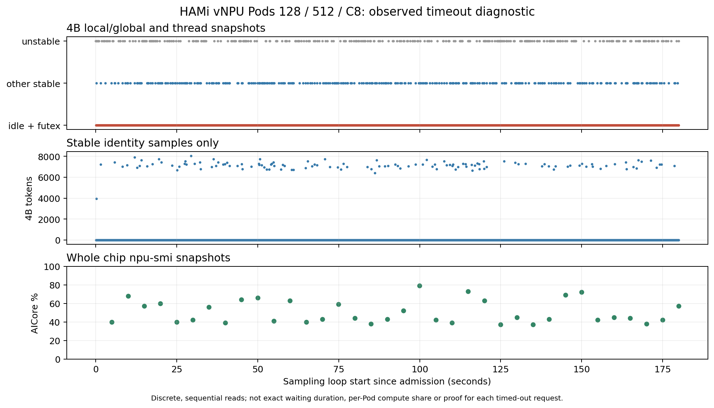

**图 14：超时诊断轮次中的调度状态、令牌和设备快照。** 点是采样时刻；密集点连成的视觉效果不代表连续观测。

它与代码中的 `state` 等待路径吻合，支持“该发射线程在多次采样时等待调度状态”。但 2,642／3,158 的 83.66% 是采样条件命中率，分母还含无效读取；它不是精确等待时间。这个 C8 诊断与前面 C4 的 84.44% 交付下降更不能因数字接近而相互解释。目前也没有将每段线程等待一一映射到四个失败请求。

## 把显存额度调大再测一次 {#显存配置不同会不会才是主要解释}

当时还有一个怀疑是，两边的显存视图不同。另开一轮探索，在 chip 1 上把两个启用实例的逻辑额度都设为 43,693 MB，`gpu-memory-utilization=0.65`，保持 dynamic 50/50。日志中的 KV 仍是 26,214／16,384 Token，同时检查了物理余量。运行期内存行为还没有逐项对齐。

在 `1024／1024／C4` 下，4B 两轮 180 秒接纳的中央输出仍只有 11.0625、11.1875 token/s，完整请求 P50 约 235.105、234.646 秒。启动视图接近之后仍观察到低交付，说明继续追踪调度路径有价值；仅凭这组实验仍不能排除全部内存因素。

这两轮各只有四个 4B 成功请求；完整请求 P50 超过接纳窗口并不矛盾，因为 180 秒后停止的是新请求接纳，已经提交的请求继续执行。伴生服务的排空和有效共享状态读数见附录图 A5、A6。它们分别来自自己的轮次，不能与正文超时轮混成一个时间线。

为了进一步将设备事件和调度状态联系起来，我们还检查了另一轮直接容器 vNPU 的独立诊断。它使用 128／512、每侧 C8；图 15 选取其中一个约 171.919 ms 的 4B Computing 内部间隔，附近恰有三次状态采样。原始字段按同一发射线程整理如下：

```text
# 时间相对所选 Computing 间隔开始；非原子顺序读取
约 +30.581 ms：state=0 tokens=0 owner=1 generation=8
约 +81.258 ms：state=0 tokens=0 owner=1 generation=8
约 +131.843 ms：state=0 tokens=0 owner=1 generation=8
三次：header_stable=true，scoreboard PID/generation 匹配
三次：发射线程 wchan=futex_wait_queue_me，等待 local SHM 偏移 24
```

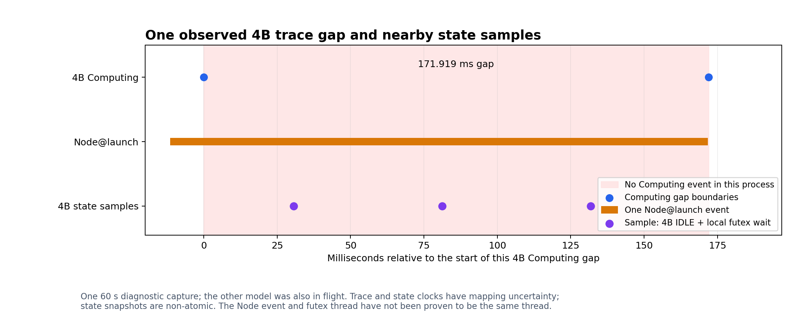

**图 15：同一诊断轮中，一段计算事件间隔与附近的共享状态采样。** 三个紫点是离散读取；橙色是一个 Host 发射事件。

这比只有“没有输出”更具体：同一诊断轮里，进程 Computing 事件间隔、长 Host 发射事件和调度状态等待在邻近时间出现。由于 trace 与状态时钟通过另存标记映射，且尚未证明 `Node@launch` 和 futex 属于同一线程，仍不能将整段 171.919 ms 全部归给该 futex，也不能用它解释另一轮四个请求超时。

至此，证据能支持继续检查准入等待、预算测量与轮次交接。要量化其成本，还需要在同一次受控诊断中关联请求、发射线程、双侧状态与设备事件，再用只改变目标路径的修复做前后对照。

## 按业务问题挑数据 {#业务评估应该引用哪组数字}

回答开关开销，用同芯片、同工作量那组。Qwen3.5-4B、C4、dynamic 100%、显存不限额，对应 1.02%–1.87%。这是已测配对的最小与最大观察值。代表负载有两次独立启动配对。

回答共卡能接多少业务，用实际部署的逐模型吞吐、延迟、成功率和排空。双 4B 的指定负载观察到 20.09% 或 46.58% 的总交付下降。4B 与 0.6B 共卡时，两边变化方向也可能不同。复测要按实际组合选样本。

如果要进一步定位成本，下一轮先补齐双实例的显存视图、CPU、KV 和工作量。再在同一轮诊断里对齐两个服务的发射线程、共享状态和设备事件。现有快照给出了准入等待线索。

做上线判断时，我会先记单实例基线，再按计划共卡的两种模型跑业务流量，最后用每个模型自己的时限与成功率验收。


---

---

## 附录：补充数据与原始查询 {#附录补充数据与原始查询}

这里保留正文引用的补充图。找设备采样看 A1、A2，核对开放负载看 A3、A4，检查显存视图探索看 A5、A6。

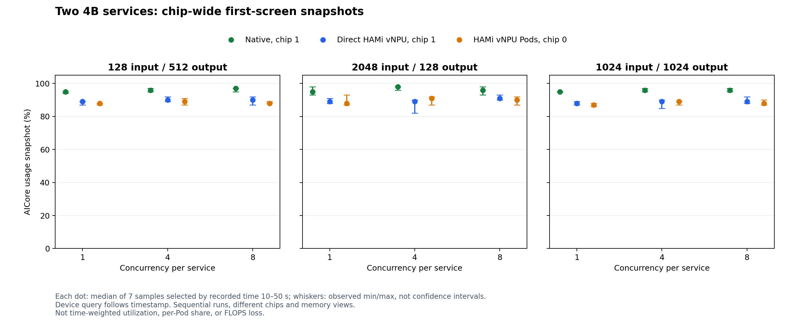

**附录图 A1：双 4B 筛查的整芯片快照。** 点和竖线表示各轮离散快照的中位数及范围，采样时间有限；这些不是标准误或置信区间。较高 AICore 读数不保证相同的客户端交付。

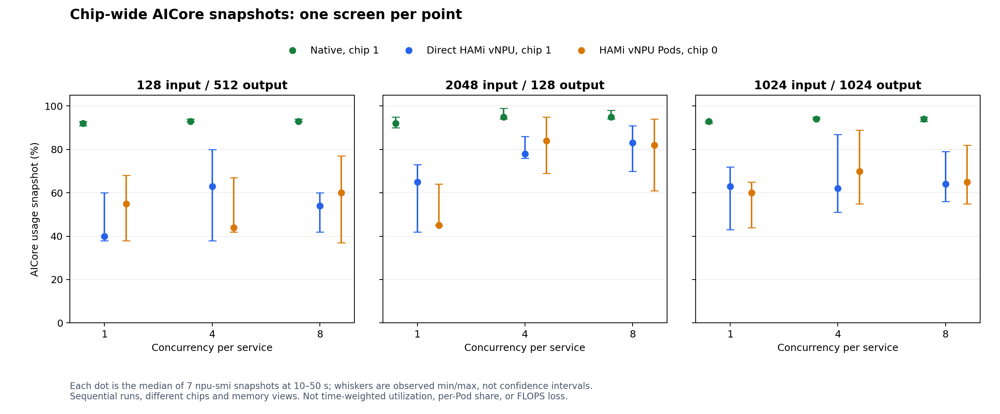

**附录图 A2：异构筛查的整芯片快照。** 这是同一组筛查的设备侧补充，原生与直接容器启用 HAMi vNPU 在 chip 1，vNPU 双 Pod 在 chip 0。设备采样范围与吞吐差异可以并列观察，不能凭相关性判断哪个函数造成了下降。

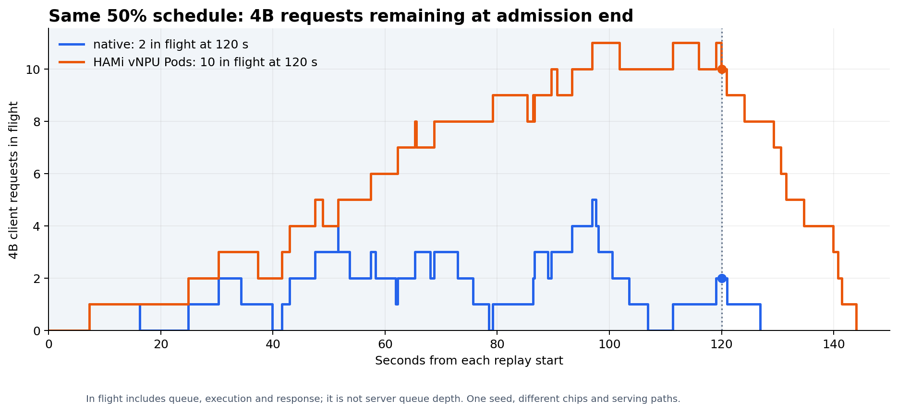

**附录图 A3：50% 参考率下的 4B 在途请求。** 120 秒接纳结束时，原生 4B 仍有 2 个在途，vNPU 双 Pod 有 10 个；两组最终均完成。客户端在途包含传输、排队、执行和响应，不能直接标作服务端排队。

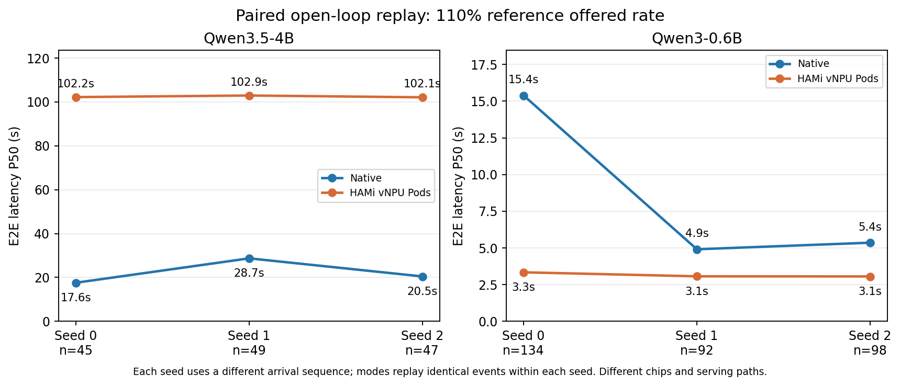

**附录图 A4：110% 参考率下三个种子的端到端延迟。** 补充 90% 以外另一个被追加验证的点。每个种子内配对，种子之间事件数不同；连线不是时间趋势，也没有置信区间含义。

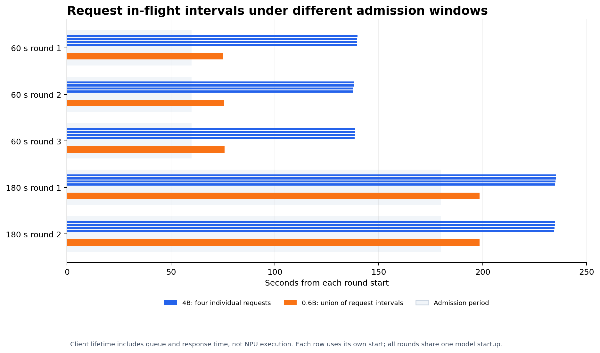

**附录图 A5：显存视图探索中的完整在途过程。** 短窗口的伴生 0.6B 约 75 秒排空，长窗口约 198 秒排空；4B 请求完成时面对的共享负载过程不同。条形只表示在途，不代表持续占用 NPU。

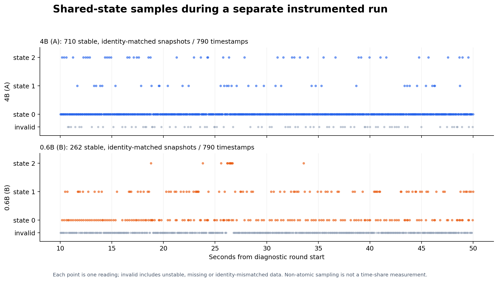

**附录图 A6：显存视图探索中的共享状态有效读取。** 灰色无效样本未用于状态结论；重复快照高度相关。627/710 是命中计数，不是精确等待比例。
