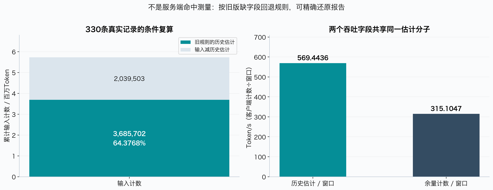
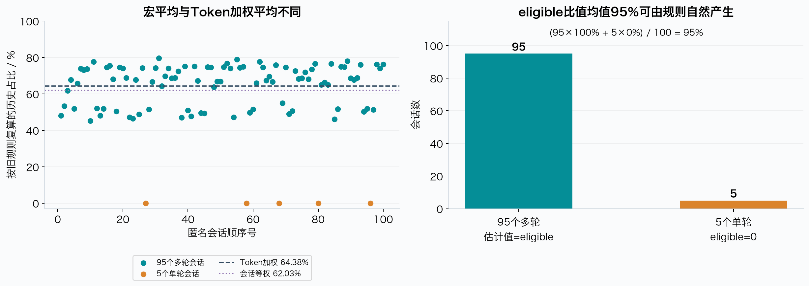
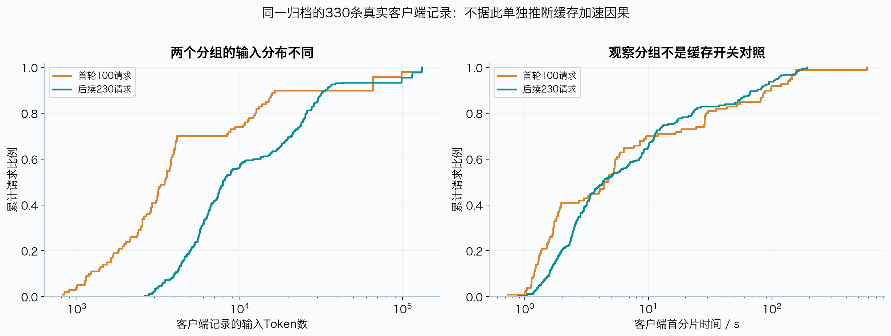
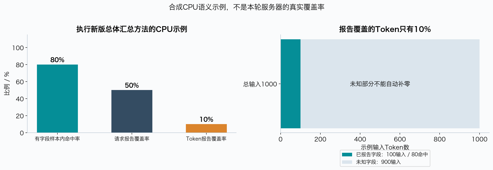

拿到这份 330 请求的压测报告时，缓存命中率写着 **64.3768%**，可复用部分的会话均值还有 **95%**。我先不看设备 trace，只拿上一轮的输入、输出计数复算。旧版 EvalScope 的历史回退规则把两个数都算了出来。

接下来要追的是这些字段从哪里进了汇总。数据库里没留下缓存字段，协议日志也不全，所以我沿着流式解析和保存代码把能确定的部分标出来。

这里用真实请求记录做离线复算。另用 CPU 合成例演示缺报、零值和部分上报，这三组例子与设备记录分开。

## 先看归档里有哪些字段 {#一先把原始计数与报告里的命中拆开}

先抄出部署背景。归档是 Qwen3.8-27B-w8a8，昇腾 A2 单设备、约 60G 显存额度、TP=1、vLLM-Ascend 0.30.0，CPU 32 核、主机内存 64G，配置了前缀缓存和 MTP。客户端材料没有独立核对生效的启动参数、镜像源码指纹和整机共享状态，设备侧归因留待采样。

客户端通过EvalScope发起流式调用，自定义多轮数据集包含100个会话，展开后共330次请求。客户端并发上限为8，最大输出1024，预热数为零。输入从813到131104 Token，是短对话、历史增长与长输入的混合负载，不是一个固定长度、固定缓存状态的基准点。

归档没有客户端安装包的精确提交或锁定文件。本文固定比较两个公开版本，用来检查能解释报告数字的统计路径，不据数值一致反推当时一定运行了某个标签。依赖版本身份与指标来源身份都应该单独保存，二者不能靠一个四位小数互相证明。

数据库的输入计数合计5725205，输出合计319690。时间线最终累计值把输入拆成3685702个所谓缓存Token和2039503个所谓新增Token。相加正好回到输入总数，但这个恒等式本身只能确认记账闭合，不能确认每一项来自哪里。

| 原报告字段 | 数值 |
|---|---:|
| KV Cache Hit Rate | 64.3768% |
| 按会话汇总的Cache Hit Rate均值 | 62.0307% |
| Eligible Cache Hit Rate会话均值 | 95.0000% |
| Cached Prompt吞吐 | 569.4436 Token/s |
| New Prompt吞吐 | 315.1047 Token/s |

复核时没有把请求原文或原始标识导出。先按首条消息的本地摘要分组，再核对每组只有一个首轮请求，后续消息数量逐轮增加，旧消息对象逐项保持为新请求的前导历史，同一会话内部也没有时间重叠。最终得到100组，与归档会话总数一致。

这些检查支持按会话追踪上一轮计数，但不证明最终模型Token序列完全相同。消息对象相同与模板展开后Token前缀相同，仍有一步转换。因此，后续计算始终标注为历史计数估计，不直接命名为设备缓存命中。

这100组的轮数也并不统一：5个单轮，28个两轮，17个三轮，37个四轮，8个五轮，5个六轮。若把“100会话”与“330请求”混为同一分母，会同时影响缓存比例、平均延迟和覆盖率的解释。

## 拿上一轮 Token 数复算报告 {#二一条旧规则怎样生成好几个漂亮数字}

沿 EvalScope v1.14.1 的多轮策略往下看。代码先取服务端缓存计数。字段缺失时，首轮填零，后续轮用上一轮输入加输出。注意这条估计和服务端报告值会进入同一个汇总字段。 [固定版本的多轮策略](https://github.com/modelscope/evalscope/blob/9d298b839375e735fbbef992b4042e0852d0b8aa/evalscope/perf/core/strategies/multi_turn.py)

设会话中第t轮输入计数为Pₜ，上一轮输出为Oₜ₋₁。在没有服务端字段的回退情形下，原规则可写成：

```text
首轮：E₁ = 0
后续：Eₜ = Pₜ₋₁ + Oₜ₋₁
总体比例 = ΣEₜ / ΣPₜ
```

本地提取原始判断语句执行，并对全部会话逐轮代入真实输入、输出计数。假设走缺字段回退，得到的E总和恰好是3685702；除以5725205，得到64.3767690415%，四位小数与报告完全一致。

这是一项有条件的来源重建，不能倒推出当时所有请求必然都走了回退。因为归档没有保存每条记录的缓存字段来源，服务端值与估计值可能混在同一个汇总字段里。数值重合证明这条规则足以生成报告，不等于已经取得运行时逐条分支证据。

若两种来源同时存在，更稳妥的做法是分别累计服务端报告值和历史估计，并保留各自对应的输入分母。把估计加入观测分子，再把这些请求算作“已经报告”，会同时改变命中率和覆盖率的含义。当前归档无法恢复这张来源掩码，所以不能事后为它补一份可信的覆盖比例。

也可以从可识别性理解这个限制：只要服务端字段没有进入可观察输入，无论内部缓存恰好全部不可用，还是历史状态恰好可复用，旧回退都会给同一组输入输出计数产生相同E。这里是在构造两个条件情形，不是声称本机实际发生过其中任何一种。客户端结果无法唯一反解底层状态，补更多小数位也不会增加这部分信息。



图1：330条真实请求计数的条件复算，未标作服务端命中测量。历史估计与剩余计数相加等于输入总数；右侧两个吞吐使用相同估计及同一时间线窗口。

用3685702除以时间线约6472.4619秒，得到569.4436 Token/s；用剩下的2039503除以同一窗口，得到315.1047 Token/s。两项也与报告一致。因此，命中率、缓存吞吐和新增吞吐可以是同一估计的不同表达，并不是三份独立设备证据。

复算使用时间线保存的6472.461885秒，不把摘要中舍入后的时长当成无限精度。两处显示接近，不保证计时边界完全相同；吞吐对账时，分子、分母应来自同一窗口，舍入差异也应保留。

如果E没有被证明是真实复用，P−E也就没有被证明是实际执行的Prefill工作量。把New Prompt吞吐直接当作NPU的Prefill计算速率，会把客户端的代数拆分当成设备执行账。总输入、总输出等记录仍有价值，不能因为缓存来源不明，就反过来否定整份压测。

总输入本身也不是唯一文本的大小。同一会话的历史会在后续请求里被重复计入，572万输入计数包含这种重复。接口可以按逻辑请求负载计量，硬件侧则要区分复用和重新计算；这两个吞吐口径都可能有用，但不能换个字段名就假定已经测到了相同工作量。

62.0307%则来自另一种加权方式。先为每个会话求历史估计占该会话输入的比例，再让100个会话等权平均，会得到这个数；把全部Token合并后求比值，得到64.3768%。较长会话在后者中权重更大，两者回答的问题不同。

这会影响跨部署比较。若只是改变短、长会话在数据集里的占比，总体比例就可能移动，即使每种会话自身的行为没有变化。比较两个模型或两个引擎时，应先固定输入长度、轮数和会话组合，或者按相同分层重新加权；否则工作负载形状改变，也可能被包装成缓存实现变好。

95%更容易产生误解。按旧规则，95个多轮会话的估计分子，与eligible分母都来自上一轮输入加输出，所以每个会话都自然得到100%；另外5个单轮会话没有eligible量，原路径记为零。把这100个值等权平均，就是95%。



图2：根据真实会话分组和旧公式复算。95个多轮会话并不是经设备计数确认全部命中；图展示的是回退估计会怎样生成相应统计。

这个结果不能解释成“设备损失了5%的可复用缓存”，更不能解释成“95%的请求实际命中”。单轮的零在这里来自分母规则，多轮的百分之百来自分子分母同源。离开公式看标题，容易给这些数字赋予它们没有携带的信息。

## 用一个真实前缀案例检查解释 {#三历史已经出现过为什么仍不保证kv可以复用}

上一轮的输入和输出，能告诉我客户端可能带回了多少历史。服务端要真的命中，还得找到相同前缀对应的可用状态。这个区别可以用一次有服务端计数的对照来检查。

前缀缓存通常用Token及其前导历史构建身份，并结合缓存隔离等附加条件。改动早期输入，会改变后续状态所属的历史；前后出现相同片段，也不能跳过不同前导上下文独立复用。接口消息对象的重复比例，因此不能直接代替最终Token序列的可匹配长度。[vLLM v0.30.0前缀缓存设计](https://docs.vllm.ai/en/v0.30.0/design/prefix_caching/)

聊天模板也参与这个转换。角色分隔、生成起始位置、思考字段或历史回填方式，可能改变下一轮实际发送的模型输入。只把上轮prompt计数加completion计数，没有检查这些边界，就还没有证明那一段恰好成为下一轮的同一Token前缀。

其次，相同前缀需要落到拥有相应状态的执行位置。多副本路由、进程重启、缓存淘汰或隔离键变化，都可能使历史仍在请求中，设备缓存却已经不可用。即使客户端保持同一个逻辑会话，也不能据此保证每轮访问同一个有效缓存池。

再者，缓存可能按块匹配，末端边界、模型层结构与状态恢复规则会限制实际复用长度。本文没有该轮逐组块表、状态保留或淘汰事件，不把某个历史计数折算成已命中的块数。缺少这些证据时，可以讨论复用候选规模，不能确认最终恢复点。

历史估计甚至不总是严格上界。首轮没有本会话历史，仍可能命中其他请求留下的公共前缀；反过来，历史裁剪或重新构造后，上一轮累计计数也可能大于当前输入。本档案中所有估计均未超过当前输入，但这个观察不能成为旧公式对任意多轮负载都成立的证明。

另一个CPU合成例直接执行旧判断：上一轮输入1000、输出100，本轮裁剪成500，缺少服务端字段时仍会生成1100的历史估计，除以当前输入就是220%。这不是归档中出现的结果，也不是缓存能够超过输入的证据；它说明回退公式依赖历史增长假设，不能当作不受请求构造影响的物理命中计数。

延迟分组同样不能替代缓存证据。真实数据中，100个首轮请求的首分片平均约28.580秒，230个后续请求约20.795秒；但它们的输入计数中位数分别为3460.5和7879，样本组成不同。直接相除，不是在测一次缓存开关干预的加速比。



图3：同一归档的330条真实客户端记录，横轴使用对数刻度。首轮和后续属于观察分组，未固定相同输入、缓存状态和到达条件，不据此建立缓存收益因果。

两组首分片中位数则约为4.552和4.264秒，与平均值的差异说明尾部会显著影响汇总。客户端首分片还包含排队、输入处理和交付路径；当前没有逐请求设备计时，不能把较短的组均值全部归到KV复用。

在 Qwen3.5-9B 的一组对照中，两组请求都有 4,096 个公共前导 Token，服务端计数器记录的命中分别为 0 和 3,696。改变预置请求结束的位置，就会改变探测时能恢复的历史状态。[前缀缓存与状态检查点实测]()

## 沿流式解析查字段在哪里丢失 {#四归档没有缓存字段不等于服务端没有上报}

打开数据库，先查了三列。没有 `cached_tokens`、`real_cached_tokens` 或 `trace_id`，`request_id` 也都是空。保存的 `response_messages` 找不到 `usage`。下一步是查客户端有没有读过没保存的消息。

EvalScope所核对版本的流式处理，将带choices的消息加入response_messages；usage处理位于另一段逻辑，能够单独读取输入、输出及缓存细节。一个末尾只有usage、choices为空的SSE消息，可以被运行时读取，却不进入这个响应消息列表。[流式解析与消息保存路径](https://github.com/modelscope/evalscope/blob/9d298b839375e735fbbef992b4042e0852d0b8aa/evalscope/perf/plugin/api/default_api.py)

为验证这个区别，CPU示例构造了两条choices消息，后接一条usage-only消息，后者带100个输入Token和80个cached_tokens。执行原始usage处理语句与对应保存语句后，运行时缓存值为80，保存列表只有两条choices消息，里面看不到缓存字段。

这是合成消息的语义验证，没有请求真实服务器，也不是本轮测到了80个命中Token。它证明的是一个反例：同样的“保存列表没有字段”，既可能来自服务端没上报，也可能来自客户端保存范围不完整。因此不能只据保存列表反推上游行为。

数据库写入路径进一步说明了缺口。它持久化响应列表和若干输入输出、计时字段，但没有单独持久化缓存数与来源。时间线里的累计缓存数又已经是汇总结果，无法反解每条请求究竟取了服务端值还是回退估计。[对应版本的数据库结构](https://github.com/modelscope/evalscope/blob/9d298b839375e735fbbef992b4042e0852d0b8aa/evalscope/perf/utils/db_util.py)

这里应区分“列存在且值为NULL”和“这个列根本没有保存”。前者可以是一次明确记录的未知观察，后者首先反映归档结构没有承载该证据。给旧数据库补列并统一填零，不是数据修复，而是在增加原本不存在的业务观察；统一填NULL也只能标识不可恢复，不能据此统计服务端真实缺失比例。

服务端还存在另一道开关。vLLM v0.30.0中，构建prompt_tokens_details的辅助函数受enable_prompt_tokens_details控制，所核对构造参数默认False；即使内部拥有缓存计数，关闭该细节构建路径也可以不生成相应对象。CPU执行原辅助函数时，关闭返回None，打开则保留示例值80。[服务端细节字段构建](https://github.com/vllm-project/vllm/blob/ced6857afa0ea7b2e3f0846a62e1394e90f15607/vllm/entrypoints/openai/chat_completion/serving.py#L90)

本轮没有锁定这个开关的有效值，也没有完整保留原始SSE事件，所以这里只确认可能的执行机制，不判断当前服务一定关闭了它。模型具备缓存能力、请求要求usage、接口返回缓存细节、客户端把细节存下来，是几项需要分别验证的事实。

因此，本档案的实际服务端报告覆盖率应标为不可恢复，而不是零。零覆盖率需要知道有多少符合条件的请求确实没有报告；现有材料连这个逐条标记都没有保存。升级工具能改进以后采集的语义，却不能补回旧记录已经丢失的来源。

## 分别统计缺报和明确的零 {#五缺失与明确为零怎样改变统计结论}

后续 EvalScope 合并了 PR #1939，移除了多轮历史回退，加上缓存报告覆盖率。我在 v1.15.0 提交 c4f6021 上看了汇总代码。它从有报告的缓存值计算比例，同时记下请求覆盖度和 Token 覆盖度。 [已合并修复](https://github.com/modelscope/evalscope/pull/1939)

不能把缺字段自动补成零。明确零表示服务端给出了“本次计为零”的观察，应该进入分母；None表示这条观察未知。只统计已上报部分并说明覆盖度，与把所有未知请求当作未命中，是两种不同的统计选择。

本地执行该版本原始数据类和汇总方法，分别验证三个CPU示例。它们使用合成计数，不代表本轮A2服务的真实缓存报告情况：

| 示例 | 输入计数与缓存字段 | 总体汇总行为 |
|---|---|---|
| 全部缺失 | 100、200；None、None | 缓存指标不输出，不能写成命中率0% |
| 明确为零 | 100、200；0、0 | 命中率0%，请求及Token覆盖度均100% |
| 部分上报 | 100、900；80、None | 已上报样本命中率80%，请求覆盖50%，Token覆盖10% |

最后一行最能说明为什么需要两种覆盖度。两个请求只缺一个，看起来有一半样本；但缺失的是900个输入Token，已被报告覆盖的输入只有百分之十。若缺失集中在长输入或高压力场景，样本内的高命中率就可能与整体表现相差很远。



图4：执行固定新版总体汇总方法的CPU合成示例，不是330请求的真实服务覆盖率。100个输入里报告80命中，另900个输入未知；三种百分比对应不同分母。

用符号表示，已报告集合为R，全部符合条件请求为A，输入为P，缓存数为H。样本内比例是ΣHᵣ÷ΣPᵣ；请求覆盖是|R|÷|A|；Token覆盖是ΣPᵣ÷ΣPₐ。三个量一起给出，才能知道高比例覆盖了多少业务工作量。

还可以在不猜未知值的前提下给一个保守数学界。示例总输入1000，已知命中80，未知部分最多900。如果只采用每条命中介于零和输入计数之间的约束，全局比例只能被限制在8%到98%。这不是置信区间，也没有利用块对齐等约束收紧；它说明信息不足以确定唯一的整体命中率。

更一般地，令Token覆盖度为q，已报告部分的比例为r，未知部分真实比例为u，则整体比例可写成qr+(1−q)u。只知道u介于零和一时，区间宽度就是1−q，与报告把r保留多少位小数无关。q只有10%，可行范围就可能宽达九十个百分点；q达到90%，同样规则下的范围才缩到十个百分点。

这也说明，请求覆盖和Token覆盖不能互相替代。很多很短的已报告请求，可能让请求覆盖看起来很高，实际覆盖的输入工作量却很小。若缺失又与长上下文、高负载或特定执行路径相关，不能直接假定已报告部分是随机样本，再用普通抽样误差给整体结果背书。

即使对已报告样本反复重采样，得到非常窄的波动区间，也没有补回那些未知请求。统计上的重复精度，不能消除报告选择偏差。先确认覆盖的是哪个总体，再讨论误差和稳定性，才能避免一个看似精确的80%掩盖整体仍可能很宽的不确定范围。

新版会话统计也保留了缺失语义。本地执行固定版本的会话数据类，全缺失示例返回None，而不是把未知当作零后继续算会话均值。不同报表路径仍应分别验收，不能因为总体表多了覆盖字段，就默认所有自定义导出都自动保留了相同语义。

对这份旧档案，我们不能照搬CPU示例，声称新版会给它显示零覆盖或零命中。实际字段来源不可恢复，无法构造可信的逐请求新输入。能做的是标注历史估计、保留可核验的计数，并在有新授权和完整采集时重新建立服务端证据。

## 下一轮压测把来源一起保存 {#六怎样把缓存收益变成可审核的推理证据}

再跑一轮时，每条请求至少留输入计数、缓存数字段、字段是否存在、来自服务端还是客户端估计，以及模型、版本、执行位置和起止时间。用匿名关联号就能核对这些记录。

原始协议与归一化字段也有不同作用。完整SSE事件能核对usage-only帧是否到达；归一化字段方便做请求级统计。只保留其中一种，可能分别遇到难以汇总或难以追溯的问题。若出于隐私不保留正文，可以独立保存必要的usage结构与存在性标记，明确采集范围。

接着建立计数契约。输入、命中与重算必须使用兼容的Token单位和窗口，检查明显的负值或不合理超过输入的情况。统计缺失单独计数，明确哪些请求进入命中分母；不要为让图表连续而无条件补零，也不要为让比例稳定而静默丢弃长请求。

服务端计数器可以提供交叉证据，但请求级字段与共享实例的累计计数不是天然一一对应。若窗口里有其他流量，整体计数增加不一定属于当前探测；多个副本先混合求比值，也可能把命中归到错误的请求。应先按执行位置、模型与配置分开，再汇总相容计数。

判断缓存是否有效，还需要匹配的干预。固定相同输入与输出预算，控制预置请求、缓存身份和执行位置，再比较允许复用与不允许复用的条件。对照应同时保留命中量、实际重算量以及Prefill和客户端交付时间，而不是只比较首轮与后续两个自然分组。

缓存命中数也不等于节省的时间。即便跳过一段输入的重复计算，后续query仍可能读取历史KV，缓存查找、状态恢复、调度和交付也有成本。若复用来自CPU或远端存储，还要把恢复与链路代价放回关键路径；不能只拿命中Token占比乘原始延迟，宣布得到预期加速。

一个简化的全注意力算例能说明原因。设输入长度N，其中L个前导位置已经缓存，只对后面的N−L个位置计算新query。线性投影的新增位置比例约为1−L/N，但新query仍要访问前面的历史键和值，注意力交互量并不会按同一个比例减少。

```text
完整因果交互数：N(N+1)/2
保留缓存后的新增query交互数：[N(N+1)−L(L+1)]/2
大长度下，剩余交互比例约为1−(L/N)²
```

例如N为1000、L为640，新增query只有360个，因果交互却仍有295380个，占原来500500的约59%。这是数学交互计数，不是本轮模型的实测计算量或时间；本地只对小尺寸逐项枚举核验了公式。它已经足以说明，即使64%是真实命中，也不能把所有计算统一扣掉64%。

真实执行还受到矩阵分块、带宽、批处理及模型结构影响，混合状态模型也不能直接套成纯全注意力成本。这个算例的用途是揭示剩余工作的依赖，而不是为缺少设备计时的报告补造加速比。要评估收益，仍需对应的重算和执行时间证据。

归档中的Cached Prompt和New Prompt曲线可以作为旧规则的工作负载描述，但要标出来源。它们描述历史候选量和剩余计数怎样随时间增长，不足以证明设备实际执行了同样多或同样少的Prefill。给这些量换一个更准确的名字，比把小数多保留几位更有价值。

这份复核还展示了持久化设计的成本取舍。增加缓存存在性、来源和匿名关联字段，数据量远小于保存全部生成文本，却能避免以后只能从汇总数字反推。保存完整内容应由实际审计需要与隐私要求决定；即使不保存内容，也不应省掉决定统计含义的元数据。

复盘时我会分别问三件事。请求带回了多少历史，服务端报告复用了多少，复用之后排队或首段到底有没有改善。依次对请求计数、缓存报告、性能对照，遇到证据缺口就在那一层停下。

## 这份报告还能用来回答什么 {#结论}

64.3768%、569.4436 Token/s 和 95% 的会话 eligible 均值，都能用真实输入输出计数和旧规则精确复算。它们共享这条估算路径，归档未留下足以算出服务端报告覆盖度的字段。

客户端交付和请求形状仍可以用这轮归档分析。引用缓存数字时，在图旁把历史估算写清楚。需要评估设备到底复用了多少，重新采 `usage` 和服务端计数。

## 资料来源

- [EvalScope v1.14.1：多轮策略中的历史回退，固定提交9d298b8](https://github.com/modelscope/evalscope/blob/9d298b839375e735fbbef992b4042e0852d0b8aa/evalscope/perf/core/strategies/multi_turn.py)
- [相同版本：总体缓存汇总](https://github.com/modelscope/evalscope/blob/9d298b839375e735fbbef992b4042e0852d0b8aa/evalscope/perf/utils/benchmark_util.py)
- [相同版本：会话与eligible指标](https://github.com/modelscope/evalscope/blob/9d298b839375e735fbbef992b4042e0852d0b8aa/evalscope/perf/utils/trace_metrics.py)
- [相同版本：流式消息及usage处理](https://github.com/modelscope/evalscope/blob/9d298b839375e735fbbef992b4042e0852d0b8aa/evalscope/perf/plugin/api/default_api.py)
- [相同版本：数据库保存结构](https://github.com/modelscope/evalscope/blob/9d298b839375e735fbbef992b4042e0852d0b8aa/evalscope/perf/utils/db_util.py)
- [EvalScope PR #1939：删除历史回退并报告缓存覆盖率，已合并](https://github.com/modelscope/evalscope/pull/1939)
- [EvalScope v1.15.0：缓存样本、请求及Token覆盖度，固定提交c4f6021](https://github.com/modelscope/evalscope/blob/c4f602169e99d266bcda027269346aeabf4ba41f/evalscope/perf/utils/benchmark_util.py)
- [相同版本：会话指标保留缺失值](https://github.com/modelscope/evalscope/blob/c4f602169e99d266bcda027269346aeabf4ba41f/evalscope/perf/utils/trace_metrics.py)
- [vLLM v0.30.0：缓存细节字段构建与返回](https://github.com/vllm-project/vllm/blob/ced6857afa0ea7b2e3f0846a62e1394e90f15607/vllm/entrypoints/openai/chat_completion/serving.py)
- [vLLM v0.30.0：前缀缓存设计](https://docs.vllm.ai/en/v0.30.0/design/prefix_caching/)
