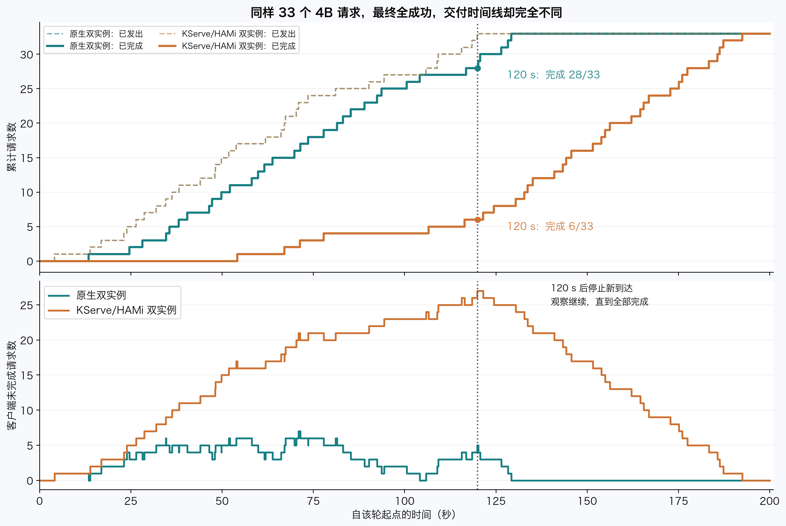
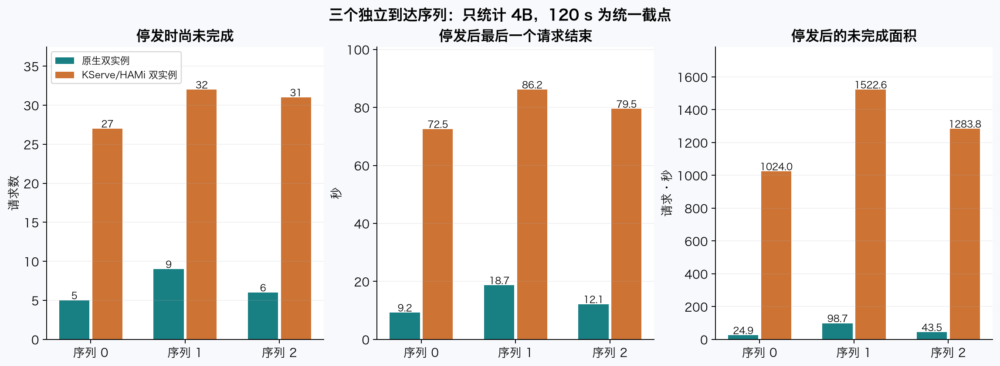
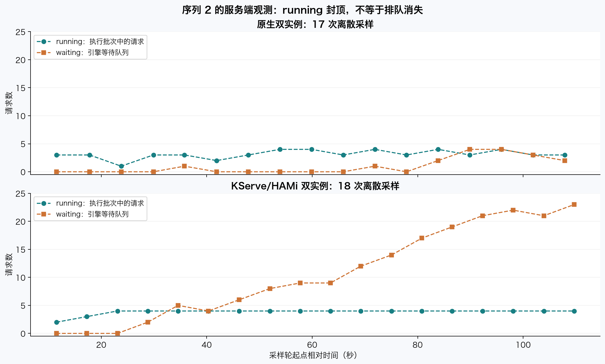
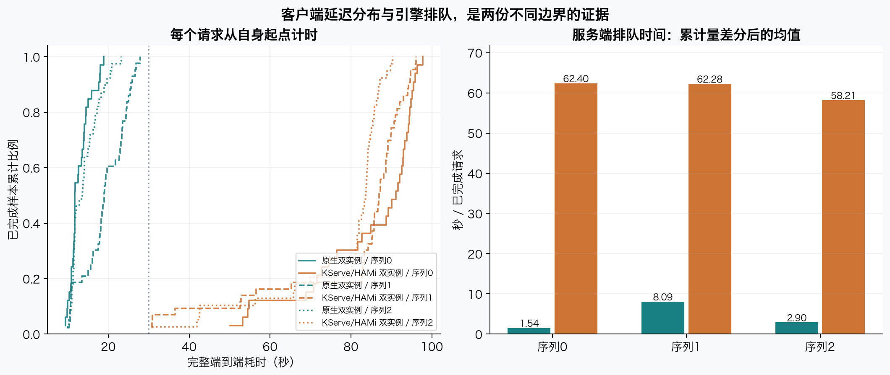
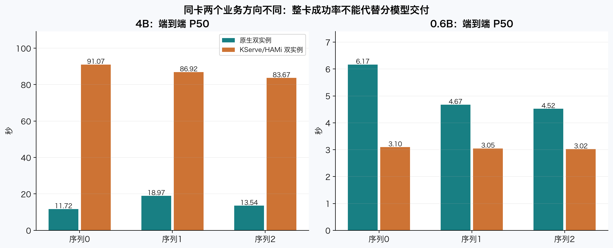

**一次推理压测里，请求最终全部成功，不等于服务跟得上请求到达。在三组真实开环回放中，KServe/HAMi 部署的 4B 服务在停止发流时，分别还剩 27、32、31 个请求没有完成，最后一个请求还要再等 72.53、86.15、79.49 秒。只看最终成功率，这些差异会被全部抹平。**

最容易造成误判的地方，是测试把发流结束和测量结束混成了同一个时刻。测试程序停止制造新请求之后，模型仍在处理存量请求；等到最后一个请求返回，再统计成功数，得到的是这批工作最终有没有做完。业务关心的却往往是：请求持续到达时交付了多少，用户已经等了多久，停止接纳之后还背着多少未完成工作。

下面重新核对三组已经保存的真实请求记录、服务端累计指标和队列快照，用统一时间边界结算这笔账。分析先确认测量过程没有丢请求，再把客户端交付和引擎排队接起来。它是一份部署行为分析，不把不同部署之间的全部差异直接归因于虚拟化库，也不拿有限时长回放宣布芯片的最大容量。

有限批次可以用达标输出速率比较吞吐与延迟。开环压测还要记下发流结束时有多少请求在途，以及它们何时完成。[有限批次里的吞吐与 Goodput]()

## 一、先固定实验对象：这不是“90% 芯片负载”

测试环境是一台 x86_64 服务器上的 Ascend 310P3 板卡，板卡暴露两个逻辑芯片。每种部署内部，Qwen3.5-4B 与 Qwen3-0.6B 两个推理实例共同使用其中一颗芯片。这里的双模型共卡，不是给两个实例各分配一颗独立芯片；也不是把一个模型按 Tensor Parallel 拆到两个设备。

原生组运行两个直接容器实例，使用 chip 1；另一组运行两个 KServe/HAMi 实例，使用 chip 0。框架运行日志中的 vLLM 版本为 0.30.0，采用 vLLM-Ascend 执行路径。两组使用相同推理镜像，但绑定 CPU、服务访问路径和显存预算参数存在差异，因此本文将它们看作两套完整部署。

共同设置包括 FP16、TP=1、eager 执行、关闭前缀缓存，最大上下文为 4096。两个模型的调度配置均为最多 4 条运行序列、每步最多 1024 个批处理 Token；实际缓存容量分别为 26214 和 16384 Token。原生异构组的显存利用率参数为 0.65，KServe/HAMi 组为 0.9；后者两侧配置 dynamic 50% 算力额度，4B 与 0.6B 的虚拟显存上限分别为 16384 与 6144 MB。

这些额度首先是资源与调度配置，不能直接解释成每个实例恰好获得一半设备时间。相同的镜像也不能消除两颗芯片、CPU 绑定和服务路径的影响。本文能够回答哪套部署交付得更慢、队列如何积累；要回答 HAMi 单一开关增加了多少耗时，还需要在同一芯片、相同实例数量和一致资源条件下另做匹配对照。

请求使用流式 completions 协议，输入固定为 128 个 Token，目标输出也为 128 个 Token；设置忽略自然结束符，以实际输出 ID、usage 和完整结束标记共同验收。固定长度减少了模型提前结束造成的工作量差异，但这仍然是受控生成负载，没有覆盖真实聊天模板、自然停止、视觉输入和长上下文行为。

采集器从构造 HTTP 调用之前开始计时，在消费流结束标记及剩余 HTTP 传输字节之后记录总耗时，随后关闭连接。它设置 600 秒总请求期限，并将单次读取保护限制在 180 秒与剩余总期限的较小值。因而，一个耗时约 90 秒、仍持续推进且完整结束的请求完全可能被记为成功；采集器允许等多久，并不是业务愿意等多久。

客户端事先生成两条独立的随机到达序列，每个模型一条，再按时间合并回放。到达间隔取指数分布；每个配对复用同一份计划，并核对输入 ID 数据完全相同。总发流窗口为 120 秒，随后停止新到达，继续等待已经发出的工作全部结束。

目录里的“90%”来自另一组原生闭环校准，而不是芯片利用率。校准按固定客户端并发下的完成数除以包含排空的墙钟时间，分别得到 4B 约 0.370445 请求/秒、0.6B 约 0.864372 请求/秒，再乘 0.9，作为随机到达过程的速率参数。因此，本轮名义速率约为 0.333400 与 0.777934 请求/秒。

随机过程的参数并不保证每个有限窗口恰好产生相同期望数量。三个序列里，4B 实际到达数为 33、43、39，0.6B 为 106、76、75；每个序列内部，两套部署的计划完全相同。把“90% 校准参考”写成“低于真实最大容量所以不该排队”，会把尚未测得的容量当成已知前提。

三组每侧共 372 个请求，两侧合计 744 条结果。逐条复核后，全部具有成功状态、完整结束标记、128 个输入计数和 128 个输出 ID。计划身份与结果身份一一对应，没有客户端拒绝，也没有失败记录。客户端每模型最多允许 64 个未完成工作，本次没有触发这个上限。

回放器也需要检查自身是否拖慢发流。它按目标时刻提交任务，实际请求计时从工作线程开始构造调用时启动；记录两者之差，可以识别本地线程或调度产生的迟发。本轮所有请求都在 120 秒之前开始，六个运行窗口的最大迟发约 18.9 毫秒，远小于随后观察到的数十秒延迟。这个检查不能保证客户端毫无开销，但足以避免把明显的秒级积压解释成测试程序没有按计划提交。

## 二、把同一批请求放回时间线，成功率就不够用了

从第一个到达开始，定义 A(t) 为实际已经发出的请求数，C(t) 为客户端已经确认完整结束的请求数。在本轮没有失败、拒绝和重试的条件下，客户端未完成数就是 U(t)=A(t)−C(t)。这里统计的是客户端仍持有的工作，不是设备正在执行的序列数。

这个边界很重要。一个已经发出的请求，可能还在 HTTP 访问路径里，也可能已经进入引擎等待队列、正在生成，或者正等待最后的响应字节。只要客户端还没有结束，它就仍然计入 U；不能把这张曲线直接改名为服务端 waiting，更不能当成某个时刻占用 KV 的请求数。

取序列 0 的 4B 服务看，两边都发出了 33 个请求。在第 120 秒这个共同截点，原生组已经完成 28 个，剩余 5 个；KServe/HAMi 组只完成 6 个，剩余 27 个。对应的截点完成比例为 84.85% 与 18.18%。这是统一发流窗口的交付观察，不是逐请求时限达标率。



图 1：序列 0，4B 的 33 个真实请求。起点来自各轮单调时钟，结束点为请求起点加完整调用耗时；120 秒后没有新增到达。两条已发出曲线因回放误差而非严格逐点重合，计划到达本身完全相同。

看累计完成曲线，两个部署的差异不是最后少返回了若干请求，而是同一批结果被交付到了完全不同的时间位置。原生组最后一个 4B 请求在约 129.23 秒结束，另一组在约 192.53 秒结束。如果只在两个终点分别生成一行摘要，两边都能写成 33/33 成功。

完成数除以 120 秒，可以描述发流窗口内的完成速率，但不能把全部 33 个最终完成数都塞进这个分子。序列 0 原生组在这个窗口完成 28 个，另一组完成 6 个；把停发后的结果也算进来，又保持分母 120 秒不变，就会将后续交付搬回过去。

反过来，用全部完成数除以完整排空时间，也有正当用途：它描述这一整批工作的平均交付效率。但分母包含开始阶段、持续发流以及最后排空，不能直接命名为长期饱和吞吐。服务在排空时不再接新任务，竞争形态也可能变化，整个有限批次不是一个已经确认平稳的区间。

同样需要避免的是在 120 秒立即截断日志，只对已结束请求计算延迟分位数。那时慢组只留下 6 个已完成的 4B 样本，另外 27 个仍在等待。提前完成者更容易进入统计，慢请求被系统性排除，得到的中位数可能比真实全批分布好看得多。本文等待完整排空后再计算请求延迟，同时另报 120 秒截点状态。

如果生产环境不能无限等待，正确的处理也不是把未完成记录丢掉。应保留截止时尚未结束、明确失败、客户端取消等不同状态，并说明分位数覆盖哪些请求。观察窗口结束是采集事实，不自动等价于模型执行失败，也不自动允许它从用户体验分母中消失。

## 三、排空债务有两种量纲：最后要等多久，与总共积压了多少

三个序列都出现了同方向的交付差异。原生组在 120 秒时的 4B 未完成数为 5、9、6；KServe/HAMi 组为 27、32、31。原生组停发后的额外等待分别为 9.23、18.65、12.12 秒，另一组为 72.53、86.15、79.49 秒。

这里的额外等待，严格定义为 4B 最后一个客户端请求结束时刻减去 120 秒。它不是最后一条请求自身的延迟，也不是整个双模型任务的共同结束时间。不同服务可能在不同时刻排空，所以实例切流、整机维护和业务单独迁移需要分别选择对应边界。



图 2：均由各序列 4B 请求的实际开始与结束时刻计算。三个序列的请求数不同，分别为 33、43、39，保留为三个配对，不把柱子当作同一工作量的三次重复。

最后结束时刻容易理解，却只描述最晚的那一个终点。假如两次测试都在停发后等 70 秒，一次只有一个请求挂到最后，另一次有几十个请求持续挂着，业务负担并不相同。因此还需要计算未完成曲线在停发后的面积。

对每条请求记录实际开始 aᵢ 和结束 bᵢ，停发时刻记为 T。将每个请求与 [T，最后结束] 这个区间的重叠长度相加，就等于 U(t) 在该区间的积分。请求没有提前结束的部分，每多停留一秒，就增加一个“请求·秒”。这只是时间区间的计数恒等式，不要求到达服从泊松，也不要求服务已经进入稳态。

在本轮所有请求均于 T 前发出的条件下，停发后面积可以简化成：

```text
停发后未完成面积 = Σ max(0, bᵢ − T)
量纲：请求·秒
```

序列 0 的原生组面积为 24.92 请求·秒，KServe/HAMi 组为 1024.02 请求·秒；序列 1 为 98.69 与 1522.58，序列 2 为 43.55 与 1283.78。它们没有把请求转换成设备算力，而是在衡量停发以后，客户端还要共同承担多少未完成时间。

面积也能与截点人数配合解释。序列 0 中，慢组停发时有 27 个请求未完成，1024.02 除以 27，得到这些请求在停发之后平均还要等待约 37.93 秒；原生组 24.92 除以 5，约为 4.98 秒。这是截点时仍未完成子集的平均剩余时间，不是全体请求平均延迟，也不是每个请求都还需要等待的固定时长。

只看剩余时间仍然会低估用户已经承受的体验。慢组这 27 个请求在第 120 秒的已等待年龄中位数约为 52.94 秒；原生组剩余 5 个的年龄中位数约为 4.41 秒。把前半段已经等过的时间删掉，再说“停发后平均只等几十秒”，仍然没有描述完整生命周期。

为检查算法没有把区间重复计算，离线程序做了两份独立复算：一份把所有开始记作加一、结束记作减一，对阶梯曲线逐段积分；另一份直接对各请求生命周期求和。在完整观察范围内，两者逐轮相等。对 120 秒前后的面积也分别裁剪，避免把截点以外的时间混进窗口。

这个恒等式与常见的平均在途量、平均延迟关系有关，但这里不需要借助稳态假设。要把有限批次的平均数外推成长期容量，则需要额外证明观察过程足够稳定。三段 120 秒回放展示了实际积压和恢复过程，不能单凭它们确认无限时长下队列必然发散。

从发布或运维看，排空债务意味着旧实例停止接纳后，仍不能立刻回收资源。假设目标是优雅退出，终止等待时间至少需要覆盖真实未完成工作的尾部，或者明确使用取消策略。本文没有执行一次真实滚动升级，因此不能把 86.15 秒写成某个集群应该固定设置的 termination grace period；它提供的是选择该预算时不能遗漏的测量对象。

## 四、沿着服务端指标和源码，确认时间花在了哪一层

客户端曲线证明了交付积压，但它不能单独区分 HTTP 访问等待、引擎队列和模型执行。下一步需要检查同一运行窗口里的服务端指标，而不是看见首段很慢，就直接断言 Prefill Kernel 很慢。

序列 2 的 4B 首个有效流分片延迟中位数，原生组为 2.66 秒，KServe/HAMi 组为 72.48 秒。这里从客户端开始调用计时，到收到第一条带文本或输出 ID 的流事件为止，包含请求进入服务、排队、首次计算和交付。它不能直接等同于设备 TTFT，更不能拿 72.48 秒去与一个注意力 Kernel 的持续时间比较。

查看 10 至 110 秒之间的离散采样，原生组有 17 个观测点，4B 的 running 中位数为 3，waiting 中位数为 0；另一组有 18 个点，running 中位数为 4，waiting 中位数为 9，最大一次 waiting 读数为 23。这为“引擎侧确实存在等待队列”提供了直接证据。



图 3：真实服务端 Gauge 快照，时间按采样轮起点对齐。监测器依次查询，点间隔约 6 秒且并不完全相等；虚线仅帮助跟随观测点，不代表连续测量，也不据此计算精确队列时间积分。

这里至少有三种“并发”：客户端已发出但未结束的工作、引擎 waiting 队列，以及进入模型执行批次的 running 请求。把它们混成一个数字，就会误以为 running 始终为 4，客户端最多也只会积压 4 个。实际上，限制同时运行序列数，并没有自动限制入口接受多少待处理请求。

固定检查 vLLM v0.30.0 的 Scheduler，可以看到初始化将 max_num_seqs 赋给最大运行请求数；在从 waiting 队列选择请求的循环里，当运行数量达到这个上限时，停止继续接纳到运行集合。这解释了为什么上限为 4 时，running 可以停在 4，waiting 却继续存在。[对应调度源码](https://github.com/vllm-project/vllm/blob/ced6857afa0ea7b2e3f0846a62e1394e90f15607/vllm/v1/core/sched/scheduler.py#L850)

这个源码分支不是对所有等待原因的完整解释。Token 预算、缓存分配、阻塞状态等条件也参与调度；一个 running 请求也不意味着每个瞬间都独占设备执行。当前快照足以说明批次槽位上限与入口积压可以同时存在，不足以证明所有队列时间都只由这一行判断造成。

离散 Gauge 还回答不了平均每个请求排了多久。为此，复核每轮开始前与完整结束后的 request_queue_time_seconds 累计量：先分别相减，再以 sum 增量除以 count 增量。不能直接拿进程启动以来的累计 sum 除以 count，因为其中还包含预热和之前轮次。

序列 2 的原生 4B 队列计数从 193 增至 232，新增 39 个；累计排队时间新增约 113.20 秒，平均 2.90258 秒。另一组同样新增 39 个，累计时间新增约 2270.07 秒，平均 58.20682 秒。两边输入、输出 Token 计数都各增加 4992，恰好对应 39×128，与客户端的完整工作量对上。

其余两个序列也保留相同对账。三个序列的 4B 平均引擎排队时间，原生组分别为 1.54、8.09、2.90 秒，KServe/HAMi 组为 62.40、62.28、58.21 秒。六轮的对应计数增量分别与各自请求数一致，抢占计数没有新增；没有将长期累计值当成某一轮测量值，也没有发生计数重置后仍机械相减的情况。



图 4：左图保留三个序列各自的 4B 客户端完整延迟分布；右图为服务端 Histogram 的 sum/count 增量之比，是均值，不是 P50。左图 30 秒竖线仅用于后文的示例时限分析，不是已经部署的业务 SLA。

源码还定义了这个排队时间的具体含义。在所核对版本的事件统计里，收到 QUEUED、SCHEDULED 等事件后保存时间戳，结束时以首次调度时间减去入队时间生成 queued_time，再写入 Histogram。它描述引擎事件之间的等待，不包含客户端发起到引擎入队之前的全部服务访问路径。[事件统计源码](https://github.com/vllm-project/vllm/blob/ced6857afa0ea7b2e3f0846a62e1394e90f15607/vllm/v1/metrics/stats.py#L505) [指标写入源码](https://github.com/vllm-project/vllm/blob/ced6857afa0ea7b2e3f0846a62e1394e90f15607/vllm/v1/metrics/loggers.py#L1139)

因此，58.21 秒这个均值不能直接从客户端 83.67 秒的中位数里减掉，再宣布剩下的 25 秒就是纯计算。一个是服务端均值，一个是客户端中位数，统计操作已经不相容；即使统一为均值，剩余部分仍包含多个层次，需要逐请求关联才能精确分解。

更不能将客户端第 120 秒的未完成数，减去附近采样的 running，再把差值叫作精确 waiting。监测查询是顺序执行的，客户端与服务端事件也没有同一个原子截点。两种证据可以相互印证有积压，却不保证每个采样时刻都能逐项相等。

现有证据已经能排除一种过早解释：不能把数十秒的首分片延迟全部视作注意力计算时间。它也把下一步排查范围缩小到了业务进入与离开运行集合的节奏、共享设备上的执行推进，以及对应资源配置。本文没有同轮逐请求关联的完整设备 Trace，因而没有为某个 Kernel、网络跳点或虚拟化函数分配具体延迟百分比。

## 五、小模型反而更快：为什么总吞吐和平均延迟会误导

这组实验不是所有业务一起变慢。三个序列中，原生 4B 的完整端到端 P50 为 11.72、18.97、13.54 秒，KServe/HAMi 组为 91.07、86.92、83.67 秒；0.6B 的方向相反，原生组为 6.17、4.67、4.52 秒，另一组约为 3.10、3.05、3.02 秒。



图 5：两种部署的每个配对复用相同请求计划与输入数据；不同序列样本数不同。图中是各模型、各序列的请求延迟中位数，没有将两个模型混合后计算一个总体分位数。

这说明平台验收必须保留业务身份。若某模型改善、另一个模型退化，只报整卡总成功率，无法回答每个用户是否获得了可接受的服务。即使总输出 Token 数相同，结果也可能在两个业务之间、以及发流与排空阶段之间重新分布。

混合延迟还受到请求数量的权重影响。序列 0 中，0.6B 有 106 个请求，4B 只有 33 个；在一个忽略模型标签的总体分布里，小模型的样本占多数。小模型改善可以让整体分位数看起来不错，同时让少数但更重要的 4B 业务持续等待。整体统计可以保留，但需要与分模型结果同时报告。

同一个输出 Token 在服务质量上也不必然具有相同价值。不同模型承担不同任务，完成 128 Token 的小模型请求，不能自动抵消一条超出交互时限的大模型请求。要比较平台是否满足业务，吞吐应按任务类型和时限分层，而不是只把所有 Token 相加。

这仍然不能直接证明调度器偏爱小模型，更不能把 dynamic 50/50 解读成“两个请求应该一样快”。两个模型每步工作量、请求频率与批次状态不同，配置份额也不等于完成速率份额。观察到相反方向的交付变化，只能说明当前部署组合的收益与损失分布不均，需要进一步用同条件干预解释原因。

利用相同计划，还可以为同一逻辑到达事件配对。这里先按模型与序号关联，再计算每个请求在两套部署中的延迟差，最后取中位数。4B 三个序列的配对延迟差中位数分别约为 76.47、67.06、68.05 秒。这与直接相减两组中位数不是同一个运算，不能交换计算顺序。

配对消除了“恰好发了另一批到达事件”的一部分混杂，却没有消除运行位置和执行顺序。两侧不是同一时刻在同一芯片上运行，所以这个差值描述当前配对部署的交付变化，不能升级成某个组件的纯开销或硬件固有差异。

另一个常被混淆的条件，是“120 秒窗口内完成”和“每个请求 120 秒内完成”。前者以整个测试的共同起点为参照；后者从每条请求自身的开始计时。一个第 119 秒发出、耗时 3 秒的请求，会错过共同截点，但仍然满足自身 3 秒时限。两种指标适用于不同问题。

为了展示这种区别，可以对已经完成的真实耗时应用一个明确标为示例的 30 秒请求时限。三个序列里，原生 4B 的 33、43、39 个请求全部在自身开始后 30 秒内结束；另一组对应为 0、0、0。若将示例时限放宽到 120 秒，两边所有 4B 请求又都达标。这是对同一批数据采用不同验收条件，并不是新做了两组实验。

示例时限不能冒充产品已有 SLA；它的用途是说明最终成功率没有携带时限含义。真正的业务验收应事先约定首段、持续输出和完整结束的要求，再统计同时满足这些约束的成功请求。vLLM 的公开基准实现也将成功完成与满足 goodput 阈值分别处理，二者不是同一个计数。[固定版本基准实现](https://github.com/vllm-project/vllm/blob/ced6857afa0ea7b2e3f0846a62e1394e90f15607/vllm/benchmarks/serve.py)

若以 120 秒为观察分母，统计本轮发出的请求最终有多少满足示例 30 秒时限，可以得到一个按到达批次验收的数量或速率；但它不是严格在 [0,120] 内已经交付的结果。定义分子时是否允许终点落在排空阶段，必须写清楚，否则“有效吞吐”也会重复之前的窗口错误。

## 六、这些证据如何改变容量验收和调优顺序

先从最简单的流量守恒看。序列 0 的 4B 在 120 秒内实际发出 33 个请求，慢组完成 6 个，净新增未完成工作为 27 个。对应窗口平均到达为 0.275 请求/秒、完成为 0.05 请求/秒，两者之差为每秒积累 0.225 个请求。这是本轮真实事件的有限窗口账，不是以抽样 GPU 利用率估算出来的负载。

它说明在这个窗口内，交付没有跟上到达；但不能直接把 0.05 当成该服务永远只能达到的处理能力。刚开始的爬升、两个模型的竞争和批次组合都会改变完成节奏。停发后 27 个存量请求在约 72.53 秒内完成，观察到的排空完成速率又不同于发流期间，足以提醒我们不要假定一个不随状态变化的常数服务率。

因此，进一步测容量时，应该固定模型组合和请求形状，分档改变到达参数，保留实际迟发、拒绝、完整延迟和未完成曲线。每一档都要知道队列是短暂起伏后恢复，还是在该观察窗口持续累积；需要延长或重复观察来区分随机突发和可持续交付不足。本轮三个种子提供了重复方向，尚没有给出完整的长期速率扫描。

也不应只看平均 Token/s 决定扩容。对交互业务，可以先定义各模型可接受的首段与完整结束目标，再检查达标交付随到达率如何变化。对离线任务，允许较长排空也许是合理选择，但应把完成期限、未完成面积和回收时间放进容量预算。相同硬件上的两个业务，可能需要不同的验收函数。

针对已有积压，入口并发上限和引擎运行上限解决的是不同问题。客户端的 64 个 outstanding 上限保护的是测试端，服务端的 max_num_seqs=4 约束的是运行集合；二者之间仍可能容纳等待。要控制用户可接受的积压，需要在承担请求责任的入口设置明确队列预算，并将拒绝、排队超时与完整失败分别记录。

限制入口可以减少无限等待，却不会凭空提升设备计算能力。如果把第 65 个请求拒绝，最终成功率的分母就必须包含这个决策造成的未交付；否则只是把慢请求从结果里拿走。若业务允许重试，还要记录逻辑请求与每次尝试的关联，避免多个尝试同时消耗资源而被统计成新增业务量。

时限也必须沿链路传递。客户端超时后，服务端是否真正停止生成、归还请求槽位和缓存，属于需要验证的正确性条件；仅断开 HTTP 连接不能被当成已经完成资源取消。本文的真实样本没有失败或取消，因而没有用这批成功记录证明某个部署的取消链路已经正确。

提高运行上限则是在改变批次和资源使用。更多序列可能改善设备利用，也可能增加每步执行时间、缓存占用与单请求等待；共享芯片上还会影响另一个模型的推进。当前看到 running=4、waiting 较高，只能说明该处值得做上限干预，不能据此承诺把上限翻倍就能让吞吐翻倍。

一项有解释力的后续对照，应该一次只改目标实例的运行上限，保持输入、到达计划、另一实例配置和资源视图一致，同时比较分模型交付、排空、队列与设备执行。若 4B 改善而 0.6B 恶化，平台需要的是业务优先级取舍；如果两边都没有改善，则要继续查共同设备上的推进和运行时瓶颈，而非反复增加入口排队。

做单组件归因，还要先补齐部署匹配。这次原生与 KServe/HAMi 分别使用不同芯片，CPU 绑定和资源视图也有差异。将它们直接相减，能反映实际交付结果；要判断库加载、入口路径或共享策略的贡献，需要分别固定其他条件。先量化问题，再收紧对照，才不会因为发现排队，就把某个最显眼的组件当成唯一原因。

复核工具本身也应具有可检查的契约。当前离线程序先验证计划与结果的模型、序号集合相等，再验证成功状态、流结束和 Token 数；随后检查所有开始时刻、迟发值以及累计指标差分。最后分别用事件扫描与生命周期求和核对面积，而不是只让一段绘图代码输出一张看起来合理的曲线。

这样的记录足以让后来者重新划分窗口，而不必接受作者预先选择的摘要。最小必要数据包括匿名请求身份、计划与实际开始、首个有效分片、完整结束、结果状态、输入输出计数，以及服务端指标的实例身份和采样边界。请求正文并不是这项排空分析的必要字段；保留这些计时和状态事实，已经可以重建本文的主要结论。

## 结论

这批 744 条客户端结果最终全部成功，但三组配对里，4B 的发流期交付、停发后排空和服务端排队时间都有明显差异；0.6B 的延迟方向又与 4B 相反。一个整卡成功率或总输出数，无法概括这样的服务质量。

容量验收至少应同时保留三张账：请求持续到达时完成了多少，截止点仍欠着多少，以及这些请求在自己的业务时限内是否交付。把排空阶段重新放回时间线，才能看见“最后都成功了”背后，用户和平台实际承担的等待。

## 附录：面积复算的最小形式

以下针对同一客户端计时边界；rows 已通过完整性校验，start_s 与 end_s 均相对本轮起点。实际分析还分别校验计划、结果与服务端计数，不能用这几行代替采集验收。

```python
T = 120.0
started = sum(r['start_s'] <= T for r in rows)
finished = sum(r['end_s'] <= T for r in rows)
unfinished = started - finished  # 本轮无失败、拒绝或重试
last_end = max(r['end_s'] for r in rows)
drain_seconds = max(0.0, last_end - T)
post_area = sum(
    max(0.0, r['end_s'] - max(T, r['start_s']))
    for r in rows
)  # 请求·秒；客户端未完成时间，不是引擎排队或设备时间
```

## 资料来源

- 本文实测证据：三组固定到达序列，两种部署，每侧 372 个真实请求；逐请求客户端计时、每轮前后服务端累计量、同轮离散队列快照。图 1—5 均从这些记录复算，未采用合成性能数据。
- [vLLM v0.30.0 Scheduler：运行集合上限及 waiting 接纳路径，固定提交 ced6857](https://github.com/vllm-project/vllm/blob/ced6857afa0ea7b2e3f0846a62e1394e90f15607/vllm/v1/core/sched/scheduler.py)
- [相同版本的引擎事件统计：入队、首次调度与完成时计时](https://github.com/vllm-project/vllm/blob/ced6857afa0ea7b2e3f0846a62e1394e90f15607/vllm/v1/metrics/stats.py)
- [相同版本的 Prometheus 指标定义及 Histogram 写入](https://github.com/vllm-project/vllm/blob/ced6857afa0ea7b2e3f0846a62e1394e90f15607/vllm/v1/metrics/loggers.py)
- [相同版本的在线基准实现：到达间隔与 goodput 阈值统计](https://github.com/vllm-project/vllm/blob/ced6857afa0ea7b2e3f0846a62e1394e90f15607/vllm/benchmarks/serve.py)
