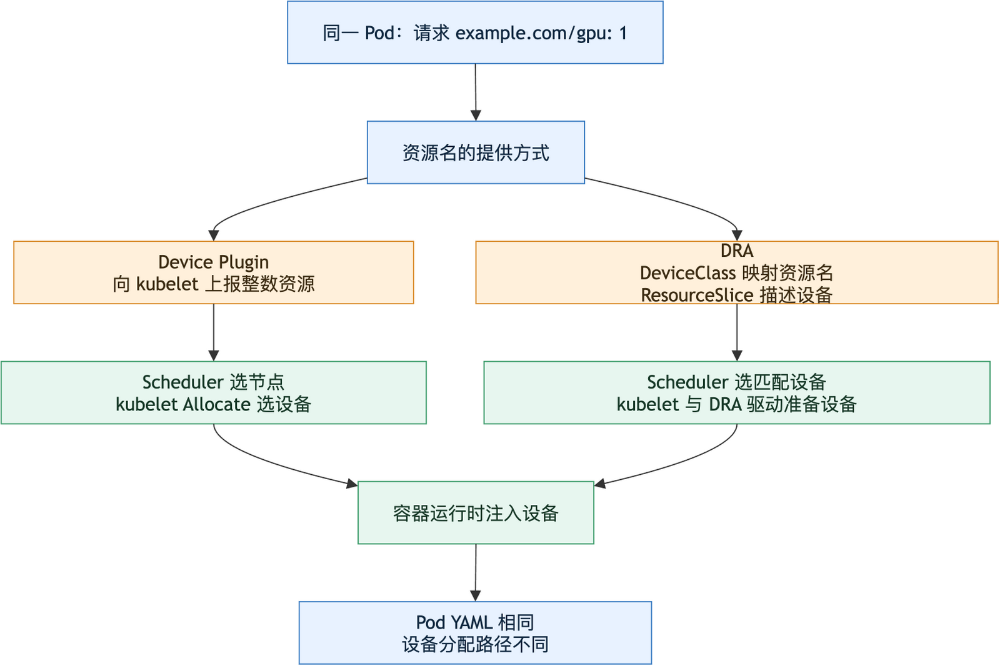
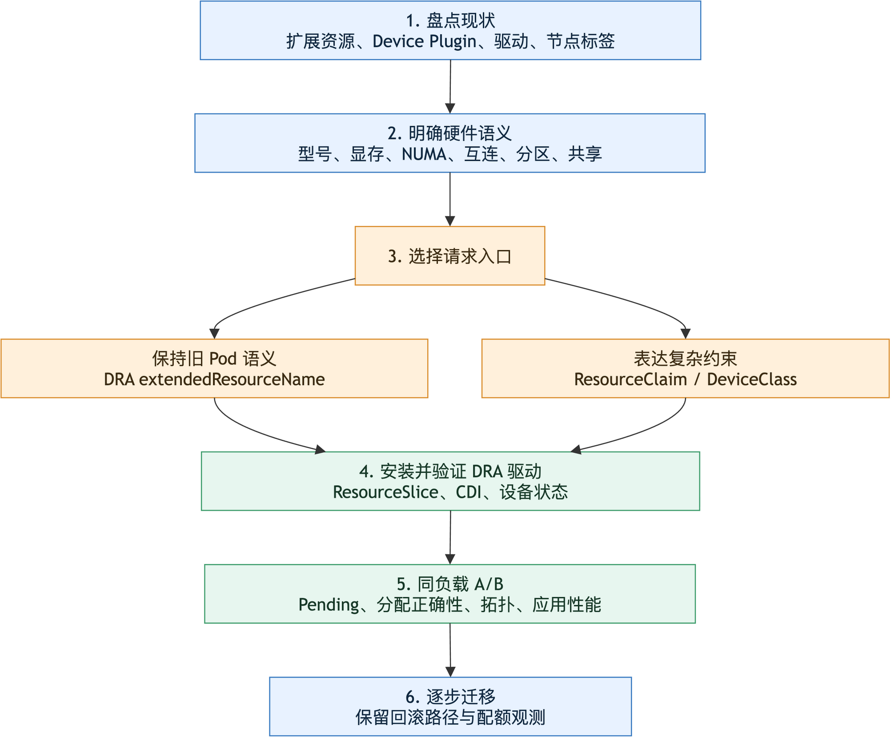

*封面图：原创概念视觉，表达从整数资源请求到设备属性分配的变化；不是实际集群拓扑。*

手里如果已经有一批写着 `example.com/gpu: 1` 的 Job，换 DRA 驱动时要改多少业务 YAML？查 Kubernetes 1.37 的发布说明，可以从集群侧做一轮试点。给 DeviceClass 配上同名扩展资源，旧 Pod 继续按整数申请。1.37 进入 GA 的就是这条兼容路径。[1][2]

## 从一条 GPU 请求看 Device Plugin {#一先看旧模型kubernetes-为什么只认几张卡}

先沿着旧 Pod 刨一遍。Device Plugin 注册 `nvidia.com/gpu` 之类的资源名，持续把设备列表和健康状态报给 kubelet。节点对外公布数量，调度器看容器请求的整数在这个节点还放不放得下。[3]

真正的设备 ID 分配与容器注入，发生在节点侧。容器创建时，kubelet 调用 Device Plugin 的 `Allocate`；插件可以返回设备节点、环境变量、挂载、注解或 CDI 设备名，让容器运行时完成访问配置。也就是说，Pod 里写的 `gpu: 1` 并不是某一块 GPU 的身份，更不是显存、互连或应用性能的承诺。[3]

这种模型很实用：工作负载只需声明数量，平台也能比较容易地部署。它的局限同样清楚。扩展资源本质上是整数，无法在原生请求里直接表达“显存至少多少”“与另一块 GPU 处于什么拓扑关系”“需要哪种分区能力”。Kubernetes 的 GPU 调度文档也说明，混合型号集群往往需要额外依赖节点标签与亲和性。标签能筛节点，但它不是结构化的单设备属性选择。[3][4]

这不是说 Device Plugin 一无是处。它的 API 长期稳定承载了大量 GPU 工作负载，节点侧也可以通过 `GetPreferredAllocation` 提供设备选择建议。问题在于，调度器首先面对的是按资源名汇总的数量；更细的设备选择往往被推迟到节点上，或需要平台自己建立额外协议。对于同型号整卡分配，这种简单性可能正合适；对于混合卡型、分区、共享与复杂拓扑，信息损失就会逐渐显现。[3]

如果故障涉及具体卡型或拓扑，只看 `kubectl describe pod` 往往只拿到一个资源名。还得回头核对节点标签、Webhook 注入的约束、设备插件的分配记录，以及平台扩展在哪一步补了信息。

## 跟着 DRA 对象走一遍 {#二dra-改变的是设备描述与分配边界}

换到 DRA 路径，可以按对象找证据。ResourceSlice 由驱动发布，记录设备池、属性、容量和可访问节点。DeviceClass 定义筛选条件和配置，ResourceClaim 或 ResourceClaimTemplate 承接显式设备请求。调度器会按这些条件选设备。[5][6]

这套对象不是为了让每个业务 Pod 都写复杂 YAML。DeviceClass 的价值恰恰在于把硬件细节收进平台边界：业务侧可以说“我要这一类设备”，平台侧定义这一类设备具体满足哪些属性。Kubernetes 官方文档列出的收益包括基于 CEL 的细粒度筛选、设备共享、按工作负载配置和集中分类；这些能力需要相应 DRA 驱动与配置支持，不是升级控制平面后自动获得。[5]

分配和实际可用之间仍有一个节点侧动作。DRA 驱动需要发布准确的 ResourceSlice，并与 kubelet 协作准备设备，把设备访问交给容器运行时；官方文档描述了通过 CDI 注入容器的路径。[5][6] 所以 DRA 不是“调度器自己会操作 GPU”，而是把设备信息、选择条件和准备动作放进更明确的协议里。

*图 1：根据 Kubernetes Device Plugin 与 DRA 文档重绘的通用流程。两侧表示同一扩展资源请求可能对应不同分配机制；图中不表示某个现成 GPU 驱动已完成迁移。*

## 在 DeviceClass 上接住旧资源名 {#三137-的桥梁旧请求如何接入新分配}

先在测试集群确认版本。1.34 的发布说明记录了 DRA 核心 API 进入 GA。到 1.37，扩展资源兼容路径进入 GA。管理员配置 `DeviceClass.spec.extendedResourceName`，例如 `example.com/gpu`，旧 Pod 就可以沿用原资源名。工作负载 YAML 无需显式声明 ResourceClaim。[1][2][8]

验收时仍然查 claim。兼容路径会生成用于分配的 claim。业务提交时少写一个对象，平台侧仍可以顺着它查选中了什么设备。[2]

举个不带厂商假设的例子：原本某个 Job 模板只有 `limits: {example.com/gpu: 1}`。迁移后模板仍可保留这行；变化发生在集群侧，驱动发布 ResourceSlice，DeviceClass 用选择条件圈出符合该资源名的设备。调度器不只是看到节点上的总数，还能在 DRA 路径里找出具体匹配设备。这个例子只说明接口兼容性，不说明任何已有 GPU 插件会自动转换成 DRA 驱动。[1][2]

过渡期可以让一部分节点通过 Device Plugin 提供某个扩展资源名，另一部分节点通过 DRA 提供同名资源。[2] 逐节点迁移时，要核对资源名、设备身份和配额，并明确每块物理设备由哪条路径提供，避免重复计入容量。

API 参考还提醒，`extendedResourceName` 应在 DeviceClass 之间保持唯一。若多个 DeviceClass 意外使用同名，系统有选择规则，但这不等于应该依赖这种规则做业务路由。[7] 对平台维护者来说，资源名是兼容契约，不只是一个字符串；更换背后的提供者之前，应确认用户原来以为拿到的设备能力是否仍然成立。

## 沿用原来的 Pod 时要验什么 {#四不改-pod-yaml究竟保留了什么丢了什么}

如果现有 Deployment、Job 和训练 Operator 都按同一个资源名生成 Pod，可以先挑少量节点切换驱动，保留这些模板。等分配和应用验证都通过，再逐批扩大范围。[1][2]

保留的还包括旧接口的一部分限制：扩展资源请求仍按数量表达，不会因为背后改由 DRA 分配，就自动获得“按显存容量请求 0.5 张 GPU”这样的语义。DRA 其他功能可能支持设备共享或可消费容量，但能否用于某个硬件、以什么粒度提供，取决于驱动、DeviceClass 和具体功能状态。不要把 DRA 的能力清单误读为一个旧 `gpu: 1` Pod 已经拥有的能力。[5]

但整数请求仍然只是整数请求。如果业务真正需要“至少 80 GB 显存”“两张卡彼此高速互连”“可切分但不能与别的租户共享”，旧 Pod 语法无法把这些约束逐项说清。管理员可以用 DeviceClass 定义一个较固定的类别，可当同一类里还存在多种选择、不同任务要不同配置时，显式 ResourceClaim 才能表达更丰富的选择与配置。把 DRA 接在旧资源名后面，并不会自动让旧 YAML 变成完整的硬件意图。[5][6]

也不要把“设备分配成功”当作应用性能保证。DRA 可以让调度器看到更细的属性，驱动可以准备设备，但 GPU 训练或推理是否达到目标，仍受驱动、容器运行时、NUMA、PCIe/NVLink、批量与模型配置影响。对 AI Infra 来说，DRA 改善的是设备请求和分配的表达力，性能仍要通过目标负载压测证明。

最后还有一个容易被跳过的调度边界：Kubernetes 官方 DRA 概览指出，DRA 资源当前不支持通过优先级抢占正在使用它的 Pod；高优先级 Pod 可能继续 Pending，直到设备释放。[5] 因此，训练队列、交互式推理和在线服务共用设备池时，不能只把旧资源名迁过来，还要检查原先依赖的优先级、排队和抢占预期。

## 一份逐节点迁移记录 {#五平台迁移应该按什么顺序验收}

我的迁移表会先列出资源名、原 Device Plugin、运行时注入、节点标签与拓扑、配额、监控，再注明每个资源名代表整卡、分区、共享份额还是能力类。旧 Pod 的兼容项写 `extendedResourceName`。需要按作业表达更细约束的项，再评估显式 ResourceClaim。[2][5]

第四步检查驱动闭环。ResourceSlice 是否准确发布每个设备和可访问节点？设备健康变化是否能及时反映？调度器选中的设备，kubelet 和 DRA 驱动是否真正准备了同一设备？容器内看到的设备、驱动版本、权限和 CDI 注入是否正确？这些问题比“Pod 已经 Running”更接近迁移成败。[5][6]

第五步做同负载 A/B：相同模型、相同请求或训练任务，在旧 Device Plugin 与 DRA 路径下分别记录 Pending 时间、分配失败、设备 ID/拓扑、容器可见性和应用性能。若某个环节变化，先区分是资源调度语义变了，还是节点运行时配置变了。不要拿只跑通一次样例 Pod 当作生产验收。

迁移测试还应覆盖不那么顺利的路径：设备在分配前变为不健康、驱动进程重启、Pod 删除后设备清理、同资源名在新旧节点间调度，以及配额接近上限时的行为。正向样例证明功能存在，异常路径才证明平台知道如何恢复。监控至少要能把 Pod、ResourceClaim、ResourceSlice、DeviceClass、节点和设备标识串起来，否则出错时仍会回到“只知道某个 Pod Pending”的老问题。

*图 2：原创迁移检查清单，不含实测数据。每一步是平台验收建议，并非 Kubernetes 自动执行的迁移流程。*

试点前也写清回滚动作。出问题时要能回答 Pod 走的是哪条分配路径，拿到哪块设备，卡在调度还是设备准备。新旧节点共用同名资源期间，继续检查配额和设备是否重复计入。

## 迁移范围 {#结论}

这份笔记核对的是 Kubernetes 1.37 提供的迁移接口。落到集群时，先选一个已有资源名和少量节点，用实际工作负载检查分配、注入和性能。遇到显存、互连或共享要求，另外核对驱动和 DeviceClass 能表达的条件。

## 资料来源

[1] [Kubernetes v1.37 DRA 更新](https://kubernetes.io/blog/2026/09/03/kubernetes-v1-37-dra-updates/)

[2] [Kubernetes 文档 · 由 DRA 分配扩展资源](https://kubernetes.io/docs/concepts/resource-management/dynamic-resource-allocation/dra-api/#extended-resource-allocation-by-dra)

[3] [Kubernetes 文档 · Device Plugins](https://kubernetes.io/docs/concepts/extend-kubernetes/compute-storage-net/device-plugins/)

[4] [Kubernetes 文档 · GPU 调度](https://kubernetes.io/docs/tasks/manage-gpus/scheduling-gpus/)

[5] [Kubernetes 文档 · Dynamic Resource Allocation](https://kubernetes.io/docs/concepts/resource-management/dynamic-resource-allocation/)

[6] [Kubernetes 文档 · DRA 如何工作](https://kubernetes.io/docs/concepts/resource-management/dynamic-resource-allocation/how-dra-works/)

[7] [Kubernetes API 参考 · DeviceClass](https://kubernetes.io/docs/reference/kubernetes-api/resource/device-class-v1/)

[8] [Kubernetes v1.34 DRA 更新](https://kubernetes.io/blog/2025/09/01/kubernetes-v1-34-dra-updates/)
