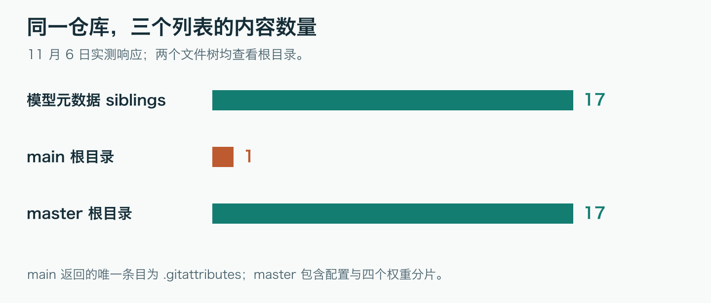
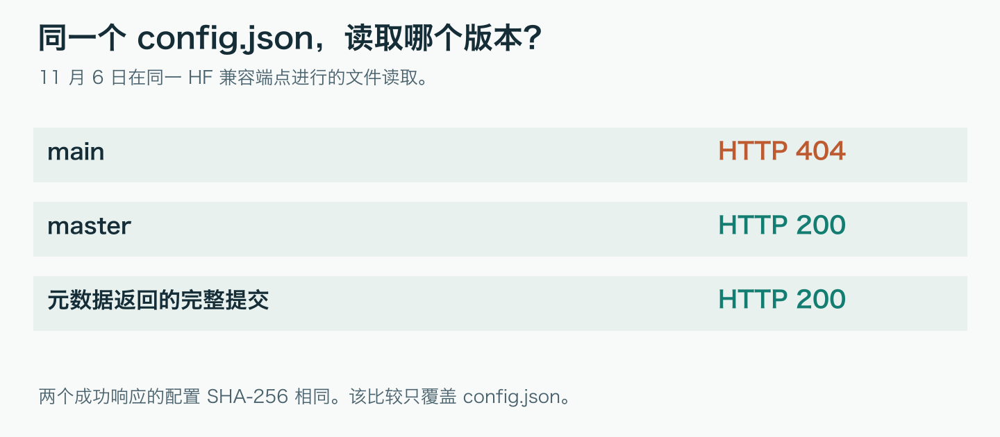

部署 Qwen3.5-9B 时，同一套 Hugging Face 兼容服务给出了三种看似矛盾的结果：模型元数据列出 **17 个文件**，`main` 文件树却只有 **1 个文件**，读取 `main/config.json` 返回 **404**。改用 `master` 后，配置可读，KServe 下载器随后完成了 17 个文件、约 19.3 GB 的模型下载。问题要沿仓库、revision、文件和下载客户端的实际调用逐项核对，单看模型列表能否打开，很难判断推理初始化能走到哪一步。

## 一、把同一模型的几个响应并排看

图一｜11 月 6 日在同一镜像站采集的 HTTP 响应。元数据按 siblings 数量计数，文件树按本次返回的条目计数。

模型元数据接口返回成功，siblings 中包含配置、分词器、模板、权重索引以及四个 safetensors 分片。继续读取显式的 `main` 文件树，响应同样是成功，但只有 `.gitattributes`。显式的 `master` 文件树则返回 17 个文件，包含配置和四个分片。这里两次文件树都只查看根层级。本例需要的这些文件就在根目录，计数没有把尚未遍历的子目录当成缺失文件。

再直接请求同一个文件，`resolve/main/config.json` 返回 404，`resolve/master/config.json` 返回 200，后者的配置声明了 Qwen3.5 的模型架构。这一步把“仓库存在”与“某个 revision 上的文件存在”拆开了。即使客户端能读到模型名称和说明，也可能在下一次带分支的文件请求上失败。若只把第一个成功响应当成整个下载路径健康，就会漏掉这个分岔。

这些结果记录的是这套兼容服务在该时点的行为。它们足以指导本次部署选择可读的 revision，却没有单独证明为何元数据和 `main` 文件树呈现不同内容。要修服务端，还需进一步核对默认分支映射、仓库同步状态和元数据缓存来源。此时先记录每条请求实际带了哪个 revision，可以避免把一个具体文件的错误泛化成整套模型服务不可达。

HTTP 状态还要与具体响应内容一起保存。文件树返回 200，只能证明服务成功返回了一份列表，无法保证列表包含模型运行需要的文件。模型配置返回 200，也应验证 JSON 是否能解析、架构字段是否符合目标模型，避免把登录页面或错误包装当成配置。本次保留了每个请求的状态、响应体大小和文件数，对成功配置另算内容哈希。复核时可以直接对这些字段比较，无需公布内部地址和凭证。

## 二、revision 会进入下载器的每一层

Hugging Face 下载接口允许用分支、标签或完整提交哈希指定版本。客户端省略 revision 时通常使用 `main`。因此，换一个兼容端点后，即使模型 ID 相同，原来的默认分支假设也需要验证。环境变量决定请求发给哪套服务，revision 决定在该服务的哪一个仓库状态读取文件。这两个维度都会影响最后拿到的内容。 [Hugging Face 版本化下载说明](https://huggingface.co/docs/huggingface_hub/guides/download)

KServe v0.20.0 的 `Storage._download_hf()` 支持 `hf://owner/model[:revision]`。它在模型名后按冒号拆出 revision，再调用 `snapshot_download(repo_id=..., revision=..., local_dir=...)`。本次部署使用了该 URI 形式，生成的 storage initializer 参数明确包含 `:master`，下载日志也记录了相同的源 URI。运行中的初始化镜像来自内部构建，公开源码用于核对这一参数传递方式，实际参数和下载成功以部署产物为准。 [KServe v0.20.0 Hugging Face 下载路径](https://github.com/kserve/kserve/blob/v0.20.0/python/storage/kserve_storage/kserve_storage.py)

有一个容易踩的语法差异。某些 Hugging Face CLI 版本接受带 `@revision` 的 HF URI，而这里经过的是 KServe 自己的存储 URI 解析。不能把一种工具支持的字符串直接复制给另一种工具，就假设它会拆出同样的仓库和版本。排查时可以直接看最终 init container 的参数，再核对下载器把它传给 SDK 的哪个参数。这样比只看最外层 YAML 更接近实际执行。

分支名还会移动。明确写出 `master` 可以解决本次默认分支选择，但复跑时分支可能已有新提交。如果目的是长期复现实验，应继续记录实际解析出的完整提交，以及关键配置、模板、索引的校验值。只把镜像 tag 固定下来，而让权重和模板随分支变化，后续性能或输出行为一旦改变，就很难判断变化来自运行时还是模型内容。

另外，提交身份属于特定仓库和服务的版本空间。兼容站从另一种模型仓库同步内容时，可能保留源端提交，也可能生成本地提交。一个看似完整的哈希，仍然需要拿到目标服务上验证能否解析。不能因为在源站存在，就假设镜像站一定接受。这里先实际读取元数据所报提交，再比较文件内容，依靠的是文件读取证据。若后续要固定它进行部署，还应确认索引和全部分片也处在同一份可解析快照中。

## 三、为什么直接访问 main 失败，仍要继续查提交哈希

图二｜同一时段对同一 config.json 的三次读取。分支 main 返回 404，master 和元数据所报的完整提交均返回 200。两个成功响应的内容哈希相同。

模型元数据还给出一个完整提交哈希。沿这个哈希读取 `config.json` 也成功，而且与 `master` 的配置响应计算得到相同的 SHA-256。这个结果提供了额外定位：在这组观测里，文件经完整提交可以解析，失败集中在显式 `main` 路径。它仍然没有证明两条仓库快照的全部文件都逐字一致，因为这里只比较了一个配置文件。

为什么这一项会影响对下载报错的判断？看一个公开的 SDK 实现，huggingface_hub v1.0.0 的 `snapshot_download()` 先请求指定 revision 的仓库元数据，再从 siblings 枚举文件，并将返回的提交哈希交给逐文件下载。它可能先解析分支，再沿提交下载文件。直接访问一个带分支的 resolve URL，和 SDK 下载整个仓库，未必逐条经过相同的 URL。定位时应检查实际安装的 SDK 版本与调用路径。 [huggingface_hub v1.0.0 的快照下载实现](https://github.com/huggingface/huggingface_hub/blob/v1.0.0/src/huggingface_hub/_snapshot_download.py)

因此，这次没有把一次手工读取 `main` 的 404 写成“默认整仓下载必定失败”。部署采用了已经验证文件树和配置均可访问的 `master`，并进一步执行完整下载。若要比较省略 revision 与显式分支是否真的行为不同，应让相同版本 SDK、相同凭证和缓存条件分别走完整路径，记录元数据解析到的提交和后续请求，再判断差异在哪里。

这也解释了为什么接口测试需要覆盖一条完整链。元数据成功只能说明服务能回答仓库信息，文件树成功还需要检查条目是否符合预期，单文件读取成功则只验证那个文件。权重分片可能经重定向或另一套存储下载，只有走到相应路径，才知道客户端能否完成整个模型的物化。测试层级越接近实际推理启动，能够排除的故障范围才越大。

不同工具还可能使用不同的缓存目录。如果文件已经命中本地快照，成功返回只说明客户端找到了本地内容，未必真的请求了远端文件。测试 resolve 路径时可以用独立的 HTTP 请求核对响应，再把它与实际 SDK 日志分开记录。验证完整下载时则注明是否使用已有缓存，并检查落盘文件与下载记录相符。否则一台机器上的成功和另一台机器上的失败，可能来自缓存状态不同，却被误解为服务随机出错。

## 四、完整下载成功后，推理仍有下一段启动路径

本次生成的初始化容器从指定镜像站下载模型，最终日志记录 17 个文件完成，下载阶段约 167.93 秒，进度条展示的总量约 19.3 GB。这是一次真实下载的结果，包含下载器当时的并发、缓存和存储条件。把进度条的舍入体积除以耗时，只能得到粗略平均交付量，无法据此归因到网卡、对象存储或某个分片的性能。

对推理冷启动，至少要把 Pod 调度、镜像获取、模型物化、运行时加载、编译或捕获、探针就绪几个阶段按实际先后画出来。它们是否重叠取决于容器布局和节点已有缓存。此处模型下载发生在 init container 中，主进程必须等它成功退出后才开始运行。即便模型文件已落盘，主容器镜像仍可能需要拉取，单独的下载成功日志并不会使服务立刻进入 Ready。

由此也能决定下一项该测什么。如果这次请求仍返回文件 404，首先查元数据和文件解析，不需要先比较显卡速度。如果权重下载完成但主容器镜像尚未准备好，就应检查镜像获取事件。等 vLLM 真正开始加载后，才有条件分析权重加载、显存预算和编译。把各阶段的起止时间与对象状态关联，才能知道 GPU 到底是在执行模型，还是只被提前分配却等待数据与镜像。

缓存位置也会改变重启代价。下载到 Pod 临时卷，通常能让同一个 Pod 内的主容器重启复用文件，但新建 Pod 可能重新下载。下载到持久卷，还要保证目录是完整模型的某个确定版本。若新旧版本共写同一目录，单看“文件已经存在”并不足以判断能否安全复用。缓存键需要带上模型版本和下载规则，完成状态应在相关文件都落盘后建立。

## 五、将版本预检变成可复核的部署证据

可以在创建推理副本前，先按预定的仓库和 revision 读取配置、模板和权重索引，并核对架构与分片列表。对于分片模型，解析索引后检查它引用的每一个权重文件都能在同一提交下找到。这个过程传输较少，适合提前发现分支错误和缺少分片。它无法替代读取真实分片，但能够把明显的内容问题挡在占用 GPU 和下载大文件之前。

接着用实际准备部署的下载器版本做一次快照物化，保留解析出的版本、完成文件数和耗时。最终交给 vLLM 的目录，也应能够对应到这份记录。若做性能对照，除了模型名称，还要固定权重版本、分词器、模板、精度和运行时镜像。这样下一次模型行为不同，可以从有记录的版本边界开始排查，而不用从一个通用的模型 ID 猜测内容是否变化。

预检结果最好随部署清单一起保留，至少有模型 ID、请求 revision、最终提交、文件索引和采集时点。若版本或端点改变，重新做小文件和索引检查；若只是同一副本的业务流量变化，则保留该版本作为后续性能分析的基线。把内容验证与性能测量接起来，就能回答“测的是哪一份模型”，也能在重建 Pod 后检查它是否仍然使用同一套输入处理规则。

这个案例的进展是从 17 个元数据条目、1 个 main 文件树条目和配置 404，追到 master 与完整提交能读取同一配置，再验证 17 个文件完整落盘。推理部署中的模型地址应包含可执行的版本语义。先让元数据、文件路径和本地目录指向同一份内容，后面的加载与性能分析才有稳定的起点。
