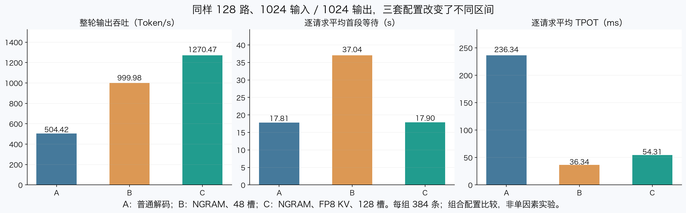
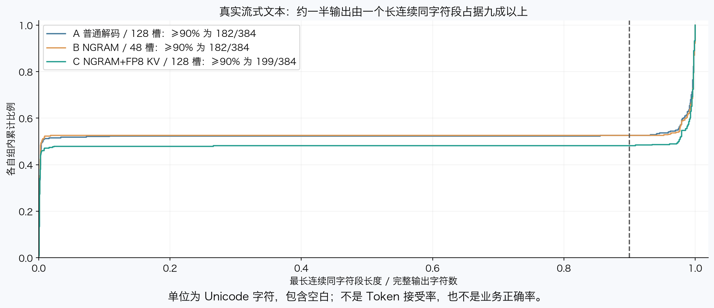
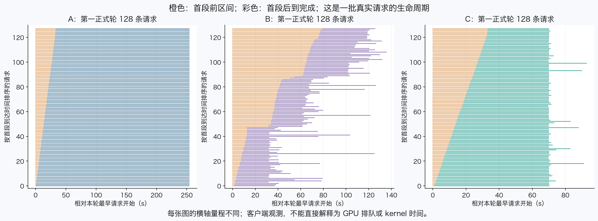
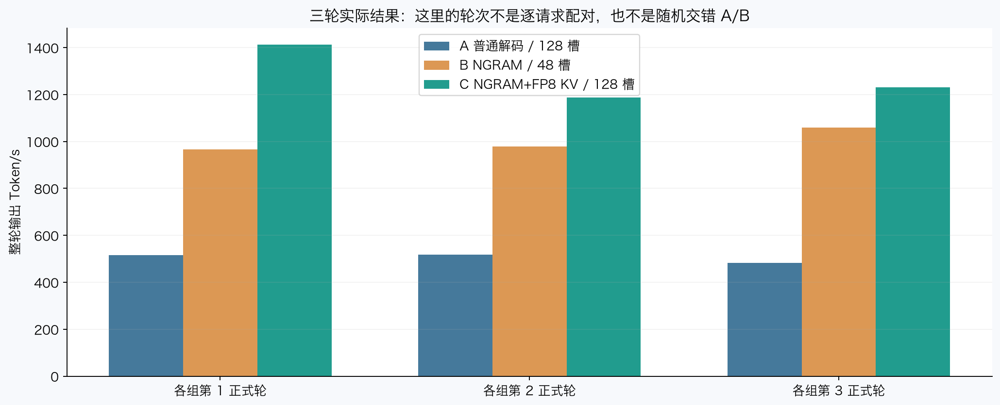

一组 SGLang 压测里，NGRAM 配合 FP8 KV Cache，满批 Decode 的三轮平均输出速率达到 3293 Token/s。但把全部请求从发送算到完成，合并吞吐只有 1270 Token/s。进一步重新读取保存的流式响应，384 条输出中有 199 条，其完整文本的九成以上，被一个连续重复的字符段占据。

这些数字都是真的，却不能互相替代。3293 描述特定 Decode 窗口中的阶段能力，1270 描述这批请求从开始到排空的输出效率，199/384 则提醒我们：模型在这里处理的内容，和真实业务可能相差很远。

问题不在于投机解码的收益是真是假，而在于收益发生在什么阶段、依赖什么序列，以及这个阶段能够代表多少实际请求。下面从三套配置的真实结果出发，把 NGRAM 的执行路径、输出重复性、并发槽位和计时窗口放到同一条分析链上。

## 一、先看一个矛盾：输出更快，首段反而等得更久

这批材料来自 Qwen3-235B-A22B-Thinking-2507-FP8，运行时为 SGLang 0.5.20，TP=8、EP=8，Attention 后端为 FlashInfer，Prefill 新 Token 预算为 2048。对应机器记录为八张 NVIDIA RTX PRO 5000 Blackwell；设备采样报告每卡总显存 48935 MiB，约 47.79 GiB。客户端使用 EvalScope 1.14.0，通过 OpenAI 兼容的 completions 流式接口发请求。

请求从同机隔离 CPU 容器经过原有入口访问模型服务，因此客户端首段等待包含入口和服务端处理。保存材料没有这三轮对应的链路带宽、PCIe 拓扑和 NCCL 传输选择记录，本文不据此判断网卡或卡间链路是否饱和。这里先回答请求级表现和投机执行的关系，不把机器型号当成已经完成底层性能定位。

三套配置记为 A、B、C。它们的输入和输出长度相同，服务端接纳请求的方式却不同。

| 配置 | 解码方式 | 最大运行请求数 | KV dtype 参数 | 静态显存比例 |
|---|---|---:|---|---:|
| A | 普通解码 | 128 | auto | 0.85 |
| B | NGRAM，候选位置数参数为 4 | 48 | 未显式改为 FP8 | 0.85 |
| C | NGRAM，候选位置数参数为 4 | 128 | fp8_e4m3 | 0.78 |

C 还显式设置 NGRAM 最大 BFS 宽度为 1。A 的上下文上限为 10240，B 为 262144，C 没有显式设置该参数。三组不能视为只改变一个开关的消融实验；这些差异会在后文分别进入判断。

每组有三轮正式测试，每轮同时发送 128 条请求，每条输入 1024 Token、输出 1024 Token。重新打开正式轮次对应的九份 SQLite 数据库，确认共 1152 条均成功，且 usage 中的长度都是 1024/1024。预热和被排除的失败轮次没有混入这一集合。

| 配置 | 三轮合并整轮吞吐 | 请求平均首段等待 | 请求平均 TPOT |
|---|---:|---:|---:|
| A | 504.42 Token/s | 17.81 s | 236.34 ms |
| B | 999.98 Token/s | 37.04 s | 36.34 ms |
| C | 1270.47 Token/s | 17.90 s | 54.31 ms |

图 1：从九份正式轮次数据库重新计算。整轮吞吐采用总输出 Token 除以各轮墙钟之和；首段等待和 TPOT 为每组 384 条请求的算术平均。配置同时改变多项参数，柱高差不能直接拆成某个参数的独立收益。

B 的输出阶段明显比 A 快，首段等待却约翻了一倍。C 的整轮吞吐又高于 B，但其平均 TPOT 比 B 大。于是三个问题出现了：为什么输出更快不保证开始得更早？为什么整轮吞吐更高不保证每条流更顺？为什么接受率很高仍然不能直接估计线上容量？

它们有共同根源：客户端并发、当前运行批次、一次验证前进的 Token 数，以及用户实际拿到结果的时间，是不同层面的量。

## 二、NGRAM 省掉了什么，又增加了什么

普通自回归解码在一个逻辑步中，为每条序列推进一个新的输出位置。目标模型不断读取权重和 KV，生成下一个 Token，再把新位置写入状态。若每次只能前进一步，大量固定成本要重复支付。

NGRAM 用已出现的 Token 片段查找可能的后续序列，再让目标模型验证这些候选。它不需要另加载一个小型 Draft 模型，但并不意味着没有 Draft 成本。查找、组织候选、准备位置和掩码、传输候选数据、验证、选择接受路径和处理缓存，都是执行路径的一部分。

对照 SGLang v0.5.20 的 `NGRAMWorker`，可以把这条路径拆成四段。`_prepare_draft_tokens()` 从请求输入和已有输出中取尾部上下文，通过 `ngram_corpus.batch_get()` 取候选；`_prepare_for_speculative_decoding()` 准备候选索引、位置和树掩码，并把 Decode 转为 `TARGET_VERIFY`；`forward_batch_generation()` 调用目标模型执行验证；随后更新已接受的位置和 NGRAM 语料状态。

源码中的缓存位置分配也很关键。候选位置先需要可写入的 KV 位置，接受后再按实际有效路径处理状态。没有接受的工作不算最终输出，却仍然消耗验证计算和临时资源。因此，“一次给出四个候选位置”并不等于“一次免费输出四个 Token”。这里的参数描述验证布局，实际前进多少必须看接受结果。[1]

可以用一个简化的成本模型说明收益条件。设普通解码在某个固定 batch 和上下文下，推进一个位置的时间为 T₁；投机一轮包含查找与准备、目标验证、接受与状态维护，总耗时为 Tₛ；这一轮每条序列平均有效前进 L 个位置。

在批次和上下文可比的条件下，投机解码有收益，需要 Tₛ/L 小于 T₁。等价地，L 必须大于 Tₛ/T₁。接受长度进入分母，验证与状态维护进入分子，缺少任何一边都无法推断速度。

还可以进一步追问：为什么相同候选数，在不同内容上收益差这么大？先考虑一条不分叉的候选链，以第一个确定位置为起点，最多有效前进四个位置。设沿链走到后续各位置的条件匹配概率依次为 p₁、p₂、p₃，那么平均前进长度为 1+p₁+p₁p₂+p₁p₂p₃。后面的收益要经过前面的检查，不能把每个位置的命中概率直接相加。

如果仅为理解机制，假设三个条件概率都等于 p，则长度为 1+p+p²+p³。p 为 0.97 时，结果约为 3.82；p 为 0.5 时，结果为 1.875。再假设投机一轮耗时是普通单步的 2.5 倍，前一种负载的理论倍率约为 1.53，后一种只有 0.75，反而更慢。这些是数学算例，不是本次测得的概率和速度，也不能用它替代树形候选的实际接受分布。

它真正说明的是，决定效率的对象是一整条可接受路径。内容变得更难预测时，后续多个位置的收益会一起缩水，而准备候选和验证的部分成本仍然需要支付。使用一份很容易匹配的输出集合测出的高接受长度，不能当成算法在其他内容上固定提供的属性。

还有一个容易忽略的细节：模型权重是 FP8，不代表 KV Cache 也是 FP8。前者压缩常驻参数，后者改变随上下文增长的状态。它们进入不同的资源项。把模型名称中的 FP8 当成缓存精度，会错读配置 A 与 C 的差别；把输出中的大量重复字符当成“参数精度造成”的现象，则又跳过了输入和采样对照。

这个模型也解释了为什么候选更多不总是更快。增加候选可能提高 L，也可能增加验证序列、注意力掩码和缓存位置，使 Tₛ 增长得更快。候选错误时，额外计算没有转化为有效输出。较大 batch 下，普通解码本来就在摊薄固定成本；此时投机验证的额外工作可能更难回本。

NGRAM 的准备张量同样有明确规模。源码按最大 batch B 和候选位置数 D 预分配 Token、位置、检索索引，以及约 B×D² 的布尔树掩码。D=4 时，仅这个小掩码不是巨大的显存项目；不能看到平方项就宣称它吃满了显存。更重要的是目标模型各层的候选 KV、Attention 执行布局、工作区，以及运行请求的历史上下文。

源代码里对 `accept_lens` 和正确候选数也有区分：前者包含本轮额外确定的输出位置，反馈正确 Draft 数时会减去一。统计接受长度、接受率和最终输出时，如果混用这几个量，得到的倍率就会错位。本文保留历史指标名称，不把接受长度直接当成纯 Draft 命中个数。[1]

这份源码是官方版本标签下的机制参照，并非从当时运行进程逐文件导出的代码证明。下面涉及性能的数字全部来自保存的请求和指标；涉及这条实现路径的解释，限定在引用源码所展示的机制。

## 三、真正值得警惕的，是输出内容太容易猜

这次工作负载使用 random 数据集、固定 1024 输入、固定 1024 输出、temperature=0、ignore_eos=true，并直接提交 Token ID 输入，不套聊天模板。数据库里可以看到一类输入是词表中连续编号的 Token 列表。这能够制造固定长度负载，但不等于自然语言请求。

“随机输入”也不意味着“输出随机”。模型接受缺乏正常语义结构的输入后，可能进入重复模式；贪心采样继续选择同一局部最优输出，忽略 EOS 又让测试保持固定生成长度。这些条件组合起来，可能使固定长度的输出包含很长的重复段。

重新读取保存的 SSE 响应后，我们没有重新 tokenize，也没有猜测每段文本对应多少 Token。做法是按消息顺序拼接 `choices[].text`，保留空格、换行和所有 Unicode 字符，然后找完整字符串中最长的连续同字符段。

例如“甲乙丙丙丙丙丙”最长连续段是五个“丙”，其比例是 5/7。这个统计不判断答案对错，只识别输出是否被一个极长的重复片段占据。把阈值设为 90%，三组结果如下。

| 配置 | 正式输出数 | 连续同字符段占完整文本至少 90% |
|---|---:|---:|
| A | 384 | 182，47.40% |
| B | 384 | 182，47.40% |
| C | 384 | 199，51.82% |

图 2：直接分析保存的流式文本，单位为 Unicode 字符，包含空白。横轴不是 Token 接受率，曲线也不是业务质量分数；每组只使用对应的 384 条成功正式请求。

这不是为了说这些请求“无效”。它们确实让模型执行了完整长度，也可以用来研究某些运行时路径。但用于解释 NGRAM 收益时，输出重复性必须进入证据，因为 NGRAM 正是从已有序列中提取后续片段。若后面一直重复同一个片段，候选机制会遇到与多样化生成很不一样的条件。

这里还要避免一个看似顺手的归因：不能因为 C 有更多重复输出，就说 FP8 KV 导致重复。A、B、C 的提示集合并不完整配对。按输入 Token ID 列表做哈希，A 与 B 只有 128 个唯一提示相交，C 与两者均无相同提示。输入内容、数值路径和部署配置同时改变，不具备把差异单独归给 KV 精度的条件。

同样，不能直接说这些重复输出“造成了全部加速”。保存的接受率是服务端批次统计，输出重复性是逐请求文本统计，二者还没有通过每轮验证的请求级接受日志连接起来。现在能确认的是：这组高收益测量包含大量高度重复输出，不能代表一般业务输出；至于每类输出贡献了多少加速，需要更细的接受记录和对照。

字符统计本身也需要防止两类误读。一个中文字符可能对应一个或多个 Token，一个 Token 也可能解码成多个字符；所以这里的 90% 不能换算成“九成候选都容易命中”。重复空白同样计入，因为运行时实际处理它们，但不能把空白数量解释成用户阅读的信息量。

另一类误读来自流式传输。一个 SSE 数据块可能包含多个位置，投机验证后也可能一次返回多个位置。本文没有用消息块数量统计输出 Token：Token 总量取最终 usage，重复性取拼接后的完整文本。即使相同文本被拆成更多或更少数据块，最长连续字符段也不应该变化。这样才能让内容统计和传输切片解耦。

这一步非常重要。一个微基准可以在自己的工作负载上完全真实，同时对另一类工作负载缺乏预测力。问题通常发生在搬运结论时：把“这批重复序列上有效”，缩成“这个模型开启 NGRAM 都能这么快”。后者跨过了数据没有提供的那一步。

## 四、3293 和 1270，差的不是统计误差，而是请求生命周期

C 组三轮选出的满批 Decode 窗口速率分别为 3462.85、3236.28、3179.02 Token/s，算术平均为 3292.72。三轮完整客户端窗口分别为 92.77、110.32、106.42 秒；每轮都交付 131072 个输出 Token，合并为 1270.47 Token/s。

两个分母的定义不同。满批窗口选在全部请求已拿到首段、还没有请求完成的区间内，服务端有 128 条运行请求、没有排队请求，并且所选样本间 Prefill 计数没有变化；窗口还要求至少六个样本和五秒跨度。取这段时间内 Decode 累计计数器的增量，再除以时间差，得到运行阶段速率。

整轮吞吐则从最早请求开始，到最后请求完成。它包含进入满批窗口之前的等待，也包含请求陆续结束后的排空。不是把一个速率换个名字，就能覆盖这些区间。

看 C 第一轮：最后一个首段在本轮约 33.42 秒到达，所选稳定窗口为 36.43 到 66.64 秒，第一个请求在 69.53 秒完成，最后一个在 92.77 秒完成。稳定窗口只有约 30.22 秒，整个请求批次却持续约 92.77 秒。

图 3：每条线来自一条正式请求的客户端时间戳。橙色是开始到首段，彩色是首段到完成；按首段到达排序。三图横轴量程不同，这些线段不等价于 GPU kernel 或服务器队列轨道。

不能把前 33.42 秒全算成纯 Prefill，再把后面的 Decode 简单相加。在最后一条请求拿到首段之前，先进入的请求可能已经在生成；同一墙钟区间中，输入处理、排队和部分请求的输出会交织。正确做法是保留请求时间轴，用计数器辅助识别区间，而不是把各阶段的最大值拼成一条不存在的串行时间线。

为核对这个阶段速率，本次重新读取 C 三轮的服务端采样，按相同运行数、队列和 Prefill 不变条件重新选段，分别得到 31、32、33 个样本。用各窗口首尾累计 Decode 计数器重算，得到的三项速率与保存摘要一致。因此，3293 并非误把预填充 Token 算进输出的算术错误；真正的问题在于读者可能误以为它覆盖了整个服务过程。

计数器差分还要求同一实例、同一统计序列没有重置。跨副本直接相减、把不同 Rank 的同一逻辑 Token 重复相加，都会把吞吐放大。此次复核沿用原采集的实例窗口，并在带 TP 标签时只取 Rank 0。该筛选服务于这批指标的标签形状，不意味着所有系统的所有 TP 指标都只能取零号 Rank；部署前应先确认指标究竟是分片量还是逻辑请求量。

排空同样不是一段没有输出的空白。第一条请求完成后，其他请求还会继续产生 Token，只是活动 batch 逐渐缩小，单位墙钟能交付的总量可能改变。C 三轮从首个完成到整轮结束分别还有约 23.24、40.18、36.33 秒。只截取满批区间，会把这部分真实交付成本留在图外。

可以做一个直观但必须标明性质的计算：若第一轮的 3462.85 Token/s 能覆盖所有输出，131072 个 Token 只需约 37.85 秒。实际完整窗口是 92.77 秒。两者的差不是待优化“空闲时间”的直接测量，因为该假设忽略了输入处理、进入批次和批次变化；它只是证明一个固定满批速率不能替代整轮时长。

请求时间线还能给出一个可精确复算的量：把每条请求从开始到完成的时长相加，再除以整轮墙钟，得到本轮平均有多少条客户端请求尚未完成。这是请求在途数量曲线的面积恒等式，不要求系统已经进入稳态。

按第一正式轮计算，A 平均约有 127.87 条请求在途，B 约 70.67 条，C 约 98.02 条。B 的这个数大于其 48 个运行槽，恰好提醒我们：客户端在途包括等待接纳的请求，不能拿它替代 GPU 正在处理的序列数。若进一步只累计首段后到完成的区间，C 的平均“已开始输出且未完成”数量约为 73.72，也明显小于标称客户端并发 128。

这些数没有直接揭示服务器逐步调度，但解释了为什么用 128 去乘单流速率容易高估整轮能力。128 是本轮同时提交的请求数量；整个墙钟内持续处于某个处理阶段的平均数量，必须从真实起止时间或对应服务器轨道积分得到。

这也是做容量规划时最容易漏掉的因素。批处理作业关心整批何时完成，交互业务关心每条请求何时开始、何时结束，长驻服务还关心持续到达下队列能否稳定。三种问题需要不同的计时边界。一次同时提交 128 条的有限批次，不能自动代表某个持续 QPS 下的稳定服务能力。

## 五、为什么 B 的 TPOT 更好，C 的总吞吐却更高

B 只有 48 个运行槽，客户端却同时提交 128 条请求，因此至少在接纳层面不可能所有请求都处于同一个运行 batch。历史服务端指标也记录了 48 的运行峰值。每条请求会在不同时间进入模型，这使首段等待分布拉长，同时让活跃输出阶段的批次规模小于 C。

B 的三轮平均首段等待约 37.04 秒，平均 TPOT 为 36.34 ms；C 对应为 17.90 秒和 54.31 ms。这个结果与“小批次中的单流推进更快，但更多请求要等接纳”的机制相容。客户端指标还包含其他开销，不能仅凭这张表把每一毫秒都指定为槽位等待；但它已经说明，用单个 TPOT 排名无法选出所有目标下的最佳部署。

这里可以区分两种速度。第一种是已经进入运行集合的请求，每交付一个输出位置需要多久。第二种是整个系统把所有请求处理完，每秒总共交付多少输出。运行请求多时，即使每条流的平均间隔变大，总输出仍可能上升；反过来，单条流更顺，并不保证排队请求更早拿到首段。

对相同长度输出，TPOT 的算术平均也不是“平均 TPOT 的倒数乘客户端并发”就得到整轮吞吐。TPOT 是逐请求首段后区间的归一化量，整轮吞吐是共享墙钟上的总量。各请求起止时间不一致，活动并发随时间变化，首段前时间又不在 TPOT 的分子里。先求平均再求倒数，还会额外引入非线性差异。

C 能使用 128 槽，配置上同时引入了 FP8 KV、不同静态显存比例和更窄的 NGRAM BFS 宽度。KV 数据类型改变的是每个位置的存储和对应读写路径；候选布局会改变验证工作；静态显存比例影响可用于模型常驻与缓存规划的预算。这些因素都可能参与结果。

如果某条缓存路径原本以两字节存储一个标量，换成一字节格式后，纯 K/V 标量部分的理论字节量约减半。但 scale、页管理、对齐、工作区和候选状态并不会因此全部减半，也不能据此宣称本案例的实际显存峰值减半。A 的 `auto` 最终解析精度没有随这次离线复核重新导出，本文不把理论比值写成该实例的实测节省。

同理，静态比例从 0.85 改为 0.78，对约 47.79 GiB 设备而言，比例差对应约 3.35 GiB 的名义预算变化。这是数量级计算，帮助理解参数作用范围，并不等价于用户可见空闲显存会准确增加 3.35 GiB。启动分析、缓存分配和驱动记账的口径不同，必须用相同阶段的真实记录验证。

图 4：三轮重复观察保留了结果波动。第几轮仅表示各配置内部的顺序，不表示跨配置随机交错，也不表示提示内容逐条配对。

三轮合并后，C 的整轮吞吐约为 A 的 2.52 倍，B 约为 A 的 1.98 倍。这样的描述是成立的，因为它明确说的是三套部署配置在这些合成负载上的观测。将其写成“NGRAM 独立提升 2.52 倍”则不成立：KV、槽位、其他参数、提示集合和时间顺序尚未被控制。

## 六、接受率该怎样进入工程判断

C 所选 Decode 窗口里的接受率 Gauge，三轮样本均值约为 88.66%、81.96%、81.69%，接受长度 Gauge 的样本均值约为 3.66、3.46、3.45。这些指标能够确认运行时在窗口中经常成功向前推进多个位置，但不能单独换算成端到端倍率。

首先，Gauge 的采样均值通常不是按每次验证的候选数量加权。采样间隔、每个统计周期覆盖的请求和验证次数都可能不同。真正的全局接受比例应从定义明确的累计接受数和累计候选数计算；如果要比较算法效率，还要把每轮验证花的时间加入。当前材料保留的是这些窗口的采样统计，本文不把它包装成全局逐候选成功率。[2]

其次，接受率描述候选与目标模型输出的匹配，不评价答案是否有用。目标模型如果正在重复一个无意义片段，候选准确重复它，也会有很好的接受指标。Token 数达到 1024、HTTP 成功、接受率很高，都不等于请求完成了用户任务。性能测试必须先说明究竟测的是固定形状运行效率，还是具有业务语义的交付能力。

再者，较高接受长度也不能推出目标验证成本不变。多位置验证改变输入形状和访存，候选状态维护也可能带来 CPU/GPU 同步。当前请求数据库没有逐步保存 Draft、Verify、接受回写的 kernel 时间，因此这里用源码解释成本项，用请求记录验证表现，不声称已经从这些数据定位出某一个验证 kernel 是瓶颈。

从这批材料能做出的工程选择已经足够具体。如果目标是研究运行时在高度重复固定长度序列上的能力，C 的 128 路满批 Decode 是有价值的观测点；如果目标是批量处理本批输入，应该使用三轮合并的 1270 Token/s，并保留整轮尾部；如果目标是交互服务，则必须同时检查首段、TPOT 和完成时间，不能只选接受率最高或满批输出最快的配置。

要把结论迁移到真实业务，下一轮最先改变的应是工作负载代表性，而不是继续调候选数。用固定版本的业务提示集合，保留真实聊天模板、输出停止和采样策略；将普通问答、代码、结构化输出以及可能重复的生成分别统计。固定长度的合成压测仍应保留，作为形状控制组，它和业务回放回答不同的问题。

之后才能做可归因的参数对照。相同提示、相同槽位、相同 KV 精度下切换 NGRAM，回答算法增量；相同 NGRAM 设置下切换 KV 精度，回答数值路径和容量取舍；固定其他条件再变更槽位，回答单流延迟与总吞吐如何交换。若显存不允许某组配置运行，应该记录“该配置在该资源约束下不可行”，而不是用另一组参数补齐后继续称为单因素对照。

这些补测没有在本次离线分析中执行，因此本文不提供它们的预期结果。已经完成的工作是：重新校验九轮正式请求的成功与长度，重算整轮吞吐和请求时延，检查三组输入集合是否配对，并从保存的原始响应逐条计算输出重复性。证据足以纠正容量解释，也明确指出下一步最有价值的验证对象。

## 结论

NGRAM 的价值在于用一次较贵的验证换取多个有效输出位置；收益由接受长度、验证成本、缓存资源和活动批次共同决定。真实压测中，3293 Token/s 的满批阶段速率、1270 Token/s 的整轮吞吐，以及超过一半输出高度重复，可以同时成立。

这批结果说明组合配置对这类负载有效，但尚未给出一般业务上的 NGRAM 独立收益。做推理优化时，先看输出了什么、何时开始输出、何时全部完成，再解释接受率。只有工作负载与业务相似，阶段指标与交付目标对应，测出的快才有机会变成线上可用的容量。

## 资料来源

1. [SGLang v0.5.20：NGRAMWorker，候选准备、验证执行与缓存状态维护](https://github.com/sgl-project/sglang/blob/v0.5.20/python/sglang/srt/speculative/ngram_worker.py)
2. [SGLang v0.5.20：metrics_collector.py，投机接受长度与接受率 Gauge 定义](https://github.com/sgl-project/sglang/blob/v0.5.20/python/sglang/srt/observability/metrics_collector.py)
3. [SGLang 官方投机解码文档](https://docs.sglang.io/docs/advanced_features/speculative_decoding)
4. 本文实测来自保存的三组部署、每组三轮正式请求：共 1152 条请求的客户端数据库、服务端指标采样及启动配置。正文图均由这些记录重新计算，离线复核不包含新的 GPU 压测。
