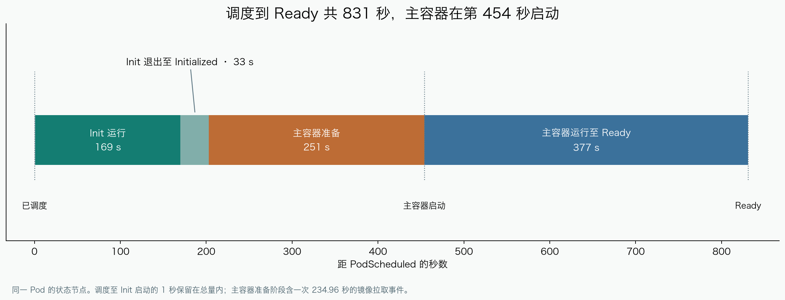

一次 Qwen3.5-9B 双卡部署，从 PodScheduled 到 Pod Ready 共 **831 秒**。其中 **454 秒发生在 vLLM 主容器启动之前**，余下 **377 秒**覆盖了引擎初始化、权重加载、编译、显存预跑和 API 启动。排查推理冷启动，先把 Pod、容器和运行时的时钟对齐，才能看清哪些阶段串行推进，哪些耗时来自两个 rank 并行执行。

## 一、先定起点与终点，再拆这 831 秒

这是 11 月 6 日的一次部署观测。模型为 Qwen3.5-9B，BF16、TP=2，申请两张 RTX 4090 D。运行时使用 vLLM 0.33.0、PyTorch 2.14.0+cu130，模型长度上限 8192、批次 Token 预算 2048。采集的是同一个 Pod 的状态和日志，初始化容器成功退出，主容器重启次数为零。这个样本记录了本次节点与缓存条件下的实际启动链。

起点取同一 Pod 的 PodScheduled 条件转换时刻，终点取保留的 Ready 转换时刻。两者相差 831 秒。这个范围从选定节点之后开始，部署控制器此前的工作和资源排队属于更早阶段。对扩容来说，可以另记副本创建时间与 PodScheduled 的差，再接上这里的时间线。

图一｜同一 Pod 保留的状态时刻。Init 的起止使用容器状态，Initialized 和 Ready 使用条件转换，主容器使用 startedAt。横轴自 PodScheduled 起算，精度为秒。

这张时间线给出五个相邻区间。调度至 Init 启动约 1 秒，Init 运行 169 秒，Init 退出至 Initialized 条件转换 33 秒，随后到主容器启动 251 秒，再经过 377 秒达到 Ready。把同一条时间轴上这些互不重叠的区间相加，才会回到 831 秒。各日志里单独输出的耗时，可以用来给对应区间补证据。

状态与进程记录各自发生在不同层。Init 的 finishedAt 说明进程何时退出，Initialized 的转换则记录组件看到初始化条件满足的时刻。这次两者之间有 33 秒。凭已有快照只能看到这段间隔，无法分解当时 kubelet 的每次同步或状态更新。画图时把这两个节点分别保留，可以避免将整个间隔算进下载，也为下次补采容器事件留出明确范围。

## 二、主进程启动前，模型与镜像走了两条路径

这次权重由 storage initializer 下载。日志记录约 19.3 GB、17 个文件，下载函数耗时约 167.93 秒，接近 Init 状态记录的 169 秒。前者是下载函数自己的经过时间，后者包括容器启动到成功退出。两者的边界和时间精度不同，保留这两个数字就能看出下载占了 Init 阶段的大部分。 [Kubernetes Init 容器行为](https://kubernetes.io/docs/concepts/workloads/pods/init-containers/)

模型下载完成后，Pod 仍要让运行时镜像就绪。启动时保留的 kubelet 事件记录，这个主容器镜像的拉取用时约 **234.96 秒**。该计时属于 Init 结束与主容器启动之间的区间。剩余部分还有状态更新和容器准备等可能开销，现有事件无法逐秒分解，所以图上按真实状态节点保留了整个区间。镜像事件的拉取时长也不能直接解释成纯网络传输，运行时的准备路径还要从更细事件核对。 [Kubernetes 镜像获取与缓存](https://kubernetes.io/docs/concepts/containers/images/)

类似地，事件里的镜像大小描述的是制品量，准备完成还依赖节点已有层、运行时获取和解包等过程。若用文件大小直接除以 kubelet 事件用时，得到的比值包含了多个环节。在另一台节点上，网络和磁盘条件还会与缓存状态一起改变。要测纯传输，可在运行时或镜像服务侧分别记录实际下载字节和请求起止。要测扩容，则保留整个容器尚未启动的时间。

模型文件和容器镜像是两个不同的制品。前者在本次 Init 中下载到模型目录，后者由节点容器运行时获取并用于启动主进程。预热镜像命中的是镜像层，保留模型快照命中的是权重文件。若只在节点上提前准备其中一种，另一条获取路径仍要单独检查。部署记录里应分别保留镜像是否已存在、模型目录是否已有文件，以及最终用的是哪个版本。

从容量角度，这段时间也有一笔独立账。Pod 调度时已经按其 GPU 请求占用了节点的调度容量，启动期间卡上是否有实际计算要靠设备指标另测。按本次两张卡与 831 秒计算，调度至就绪的资源占用约为 0.462 卡时。这个算术描述预留容量经过的时间，适合估算扩容期间有多少设备尚未形成可用副本，不能代替实际 GPU 利用率或计费记录。 [Kubernetes Init 与应用容器的有效资源请求](https://kubernetes.io/docs/concepts/workloads/pods/init-containers/#resource-sharing-within-containers)

## 三、两张卡各加载约 147 秒，墙钟怎样算

主容器启动之后，vLLM 要初始化进程和通信，再让各 worker 构建并加载模型。日志中，rank0 的 checkpoint 在 XFS 上，大小约 17.98 GiB。进度显示四个 safetensors 分片完成。默认加载器报告 rank0 加载权重约 143.09 秒，外层 Model Runner 报告模型加载 146.69 秒，rank1 的外层计时为 146.82 秒。外层还覆盖模型构建和该路径里的其他加载工作。 [vLLM 0.33.0 默认模型加载器](https://github.com/vllm-project/vllm/blob/v0.33.0/vllm/model_executor/model_loader/default_loader.py) · [GPU Model Runner 的模型加载计时](https://github.com/vllm-project/vllm/blob/v0.33.0/vllm/v1/worker/gpu/model_runner.py)

图二｜从原始日志读取两个 rank 的模型加载、主干编译与首次显存预跑计时。三项采用各自函数边界，两条柱表示并行 worker 的计时。

两个 rank 的加载完成日志在同一秒出现。结合约 147 秒的各自计时，能够看出这两个加载区间基本重合。对于必须等所有 rank 的阶段，墙钟由最早起点到最晚完成的跨度决定。若两边同起，慢的一边决定这个阶段何时通过。把两张卡的各自耗时相加，可以表达两份 worker 活动的累计量，用来解释用户等了多久时则应按重合后的时间轴计算。

两个进程共享同一个节点与文件来源，也意味着并行并不会自动消除竞争。如果一个 rank 更晚结束，另一边可能已经具备继续执行的局部条件，却仍要等整个 TP 组。当前两边的加载结束基本一致，说明此次记录没有出现明显的一侧长尾。下次若要调整加载方式，除了记录两个进程各自的计时，还应记录它们的开始、结束及共同通过的时刻，以免把等待挪到下一阶段后看漏。

checkpoint 大小、单 rank 设备驻留和实际磁盘读取也是三种量。启动日志报告每 rank 模型加载消耗约 8.83 GiB，而本地 checkpoint 约 17.98 GiB。文件里有参数分片来源，模型加载器还会执行张量分配与拷贝。实际读取可能被页缓存命中，也可能受到两个 worker 读盘竞争影响。要找 147 秒具体花在读取、反序列化还是搬运，需要把文件读取计数与加载区间对齐，而仅用 checkpoint 大小除以加载时间只能得到一个逻辑速率。

本次权重路径还报告 XFS 下未自动启用预取。这给下一轮留下一个可验证的输入条件。可以先在相同文件和运行时条件下观察两个 worker 的实际读取字节、磁盘等待与内存压力，再对比不同加载方式。页缓存如果被上一轮预热，第二轮看到的读盘量就可能明显改变。只有记录节点缓存和内存条件，才能判断某段时间变化主要对应读盘还是模型加载器的其他工作。

## 四、权重到位以后，API 还在等什么

模型加载结束距主容器启动约 236 秒，距 Ready 仍约 141 秒。后续日志依次出现主干编译、初始 profiling/warmup、图捕获、KV Cache 预算、再一次图捕获和 API 启动。rank0、rank1 的主干编译各约 25.41、26.41 秒。紧接的首次预跑分别约 73.90、72.88 秒。两个 rank 各自记录计时，设备和进程间的依赖决定最终墙钟。

沿 vLLM 0.33.0 的 `EngineCore._initialize_kv_caches()` 与 `GPUWorker.determine_available_memory()` 看，引擎先确定模型所需的缓存规格，worker 用代表性前向观察显存峰值，再给 KV Cache 划预算。本次日志打印单 rank 可用 KV Cache 内存约 10.8 GiB。随后还要为实际运行配置完成缓存初始化和图捕获。此处 profiling 指引擎初始化的显存预跑，业务请求的 PyTorch trace 采集是在就绪后另外发起的。 [vLLM 0.33.0 引擎缓存初始化](https://github.com/vllm-project/vllm/blob/v0.33.0/vllm/v1/engine/core.py) · [GPU worker 显存预跑](https://github.com/vllm-project/vllm/blob/v0.33.0/vllm/v1/worker/gpu_worker.py)

引擎给出的外层初始化计时还有一条可核对的记录。引擎初始化结束时，日志报告显存 profiling、创建 KV Cache 与模型 warmup 合计 128.58 秒，括号内的编译为 26.41 秒。编译已包含在外层计时里。若先把 128.58 当成初始化总量，再额外加 26.41，就会重复计算。图二保留 worker 的局部计时，外层时间仍按引擎自己的边界解释。

同一份日志里出现两轮 CUDA Graph 捕获。第一次约 4 秒，随后记录可用 KV 预算，之后又记录了约 2 秒的最终图捕获。两个数字对应不同阶段，既不能将所有初始化耗时归到图捕获，也不能把 73.90 秒的预跑再命名为编译。逐项看日志位置与函数边界，才能判断某个缓存命中或参数调整实际能覆盖哪一段。

预跑阶段还出现了共享内存广播长等的日志。它记录的是进程在等待某个通信资源的状态，当时 worker 仍在推进预跑与捕获，随后引擎正常完成初始化。单看这一行无法确定根因。排查时可以将等待日志与 worker 的阶段结束时刻放在一起，检查一侧是否停滞，以及等待时其他进程正在执行什么。这样的证据比给日志里的每个等待数字另开一段墙钟更可靠。

API 启动日志出现在 Pod Ready 前约一秒。这里采用的是日志与 Kubernetes 条件各自的秒级时间戳，无法拆出探针、状态传播和网络注册的精细耗时。Kubernetes 的 readiness 表达副本是否可以作为服务后端参与流量。验证用户实际可用，还可以另记经网关成功完成第一条请求的时刻。这样平台就绪与业务成功各有证据。 [Kubernetes 就绪探针](https://kubernetes.io/docs/concepts/workloads/pods/probes/)

## 五、扩容变慢时，先验证缓存命中了哪一层

按这个样本拆，模型获取和主镜像准备属于主进程之前的一半多时间。如果后续要验证预热，先分别对照镜像是否已在节点、模型快照是否已在目标目录，固定模型 revision 和镜像 digest。镜像预拉与权重缓存应单独试，记录哪一个实际区间缩短。若两项一并改，能看见整体改善，却较难判断下一次节点变更会失去哪部分收益。

可以先用一个数学算例衡量改动目标。如果只移除本次记录的下载函数耗时，假设其他阶段完全相同，831 秒减去 167.93 秒，仍约有 663 秒。真实预热还可能改变读取和缓存，实际结果要重新测量。这个算式说明单项优化应该对应哪一段预算，也提示扩容目标若远短于当前观测，需要同时检查镜像准备、引擎初始化和触发扩容的时机。

同一节点复跑还要区分重新创建 Pod、容器重启与服务进程热启动。容器镜像层可能保留在节点，模型文件的生命周期取决于挂载方式，编译产物也有自己的缓存目录。即便启动参数相同，三种条件可能命中不同层。验收前记录各缓存的实际状态，比统一写成一次冷启动和一次热启动更便于复现。

这次只观测到一个启动样本，831 秒适合作为这套配置下的排查起点。若要做容量规划，下一轮需要在明确的缓存条件下重复采样，保留 PodScheduled、Init 起止、主容器启动、模型加载完成、引擎就绪、Pod Ready 与网关首个成功请求。这样得到的时间线既能定位耗时，也能判断预留的双卡在什么时候真正转化成可接流量的副本。
