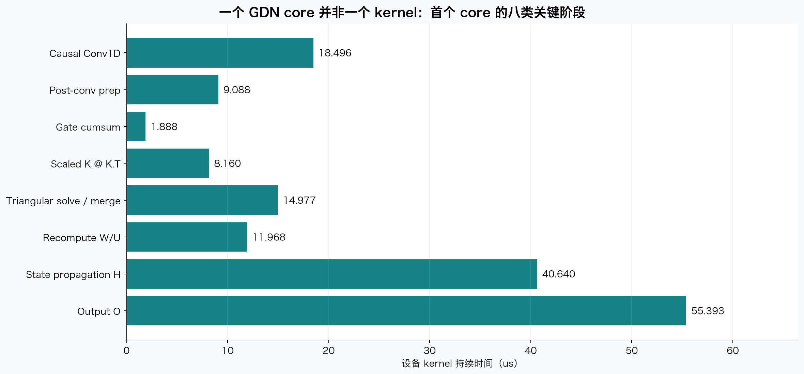
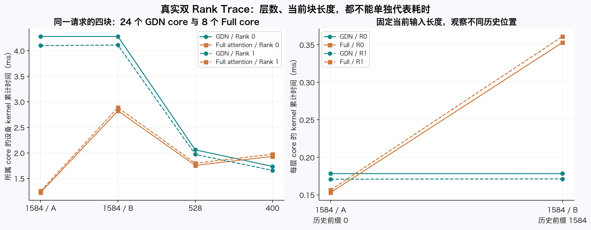
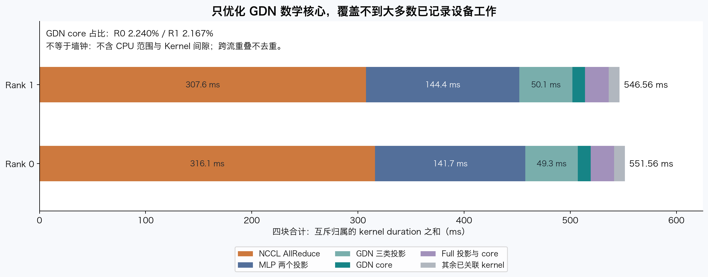
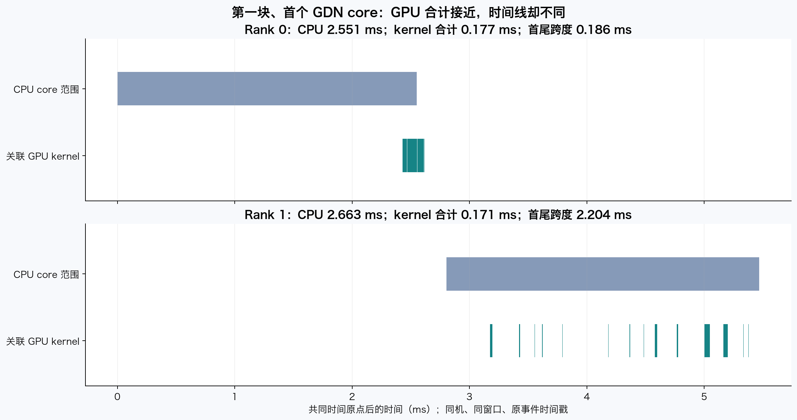
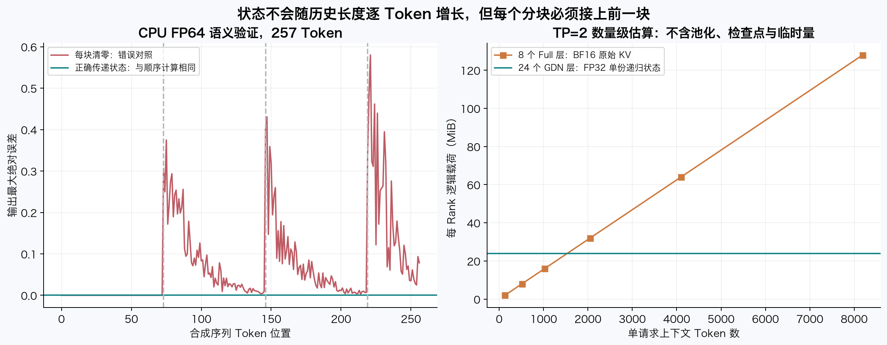

Qwen3.5-9B 的 32 个语言层里，24 层使用 Gated DeltaNet，只有 8 层使用全注意力。但在两张 RTX 4090 D、BF16、TP=2 的一次 4096 Token Prefill Trace 中，24 层 GDN core 关联到的设备 Kernel 累计时间，只占同口径统计预算的约 2.2%。这并不意味着整个 GDN 模块只花了 2.2% 的请求时间，而是提醒我们：层数、数学核心、模块边界和请求关键路径，是四个不同的问题。

更值得追问的是，同一个请求连续处理两个 1,584 Token 的块，GDN core 的累计设备时间几乎不变，全注意力 core 却从约 1.23 ms 增加到 2.82 ms。同时，首个 GDN core 在两张卡上的 Kernel 合计都不到 0.18 ms，首尾跨度却分别约为 0.19 ms 和 2.20 ms。只看复杂度、只看算子排行榜，都会漏掉一部分真实执行过程。

下面沿着这三个现象，拆清输入投影、状态更新、块内并行、跨块状态传递和双 Rank 时间线，再判断哪些优化能覆盖足够大的成本，哪些还需要额外证据。

## 一、先固定样本：我们究竟在统计哪一段时间

分析对象是 Qwen3.5-9B 的文本推理，BF16、张量并行 TP=2。两张 RTX 4090 D 各有约 24 GiB 显存，位于同一 NUMA，拓扑显示 PHB，P2P 读检查双向为 NS。服务运行在 KVM 客体中，客体可见 24 个 vCPU，容器 CPU request 为 8、limit 为 16，内存 request 为 24 GiB、limit 为 40 GiB。资源申请快照中，这个节点的 GPU 只申请给了该推理服务；快照并不能排除所有宿主机干扰。

软件记录为 vLLM 0.33.0、PyTorch 2.14.0+cu130、CUDA 13.0。Trace 的 distributedInfo 记录 NCCL 2.30.7，本文保留这个字段的原值，不用另一套加载日志的版本字符串覆盖它。两个 Rank 的模型配置、调度参数与采样窗口相同，最大序列长度为 8,192，单步 Token 预算为 2,048，最大并发序列数为 8。本次分析只使用这一窗口，未混入后来扩大上下文上限后的采样。

请求输入为 4,096 个文本 Token，申请输出 1 个 Token，并发为 1。两份 Worker Trace 均记录四个 Prefill 步，依次处理 1,584、1,584、528、400 个位置，总和恰为 4,096。本文没有拿这四块冒充四次独立请求，也没有用两个 Rank 冒充两次重复实验。它们是一次请求推进过程中的配对观察，适合核对执行结构与局部变化，不能给出跨请求的置信区间。

请求经过 HTTP API 进入服务，但这里的核心证据来自 Worker 内部，不包含完整的客户端往返。两卡处于同一个进程组，不经过跨节点训练网络；PHB 与 P2P 状态也只描述可见拓扑和能力。没有记录各通道的 NCCL transport 与链路吞吐，因此后面出现的 AllReduce 时长，不能直接换算成网卡带宽或者 PCIe 有效带宽。

统计从 CPU 的 execute 标注开始：筛出同线程、完整包含在该标注里的算子，收集其 External id，再关联同一 Trace 内的 GPU Kernel。投影用输入形状和模型执行顺序共同确认；GDN core 则收集自定义算子内部的子操作。每个设备事件只归入一个类别，避免把父算子和子算子的 inclusive 时间重复相加。External id 只在本 Rank 内使用，跨 Rank 不靠相同数字认亲。

有两个容易忽略的边界。其一，CPU execute 标注内提交的部分 Kernel，会落在 GPU execute 标注外，因此不能拿后者直接裁掉前者。其二，少量缓存管理 Kernel 没有可用的 External id，无法按同样方法归属，保留为独立的未关联记录。下文的“统计预算”明确指已关联 Kernel 的 duration 之和，不是所有设备活动的无遗漏账本，更不是请求墙钟时间。这个定义会贯穿整篇分析。

## 二、GDN 省的是历史展开，仍然要处理当前块

普通全注意力会为历史位置保留 K、V。新查询到来时，需要与可见历史交互；因果 Prefill 后面的块拥有更长的可见前缀。GDN 改变的是这部分历史的表示方式：它用矩阵状态保存经过更新的关联记忆，不需要在每一步重新枚举所有历史 K、V。状态具有固定维度，但处理新 Token 的工作不会凭空消失。

可以先用单头形式理解这个状态。设键向量维度为 K，值向量维度为 V，状态 S 为 V×K 矩阵。先按遗忘系数衰减旧状态，再计算当前值相对旧记忆预测的残差，最后把残差按键方向写回。忽略模型外围的卷积、归一化和输出门，递归核心可以写成下面的形式：

$$
\widetilde S_t=\alpha_t S_{t-1},\qquad
r_t=v_t-\widetilde S_t k_t
$$

$$
S_t=\widetilde S_t+\beta_t r_t k_t^\top,\qquad
o_t=S_tq_t/\sqrt K
$$

这不是往状态里简单相加一个新值。残差先减掉状态在当前键上的预测，更新因此会修正已有记忆；遗忘门则控制旧信息保留多少。这里采用 V×K 的状态方向，与本文核对实现的状态布局一致。把矩阵转置后也能表达同一递推，但公式、乘法顺序和代码布局必须一起变，不能混着使用。[Gated Delta Networks 论文](https://arxiv.org/abs/2412.06464)

对应到模型配置，GDN 有 16 个键头、32 个值头，键和值的头维均为 128。在 TP=2 下，每个 Rank 的递归状态尾部形状为 16×128×128。Trace 中状态索引操作的输入类型为 float，所选状态也对应这个尾部形状；按 FP32 计算，一层的一份状态载荷为 1 MiB，24 层为 24 MiB。这里算的是一个逻辑序列的一份状态，不是缓存池总分配量。

卷积还要保存短历史。核宽为 4 时，无投机分支的卷积历史长度为 3；本例每 Rank 的 QKV 通道数为 4,096，若按 BF16 保存，单层载荷为 24 KiB。它与递归矩阵是两种状态，前者负责短距离变换，后者承接长历史。只保留递归状态、丢掉卷积历史，也不能保证切块后的模型输出正确。

作为数量级对照，8 个全注意力层在本例每 Rank 保留 2 个 KV 头，头维 256、BF16。原始 KV 载荷合计为每 Token 16 KiB，4K 上下文约 64 MiB。GDN 的单份递归状态不随着历史 Token 数逐项增加，但实际运行时仍有状态检查点、池化布局、对齐、临时工作区和并发序列。不能把“24 MiB 的逻辑状态”直接解释为 nvidia-smi 只多用了 24 MiB。[状态形状计算源码](https://github.com/vllm-project/vllm/blob/4ba787ec9959e566d3b587a796dff07673324da5/vllm/model_executor/layers/mamba/mamba_utils.py)

因此，线性注意力的优势需要分两层理解：历史表示改变了长期增长方式；当前块仍需投影、卷积、门控、状态传播和输出。尤其在固定 4K 输入的短实验里，减少历史展开未必能压过权重投影、CPU 提交以及跨卡集合通信。这也解释了为什么不能从模型结构图上的层数比例，直接画出性能饼图。

## 三、从源码到 Kernel：一个 GDN core 外面还有三类投影

本次核对了部署时归档的 qwen3_5、qwen3_next 和 qwen_gdn_linear_attn 三个文件，其内容与公开提交 4ba787ec9959e566d3b587a796dff07673324da5 的对应文件逐字节一致。这个匹配支持具体的 Python 执行路径解释；它并不替代对全部依赖、二进制内核和构建选项的核验。分析时先确认文件，再拿形状回到真实 Trace，避免仅凭当前主分支猜测历史执行。

GDN 的 CUDA 前向分成输入投影、核心注意力、输出投影。第一个投影合并产生 Q、K、V 与输出门 Z，第二个产生 B、A 门参数。核心处理结束后，还有带门归一化及输出投影，之后才进入残差和 MLP。Profiler 里的 qwen_gdn_attention_core 只是中间一段，名字听起来像完整注意力模块，统计边界却没有包含全部模块工作。[GDN 前向实现](https://github.com/vllm-project/vllm/blob/4ba787ec9959e566d3b587a796dff07673324da5/vllm/model_executor/layers/mamba/gdn/qwen_gdn_linear_attn.py#L1134)

在当前 TP=2 配置下，每个 GDN 层能从 Trace 中核对三组矩阵：QKVZ 投影为 [M,4096]×[4096,6144]，BA 投影为 [M,4096]×[4096,32]，输出投影为 [M,2048]×[2048,4096]。这里 M 是本步处理的位置数。全注意力输入投影的输出宽度为 5,120，而它的输出投影也恰好是 [M,2048]×[2048,4096]。仅按最后一组形状分类，会把两种注意力的输出混在一起。

解决办法是核对完整层序。每三个 GDN 层之后跟一个全注意力层；GDN 层有三类注意力投影和两个 MLP 投影，全注意力层有两类注意力投影和两个 MLP 投影。因此每步主体矩阵乘应为 24×5+8×4，也就是 152 个。两份 Trace 的四块都通过这个计数和形状检查。CPU 的一次矩阵乘也未必只对应一个 Kernel：本例每步 24 个 BA 矩阵乘对应 48 个 Kernel，存在额外归约阶段，不能把设备事件数当成语言层数。

还可以从形状算一遍工作量，检查“核心状态很小”有没有被误读成“整个模块不用算”。按一次乘加计两个浮点操作，GDN 三类投影每层、每个当前位置的计算量，为三组矩阵内积规模之和再乘二。把二十四层、四千零九十六个位置代入，这三类投影在单个 Rank 上约为 6.62 TFLOP；三十二层 MLP 的两个投影则约为 19.79 TFLOP。这里是稠密矩阵公式计算的算法工作量，没有包含卷积、门控和通信，也不是硬件计数器读出的实际指令数。

这两个量说明了一个具体取舍：固定历史状态能够减轻长上下文的存储和读取增长，却没有消掉当前输入到各投影之间的大量乘法。反过来，缩小隐藏宽度或者改变投影布局，会影响权重形状与模型计算，不能被当作单纯的缓存参数修改。只拿递归状态的大小和全注意力 KV 比较，是容量分析；要讨论时延，还得把这些投影以及它们实际选中的 Kernel 加回来。

再进入 core 内部。第一层的真实事件依次出现因果卷积、卷积后准备、门的局部累积、块内键交互、三角系统处理、W/U 重构、状态传播以及输出计算，中间还夹着拷贝、索引、掩码和状态写回。首个 core 共关联 15 个设备 Kernel。图中挑出八类关键阶段，保留原持续时间；它是从 Trace 绘出的统计图，并非虚构的“理想流水线”。



图：Rank 0、第一块、首个 GDN core 的真实 Kernel 时长；另有七个辅助 Kernel 未画入该柱图，完整记录共十五个。单位为微秒，不能把不同阶段当成独立请求。

为什么递归公式最终出现三角求解和多个块操作？逐 Token 更新有依赖，但每次更新对旧状态都是一个仿射变换。多个变换可以组合，在内部固定块中整理为适合矩阵运算的形式，然后把块间状态接起来。实现用门的累积、块内交互和中间表示重构完成这个过程；既保留状态语义，也让当前块的一部分工作并行执行。[块式前向源码](https://github.com/vllm-project/vllm/blob/4ba787ec9959e566d3b587a796dff07673324da5/vllm/third_party/flash_linear_attention/ops/chunk.py)

这里必须区分调度器的 Prefill 块和数学 Kernel 的内部块。1584 是这个调度步提交的位置数；事件名中的 blockdim64 是内核实现的内部参数线索。两者不在同一层，不能认为服务端每次只算 64 个 Token，也不能通过把 HTTP 请求切成 64 Token 就复刻内核算法。性能调优前先分清这两个尺度，才能知道到底改了调度公平性，还是改了内部计算实现。

## 四、双 Rank 数据：同长的第二块，为何只让全注意力明显变慢

先看 core 关联设备时间。第一块的 24 个 GDN core 合计约 4.28 ms，第二块仍约 4.28 ms；Rank 1 对应为 4.10 ms 与 4.11 ms。全注意力只有 8 层，Rank 0 却从 1.23 ms 变为 2.82 ms，Rank 1 从 1.25 ms 变为 2.89 ms。两个 Rank 都出现相同方向的变化，说明这不是只在一侧统计时偶然漏掉了某类算子。

| 位置数与前缀 | Rank 0 GDN core | Rank 1 GDN core | Rank 0 Full core | Rank 1 Full core |
| --- | ---: | ---: | ---: | ---: |
| 1584，前缀 0 | 4.280 ms | 4.102 ms | 1.226 ms | 1.253 ms |
| 1584，前缀 1584 | 4.281 ms | 4.111 ms | 2.825 ms | 2.889 ms |
| 528，前缀 3168 | 2.061 ms | 1.972 ms | 1.756 ms | 1.798 ms |
| 400，前缀 3696 | 1.736 ms | 1.657 ms | 1.932 ms | 1.976 ms |

表：一次 4096 输入、1 输出、并发 1 的四个连续 Prefill 步。GDN 为每步 24 个 core 的关联 Kernel 之和，Full 为 8 个；不包含外围投影，不是客户端延迟。

若按单层平均，两个等长块中的 GDN core 都约为 0.178 ms，而全注意力由约 0.153 ms 变为 0.353 ms。这个平均只是把同一步的层总量除以层数，不是二十四次独立实验的均值。它适合说明“75% 的层”为什么不等于“75% 的耗时”，不适合宣称任意一个 GDN 层都固定耗时 0.178 ms。



图：从同一请求的两份真实 Worker Trace 重算。左图保留四个调度块，右图只对比两个等长块，并按各自层数归一化。历史前缀是处理该块前已推进的位置数。

机制上的解释与观察一致：后一个全注意力块不仅处理当前查询，还能看到前一个块留下的 K、V；GDN 则从前一个块的矩阵状态继续，当前计算量主要随本块长度、头维和内部分块变化。这支持“历史表示不同，会改变后续块的成本增长方式”，但不是对硬件瓶颈的最终定性。我们没有 DRAM 字节计数、Tensor Core 活跃度或者多轮同形状重放，不能仅凭曲线就宣布某个 Kernel 已经带宽打满。

当前块缩小时，GDN 的单位位置成本也不是常数。Rank 0 第一块的二十四个 core 合计约 4.280 ms，除以 1584 约为每位置 2.70 微秒；最后一块合计约 1.736 ms，除以 400 却约为 4.34 微秒。这两个商只用于展示当前样本的摊销差异。较小的块可能让准备、索引、尾块处理和 launch 成本更难摊薄，也可能改变内核的有效并行度；没有相同长度在不同位置的独立对照，不能继续拆出每种原因各占多少。

因此，“线性”更准确地描述一种随序列长度增长的算法关系，并不承诺每个 Token 的实际设备时间恒定。图上较短块的总耗时下降，同时单位位置耗时上升，两件事可以同时成立。服务调度必须在大块的摊销效率与小块的让出机会之间取舍，不能仅用单块 Token 数作为工作成本的精确替代。

第三、第四块还提供了反例：输入位置数减少，并不保证 Full core 时间严格下降。528 到 400 时，历史前缀继续增加，两个 Rank 的 Full core 都略升；GDN core 则继续下降。实际 Kernel 有分块、尾块、占用率和调度开销，数学工作量的趋势不会逐点等同于实测时长。因此不能用四个点拟合一个“每千 Token 必慢多少毫秒”的通用公式，再外推到十几万 Token。

把四块合并后，Rank 0 已关联 Kernel 累计约 551.56 ms，其中 GDN core 为 12.36 ms，占 2.240%；Rank 1 为 546.56 ms，其中 GDN core 为 11.84 ms，占 2.167%。但 GDN 三类投影还分别占了约 49.26 ms、50.10 ms。若把投影加回来，归属于这几项的预算已经明显大于 2.2%，更不用说输出门、归一化和相关集合通信。



图：两份 Trace 各自统计，不把两张 GPU 的时间相加成请求时间。各颜色互斥；“其余”只含已关联事件，未关联缓存管理事件另存。Kernel 之和不含 CPU 范围和设备事件间隙。

最容易误读的地方恰好在这里。GDN core 不是一段可以从整条执行链上直接剪掉的纯计算。首块首层在 Rank 0 的 CPU core 范围约为 2.551 ms，关联 GPU Kernel 合计约 0.177 ms，首尾跨度约 0.186 ms；Rank 1 的 CPU 范围约为 2.663 ms，GPU 合计约 0.171 ms，首尾跨度却约为 2.204 ms。两侧算术执行量接近，提交和到达节奏却不一样。



图：同机同窗口，共同时间原点，使用原事件时间戳重新绘制。蓝色是 CPU 自定义算子的范围，绿色是关联 GPU Kernel；留白保留了设备事件之间的真实间隔。这是事件重绘图，不是 Perfetto 页面截图。

在这种时间线上，至少要分别记录三个量：所有关联 Kernel 的持续时间之和、同一集合在时间轴上覆盖区间的并集、从第一个开始到最后一个结束的跨度。若多个流重叠，第一个量会重复覆盖同一段墙钟；若中间有长间隙，第三个量又会远大于前两个。本文的首个 core 图没有把白色区域补成“计算”，也没有把两张卡各自的时长相加，因为 TP 请求通常需要等待相互依赖的结果，而不是依次用完两张卡。

跨 Rank 观察还需要共同时间基准。本例两份原始 Trace 的 baseTimeNanoseconds 一致，时间线保留同一窗口的相对起点；如果先把每个 Rank 各自的首事件都挪到零点，就会抹掉两侧到达时差。跨机器的时钟则有额外同步问题，不能照搬这个处理。先保证时间轴可比较，再讨论谁先到、谁在等，才能避免把人为对齐画出的差异当成调度事实。

不能把 CPU 范围加到 GPU 合计上得到 2.7 ms，也不能用两者相减就认定剩下的全是 Python 开销。CPU 提交与 GPU 执行可以重叠，Kernel 也可能在排队。Rank 1 的留白只能证明这些关联 Kernel 没有连续铺满首尾区间；要判断期间设备是否在忙别的工作，还要查看同设备其他流，核对对应 launch、依赖和调度事件。Profiler 本身又开启了形状记录，这个首层样本不能直接代表关闭采样后的稳态提交成本。

## 五、优化先算覆盖面，再检查是否真的处在关键路径

假设只把 GDN core 的设备 Kernel 加速两倍，Rank 0 的这部分预算最多减少约 6.18 ms，相对 551.56 ms 的同口径总量约为 1.12%。这只是“其他已记录 Kernel duration 不变”的账面计算，不是端到端加速上限。若改动同时减少了 CPU 分派和设备间隙，效果可能不同；若改动引入新的转换或同步，也可能把省下的时间花回去。

同样不能看到 AllReduce 的累计时间约为 316.08 ms、307.59 ms，就把它们全部当成线缆搬运。集合通信 Kernel 可能包含等待另一个 Rank 的时间。首层两侧提交节奏已经表明，等待的来源可能在通信之前。真正有价值的下一步，是按序号配对两侧集合操作，向前追每侧最后一个产生输入的 Kernel 及其 launch，而不是先改一个 NCCL 环境变量，再把变化统称为“网络优化”。

投影的覆盖面则可以从矩阵本身解释。GDN 的 QKVZ 投影远宽于 BA 门投影，输出投影也要执行实际矩阵乘。把递归状态做得很紧凑，并不等于权重访存或矩阵乘成本一起变成常数。当前块较大时，投影可以获得更多批量计算机会；Decode 只处理少量位置时，同一套权重可能进入完全不同的执行形态。因此本文的 Prefill 分解不能直接替代 Decode 的优化排序。

有一种尤其容易产生假收益的改法，是把某个昂贵的前处理挪到测量区间外。Kernel 表看起来变短了，但请求从接收到首段的时间没有改善；或者只把同一工作从 GDN core 移进了外层融合算子，分类占比下降而总量不变。比较两个实现时，应先对齐输入准备和状态读写的边界，再核对整个步骤的时间。算子名字变化可以解释优化做在何处，不能单独证明优化已经发生。

若考虑换 GDN 后端，首先要检查目标硬件是否进入对应分支。本文核对源码中的自动选择逻辑包含设备架构和运行时条件，SM89 的 4090 D 不能因为安装了较新的 CUDA，就自动等同于 Hopper 或 Blackwell 的专用路径。Trace 实际出现了 chunk 系列 Kernel，才是本次执行使用块式路径的证据。仅看包里存在某个 FlashInfer 函数，不能证明请求真的调用到了它。

vLLM 社区在 GB200 NVL72 上测试过 Blackwell 专用 GDN Prefill 内核，工作负载为 Qwen3.5-397B-A17B-NVFP4，且使用分离式 Prefill/Decode。这是另一个硬件与模型条件下的优化路径。评估本文的 SM89 样本时，仍应从实际进入的块式后端和相同输入的对照着手。 [vLLM 社区实测与内核说明](https://github.com/vllm-project/vllm-project.github.io/blob/main/_posts/2026-08-06-qwen35-25k-tps.md)

若考虑融合辅助操作，也要明确融合的边界。卷积后变换、门生成、归一化和状态更新之间有中间张量与布局要求，融合可能减少 launch 和临时读写，也可能提高寄存器压力，限制并行度。图中的微小 Kernel 是候选线索；只有结合其相邻空隙、CPU 提交节奏，以及关闭 profiler 后相同请求的对照，才能判断减少 Kernel 数是否真正降低了首段延迟。Kernel 更少不是最终验收指标。

若考虑提高 Prefill 的单步预算，收益和代价也不是单向的。更大的块可以减少部分重复准备与调度次数，却会让其他请求等待更久，并改变临时工作区需求、全注意力可见范围和状态检查点边界。当前数据只有单并发，不能证明把预算加大一定改善多租户交互体验。应把单请求完成时间、其他请求的首段、输出间隔和峰值显存放在同一组受控实验中比较。

这套优化排序最终回到三个问题：候选改动覆盖了多大成本；被覆盖的工作是否暴露在请求关键路径上；消除它之后会不会把瓶颈转移到别处。成本分解负责回答第一个，双 Rank 时间线负责帮助回答第二个，固定工作负载的对照负责回答第三个。缺了其中任何一层，都容易把合理的机制解释误写成已经成立的性能收益。

## 六、切块必须接上状态：用可复跑验证守住正确性

性能分析还需要一条正确性主线。Prefill 被拆成四块，不能解释为四个互不相关的小请求。第二块的 GDN 必须接上第一块的最终状态，卷积也要接上短历史。本文核对的实现先通过状态索引取出 initial_state，只对没有初始状态的序列清零，计算后再写回 last_recurrent_state；混合批次则依靠序列边界元数据区分各请求。相同长度或者相邻的 Tensor 行，不等于属于同一个请求。

用前面的递推可以进一步说明块式处理为何成立。把每次状态更新写成 S_t=S_{t-1}A_t+B_t，一个块就能表示为输入状态经过一串 A 的乘积，再加上经后续变换传播的 B。两个相邻块组合时，后一个块必须以先前块的输出状态为输入。可以改变块内计算组织，但不能任意重置状态，也不能忽略矩阵乘法的顺序。这个条件比“看起来每块都跑完了”更严格。

为了检查这条语义，下面的脚本在 CPU 上构造了 257 Token、2 个头、键维 8、值维 6 的 FP64 输入，固定随机种子，按 73、73、73、38 四段执行。顺序递推与正确携带状态的分段递推，输出最大绝对误差为 0；另外独立构造仿射变换并按块组合，最终状态最大绝对误差约为 6.66×10⁻¹⁶。每块错误清零的对照，输出最大绝对误差约为 0.5802。

将下面的代码保存为 `gdn_state.py`，用 NumPy 2.2.6 运行。它比较顺序递推、跨块携带状态与每块错误清零，并独立核对仿射变换的组合。

```python
import numpy as np

rng = np.random.default_rng(20261122)
T, H, V, K = 257, 2, 6, 8
q, k = (rng.normal(size=(T,H,K)) for _ in range(2))
q /= np.linalg.norm(q, axis=-1, keepdims=True)
k /= np.linalg.norm(k, axis=-1, keepdims=True)
v = rng.normal(size=(T,H,V))
alpha = rng.uniform(.97,.999,size=(T,H))
beta = rng.uniform(.1,.8,size=(T,H))
bounds = [0,73,146,219,T]

def reference(start, end, state):
    state = state.copy()
    ys = []
    for t in range(start,end):
        state *= alpha[t,:,None,None]
        residual = v[t] - np.einsum('hvk,hk->hv',state,k[t])
        state += beta[t,:,None,None] * residual[:,:,None] * k[t,:,None,:]
        ys.append(np.einsum('hvk,hk->hv',state,q[t]) / np.sqrt(K))
    return np.array(ys), state

initial = rng.normal(size=(H,V,K))*.1
ref, sf = reference(0,T,initial)
state = initial.copy()
parts = []
bad = []
for a,b in zip(bounds[:-1],bounds[1:]):
    y,state = reference(a,b,state)
    parts.append(y)
    z,_ = reference(a,b,initial if a == 0 else np.zeros_like(initial))
    bad.append(z)
segmented = np.concatenate(parts)
reset = np.concatenate(bad)

# Independently compose S_end = S_start @ A_product + B_accumulated.
state_affine = initial.copy()
I = np.broadcast_to(np.eye(K),(H,K,K))
for start,end in zip(bounds[:-1],bounds[1:]):
    Ap = I.copy()
    Bp = np.zeros((H,V,K))
    for t in range(start,end):
        A = alpha[t,:,None,None] * (I - beta[t,:,None,None]*k[t,:, :,None]*k[t,:,None,:])
        B = beta[t,:,None,None]*v[t,:,:,None]*k[t,:,None,:]
        Ap = Ap @ A
        Bp = Bp @ A + B
    state_affine = state_affine @ Ap + Bp
carry_error = np.max(np.abs(segmented - ref))
affine_error = np.max(np.abs(state_affine - sf))
reset_error = np.max(np.abs(reset - ref))
assert carry_error == 0 and affine_error < 1e-12 and reset_error > 0.01
print(carry_error, affine_error, reset_error)
```



图：左侧为实际执行的 CPU FP64 语义实验，虚线为合成分块边界；右侧为固定模型配置下的逻辑载荷估算。右侧不是 GPU 显存实测，左侧也没有运行生产 GDN 内核。

这项验证回答的是“块边界传递状态是否构成必要语义”，不是确认某个 Triton 内核已经正确，也没有测出 GPU 吞吐。生产验证还要覆盖更多非零初态、多个不同长度的序列、尾块、状态槽位回收和卷积历史。特别是持续批处理场景，同一批里有请求结束、加入和继续时，状态索引可能比数学公式更容易出错；只拿一个从零开始的整段输入测试，覆盖不到这些行为。

正确性与性能还会在状态精度上相遇。把递归状态从 FP32 改成更窄类型，按载荷公式确实能减少字节，但每个块写回时都会引入新的舍入，误差随后继续参与历史更新。前面的 FP64 验证没有覆盖这个问题，也不能用短序列最大误差替代长上下文任务质量。若优化涉及状态精度，应在固定输入上分开检查块边界误差、长距离检索和最终输出，而不是只报告显存下降。只改变暂存布局与改变状态数值精度，验收要求并不一样。

回到真实 Trace，复核可以按同一条链完成。先确认 Worker 的 Rank 和窗口；找到两个 1584 的 execute；在各步里数出 24 个 GDN core；从第一个 core 展开状态索引与块式计算；按 External id 找回设备事件；再把 QKVZ、BA、输出以及 MLP 投影分别归类。最后比较两侧的 CPU 起点、Kernel 合计、首尾跨度，并保留未关联事件清单。这样得到的每个比例，都能追溯到具体统计集合。

重跑分析脚本时应保留原 Trace 的校验值，改变分类规则后重新生成全部图，而不是手工修改某个柱子的标签。若进一步做性能对照，则需要相同模型版本、输入 Token、输出长度、缓存条件和并发节奏，并将 profiler 打开与关闭的窗口分开。本文已完成双 Trace 离线重算和 CPU 语义验证；没有运行新的 GPU 对照，因此不把任何候选优化写成“已经加速”。

## 结论

分析混合模型时，先沿执行路径划定统计边界。24 个 GDN 层的数学核心，和它们的输入输出投影、状态管理、CPU 提交及后续通信，处在不同的性能边界里。同样长度的两个 Prefill 块，GDN core 接近不变、全注意力 core 明显增长，与两者不同的历史表示相符；首层双 Rank 的时间线又说明，设备合计接近，并不保证完成节奏相同。

调后端、融合、批量和通信参数时，分别对比设备实际做的工作、相邻操作间的等待，以及跨块状态是否仍与顺序递推一致。这三项分别约束性能收益的覆盖面、关键路径和正确性。

同一请求每块执行完后还有词表投影和候选采样。两份 Trace 与客户端结果能解释最终只有一个有效输出的原因。 [vLLM 分块 Prefill 的采样与有效计数]()

## 资料来源

- [Qwen3.5-9B 模型配置](https://huggingface.co/Qwen/Qwen3.5-9B/blob/main/config.json)：本文使用部署归档配置，公开链接用于核对模型结构。
- [Gated Delta Networks: Improving Mamba2 with Delta Rule](https://arxiv.org/abs/2412.06464)：递归更新与块式计算的数学背景。
- [vLLM Qwen3.5 模型层构造](https://github.com/vllm-project/vllm/blob/4ba787ec9959e566d3b587a796dff07673324da5/vllm/model_executor/models/qwen3_5.py)：语言层类型及模型状态接口。
- [vLLM GDN 前向与状态读取写回](https://github.com/vllm-project/vllm/blob/4ba787ec9959e566d3b587a796dff07673324da5/vllm/model_executor/layers/mamba/gdn/qwen_gdn_linear_attn.py)：投影、后端分派与分块执行路径。
- [GDN 块式核心](https://github.com/vllm-project/vllm/blob/4ba787ec9959e566d3b587a796dff07673324da5/vllm/third_party/flash_linear_attention/ops/chunk.py)、[状态传播](https://github.com/vllm-project/vllm/blob/4ba787ec9959e566d3b587a796dff07673324da5/vllm/third_party/flash_linear_attention/ops/chunk_delta_h.py)、[递归更新内核](https://github.com/vllm-project/vllm/blob/4ba787ec9959e566d3b587a796dff07673324da5/vllm/third_party/flash_linear_attention/ops/fused_recurrent.py)：块内与递归执行的具体实现。
- [PyTorch Profiler](https://docs.pytorch.org/docs/2.14/profiler.html)：CPU、CUDA 活动及形状记录的采集接口。

实测图来自一组 Qwen3.5-9B TP=2 的原始 Worker Trace；递推验证与容量估算在相应图注中分别标明。

同一个混合模型做容量预算时，可以把全注意力 KV 头的复制和 GDN 状态分开计算。 [Qwen3.5 的 TP 分片与 KV 头复制]()
