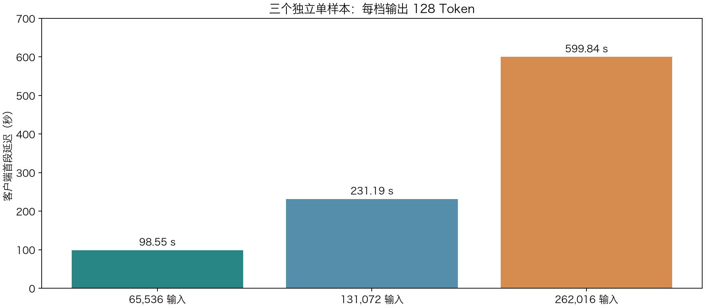
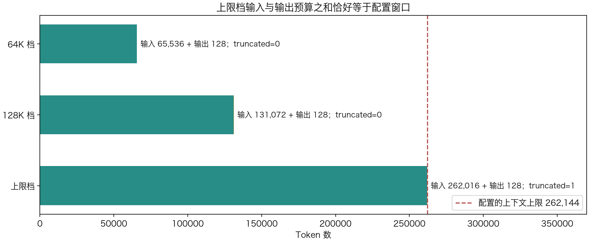

一个标注 256K 上下文的模型服务，收到了 262,016 个输入 Token，并返回 128 个输出 Token。输入和输出正好加起来等于 262,144。HTTP 请求成功，回答里也找到了放在资料首尾的两个校验码。

如果验收表只看这三项，这次测试似乎已经通过。但服务日志同时记录了 `truncated=1`，自动检查因此报告了边界异常。**请求完成、首尾标记被找回、没有触及截断边界，是三件不同的事。** 仅凭其中任何一项，都不能替代另外两项。

我重新核对了三个长度档的客户端数据库、服务端日志与请求预检记录，并查看发行包记录的上游代码。结果说明，日志标志可能与生成触达容量边界有关；由于厂商分支没有完成逐行核验，也不能据此断言输入开头一定被丢弃。更重要的是，这个案例展示了如何设计上下文验收，避免把“接口返回成功”写成“任意 256K 输入都能完整使用”。

## 一、先看三个请求：上限档成功返回，却亮起边界标记

测试对象是一台海光 x86 主机，搭配一张厚摩 LQ50 24GB 加速卡，设备工具报告内存总量 24,448 MB；模型为 Qwen3.6-35B-A3B 的厂商 W4A8 适配产物，单卡双 IPU 核心，batch 1，服务单 slot。现场服务版本记录为 HLIELLama 2.1.0、TCIM 1.3.0；模型编译包和服务加载配置标注上下文上限为 262,144 Token。这里的上下文上限属于这套实际加载配置，不是对所有同名模型部署的通用承诺。

客户端使用 EvalScope 1.14.0，通过单并发流式聊天接口发送请求。三档输入按 64K、128K、上限档递增执行，各一条、无预热；输出长度固定 128 Token，温度 0.1，忽略 EOS，关闭请求缓存和思考模式。三条请求使用同类合成资料：长段重复的运维文本，前后分别插入不同校验码，让模型返回两码。

执行前，测试调用服务原生的模板与分词接口，得到套用模板后的输入 Token 数；本文的输入长度采用这个口径，而不是用原始文本字节数估算。随后请求数据库也记录了相同输入长度。该预检方法有助于把系统消息、聊天模板和特殊 Token 纳入预算；具体输入仍要以目标服务和模板为准。

| 输入 Token | 输出 Token | 输入加输出 | 客户端首段等待 | 完整请求耗时 | 日志 truncated |
|---:|---:|---:|---:|---:|---:|
| 65,536 | 128 | 65,664 | 98.55 s | 104.53 s | 0 |
| 131,072 | 128 | 131,200 | 231.19 s | 238.77 s | 0 |
| 262,016 | 128 | 262,144 | 599.84 s | 610.63 s | 1 |

三档各只有一个样本，表里的数是单次观测；不能把它称为稳定均值、P95 或不同长度下的性能曲线。输入按长度递增，内容虽按同一种方式构造，实际 Token 和数据并非完全相同；没有随机交错重复，温度和设备状态也可能随时间变化。



图 1：来自三个独立客户端数据库的单次请求；每档输出 128 Token，首段等待是客户端记录。横轴输入长度不同，纵轴不是 GPU/NPU kernel 计时；上限档带边界标记。

这张图可以回答：在这三次请求中，长输入的首段等待比短输入更长。它不能回答“每增加一倍上下文，延迟必然增加多少”，更不能仅凭曲线断定 Attention 算子或硬件带宽是瓶颈。没有同窗口的设备 profiler、重复样本与严格控制变量，性能原因还需要单独测量。

## 二、为什么 256K 输入不能再额外要 128 Token

上下文窗口是服务为当前序列提供的 Token 预算。对于这次单 slot 测试，至少要把**模板化输入**与后续要生成的输出一起考虑：

`模板化输入 Token + 预留输出 Token ≤ 当前 slot 可用上下文`

这条式子是预算检查的起点，不是保证一定成功的充分条件。模型服务可能为内部标记或特定实现保留位置；多模态模型还可能引入图像或其他模态对应的 Token 或内部状态。其他引擎、并发 slot、上下文切分和拒绝策略也可能不同，必须以该服务实际配置和 API 行为为准。

在上限档，服务端预检得到 262,016 个输入 Token，客户端要求固定生成 128 个输出 Token，两者相加正好是 262,144。若只看预算算术，剩余为零。换句话说，请求没有为额外 Token、模板变化或边界处理留下任何余量。



图 2：根据三条历史请求的输入和输出 Token 数绘制；虚线是本次配置的 262,144 上限。橙色段按实际 128 Token 绘制，因比例很小而接近不可见；`truncated` 为服务日志中的标记。

相比之下，64K 档使用 65,536+128=65,664 个 Token，相对配置上限还有 196,480；128K 档使用 131,072+128=131,200，仍有 130,944。两档日志均为 `truncated=0`。这些余量只表示这次算术预算没有触顶，不代表服务在任意条件下都能容纳更多并发，也不代表文本理解已经充分验收。

同一个字符串在不同 tokenizer、聊天模板和特殊 Token 规则下，计数可能不同。用户界面看到的字符数、文件大小或者某个第三方分词器给出的数字，不能自动代替推理服务实际接收的 Token 数。尤其临近上限时，即使只差一个模板起始符或停止标记，也可能改变是否触发边界判断。

本次请求构造过程也体现了这一点：生成近似长度的主体之后，测试逐次调整短后缀，再通过服务端模板和 tokenizer 预检，直到上限档达到 262,016。它并非拿字符数直接推算 Token 数。服务端返回的输入 usage 与预检一致，支持“请求按这个输入长度被计量”的判断；但 usage 一致本身也不等价于证明每个输入位置在所有后续执行阶段都被完整保留。

一个常见的业务请求，预算并不只由用户最后输入的那句话组成。假设应用携带系统提示词、多轮历史、工具定义和检索文档，它们经过同一个模板合成后，都会成为当前请求的上下文组成部分。用户界面上看到的“本次粘贴了多少字”，可能只是其中一个字段；应用每轮又把先前回答放回历史时，下一轮输入预算还会继续增长。

对于自动化工作流，输出上限也不是实际输出长度的同义词。客户端可能设置最多生成 128，而模型在第 20 个 Token 就自然结束；也可能因为忽略 EOS 或内容较长一直生成到长度限制。本测试固定输出 128，是为了让预算和测量口径更明确。不能把它外推成所有请求都必定消耗 128，也不能因为以前某些短回答只用了 20，就在容量规划时完全不预留输出空间。

反过来，预留输出预算也不应假定一定会预先分配同等大小的显存。配置能否分配、引擎如何管理 KV 页和缓存、模型是否使用混合注意力或其他状态，都是具体实现决定的物理资源问题。预算式描述的是逻辑 Token 上限；显存与系统内存需要根据模型的实际状态布局、引擎分配策略和运行数据单独核算。本案例没有导出逐层 KV 布局，也没有执行显存对照，因此不从 262,144 推算每张卡的准确缓存字节数。

## 三、HTTP 200、找回校验码和 truncated，分别证明什么

HTTP 成功表示请求在协议层得到了成功响应。对于本例，客户端数据库还记录了 128 个输出 Token；这比只看到一个 HTTP 状态更具体，因为至少能确认客户端按 usage 口径收到了要求长度的输出。

首尾校验码测试则是在内容层增加两个观测点：把不同标记放在输入的前部和尾部，要求模型在回答中给出两者。重新解析客户端数据库保存的流式响应，只拼接模型输出的 `delta.content`，三个结果均找到了首码和尾码，结束原因均为 `length`。这可以说明，这三次响应中目标字符串出现了；如果标记设计和请求构造被正确验证，它为首尾信息在本次任务中可访问提供了有限证据。

但这仍然不是完整长上下文质量测试。两个标记不能代表中间全部位置；回答出现字符串也不能证明模型理解了整篇资料、能够跨远距离推理，或在一百种不同指令上都能准确检索。测试文本高度重复、输出被强制固定为 128 Token，模型的自然停止行为也没有在这一轮得到验证。

此外，验证“找回”时需要区分匹配对象：应该检查模型新生成的答案，而不是在请求原文、回显内容或拼接后的日志中搜索。本次离线复核只在数据库保存的助手 `delta.content` 中检索，不把请求原文和日志拼进去；三档都找到了两个完整标记。但它只能验证保存的输出文本是否包含标记，不能排除服务端行为中的其他混淆，也不能升级成严格的全位置检索正确率。

把三档生成结果逐一复核还有一个细节：解析的是聊天流式消息里的助手内容，而不是把每个事件当成一个 Token。三个数据库各保存 130 个响应事件，但它们包含角色、内容或结束信息，不能据事件数量反推输出 Token 数。输出长度使用最终 usage 对应的数据库字段；完整字符串用于检查两个校验标记。不同统计对象必须分别保留。

这一步能够进一步排除一种常见的脚本错误：程序在包含完整输入的请求 JSON 上直接搜索标记，当然总能找到首码与尾码，却并未证明模型回答包含它们。这里的离线代码明确只遍历响应中的 `choices[].delta.content`。它重新复核的是已经保存的三个输出，不会调用模型，因此也不能证明重新运行一定得到相同答案。

最后是 `truncated`。服务日志在 64K、128K 档分别记录 `truncated=0`；上限档记录 `n_tokens=262143, truncated=1`。最初的自动检查把“context shift”与 `truncated=1` 合并成一个失败条件：

```python
re.search(r"context shift|truncated\s*=\s*1", server_log, re.I)
```

因此它报告的是“上下文移动或截断至少有一项被观察到”，不能单凭这条断言就说发生了 context shift。离线复核再分别匹配两种日志；这份样本命中 `truncated=1`，没有匹配到 `context shift` 文本。历史汇总将上限档记为“完成计量但触发边界标记”。这个失败信号应该保留，而不能因为前两项看起来成功就删除。

与此同时，`truncated=1` 这个词也不能脱离实现语义解释。它可能涉及输入截断、上下文移动、生成因达到容量停止，或者该厂商分支的其他逻辑。要知道具体是哪一种，必须查看实际运行的版本和分支。只有一个布尔标记，无法单独说明究竟丢掉了哪些 Token。

## 四、上游源码能解释什么，不能解释什么

发行包版本记录声称同步了 llama.cpp 上游提交 `e43431b3811543efdad896e93a992551cc72ab5a`。在该上游提交的服务端代码里，可以找到一个与这次日志相符的条件：当 context shift 关闭，且当前 slot 的 Token 数加一达到或超过 slot 上限时，代码设置 `slot.truncated = true`，将停止类型设为长度限制，并让生成停止。[1]

```cpp
if (!params_base.ctx_shift && slot.prompt.n_tokens() + 1 >= slot.n_ctx) {
    slot.truncated = true;
    slot.stop = STOP_TYPE_LIMIT;
    slot.has_next_token = false;
}
```

把它与上限档的两个数字放在一起看：配置上限是 262,144，日志记录 `n_tokens=262143`，代入条件后 `262143 + 1 = 262144`。从算术上看，这个位置恰好满足上游条件。在这个上游提交里，`common_params::ctx_shift` 默认值为 `false`，命令行帮助也把默认状态标作 disabled。[2] 本次 EvalScope 配置没有显式传入这个选项；这让上游默认值成为一个可对照的解释，但不能证明 HLIELLama 厂商分支沿用了同一默认值。三个服务日志没有匹配到明确的 `context shift` 文本，只有上限档出现 `truncated=1`。因此可以提出一个合理解释：**该标志可能表示生成触达 slot 的容量边界；是否实际运行了与公开上游完全相同的分支，仍未验证。**

“相符”还不等于已经证明运行时走过这行代码。首先，这套服务是厂商适配的 HLIELLama，发行包记录上游提交并不能证明部署二进制与公开上游文件完全相同。厂商可能修改条件、计数、返回值或其他状态。其次，日志里的 `n_tokens` 属于服务内部 slot 状态，客户端的 128 个输出 Token 来自 API usage；一个数是 262,143，另一个加总为 262,144，不能直接断言“服务丢了一个 Token”，还要理解内部采样、写入 KV、发送和统计发生在什么顺序。

这条条件检测的是 slot 内部的 `prompt.n_tokens()`，而日志字段也是同一类内部状态；它不是客户端输入 Token 数的同义字段。上游代码指出，采样 Token、写入下一步上下文和最终记录状态发生在不同阶段。不能把内部 `n_tokens=262143` 和客户端的 `262016 + 128` 机械相减，然后断言“恰好少了一个 Token”。目前能确认的是：这组内部计数满足上游代码的停止条件；厂商实现的具体写入顺序仍需用其对应版本核验。

想真正确认因果，需要固定适配包的源码或可核验的补丁、版本信息和实际启动参数；在隔离环境使用同样的模板，分别对窗口留出多个不同余量的请求做实验；记录完整响应、服务日志、结束原因及内部 slot 状态。若厂商提供解释 `truncated` 的文档，也应将其与实际二进制版本核对。**这些额外实验在本次离线复核中没有执行。**

为了检查日志差一和最终输出之间是否存在确定关系，可以把生成过程拆成几个事件：输入完成模板化、服务接纳请求、设备写入输入状态、模型产生下一个候选 Token、服务将其加入响应、内部状态准备下一步、客户端收到片段、最终 usage 被生成。只有确认各字段在哪个事件采样，才能对齐它们。

例如，一个系统可能先采样出最终 Token 并发送给客户端，但无需再把它作为下一轮输入执行，因为请求马上结束。此时“已经发送的输出长度”和“已用于下一次模型前向的内部位置”可以不同。这个例子只解释为什么计数差异不必然等于丢失；本文没有在厂商版本逐事件证明它就是本次差异的原因。

同样，结果中的停止类型也要按不同层次看。客户端最大输出长度可以让请求按长度结束；服务内部窗口触顶也可能引发长度限制。两者在某些实现中可能映射到相近的 API 结束原因，应用若只存一个 `finish_reason`，就可能丢掉是哪一层先触发的信息。建议在可观测性记录中同时保存用户配置的输出上限、预检后的输入长度、服务端实际停止原因和边界标记，并对照厂商版本的语义。

## 五、延迟变长：哪些是数据，哪些还只是候选解释

三个客户端首段等待分别约为 98.55、231.19 和 599.84 秒。输入从 65,536 增至 131,072 是两倍，这两次首段等待的比值约为 2.35；从 131,072 增至 262,016 接近两倍，单次等待比值约为 2.59。这只是对三个具体测量值的算术比较，并不构成复杂度拟合。

首段等待从客户端开始计时，到客户端收到首个流式片段为止。它可能包含入口处理、模板与分词、服务接纳、长输入处理、首次采样、传输和客户端接收。单并发减少了本次测试中的同类并发排队，但不意味着这整个数值都等于设备端 Prefill kernel 时间；如果要确认各段贡献，需要同一次请求的服务端阶段计时和设备 trace。

直觉上，长上下文可能增加输入处理工作，Attention 或其他状态更新也会随上下文形状变化。但实际开销取决于模型架构、分块策略、缓存布局、实现和设备。没有对应算子记录，就不能因为等待增加超过两倍，立即宣布“Attention 的二次复杂度导致了这次 2.59 倍”。这个比值还可能受到分块、运行状态、温度或其他条件变化影响。

同样，每档输出固定为 128 Token，意味着较短的生成区间被放在一个很长的输入之后。把 128 除以完整请求耗时，只能得到从请求开始到结束的整轮输出吞吐；它把首段之前的等待一起计入。若想描述首段之后的平均输出间隔，应使用该客户端保存的 TPOT 等字段，并先核对其定义与流式块和 Token 的映射。

这组数据库中 TPOT 分别约为 47.07、59.67、84.92 ms。它们来自三次不同上下文、不同请求的客户端统计，同样每档只有一个样本。可以观察到后两次记录的 TPOT 更高，但不能据此建立稳定的 Token 间延迟分布，更不能把每次网络流式片段间隔都视为模型每个 Token 的设备执行时间。

这也是为什么正式验证要分成两条线：一条测试容量与边界语义，重点看输入预算、标记、停止原因与内容是否保留；另一条测试性能，使用重复请求、明确缓存状态、预热策略、真实长度分布及阶段指标。把两条线合并成一个“能跑 256K”的结论，会同时丢掉正确性和性能信息。

三条样本还展示了另一个统计细节。报告虽然可以为单条请求输出 P50、P95 等字段，但每档请求数量均为一，按请求维度计算出的这些分位数不会提供群体波动信息；而一条响应内部的多个流式间隔可能有自己的分布，那又是另一个样本集合。文章中的单次 TTFT 不把这两类分位数混在一起，也不使用它们评价生产尾延迟。

如果想判断长上下文带来的性能变化，最小对照至少需要控制请求内容结构、输出数、cache 状态、硬件频率和运行时版本。随后在每档做多次重复，并打乱或交替执行顺序，记录预热与监控条件。对于窗口上限测试，先确认不同输入确实按预期进入服务；对触发截断或失败的样本单独标记，而不是只比较成功者的速度。这样得到的比较仍需结合业务真实上下文长度分布，不应拿合成重复文本直接替代线上结果。

## 六、如何设计真正可复核的上下文边界测试

第一步，固定版本与窗口定义。记录模型和量化产物、模板版本、tokenizer、运行时、实际 slot 数以及服务启动配置；区分模型宣传的最大上下文、引擎配置的窗口和单请求实际可用的 slot 容量。多并发时，总上下文池与单 slot 上限不一定是同一个数，不能把设备总池直接当作每条请求的预算。

第二步，用服务侧 tokenizer 预检真正发送的完整请求。系统消息、历史轮次、工具定义、用户输入与生成前模板标记都应包含。对于多模态输入，还要确认服务如何展开图片或视频相关内容；仅计算文本无法覆盖所有资源消耗。应在客户端保留一份请求摘要、模板版本与输入 Token 数，避免线上错误出现后无法重建。

第三步，为输出预留空间而不是贴着数学上限。可以先设计若干相对于窗口的余量档位，确保输入加预期输出加上服务所需保留小于上限；具体余量应依据引擎实现和业务输出长度决定。本文的上限档剩余为零，触发了 `truncated=1`，不能从这一个点反推出所有服务都必须预留某个固定数量。

预算检查还应该和实际发送使用同一份不可变请求。若应用先用旧模板做预检，之后又加入工具定义、检索结果或一轮历史，再发送到另一个 tokenizer 版本的服务，预检结果就可能失效。一个可复核的实现可以记录模板版本、tokenizer 标识、最终请求摘要以及预检结果，并在内容变化时重新计算。对于发送给负载均衡器的请求，还要确保最终副本的模板与模型版本一致；否则即便入口预检准确，后端解释也可能不同。

当预算不够时，产品需要明确选择：拒绝并返回可理解的错误、由应用压缩或删减某些内容、减少输出预算，或者切换到适合更长窗口的服务。每种选择都有语义代价。例如删除历史可能改变指令约束，压缩文档可能遗漏证据，减少输出长度可能让答案不完整。截断策略应明确哪些内容优先保留，并在用户或调用方需要时传递这一事实；测试也必须确认实际执行的是哪一种策略。

第四步，在边界附近做成对对照：保持服务、模板、输入内容组织和输出上限尽可能一致，逐步改变余量，记录请求是否被拒绝、是否发生上下文移动、是否出现 truncated 标记、输出长度、结束原因和可见内容。对每档重复多次，并用不同位置的校验标记和真实任务验证内容。若某档失败，要保存完整服务日志与请求条件；不要只保留成功的结果。

第五步，做信息保留测试时，把标记分布在开头、多个中间位置和尾部，并确认验证程序只检查新生成的回答。不同任务应使用不会自然出现在模板和提示问题中的随机标识，避免回显、重复文本或固定提示让测试看起来通过。信息检索只是基础，再逐步增加跨文档汇总、矛盾识别和长距离推理；这些质量指标与 Token 吞吐应分别报告。

第六步，在不影响业务的授权环境中补齐性能证据。以一致的输入输出长度、关闭或明确标记缓存的条件，重复测量不同上下文档位的 TTFT、TPOT、完整请求时长与失败率；用服务端阶段时间与 profiler 锚定同一请求窗口，检查温度、频率、设备负载和其他共享因素。只有这样，才能将性能变化缩小到某个执行阶段，进一步讨论优化。

本文附带的离线脚本重新读取三份客户端 SQLite、对应预检 JSON 和服务日志，确认每档一条成功记录、输入和输出长度、首段时延，以及日志中的内部计数和 truncated 标志。脚本不连接设备，不重新运行推理；脚本使用禁止类加载的受限反序列化器读取保存的流式响应，重新拼接助手文本并检查首尾码；这是对历史输出的离线复核，并非重新完成的质量实验。每条数据及对应文件哈希保存在本地复核结果中。

## 结论

上限档的事实是：输入 262,016、输出 128、HTTP 成功，历史摘要记录首尾码出现，服务日志同时出现 `truncated=1`。因此，这条请求完成了计量，却没有通过“明确无边界截断”的验收。

公开上游源码提供了一个与日志数值吻合的边界停止解释，但厂商分支和实际二进制还需要核验。对系统设计来说，可靠的上下文容量不是模型名称后面的一个数字，而是一组可重复验证的条件：完整模板预算、输出余量、服务停止语义、内容保留能力与满足业务要求的延迟。这些条件需要针对实际部署版本逐项复核，并在配置变更后重新验证。

## 资料来源

1. [llama.cpp 固定提交的上下文容量停止条件](https://github.com/ggml-org/llama.cpp/blob/e43431b3811543efdad896e93a992551cc72ab5a/tools/server/server-context.cpp#L1409-L1416)
2. [同一提交的 ctx_shift 默认值与参数说明](https://github.com/ggml-org/llama.cpp/blob/e43431b3811543efdad896e93a992551cc72ab5a/common/common.h#L539) · [命令行默认值说明](https://github.com/ggml-org/llama.cpp/blob/e43431b3811543efdad896e93a992551cc72ab5a/common/arg.cpp#L1345-L1351)
3. [EvalScope v1.14.0 发布记录](https://github.com/modelscope/evalscope/releases/tag/v1.14.0)
4. 三档历史请求数据库、服务日志和模板分词预检记录；每档一条，本文仅执行离线复核。
