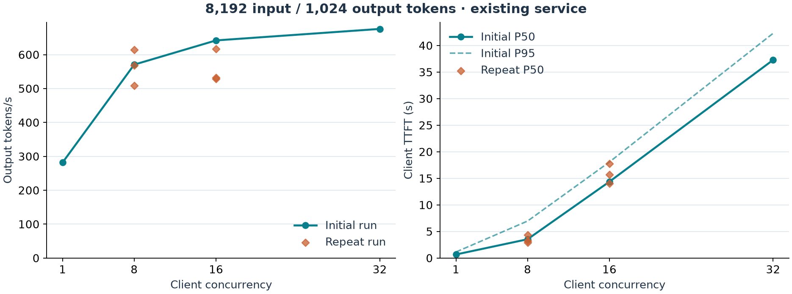
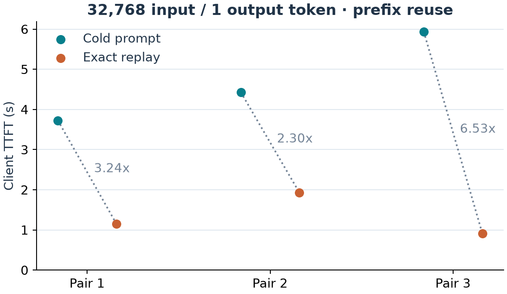

一次 DeepSeek-V4.1-Flash-1017 的压测里，我看到一个很不划算的变化。并发从 8 加到 32，输出吞吐从 571 涨到 676 tok/s，只多了 18.5%。首 token 延迟的中位数却从 3.54 秒涨到 37.28 秒。

这套服务运行在 8 张 H100 80 GB 上，用 SGLang 0.5.22、TP8、EP8、Marlin MoE 和 DSpark。这一轮按 8,192 token 输入、1,024 token 输出发压，服务端返回的长度也对得上。测试跑在已有业务流量的实例上，所以我做了三轮交替复测，再用 Nsight Systems 和 PyTorch Profiler 看时间到底花在哪里。

## 并发多了，实际在运行的请求有多少

第一轮的并发 32 是**客户端**同时发出的请求数。服务端采样到的运行请求峰值只有 10，排队峰值却到了 31。逐请求计算首 token 延迟占端到端耗时的比例，中位数为 **81.2%**。吞吐曲线已经变平时，加进来的请求大部分时间花在等首 token。

为了看这个现象会不会重现，我用相同的输入和输出长度，每轮各发 48 条请求，交替跑并发 8 和 16。三轮里，并发 16 的吞吐相对于并发 8 分别是 **+4.8%、−6.9% 和 +0.3%**。首 token 的尾延迟倒是每轮都更差。

| 客户端并发 | 三轮输出吞吐范围 | 三轮 TTFT P95 范围 |
|---:|---:|---:|
| 8 | 508～615 tok/s | 7.37～9.10 秒 |
| 16 | 529～617 tok/s | 20.35～25.26 秒 |

在另一次并发 16 的采集中，客户端 TTFT 减去服务端 TTFT，中位差只有 **4.4 ms**。同一轮服务端记录的 51 条排队样本，首次进入 forward 前平均等了 **11.64 秒**。这批样本包含背景业务，能用来确认时间主要花在服务侧，无法逐条归给测试请求。

## 把输出缩到一个 token 后，输入长度就容易看清了

在这套服务上，每个 Prefill chunk 的新 token 预算是 4,096。处理一个 8K 冷输入需要做约两个满块的工作，32K 则约八个。一个批次可以把这 4,096 个位置分给不同请求。首 token 什么时候出来，取决于自己的输入要处理几块，以及前面还有多少新 token 等着算。

我把输出固定为 **1 token**，以并发 4 对比冷输入。两档都做完了 20 条，测得的整轮输入处理速率基本一致。

| 冷输入 | 输入吞吐 | TTFT P50 |
|---:|---:|---:|
| 8K | 7,930 tok/s | 3.95 秒 |
| 32K | 7,849 tok/s | 16.08 秒 |

输入工作量是四倍，中位 TTFT 是 **4.07 倍**。接着我把相同的 32K 输入立刻重放，用三个不同的输入各做一次。三次都复用了 **32,512 / 32,768 token**，TTFT 分别缩短 **2.58 秒、2.50 秒和 5.02 秒**。一个对照增加冷输入工作量，另一个对照通过缓存减少它，两个结果都指向 Prefill。

## 两张 Trace 先确认实际抓到了什么

PyTorch Profiler 很容易抓到背景流量。判断采集是否命中目标阶段，先看 SGLang 的 `step[...]` 标记，再看 GPU stream 上实际执行的 kernel。

这份 **32K Prefill** Trace 里，Rank 0 有四个 `EXTEND`，每个 forward 都处理 4,096 个新 token。上面是 CPU 侧标记，下面是 GPU stream 的 kernel 时间。两行用同一时间轴。图上的空档只表示这一位置没有显示 GPU kernel，业务排队和 CPU 调度还需要用对应的请求指标判断。



这份 **8K Decode** Trace 有四对 `DRAFT / VERIFY`，实际逻辑 batch 为 7。蓝色 `D` 是 DSpark 提出候选 token，绿色 `V` 是目标模型验证。CPU 标记结束后，GPU 上仍然可以继续执行之前提交的工作。图里能直接看到这一点，标记本身的长度不能当成 GPU 执行时间。



按 GPU kernel 名称归类，Prefill 的 Rank 0 上，归约占累计 kernel 时间的 **24.8%**，ATen 逐元素与规约占 **22.8%**，Marlin MoE 占 **15.2%**。到了 Decode，Marlin MoE 占 **23.2%**，归约占 **18.0%**。这里的分母是该 Rank 的 kernel 时长之和，可能包含 stream 重叠。两个窗口的总时长和处理的任务不同，各自的占比用来定位接下来该看哪些 kernel。



## NCCL 排第一，为什么我回头去看 Marlin

先看 Nsight Systems。并发 16 测试的中段里，有 24 秒能与测试请求的 SSE 输出对齐。只取 GR Active 至少 90% 的采样点，DRAM 读活跃度 P95 是 **41%**，所测 NVLink RX 请求用户数据指标 P95 是 **15%**。四组设备级采样里都没有看到这两类指标持续接近峰值。1 kHz 的采样仍可能错过短时峰值，所以这一步只能缩小范围。

接着把同一次 AllReduce 在八张卡上的 kernel 对齐。PyTorch Trace 有 NCCL 通信组、序列号和 Comms ID，可以精确找到同一次操作。下图展示的是一条启动偏斜接近 40 MiB 样本中位数的记录。蓝色只画归约前的两次 Marlin GEMM，橙色画这一轮 NCCL AllReduce。



Rank 3 最早启动，Rank 4 在 **867 µs** 后启动，八个 Rank 的完成时间却只差 **8.6 µs**。只看 Rank 3 上那条又长又显眼的橙色 kernel，容易把参与者陆续到达的时间一起算成链路传输耗时。往前看，这一轮 Rank 4 的两次 Marlin 共花了约 **1.84 ms**，Rank 3 约 **0.98 ms**。

两份 Prefill Trace 共匹配了 **3,652 次** 8 Rank AllReduce。其中 40 MiB 组有 **3,564 次**。两份 Trace 的启动偏斜中位数分别是 **0.860 ms 和 0.828 ms**，完成偏斜中位数都约 **8 µs**。在最晚 Rank 启动后到全部完成之间，两份 Trace 的中位数都约为 **0.233 ms**。这组分布解释了为什么某些早到 Rank 的归约 kernel 更长。



## 最慢的卡随层变化，两份 Trace 的分布高度一致

我再把 Marlin 按 **forward、层、Rank** 配齐。两份 Prefill Trace 有 44 个实际 forward、每步 40 层，共 1,760 个组合。同一组合内，八张卡的 kernel 签名、grid、block 和资源配置相同，但最慢 Rank 对最快 Rank 的耗时比，中位数仍约为 **2.77 倍**。最慢的卡也会随层变。64K 窗口里，Rank 6 有 281 次最慢，也有 284 次最快。

热图的每个格子，先取该 Rank 在该层的两次 Marlin 耗时之和，除以同层、同一步八张卡的平均耗时，再跨步取平均。两张图分别来自 32K 和 64K Prefill，使用不同输入。**40 层各自平均最慢的 Rank，跨两份 Trace 全部复现。**



同层的两次 Marlin GEMM 使用同一套路由分组。按层、按步归一化，并扣除单个 Rank 的平均快慢后，两次 GEMM 的耗时相关系数仍为 **0.9998**。每层每卡分到的有效工作可能不同，两次 GEMM 都会受这个差异影响，之后进入 AllReduce 的时刻也随之拉开。

数据能确认到这里。当前实例启动时没有启用专家分布记录，Marlin 实际执行的工作行数在设备 buffer 里，旧 Trace 没有保存。所有 Rank 都启动同样大小的 CUDA grid，无法从 grid 或耗时倍率反推每卡拿到多少 token。究竟是路由 token 数偏斜、padding 放大，还是同量工作下的执行效率差异，仍需逐专家计数才能区分。

## 测试口径

本次共有 **684 条无采集请求**和 **170 条采集伴随请求**，都达到了指定输入和输出长度。时间线由已有 PyTorch Profiler 原始事件绘制，硬件指标取自四个 Nsight Systems 设备级采样窗口。测试使用同机直连 SGLang 的 native API 和固定长度合成输入，期间有背景业务流量。网关容量、真实 Agent 的缓存命中和 SLO 下的吞吐，需要各自的业务负载来回答。

参考实现与指标定义见 [SGLang v0.5.22 Benchmark 与 Profiling 文档](https://github.com/sgl-project/sglang/blob/v0.5.22/docs/docs/developer_guide/benchmark_and_profiling.mdx)、[PyTorch Profiler API](https://docs.pytorch.org/docs/stable/profiler.html)、[NVIDIA Nsight Systems GPU Metrics](https://docs.nvidia.com/nsight-systems/UserGuide/index.html#gpu-metrics) 和 [NCCL AllReduce 定义](https://docs.nvidia.com/deeplearning/nccl/user-guide/docs/usage/collectives.html#allreduce)。
