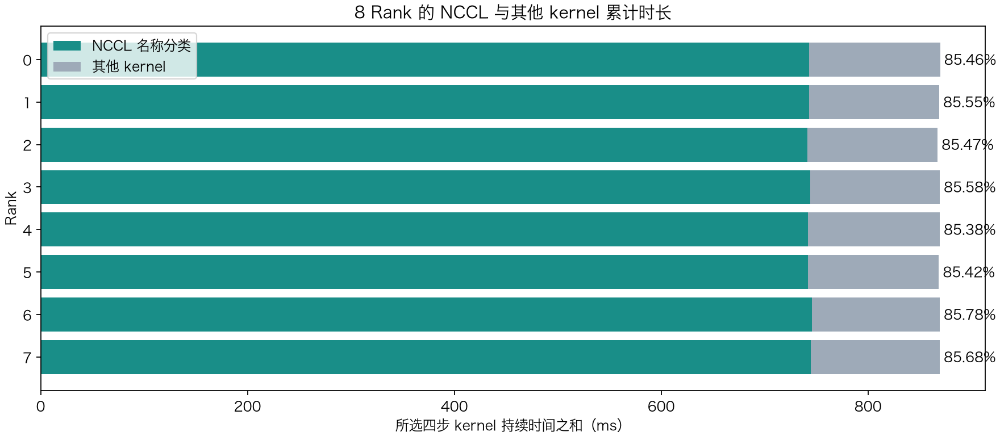
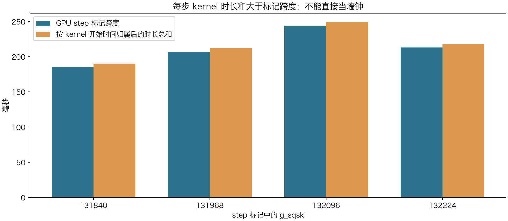

在八张 RTX PRO 5000 Blackwell 上跑 SGLang，我看到 Rank 0 的四个 Decode 步骤里，NCCL Kernel 的持续时间加起来有 **743.24 ms**，占所选 Kernel 累计时长的 **85.46%**。其余七个 Rank 也都在 85% 附近。

把这些 Kernel 放回时间线后，Rank 0 的 NCCL Kernel 区间几乎不与其他 Kernel 重叠。用四个 GPU 标记自己的时间作分母，有 NCCL Kernel 活动的覆盖率是 **87.44%**。去重之后，NCCL 依然占据这段 GPU 时间线的大部分。真正悬而未决的是，长时间运行的 Kernel 在做什么，以及缩短哪部分时间能够加快请求。

## 两份数据分别测了什么

数据采集于 2026 年 10 月 22 日。模型是 Qwen3-235B-A22B-Thinking-2507-FP8，运行在单节点八张 RTX PRO 5000 Blackwell 上。SGLang 0.5.20 使用 TP8、EP8、FlashInfer Attention 和普通解码，最大运行请求数为 128，CUDA Graph 已启用。

正式压测用 EvalScope 1.14.0，在关闭 Profiler 时发出三轮有效请求。每轮客户端并发 128，共发 128 条，输入和输出均为 1,024 Token。输入由随机 Token 构成，采用流式返回、temperature=0、ignore EOS。成功的判据是接口正常完成并返回指定长度。

| 轮次 | 客户端 | 成功请求 | 整轮耗时 | 满批 Decode | 整轮输出吞吐 |
| --- | --- | ---: | ---: | ---: | ---: |
| 1 | 本机 | 128/128 | 254.25 s | 590.34 Token/s | 515.53 Token/s |
| 2（重测） | 服务侧独立 CPU 客户端容器 | 128/128 | 253.17 s | 595.56 Token/s | 517.73 Token/s |
| 3 | 服务侧独立 CPU 客户端容器 | 128/128 | 272.13 s | 547.65 Token/s | 481.66 Token/s |

最初的第 2 轮出现客户端时钟停顿和 SocketTimeout，归档保留了该轮并从性能汇总中剔除。重测时换了客户端，继续通过同一入口访问服务。有效轮次的 384 条请求均有实际 usage 记录。哪怕只看使用同一客户端的后两轮，满批 Decode 也从 595.56 波动到 547.65 Token/s。这个幅度会影响几个百分点级别的优化判断。

满批 Decode 的窗口从所有请求已收到首个输出事件至少 2 秒后开始筛，到第一个请求完成至少 2 秒前为止。基准脚本在这个范围里找运行请求数为 128、队列为 0、Prefill 计数不增加的最长连续采样区间，再用 Rank 0 的 Decode Token 计数器增量除以区间长度。三个窗口速率的算术平均是 **577.85 Token/s**。

整轮吞吐使用客户端时间，从最早请求发出到最后一条结束。三轮共输出 393,216 Token，合计 779.54 秒，得到 **504.42 Token/s**。如果直接平均表中三个整轮速率，则得到 504.97 Token/s。前者按每轮时长加权，后者每轮权重相同。

GPU trace 来自另一次诊断。启动采集时，服务端观测到 121 条运行请求、3 条排队请求。随后八份 trace 都出现了五个 `DECODE bs=128` GPU 标记。诊断客户端设了 240 秒超时，128 条请求均超时，完成数为 0。**正式压测和诊断 trace 是两个独立窗口。** 这段 trace 可以解释窗口里的设备活动，无法和正式测试的 384 条请求逐一对应。

## 85.46% 的分母是哪些 Kernel

我把每个 Rank 的 GPU Decode 标记按开始时间排序，保留后四步，避开靠近采集启动的第一步。对于每个标记 `[start, end)`，只选择开始时间落在窗口内的 GPU Kernel 事件。名称里包含 `nccl` 的事件归为 NCCL。用选中事件的完整持续时间相加，可以复算这两项时长。

```text
Rank 0 后四步 NCCL Kernel 累计时长     = 743.2428 ms
Rank 0 后四步全部所选 Kernel 累计时长  = 869.6468 ms
743.2428 / 869.6468                  = 85.46%
```



八个 Rank 各自的结果是 **85.38%–85.78%**。图里的每一行是一个 Rank 的四步统计。这四步在八份 trace 中具有相同的 `g_sqsk` 标记值，但仅凭步标记无法对齐每一次 collective。

首步的取舍会改变比例。Rank 0 的首步标记跨度为 381.47 ms，单独算出的 NCCL 时长占比为 91.84%。把五步都纳入，Rank 0 的占比变为 **87.42%**，八个 Rank 落在 **85.22%–88.53%**。这说明 NCCL 是采样中的主要 Kernel 类别，精确的 85.46% 则依赖这四个观察窗口。

在每个保留步骤里，每个 Rank 有 189 条 AllReduce Kernel 事件和 1 条 AllGather Kernel 事件。Rank 0 的 AllReduce 核名带有 `Sum_bf16_RING_LL`，AllGather 带有 `RING_LL`。这些字段提供归约类型、数据类型、算法和协议线索。消息字节数还需要 collective 的元素数和数据类型。189 是设备事件的计数，框架调用数还需要从 CPU 调用、CUDA Graph 节点或 NCCL 事件建立关联。

## 把 Kernel 的持续时间放回时间线



图里四个步骤的 Kernel 累计时长都超过了 GPU 标记跨度。有两种情况能造成这种现象。两条 Kernel 同时运行时，持续时间相加会重复计算重叠区间。按开始时间归属时，窗口内启动、窗口外完成的 Kernel 还会把末尾的时间带进累计值。仅从两根柱子的差不能区分原因。

这份 Rank 0 trace 的四步里，核对结果是 **窗口前后都没有跨边界的 Kernel**。我将事件裁到标记边界，再求一次全部 Kernel 的时间区间并集，最后分别求 NCCL 和其他 Kernel 的并集、交集。

| `g_sqsk` | GPU 标记跨度 | 全部 Kernel 时长和 | 全部 Kernel 并集 | NCCL 并集 | NCCL 与其他 Kernel 交集 |
| ---: | ---: | ---: | ---: | ---: | ---: |
| 131840 | 185.64 ms | 190.23 ms | 184.65 ms | 158.16 ms | 7.1 μs |
| 131968 | 207.08 ms | 211.89 ms | 206.09 ms | 180.39 ms | 4.9 μs |
| 132096 | 244.12 ms | 249.30 ms | 243.13 ms | 218.01 ms | 7.2 μs |
| 132224 | 213.13 ms | 218.22 ms | 212.16 ms | 186.68 ms | 7.6 μs |

拿第一步举例，全部 Kernel 的累计值比并集多约 5.58 ms，NCCL 和其他 Kernel 却只交叠约 7.1 μs。结合 NCCL 自身的累计值与并集一致，可以推断重复计时主要来自其他 Kernel 之间。若有三条 Kernel 同时运行 1 ms，累计值比并集多 2 ms，实际重叠区间只长 1 ms。标记跨度比并集多的约 0.99 ms 也只代表没有选中 Kernel 覆盖，可能还有拷贝等其他设备活动。

下面这段 Python 可以在单个标记里重算覆盖时间。输入是 Chrome trace JSON 的 `kernel` 事件，`ts` 和 `dur` 使用微秒。用区间相交判断把左右跨边界事件都纳入。上面的 Rank 0 样本两侧都没有跨界事件，因此这一步与原稿按开始时间选入的结果一致。

```python
def covered_us(kernels, lo, hi):
    spans = sorted(
        (max(lo, e["ts"]), min(hi, e["ts"] + e["dur"]))
        for e in kernels
        if e["ts"] < hi and e["ts"] + e["dur"] > lo
    )
    total, covered_until = 0.0, lo
    for start, end in spans:
        if end > covered_until:
            total += end - max(start, covered_until)
            covered_until = end
    return total


def kernel_coverage(kernels, marker):
    lo = marker["ts"]
    hi = lo + marker["dur"]
    nccl = [e for e in kernels if "nccl" in e["name"].lower()]
    other = [e for e in kernels if "nccl" not in e["name"].lower()]
    nccl_us = covered_us(nccl, lo, hi)
    other_us = covered_us(other, lo, hi)
    all_us = covered_us(kernels, lo, hi)
    return {
        "nccl_share_of_marker": nccl_us / (hi - lo),
        "nccl_overlap_with_other_us": nccl_us + other_us - all_us,
    }
```

四个标记的跨度合计 849.98 ms，NCCL 区间合计覆盖 743.24 ms，即 **87.44%**。这个比例以 Rank 0 的四个标记为范围，描述任意 NCCL Kernel 在执行的时间。要估计一次 Decode 步能省多少时间，还得追踪跨 Rank 的依赖，判断哪些事件卡住了后续计算。即使某段时间只有 NCCL Kernel 在这张卡上运行，它也可能在等待另一张卡产出输入。

## 一次 AllReduce 的长条里有什么

TP 推理里，各卡可能只算出一部分结果。例如行并行线性层按输入维度分片，每个 Rank 用自己的输入切片和权重切片做局部矩阵乘法，局部结果需要相加才能得到该层输出。AllReduce 将这些局部结果归约，再把完整结果发给所有参与者。不同通信组和算子用途都会改变调用位置，因此不能从设备事件的总数反推模型层数。[NVIDIA NCCL 集合操作](https://docs.nvidia.com/deeplearning/nccl/user-guide/docs/usage/collectives.html#allreduce)

假设同一轮 AllReduce，Rank A 先入场，Rank B 晚 4 ms 才完成前置计算。若这个例子中两者在 B 到达后还需要 1 ms 才完成，那么 A 的 Kernel 可能停留 5 ms，B 的只停留 1 ms。两张卡参与的是同一次操作。真实实现可以在部分 Rank 到达后就推进一部分工作，最后入场到全部完成的时间也包括协议推进、归约和同步开销。

这正是 **相似的 NCCL 占比不能验证等待成因** 的地方。八张卡的四步总量接近，允许每次操作由不同 Rank 先到或迟到。要测入场偏差，先要确认同一 communicator 内的同一个操作，再比较各 Rank 的开始和完成。这里每份 trace 内可见 stream、correlation 和 CUDA Graph 等信息，当前材料没有能把这些设备事件可靠配对的逐 collective 序列。按同名 Kernel 的出现顺序只能生成候选配对。

运行时还有两个需要分开的证据。启动日志记录 `CustomAllReduceV2` 在这套八卡环境中禁用，GPU 轨道实际出现了 NCCL Kernel。SGLang 日志中的 **2.30.7** 来自 PyNccl 对其加载库的版本查询，八份 trace 的 PyTorch `distributedInfo.nccl_version` 则记为 **2.29.7**。PyTorch 通过 `torch.cuda.nccl.version()` 填充该字段。两份记录各有来源，无法用其中一项为每个 GPU Kernel 绑定库版本。那需要逐操作关联或对应进程的库加载记录。[SGLang v0.5.20 PyNccl 源码](https://github.com/sgl-project/sglang/blob/v0.5.20/python/sglang/srt/distributed/device_communicators/pynccl.py) · [PyTorch Profiler 元数据实现](https://github.com/pytorch/pytorch/blob/v2.14.0/torch/profiler/profiler.py)

## 从单机拓扑走到可验证的传输瓶颈

现场拓扑中，八张卡按四加四分布在两个 NUMA 域，跨组路径为 `SYS`，未看到 NVLink。NVIDIA 对 `SYS` 的定义是路径同时经过 PCIe 和 NUMA 节点之间的 SMP 互连。归档的 P2P **读取**能力检查为 OK。拓扑、可用能力和实际传输选择是三层信息。要区分 GPU 直接访问、经主机共享内存中转和其他路径，需要查看 NCCL 的运行时传输记录。Kernel 名里的 Ring 和 LL 也不能定位具体链路。[nvidia-smi 拓扑与 P2P 检查](https://docs.nvidia.com/deploy/nvidia-smi/#topology) · [NCCL P2P 与 SHM 配置](https://docs.nvidia.com/deeplearning/nccl/archives/nccl_2307/user-guide/docs/env.html#nccl-p2p-disable)

| 要区分的情况 | 补什么证据 |
| --- | --- |
| 有的 Rank 在等前置计算 | 按通信组和操作序列配对，校验各 Rank 的时钟，记录各自前置计算结束与通信 Kernel 启动的时间 |
| 消息很小，单次固定开销积累 | 保存实际元素数、数据类型和操作频率，在相同通信组和同级消息规模做小消息延迟扫描 |
| 传输路径带宽或竞争受限 | 确认实际 transport 和通道，观察同窗硬件计数器，对照同 NUMA 和跨 NUMA 的微基准 |
| 局部变化能否加速推理 | 在关闭采集时做相同工作负载的交错对照，复核吞吐、TTFT、TPOT、失败率和输出正确性 |

逐操作采集可以从 NCCL Profiler 插件入手。它的 collective 事件描述包括通信器内序列号、count、dtype、算法与协议，具体字段要按加载库支持的接口核对。如果还需要算关键路径，就将这些事件接回各 Rank 的 GPU 依赖链，并检查采样是否截断。[NCCL Profiler 插件接口](https://github.com/NVIDIA/nccl/blob/master/plugins/profiler/README.md)

微基准方面，`nccl-tests` 给出单次操作时长、`algbw` 和 `busbw`。以 AllReduce 为例，`algbw = 消息字节数 / 时间`，八 Rank 的 `busbw = algbw × 2(8−1)/8`。后者是集合操作的归一化估计。实际链路计数器读的是特定接口的数据活动，可以结合使用以定位传输路径。微基准还需要固定 Rank 到 GPU 的映射，否则同样的 GPU 数也可能走不同的 NUMA 路径。[NVIDIA nccl-tests 指标定义](https://github.com/NVIDIA/nccl-tests/blob/master/doc/PERFORMANCE.md)

部署侧的变更也要连带核对。比如减少 TP 可能减少某个通信组的参与者，同时改变每卡权重和专家布局。现场 TP8 启动日志每卡权重记为约 27.87 GB，单卡设备总量约 47.79 GiB。均匀减半分片数的粗算就会大幅抬高每卡权重，尚未计入 KV Cache、复制权重和运行时空间。另一个线索是现场 MoE Triton 调优配置缺失，运行时回退默认配置。它值得做独立对照，因为如果前置 MoE 计算改变了 Rank 入场偏差，NCCL 时长也可能跟着变。

这里最终能确认的是，**八卡短窗口的 GPU 时间线长时间被 NCCL Kernel 覆盖**，而且这个观察在去重和纳入首步后仍然成立。接下来需要用逐操作的配对记录和链路数据，量出时间分别花在等待、协议推进和实际传输的哪一环。文章中的数字来自八份历史原始 trace、三轮请求记录和服务端计数器的离线重算。

延伸阅读 · [八卡 H100 上，如何把同一次 AllReduce 对齐到八个 Rank]() · [从 vLLM 的自定义 AllReduce 分派追到设备 Kernel]()
