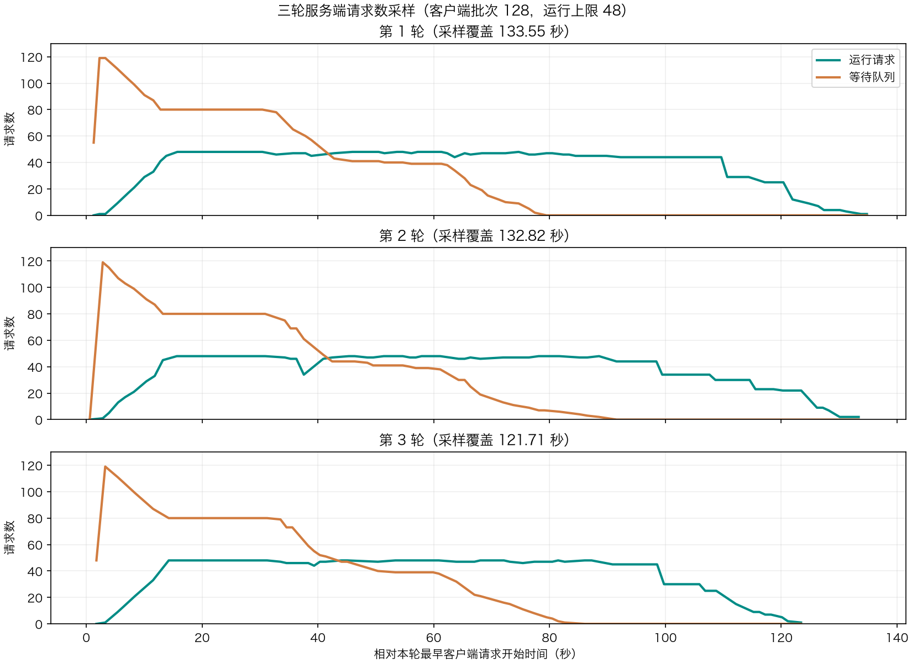
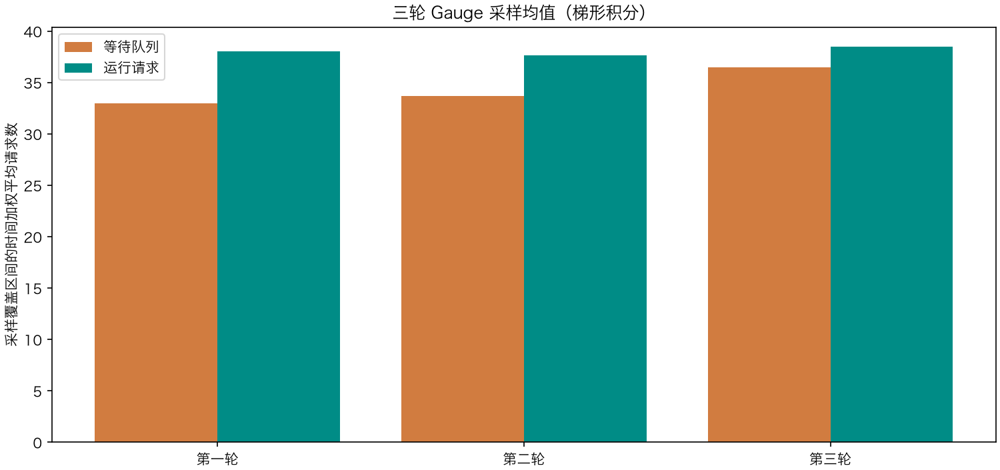

客户端并发设置为 128，并不意味着 GPU 会在整轮测试中一直处理 128 个请求。

在一组 SGLang 历史压测中，客户端每轮同时发出 128 条请求，服务端的最大运行请求数为 48。重新计算三轮服务端监控采样后，运行请求数的时间加权平均分别约为 38.06、37.67 和 38.46；队列请求数的时间加权平均分别约为 32.95、33.71 和 36.50。运行数的采样峰值达到 48，队列采样峰值达到 119。

这几个数字说的是不同的事：128 是客户端提交的并发任务数，48 是服务端配置的运行请求上限，38 左右是**被采样区间**内的时间加权平均运行数。119 是某个采样点的队列快照。它们可以同时成立，也不能互相替代。

这篇文章从原始请求数据库和监控采样出发，解释如何从“有多少请求”走到“请求在哪里等待”，以及采样曲线为什么不能自动还原成逐请求的排队时间。

## 一、先把 128、48 和 38 放回各自的位置

样本来自 Qwen3-235B-A22B-Thinking-2507-FP8，SGLang 0.5.20，使用八张 NVIDIA RTX PRO 5000 Blackwell，张量并行 TP=8、专家并行 EP=8，Attention 后端为 FlashInfer；启用 NGRAM 投机解码，候选位置参数为 4。服务端最大运行请求数为 48。客户端使用 EvalScope 1.14.0，流式请求，每轮同时提交 128 条，每条输入和输出均为 1024 Token。

工作负载采用合成随机 Token 输入，温度为零，并忽略 EOS 来维持固定输出长度；这是固定形状的压力测试，不是正常多轮对话或业务正确率验收。三轮各有 128 条请求成功，数据库中输出使用量都达到指定长度。该模型测试的历史材料记录无额外流量，但采样间隙中是否存在极短暂的背景请求，不能仅凭结果表完全排除。

客户端通过既有入口访问服务，记录的是从客户端开始到首段和完成的时间。队列与运行数来自服务端监控采样。两个采集源使用保存的单调时钟值对齐；本文只取每轮最早请求开始到最晚请求完成之间的服务端采样点。请求数据库和服务端采样位于同一次测试轮次，但服务端队列数据并未携带每个客户端请求的逐条对应信息。

三轮整轮墙钟分别约为 135.67、133.89 和 123.67 秒。用于绘图的有效服务端采样分别为 83、87 和 69 个；首尾有效点之间覆盖约 133.55、132.82 和 121.71 秒。采样区间略短于整轮，因此本文报告的是采样覆盖区间里的均值，不把缺失的开头或结尾补成零。



图 1：三轮服务端监控采样；横轴相对于当轮最早客户端请求开始。连线用于展示离散采样点之间的变化，不代表采样间状态已经逐毫秒记录。

图上的运行数达到 48，只说明采样曾观察到服务端运行请求数达到配置上限。客户端创建 128 条任务之后，请求还要经过客户端网络、入口和服务调度；未进入运行集合的请求可能仍在客户端、网关或服务端队列里。对于这次测试，服务端队列指标表明确有请求积压，但不能因此把客户端看到的所有首段等待都称作服务端排队。

同样，运行数平均约 38，并不表示这套服务的配置上限实际变成了 38。首批请求逐渐被接纳，最后一批请求逐渐完成，整个测试首尾都有不足 48 的区间。把整轮的时间序列压成一个数时，这些非满载区间自然会影响均值。若另选“只看满批 Decode”的窗口，平均运行数当然会更接近 48，但那已经回答了另一个问题。

## 二、采样值怎样变成平均请求数

假设队列长度在时间 t 为 Q(t)。在一个完整且连续记录的窗口中，平均队列长度定义为：队列曲线下的面积，除以窗口持续时间。

面积的单位是“请求·秒”。一条请求在队列停留 5 秒贡献 5 请求·秒；两条请求同时各等待 5 秒贡献 10 请求·秒。它衡量的是队列累计占据量，而不是发出了多少条独立请求。

现在只有离散采样。若相邻两次采样的队列长度分别为 q₀ 和 q₁，时间间隔为 Δt，本文用梯形近似，把这一小段面积估为 `(q₀ + q₁) × Δt / 2`。对所有相邻采样点求和，再除以首尾有效采样时间差，得到采样覆盖区间的时间加权平均。运行请求数采用同样算法。

这里使用时间权重是必要的：这批记录的采样间隔并不保证完全相等。若只对每次读取到的数做普通算术平均，采样密集的短时间段会得到更大权重，采样稀疏的长时间段反而被低估。

按保存的单调时钟和原始 Gauge 计算，三轮近似队列面积分别为 4401.06、4477.54、4442.52 请求·秒；运行集合面积分别为 5083.34、5003.29、4681.09 请求·秒。除以各自的采样跨度，得到：

| 轮次 | 有效点数 | 采样跨度 | 平均队列数 | 平均运行数 |
|---|---:|---:|---:|---:|
| 第一轮 | 83 | 133.55 s | 32.95 | 38.06 |
| 第二轮 | 87 | 132.82 s | 33.71 | 37.67 |
| 第三轮 | 69 | 121.71 s | 36.50 | 38.46 |



图 2：按相邻监控采样点做梯形积分后除以首尾有效点跨度。结果是该采样区间的近似平均请求数，不是逐请求平均排队时间，也不代表整个集群的其他实例。

源码层面，SGLang v0.5.20 的 `metrics_collector.py` 把 `sglang:num_running_reqs` 和 `sglang:num_queue_reqs` 定义为 Gauge，把 `sglang:queue_time_seconds` 定义为 Histogram。`metrics_reporter.py` 构造 Gauge 快照时，运行数来自当前 Prefill/Decode batch，队列数来自 `scheduler.waiting_queue`；`log_stats` 再把这两个值写入 Gauge。Scheduler 的指标默认只由 attention TP rank 0 汇报，除非打开 `enable_metrics_for_all_schedulers`。这次采样每个 scrape 中只有一条匹配序列，标签为 `tp_rank=0, pp_rank=0, moe_ep_rank=0`，所以没有把同一个逻辑批次按八个 TP rank 重复相加。[1][2]

Reporter 会在 Prefill 统计时更新 Gauge，也会在 Decode 统计 tick 到达 `decode_log_interval` 时更新。Prometheus 即便每秒 scrape，读到的也可能是上一轮 Scheduler report 写下的值。本文的梯形积分计算的是 scrape 序列之间按线性插值近似的 Gauge 曲线面积；若真实 Gauge 在两次报告间保持阶跃或多次变化，曲线就不会完全等于真实队列面积。这个额外误差无法仅凭当前采样点反推出。[2]

这里的 `num_queue_reqs` 是 v0.5.20 Scheduler 的 waiting queue，不等于所有排队位置的总和。当前上游的生产指标参考另外列出 `frontend_queue_depth`，并区分 intake、tokenizer、multimodal 和 scheduler 等前端阶段。排查其他版本时要先核对正在运行镜像对应的指标文档，不要把这篇历史样本的 `num_queue_reqs` 直接当成当前服务的总队列。[7]

这一区别也关系到图表解释。运行数在某个时刻为 48，是一个瞬时快照；若从两个快照之间求出的曲线面积为 48 请求·秒，它可以来自一个请求持续 48 秒，也可以来自 48 个请求同时持续 1 秒。仅凭这个面积，无法还原哪种具体情况发生，也不能得到单个请求的最大等待时间。想知道尾延迟，需要逐请求分布或者适用的直方图桶和明确的采样窗口。

为什么说是近似？队列长度实际会在请求入队和离队的瞬间阶跃变化。采样只记录两个时刻的快照，梯形算法假设中间可以线性连接；真实变化可能是突然上升、突然下降，也可能发生多次入队和出队。两次采样恰好都是 48，不能证明它们之间从未降到 30。没有更密的事件记录，就无法恢复被采样掩盖的所有波动。

同一个分母还带来边界问题。第一轮完整请求窗口约 135.67 秒，采样跨度约 133.55 秒，相差约 2.11 秒。我们不知道遗漏区间内部队列轨迹的细节，所以不能把 4401.06 直接说成完整批次的精确队列面积。本文选择保留采样窗口而非擅自补值，目的是让结果与可观测事实一致。

## 三、队列面积除以请求数，为什么不能直接说是平均排队时间

第一轮把近似队列面积 4401.06 请求·秒除以 128，得到约 34.38 秒。这个数字很诱人：看起来可以写成“平均每个请求排队 34.38 秒”。但在确认三个条件之前，这样写会越过证据。

第一，队列 Gauge 的统计对象要与客户端数据库中的 128 条请求一致。若有背景请求、其他入口流量、被取消任务，或某类请求不计入该 Gauge，队列面积的分子就包含不同的集合。客户端数据库里的成功数只描述它自己的测试请求，不能单独证明监控窗口里没有任何其他对象。

第二，队列面积必须覆盖每个请求完整的入队和离队区间。采样从客户端发起之后才取得第一个有效点，并在最后一个请求完成之前结束，窗口边缘缺失；部分请求的等待可能落在未观察的时间里。即使采样覆盖完整，离散插值也会带来误差。

第三，要证明 Gauge 描述的是所说的那个等待阶段。推理服务可能有网关队列、调度器等待队列、资源准备、Prefill 和输出发送等多个阶段。客户端首段等待横跨多个阶段。服务端某个队列 Gauge 的面积即使准确，也不能推断入口前等待或模型计算各自占了多少。

在满足对象、边界和单位一致时，队列面积还可以与完成请求数联系起来。对有限批次，如果 Scheduler 等待队列开始和结束时为空，且每条计入的请求都完整经历入队和离队，那么整个窗口内队列长度的积分，等于这些请求在该队列中的驻留时长之和。再除以请求数，才是这一批请求的平均 Scheduler 队列驻留时长。这是面积恒等式，而不是要求系统已经进入稳定状态；它也不包括请求到达 Scheduler 之前的客户端、网关或分词阶段。

Little 定律常写为 `L = λW`：平均在系统中的数量等于到达率乘平均停留时间。它通常需要稳定条件和一致的系统边界；本次测试是同时提交有限批次、从启动到排空的过程，不应把某一时刻的队列峰值或客户端配置的并发直接代入，宣称得到了线上稳定 QPS。有限批次面积恒等式更直接，但它同样要求每个对象的完整驻留区间。

因此本文只报告“采样覆盖区间的平均队列数”。想得到逐请求的服务端排队时间，应该给请求贯穿入口与调度器的关联标识，记录入队、首次接纳、开始 Prefill、首 Token 和完成事件，再按同一条请求求差。即使收集到这些事件，也应说明重试、取消和多副本如何计数。

这里还有一组可以用于交叉检查的记录：服务端同时暴露了 `queue_time_seconds` 直方图的 `_sum` 和 `_count`。重新读取各轮保存的全部有效监控样本，首尾 `_count` 差值都是 128，`_sum` 差值分别约为 4391.73、4531.33 和 4486.67 秒。用每轮的差值相除，得到监控累计器在这些样本间新增观测的均值，约为 34.31、35.40 和 35.05 秒。

这组数字比“队列 Gauge 面积除以 128”更贴近服务端代码定义的 Scheduler 等待时长，但不等于客户端逐请求端到端等待。SGLang v0.5.20 的 unified 调度路径先为请求预取缓存前缀，再把请求追加到 `scheduler.waiting_queue` 并记录 `wait_queue_entry_time`。批次组建时，调度器从等待队列选择可运行的 `can_run_list`，移除这些请求，然后在创建新 batch 前调用 `set_forward_entry_time`。这个首次 forward-entry 时间点写入 Histogram 的观测值，值为 `forward_entry_time - wait_queue_entry_time`。[3][4]

所以这个 Histogram 量到的是：缓存前缀预取之后进入 Scheduler 等待队列，到请求首次被选入 Prefill/forward batch 之间的时间。它不包含客户端到服务端、API 入口和分词阶段，也不等于首 Token 等待或整条请求的排队总感受。计时代码只在 `forward_entry_time` 尚未设置时观察；若 retry 路径重置了这组时间状态，同一逻辑请求仍可能产生多次观察。三轮 `_count` 增量均为 128，与每轮 128 条成功请求相符，是一致性线索；Histogram 没有请求 ID，不能据此证明逐条对应。

比较第一轮，队列 Gauge 按相邻点近似积分得到 4401.06 请求·秒；直方图累计 `_sum` 的首尾差值为 4391.73 秒，数值相差约 9.33。第二轮分别是 4477.54 和 4531.33，相差约 53.80；第三轮分别是 4442.52 和 4486.67，相差约 44.15。两组数值接近，却不能直接称为“采样误差”：前者仅使用客户端请求窗口内的采样，后者使用监控文件首尾有效样本，而且队列长度时点采样和已观察排队时长的事件累计，记录边界本来就不同。

一个具体反例可以说明这两种统计为什么不必完全相等。假设请求在采样窗口开始前已经进入 Scheduler 等待队列，窗口内才被首次选入 forward batch。Gauge 面积只计窗口开始后的等待部分；Histogram 在 forward-entry 时观察从 `wait_queue_entry_time` 起算的完整 Scheduler 等待时长。反过来，若请求在窗口结束时仍未被选入 batch，Gauge 面积已经计入窗口内的等待部分，而 Histogram 还没有这条观察。两种边界都能让累计值出现差异；这是计量机制示例，不代表本次原始样本确实包含上述请求。

相比直接将两个数字相减，一个可靠的实验是同时保存原始队列事件、Gauge 采样、直方图快照和统一请求 ID。先使用事件恢复完整入队/出队区间，再按同一个时间窗口计算精确面积；接着只对同一实例与同一批请求比较直方图增量，最后才分析 Gauge 的采样间隔造成了多少差异。该流程也能识别监控重启造成的累计值重置。本文已有的是历史监控与客户端记录，没有在本次实际补采这些事件。

## 四、队列峰值 119，能否说明只有 9 个请求运行？

第一轮服务端曾采到队列数 119，但不能直接用 128−119 推断同一时刻只有 9 个请求运行。

最直接的原因是，“客户端并发 128”是一次配置上限，不是这个采样瞬间已经进入服务端的请求总数。客户端各请求虽然几乎同时发起，但经过并发连接和入口转发后，抵达服务器的具体时刻可能不同。更何况监控采样有时延：请求数据库里的客户端起点与服务端 Gauge 的取值时间并非同一个事件。

另一个原因是指标之间不一定形成无重叠的完整分区。`num_running_reqs` 和 `num_queue_reqs` 的含义由采集版本的实现决定；某些正在准备或传输中的任务、已结束但客户端尚未读到响应的任务，未必落入这两个集合。若要把它们相加解释为服务内总请求数，需要先核对该版本调度器对每个状态的定义，以及计数器采样是否一致。

这也解释了为什么图里的 48 应该读成采样观察，而不是“全程 48”。只有在曲线上持续存在一段采样值为 48 的区间，才可以进一步问：这段时间是否也没有队列变化、Prefill 计数是否变化、是否已经有请求完成？原历史分析选择的是首个请求完成前、运行数为 48 且 Prefill 计数不变的最长合格窗口。这种筛选适合观察初始满批 Decode，但不能代表第二批、第三批请求接纳时的行为。

从队列曲线看，先前的测试报告给出的“初始 48 请求稳态 Decode”与本文的整轮队列面积有不同的时间边界。前者挑选了约十几秒的局部区间，后者覆盖首尾有效监控点之间的一百多秒。一个窗口更适合研究运行阶段的吞吐，另一个能显示有限批次从积压到排空的过程。二者都不能单独说明长期持续到达下的服务能力。

如果系统接收的是长时间持续到达的请求，队列是否持续增长，要看稳定运行区间内输入速率和完成速率的关系，还要看请求长度、并发及拒绝策略。仅凭一次 128 条同时发出的有限批次，既不能证明服务处于不稳定状态，也不能给出一个通用线上 QPS 上限。

## 五、如何把队列现象变成可用的容量实验

第一步是定义目标。若用户要求交互体验，应同时设置首 Token 时间、输出间隔和错误率目标；若目标是批处理总成本，则还要看整个任务集从开始到完成的时间。服务端队列平均数是解释这些结果的线索，不是最终目标本身。

第二步是固定可比条件。相同模型、镜像、硬件、权重精度、KV 配置、提示集合、输出长度和采样方式下，只改变一个参数，例如运行请求上限；重复几轮并交错测试顺序。不能把本文的 48 槽 NGRAM 与另一组同时改了缓存精度和其他参数的 128 槽结果直接当作“提高运行上限”的单因素收益。

固定目标后，还要决定请求超时和排队上限。假设一个有限批次的平均队列驻留时间为 W，只有当统计对象一致、每个请求都完整入队并离队时，`总队列请求·秒 / 请求数` 才能得到该批次平均 W。面对持续流量，还必须考虑请求长度不均：一个短输入短输出请求和一个长上下文请求，都只算一个“运行请求”，它们消耗的 GPU 计算与 KV 容量却不同。因此，运行请求数达到 48 并不等同于所有批次的算力需求都一样。

如果只观察 `num_running_reqs` 维持在上限，很容易把扩大上限当成唯一方案。更大的运行集合可能提高批处理效率，也可能增加 KV 占用、延长 Decode 间隔，甚至在固定显存预算下引入抢占。实际效果取决于模型、请求长度分布和引擎调度。本文没有在同一组输入上仅修改上限并做配对试验，因此无法用当前三轮推算 96 槽或 128 槽的收益。

相反，减小上限可能改善已接纳请求的单流体验，但更多请求留在队列，整体首段等待可能恶化。合理的运行上限应在一个明确的工作负载与服务目标下，以无采集实验比较请求通过率、首段和完成时间，再配合显存及队列数据判断。一个参数值只有连同这些条件，才有可迁移的意义。

第三步是同时保留两套记录：逐请求生命周期和服务端状态。每条请求至少记录到达入口、进入服务端队列、被调度接纳、首 Token 产生、客户端首段到达、完成或取消。对每个实例记录运行数、队列数、缓存占用、拒绝和抢占；聚合多副本时要防止漏掉某些实例，也要避免把 TP 各 Rank 重复上报的逻辑请求数直接累加。

第四步是选择适当的负载模型。闭环并发测试一般在请求完成后才补充新请求，能够观察给定并发下的服务响应；固定到达率的开环测试可以观察到达超过服务能力时队列如何变化。两种测试对系统的刺激方式不同，压测结果的分母和尾部排空边界也不同。无论哪种，都应报告输入和输出长度分布，避免固定长度样本掩盖真实工作负载。

第五步是复核采样误差。对同一段请求窗口，以秒级 Gauge 梯形积分作为近似，同时用逐请求入队/离队事件精确计算队列驻留时间和面积。先对齐实例、请求集合与时间边界，再比较两者；逐步降低采样频率，观察误差如何变化。该对照在本次材料中尚未执行，因此本文不声称当前 32.95 等数字的误差上限。

监控采集本身也可能改变观察结果。Gauge 是快照，而 `_sum` / `_count` 是从进程启动后累积的数值：当监控进程重启时，累计值可能归零；当 scrape 失败时，两次有效采样之间的时间会变长。处理累计值时不能无条件把最后一个数字减第一个数字，应该先检查中间是否存在重置、标签变化或副本切换。本文的脚本对每轮首尾作差；逐样本检查显示，这三轮已保存的 `_sum` 和 `_count` 有效采样均未出现下降；这能排除可见的数值回退，仍不能单凭它证明中途没有发生无法从这些点识别的重置或标签切换。

对于多卡模型，指标标签是另一处常见陷阱。SGLang v0.5.20 的 Gauge 带有 `tp_rank`、`pp_rank` 和 `moe_ep_rank` 等标签，默认由 attention TP rank 0 的统计器汇报；打开 `enable_metrics_for_all_schedulers` 后，所有 scheduler 都会分别暴露指标。本文的历史采样在每个 scrape 中只有一条匹配的 queue/running 序列，标签为 `tp_rank=0, pp_rank=0, moe_ep_rank=0`，所以脚本没有把 TP 的八个 rank 相加。这个结论只适用于这份归档和它的采集配置；跨版本或启用全 rank 指标时，应先看标签集合及 Scheduler 统计器配置。[1][2]

同理，多副本聚合需要判断一个请求的归属和迁移。统计某时刻整个服务的排队规模时，可以在每个独立实例的同义队列指标上求和；如果其中一项来自网关、另一项来自后端，二者可能描述同一请求先后经过的两个阶段。直接把不同时间段的峰值相加，更会得到一个没有实际发生过的总峰值。正确的做法是在相同时间对齐快照，先确定是否需要求和，再计算时间加权均值或高分位。

当采样频率过低时，除了短暂峰值可能漏掉，计数曲线还可能掩盖短促的批次振荡。比如两次读取间运行数均为 48，期间完全可能出现一批请求结束、另一批被接纳；连接两点画成水平线，只能说两次读取时均为 48。若排查的是几十毫秒的调度空洞，秒级 Gauge 无法给出充分证据，需要调度事件或适当范围内的 profiler trace。采集粒度提高也会增加数据量和性能扰动，应先明确问题再选择采样方式。

## 六、复算这三轮数据

本文的离线分析使用三轮客户端请求数据库和同轮服务端指标采样，没有向推理服务发送请求，也没有重新运行 GPU 负载。发布版本不包含原始数据库、完整日志或本地分析脚本；以下函数展示了如何对一串时间戳和 Gauge 值作同样的梯形积分。

```python
def time_weighted_mean(samples):
    """samples: 按单调时钟递增的 (time_seconds, value) 序列。"""
    if len(samples) < 2:
        raise ValueError("至少需要两个采样点")

    area = sum(
        (t1 - t0) * (v0 + v1) / 2
        for (t0, v0), (t1, v1) in zip(samples, samples[1:])
    )
    duration = samples[-1][0] - samples[0][0]
    return area / duration, area
```

复核完整实验时，先确认成功请求数和采样窗口，再检查每个 scrape 的完整标签集合；同一个逻辑 Scheduler 的 `tp_rank`、`pp_rank`、`moe_ep_rank` 不能不加区分地求和。随后检查采样时间严格递增、单位统一为秒，并分别核对首尾跨度、梯形面积和时间加权均值。若使用采样点算术平均，或将多个 rank 上重复表示的逻辑请求直接相加，得到的会是另一个统计口径。

这次没有把 4401.06 请求·秒写成逐请求队列时长之和，也没有把历史上报的 Decode 速度归因于某一段队列。证据充分支持的是：在这批固定形状请求和服务端配置下，三个采样窗口都出现过明显排队，运行 Gauge 的时间均值低于客户端并发和服务端运行上限。要进一步归因，就需要同请求身份贯穿多个阶段的记录。

## 结论

并发设置、运行槽位和时间平均运行数分别处在客户端配置、服务端配置和监控观测三个层面。三轮真实采样中的 128、48、约 38 和约 33 并不矛盾：它们共同描述了有限批次从提交、进入服务、排队到排空的不同部分。

做推理容量规划时，先确定请求集合和时间窗口，再区分单条请求体验、阶段速率与整轮完成能力。队列图不是答案的终点，它是定位等待发生在哪里、下一轮应该补什么事件的起点。

如果要继续比较整轮吞吐与单请求速率，可再看[DeepSeek-V4.1-Flash-1017 的 Token/s 口径复核]()；该文回答指标分母如何变化，这篇则把请求数放回服务端队列和运行集合。对持续到达流量下的队列与排空，参见[请求全部成功，停发后却还要等 86 秒]()。

## 资料来源

1. [SGLang v0.5.20 指标定义与 Gauge 写出](https://github.com/sgl-project/sglang/blob/v0.5.20/python/sglang/srt/observability/metrics_collector.py)
2. [SGLang v0.5.20 Scheduler 采样字段构造](https://github.com/sgl-project/sglang/blob/v0.5.20/python/sglang/srt/managers/scheduler_components/metrics_reporter.py)
3. [SGLang v0.5.20 队列时间起止与 Histogram 观察点](https://github.com/sgl-project/sglang/blob/v0.5.20/python/sglang/srt/observability/req_time_stats.py)
4. [SGLang v0.5.20 等待队列登记与首批调度](https://github.com/sgl-project/sglang/blob/v0.5.20/python/sglang/srt/managers/scheduler.py)
5. [SGLang 服务参数文档](https://docs.sglang.io/docs/advanced_features/server_arguments)
6. 本文统计和图表来自三轮保存的客户端请求数据库与同轮服务端指标采样；为离线复算，没有新执行 GPU 压测。
7. [SGLang 当前主线生产指标参考](https://github.com/sgl-project/sglang/blob/main/docs/docs/references/production_metrics.mdx)（页面随上游更新；旧版口径以 v0.5.20 源码为准。）
