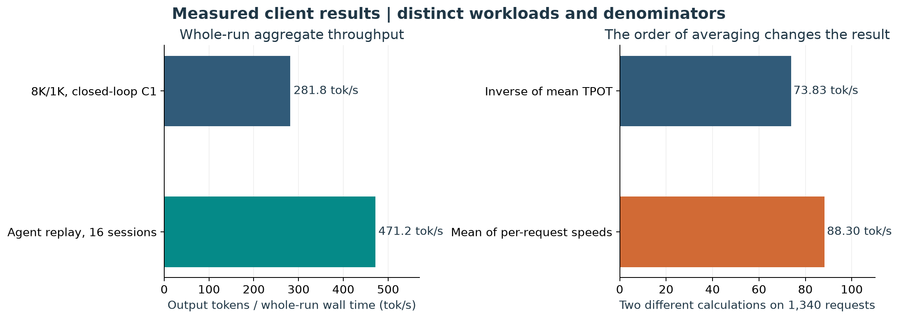
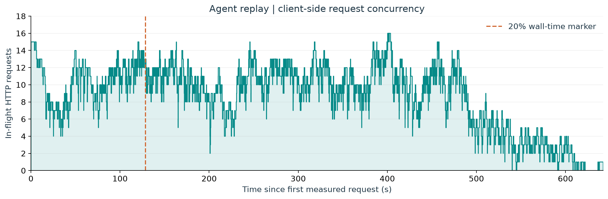
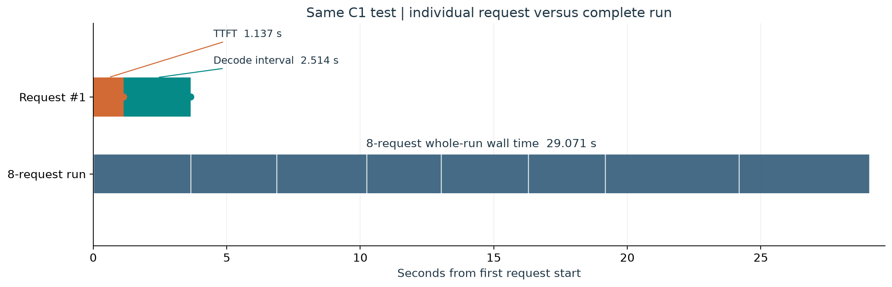

同一套 8 卡 H100 上运行的 DeepSeek-V4.1-Flash-1017，服务端日志的某些统计窗口打印 **51.64 token/s**，有时打印 **331.34 token/s**。另一份 16 并发 Agent 轨迹压测报告，稳态输出吞吐是 **464.72 token/s**。标题里的“50”指日志窗口值，不是整轮平均速度。

这几个数字放在一起，第一反应很容易是：服务速度到底是多少？是线上流量更慢，还是压测工具算高了？

我把 SGLang 日志的计数代码、EvalScope 报告、1,340 条成功请求的客户端记录，以及另一组 8K/1K 单并发原始数据重新对了一遍。最重要的发现是，每个数字都带着自己的**计数范围和时间窗口**。离开这两个条件，单独比较 token/s 很容易得出错误结论。

文中会分别回答三个问题：SGLang 的 50 是怎么记出来的，EvalScope 的 464 在统计什么，以及为什么一个请求的 Decode 速度能比整轮吞吐高。

## 先把环境、资源和启动参数写清楚

这不是一台“只写了 8 张卡”的抽象机器。下面是压测时实际运行的 Predictor Pod 配置快照；启动参数和环境变量保留其原有顺序及重复项，节点和仓库标识经过脱敏，不把一份现场配置整理成看起来更干净、但无法复现的命令。

| 项目 | 现场配置 |
| --- | --- |
| 模型 | `DeepSeek-V4.1-Flash-1017` |
| GPU | 8 × NVIDIA H100 80 GB HBM3 |
| SGLang 镜像 | `SGLang v0.5.22`（内部镜像） |
| CPU request / limit | `1` / `64` |
| 内存 request / limit | `1600Gi` / `1600Gi` |
| GPU request / limit | `8` / `8`，`nvidia.com/gpucores=100`，`nvidia.com/gpumem-percentage=100` |
| 服务端口 | `80` |

Pod 中的启动参数如下。`--model-path`、`--swa-prefix-tails` 和并行度参数在现场 spec 中出现了重复或并存写法；这正是复现时需要记录的事实，不能事后静默删除。后一个 `--swa-prefix-tails=640` 是 spec 中最后出现的值，但本文不把“最后一个参数覆盖前一个参数”当成未经源码核对的性能结论。

```text
--model-path=/mnt/models
--model-path=/mnt/models
--host=0.0.0.0
--served-model-name=DeepSeek-V4.1-Flash-1017
--port=80
--trust-remote-code
--tp=8
--ep-size=8
--moe-runner-backend=marlin
--mem-fraction-static=0.7
--chunked-prefill-size=4096
--max-running-requests=32
--cuda-graph-max-bs-decode=64
--prefill-decode-interval=16
--swa-prefix-tails=512
--enable-hierarchical-cache
--hicache-ratio=2
--hicache-io-backend=direct
--hicache-mem-layout=page_first_direct
--hicache-write-policy=write_back
--reasoning-parser=auto
--tool-call-parser=auto
--speculative-algorithm=DSPARK
--speculative-dspark-block-size=5
--watchdog-timeout=3600
--swa-prefix-tails=640
--enable-metrics
--tp-size=8
```

环境变量也会改变启动路径，不能只复制命令行：

```text
SGLANG_HICACHE_HOST_REGISTER_CHUNK_GB=1
SGLANG_ENABLE_DSV41_ENGRAM_HOST_TABLE=1
SGLANG_DSV41_ENGRAM_HOST_TABLE_LAYOUT=per_rank
SGLANG_DEFAULT_THINKING=1
SGLANG_DSV41_REASONING_EFFORT=high
```

这里的 `CPU request=1` 不是“启动只用了 1 个 CPU”，而是调度保证；`CPU limit=64` 才是容器上限。本文保存的配置快照没有逐秒 CPU 利用率曲线，因此不能把这两个 Kubernetes 数字写成实际 CPU 消耗。内存同理：`1600Gi` 是 Pod 的 request/limit，不等于每时刻都占满 1.6 TiB。

不过，启动日志给出了可核对的内存事实：每个 rank 的 Engram host table 单层约 `24,171 MiB`，记录了两层；V4 HiCache 还记录了 `swa 14.67 GB`、`deepseek_v4_c1 6.47 GB`、`c1_indexer 0.75 GB`、`deepseek_v4_c2 9.71 GB` 和 `c2_indexer 1.13 GB` 的 host pool。这些是每 rank 的分配记录，不能在没有完整 pool 清单时冒充整台机器的总内存峰值。`SGLANG_HICACHE_HOST_REGISTER_CHUNK_GB=1` 是为规避大块 pinned-host 注册失败而保留的现场设置；它不是把 HiCache 容量固定成 1 GiB。

启动后服务自动把 `--tool-call-parser=auto` 解析为 `deepseekv41`，主模型和 DSpark 权重分别完成加载；这说明本文的测试确实是在这套 V4.1、TP8/EP8、Marlin、HiCache、DSpark 配置上进行的，而不是在一条简化命令上重新估算。

下面整理了线上日志中的几个统计窗口。日志反映服务端批次状态，同一行的运行请求数是打印时的快照。

| 日志记录 | 生成吞吐 | 打印时运行请求数 |
| --- | ---: | ---: |
| 窗口 A | 51.64 Token/s | 1 |
| 窗口 B | 70.23 Token/s | 1 |
| 窗口 C | 46.40 Token/s | 1 |
| 窗口 D | 52.38 Token/s | 1 |
| 窗口 E | 331.34 Token/s | 1 |

相邻 Prefill 日志中有一次记录 155,392 个缓存 Token 和 106 个新 Token。这些摘录能证明日志值出现过，还需要完整窗口和逐请求数据才能计算单个请求的平均 Decode 速度。

## 一、先把四个数字放回各自的测试里

两份数据使用同一型号的模型和 8 张 H100，采集时间和负载不同。

| 数字 | 数据来自哪里 | 测试条件与统计对象 |
|---|---|---|
| 51.64、70.23、331.34 tok/s | 一段 SGLang Decode 日志 | 短统计窗口，日志打印时运行请求数为 1 |
| 471.22 tok/s | EvalScope Agent 轨迹报告 | 全程输出 token 除以整轮时间，16 个并发会话 |
| 464.72 tok/s | 同一份 EvalScope 报告 | 报告标注的稳态窗口输出吞吐，去掉前 20% 后统计 |
| 281.80 tok/s | 另一轮固定长度压测 | 8K 输入、1K 输出、客户端并发 1，8 条请求整轮统计 |

Agent 轨迹测试于 11 月 20 日进行，16 个并发**会话**共发出 1,352 次请求，其中 1,340 次成功、12 次失败。报告中的请求平均输入约 15,883 token、平均输出约 226 token。轨迹回放使用 trie_agentic_coding 数据集，按编码 Agent 轨迹合成长度、轮次和等待时间，并没有实际执行工具。

另一轮 8K/1K 测试于 11 月 23 日进行。客户端通过 SGLang 的 native /generate 接口发送固定 token ID，8 条请求均为 8,192 输入、1,024 输出，客户端并发 1，缓存命中均为 0。两轮都使用合成负载，报告 16 并发对应会话数，和某个时刻 GPU 上正在 Decode 的请求数是两个不同的量。

这两次测试使用的 SGLang 部署记录为 v0.5.22。11 月 20 日报告没有记录 EvalScope 的精确版本与提交，下面对 EvalScope 代码的分析会明确标为**本机 v1.15.0 的实现**。它能解释一个具体实现如何计算指标，不用它倒推出归档报告一定使用了同一版本。



图左的两个柱子来自不同轮次，不能拿来判断并发 16 比并发 1 快多少。图右使用同一批 1,340 条成功请求，展示两种统计顺序，后面会解释。

## 二、SGLang 日志里的 50，分母是两次统计之间的时间

先看日志中的 Decode 记录。这个环境实际运行镜像里，report_decode_stats 的核心逻辑可以概括成：

    gap_latency = time.perf_counter() - last_decode_stats_tic
    last_gen_throughput = num_generated_tokens / gap_latency
    num_generated_tokens = 0

Decode 结果处理会通过 result.get_num_generated_tokens(batch_size) 更新生成 token 计数。统计函数在达到 `decode_log_interval` 对应的 forward 计数时计算，并清零窗口计数。它不是一个固定秒数的定时器，所以日志时间戳之间的间隔可以变化。打印的 gen throughput 对应：

    两次 Decode 统计之间累计生成的 token 数
    ÷ 两次统计之间经过的墙钟时间

这段墙钟时间可能涵盖请求进入、完成、相邻请求之间空闲，以及同一窗口里的其他调度活动。日志里打印的运行请求数 1 反映打印该条统计时的 batch 状态，不能单凭它还原整个统计窗口里每一个时刻的运行请求数。DSpark 打开时，单次验证可能提交多个 token；`accept len` 是接受长度的统计线索，不是这个窗口的输出 token/s。输出 token 数仍由结果处理路径计数，不能简单地把 Decode 迭代次数当输出 token 数。

同一段日志里能看到 46.40、51.64、70.23，随后也有 331.34 tok/s。**数值波动是真实的日志观测，但只凭几行日志，无法知道每个低值窗口各有多少秒在空闲、Prefill 或 Decode。** 要拆出具体原因，需要保存相邻统计时刻的精确时间、窗口生成 token 数，再把窗口与请求或 GPU 时间线对齐。

input throughput 使用另一个计数。当前镜像的 Prefill 统计把本次新输入 token 数加上 replay token 数，再除以距离上次 Prefill 统计的墙钟间隔。举个直观例子，一次日志显示 106 个新 token、32.19 tok/s，前后 Prefill 日志大约相隔数秒。这个结果描述的是**跨统计间隔的新输入速率**。它不能直接作为 106 个 token 在 GPU 上的纯计算速率，也不能把 155K 缓存前缀当作这次新算了 155K token。

日志里还有两个容易连在一起看的数字：

    #new-token: 106
    #cached-token: 155392
    input throughput: 32.19 token/s

大约 155K token 的前缀被复用，新进入该批 Prefill 的 token 是 106。缓存减少了需要重新处理的输入量，但后续 Decode 的上下文仍然很长。显存状态、实际缓存层级和注意力读取工作还需要看对应实现与采集数据，不能只用新 token 数判断 Decode 会有多快。

这段日志来自长上下文的业务时段；Agent 轨迹报告的最大输入为 68,410 token，平均约 15.9K。**155K 热前缀日志和 16 会话报告不是同一批请求，也不是同一个时间窗口。** 它们适合用来解释指标口径，不足以计算两种场景的性能差距。

SGLang 的实现随版本变化。本文分析以现场读取到的 v0.5.22 镜像代码为准，可结合对应上游版本核对。[SGLang v0.5.22 调度器指标代码](https://github.com/sgl-project/sglang/blob/v0.5.22/python/sglang/srt/managers/scheduler_components/metrics_reporter.py) · [Decode 结果计数](https://github.com/sgl-project/sglang/blob/v0.5.22/python/sglang/srt/managers/scheduler_components/batch_result_processor.py)

## 三、464 是什么：多个会话在同一段时间里交付了多少输出

Agent 轨迹报告的 **464.72 tok/s** 是工作负载级别的稳态输出吞吐。它把多个会话、多个请求在所选时间窗内产生的输出合起来，再除以该窗口长度：

    窗口内所有纳入请求的输出 token 总量
    ÷ 窗口长度

这与某个时刻一条请求的速率解决的是两个问题。单请求速度影响一个用户看到的回答节奏；系统输出吞吐关注整个服务在单位时间内交付了多少 token。

16 个并发会话并不意味着 16 条请求一直在 GPU 上生成。Agent 多轮负载中，会话有请求、响应和轨迹中定义的轮间等待。为了核实真实重叠程度，我用归档中保留的 1,352 条匿名请求起止时间重建了客户端在途曲线。



图中峰值达到 16，整轮时间加权平均约 **8.74 个请求在途**。这条曲线不能换算成 GPU batch，但它能说明：会话并发上限为 16 时，同一时刻的请求重叠程度确实在变化。一个窗口里只有 1 条请求运行，和另一个长窗口里多条请求不断进出，输出 token 的累计速度完全可以不同。

全程吞吐还可以直接复算。匿名逐请求快照中，成功请求的输出 token 相加为 **302,673**；首条测量请求开始到最后一条结束约 **642.322 秒**：

    302,673 / 642.322 ≈ 471.22 token/s

报告里的 **464.72 token/s** 来自另一个窗口，不能用全程 302,673 和 642.322 相除得到。本机 EvalScope v1.15.0 的 steady_state_rates 会按整轮时间的 20% 寻找累计量锚点，用最后一个累计点减去锚点，再除以两点间的时间。官方指标说明把 Output Throughput 定义为窗口内总输出 token 除以测试时长，把 Decode tok/s 定义为 `1000 / TPOT`，两者不是同一个指标。[EvalScope 指标说明](https://evalscope.readthedocs.io/en/latest/user_guides/stress_test/quick_start.html) 报告也标明“去除前 20%”的口径，但当时的原始时间线文件和工具提交未能重新取得，**464.72 作为报告值引用，不能声称这次已从原始窗口独立复算**。

这里的“稳态”是报告对所选窗口的名称。丢弃一段启动时间有助于减轻开头的影响，本身不保证后续窗口内请求在途数、输入长度和 batch 大小恒定。比较两次测试时，最好把时间窗口和负载随时间的变化一起保存下来。[EvalScope v1.15.0 工作负载时间线实现](https://github.com/modelscope/evalscope/blob/v1.15.0/evalscope/perf/utils/workload_timeline.py)

## 四、73.86 看起来是平均速度，为什么还要追问怎么算

报告还给了 **平均解码速度 73.86 tok/s**、平均 TPOT **13.54 ms**。直接把 13.54 ms 换成秒并求倒数：

    1 / 0.01354 ≈ 73.86 token/s

这两个报告数字非常接近。但这里有一个很容易忽略的数学问题：**先求平均 TPOT 再取倒数，与先求每条请求的速度再取平均，并不相等。**

拿两条虚构请求举例：

    请求 A 的 TPOT = 10 ms → 100 token/s
    请求 B 的 TPOT = 20 ms →  50 token/s

    平均 TPOT = 15 ms
    平均 TPOT 的倒数 = 66.67 token/s

    两条请求速度的算术平均 = 75 token/s

这不是小数点四舍五入造成的差异，而是运算顺序不同。

我进一步用保留下来的 **1,340 条成功请求匿名快照**重算。按照本机 EvalScope v1.15.0 中请求级 TPOT 的公式：

    TPOT = (请求完成时间 - 首个输出事件时间)
           / (输出 token 数 - 1)

先求 1,340 条请求的平均 TPOT，结果约 **13.5448 ms**，倒数为 **73.83 tok/s**。如果先算每条请求 TPOT 的倒数，再对这 1,340 个速度取算术平均，结果约 **88.30 tok/s**。

因此，将 73.86 直接解释为“逐请求速度的平均值”，缺乏充分依据。**它与报告中四舍五入后的平均 TPOT 倒数相符，不能据此断言原报告采用了逐请求倒数的算术平均。** 73.86 与用匿名记录重算的 73.83 略有差异，现有材料不足以确定产生差异的原始计算路径。

本机 v1.15.0 的请求分位数代码对每条有有效 TPOT 的流式请求计算 1 / TPOT，再统计解码速率分位数。它和概览表里的平均 TPOT 是不同的聚合过程。本文同时保留 EvalScope 报告值和匿名记录复算值，没有把本机版本的代码冒充 11 月 20 日测试时的精确实现。[请求级 TPOT 和汇总实现](https://github.com/modelscope/evalscope/blob/v1.15.0/evalscope/perf/utils/benchmark_util.py) · [请求级 Decode 吞吐分位数实现](https://github.com/modelscope/evalscope/blob/v1.15.0/evalscope/perf/utils/db_util.py)

## 五、同一轮测试里，407 和 282 为什么也都成立

上面几个数字来自不同负载。为了排除“只是换了场景”的疑问，再看同一轮 8K/1K、客户端并发 1 的原始记录。

第一条请求的时间点是：

    发出请求 → 收到首个新增 token 事件： 1.137 秒
    首个事件 → 最后一个输出 token 事件：2.514 秒
    实际输出：1,024 token

按照本文采用的客户端事件口径，首个输出之后还有 1,023 个 token，单请求 Decode 区间平均速度约为：

    (1,024 - 1) / 2.514 ≈ 407 token/s

但整个测试是八条闭环请求。8 条共输出 8,192 token，从第一条请求开始到最后一条结束约 **29.071 秒**：

    8,192 / 29.071 ≈ 281.80 token/s

一条请求的 407 与整轮的 282 同时成立。后者覆盖了每条请求的首 token 前时间，也把八条请求的实际持续时间全部纳入分母。它并不说明 GPU 在每一个 Decode 时刻都以 282 token/s 运行。



图中的 Decode 区间来自客户端收到输出事件的时间，可能包含服务端调度、网络和流式输出的影响。它是**客户端观察到的单请求区间平均值**，不是 CUDA kernel 的纯计算时间。一次 SSE 事件也可能携带多个 token，因此不能将相邻事件间隔直接当作逐 token ITL。

### 如果要把一条日志与客户端请求真正对上

可以选一个有明确开始与结束时间的观测区间，同时记录服务端增量和客户端输出。第一步是保存这个区间的起止时刻，而不是只截图一条打印值。SGLang 的 Decode 日志并非每次生成一个 token 就打印，两个统计点之间可能跨过多条请求。对带 DSpark 的服务，采集时还要同时保存实际提交的输出数和接受长度。单次验证推进多个 token 时，拿 verify 次数充当输出数会低估生成量。

第二步是在客户端保存每个请求的发出时间、首个包含新增 token 的事件时间、末个输出事件时间、结束时间以及服务端返回的 completion token 数。输出事件可能一次携带多个 token，所有参与计算的事件都要能区分空内容、推理内容和最终文本。业务关心的“看到第一段最终答案”也许比第一个非空推理片段更晚，需要单独标记。

第三步，用同一时间边界对服务端累计输出 token 计数器求差，再除以窗口长度。客户端请求的输出有一部分可能在窗口开始前已经产生，或在窗口结束后才返回。如果只把窗口内完成的整条请求的总 token 相加，跨边界请求就会让分子偏大或偏小。更精确的办法是在客户端保留每个输出事件的增量 token 和时间戳，再按窗口裁剪。计数器与客户端结果仍可能因首 token、失败、取消、结束前的缓冲和时间精度等边界不同而不完全一致。

这套对齐可以回答“同一个窗口里服务总共推进了多少输出”以及“客户端收到了多少输出”。如果这两个量接近，说明观测链路上没有发现显著差异。它仍不能把等待拆成某一种 kernel 或通信成本。那一步要让 PyTorch Profiler、Nsight 的采集时间与请求时间对上，并记录采集开销；只凭后台日志里的一个速率做根因结论仍然不够。

## 六、下次看到速度不一致，先对哪几项

我现在会把需要比较的两个数字各自写成一行，然后逐项补齐：

| 核对项 | 需要问清楚的问题 |
|---|---|
| 分子 | 统计的是新输入 token、输出 token，还是 draft/verify 候选？是单条请求还是所有请求之和？ |
| 时间边界 | 包含 TTFT、排队、请求间空闲和收尾吗？是否只取首个输出之后？ |
| 并发单位 | 是并发会话、客户端在途请求，还是某一时刻的服务端 Decode batch？ |
| 输入与缓存 | 原始输入有多长，新计算多少，缓存命中字段是否真实上报？ |
| 聚合顺序 | 先算每条请求速度再平均，还是先平均 TPOT 再取倒数？ |
| 有效样本 | 成功和失败各多少，是否排除 warmup、单 token 请求及未完成会话？ |

这些信息补齐后，才能判断需要追查的是服务排队、单请求生成、缓存命中，还是系统整体容量。对于本文开头的 155K 日志，还缺少同一时间窗的逐请求输出时间和 token 计数，因此不能把 51.64 精确拆成“GPU 生成时间占多少、空闲时间占多少”。

11 月 20 日的轨迹测试有 **12 条请求失败，具体原因未确认**。报告显示 cached prompt 为 0，但压测日志表明 1,340 条成功请求都没有上报 cached_tokens。这属于缓存字段缺失，不能据此认定实际缓存命中为零。数据归档中的原始数据库后来不可用，本文从此前保存的匿名逐请求快照独立复算了全程吞吐和 TPOT；稳态 464.72 继续按原报告引用。

比较 token/s，最先要看的是这个数字究竟数了哪些 token，又把哪些时间装进了分母。之后再讨论设备、模型和调度，结论才有可比的起点。

## 资料与实现

- [SGLang v0.5.22 调度器 Prefill 与 Decode 统计实现](https://github.com/sgl-project/sglang/blob/v0.5.22/python/sglang/srt/managers/scheduler_components/metrics_reporter.py)
- [SGLang v0.5.22 Decode 输出计数](https://github.com/sgl-project/sglang/blob/v0.5.22/python/sglang/srt/managers/scheduler_components/batch_result_processor.py)
- [EvalScope v1.15.0 请求指标与汇总实现](https://github.com/modelscope/evalscope/blob/v1.15.0/evalscope/perf/utils/benchmark_util.py)
- [EvalScope v1.15.0 工作负载吞吐窗口](https://github.com/modelscope/evalscope/blob/v1.15.0/evalscope/perf/utils/workload_timeline.py)
- [EvalScope 指标说明](https://evalscope.readthedocs.io/en/latest/user_guides/stress_test/quick_start.html)

同一套服务的并发与首 Token 延迟对照见 [8 卡 H100 的 SGLang 实测]()。
