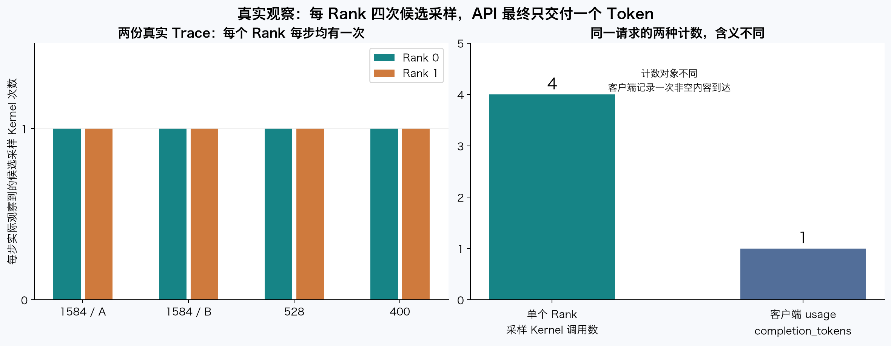
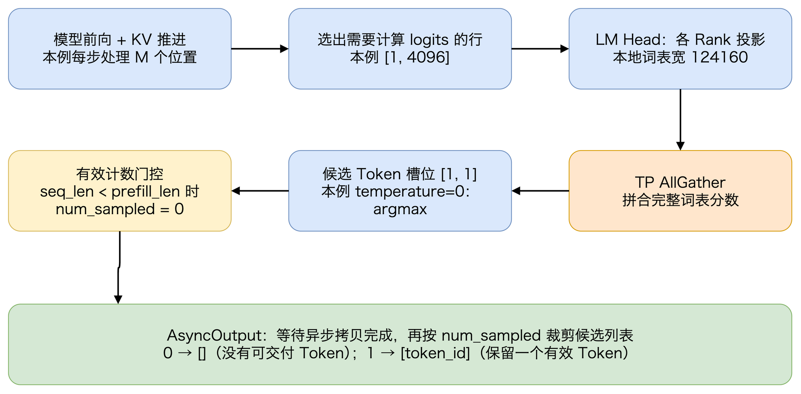
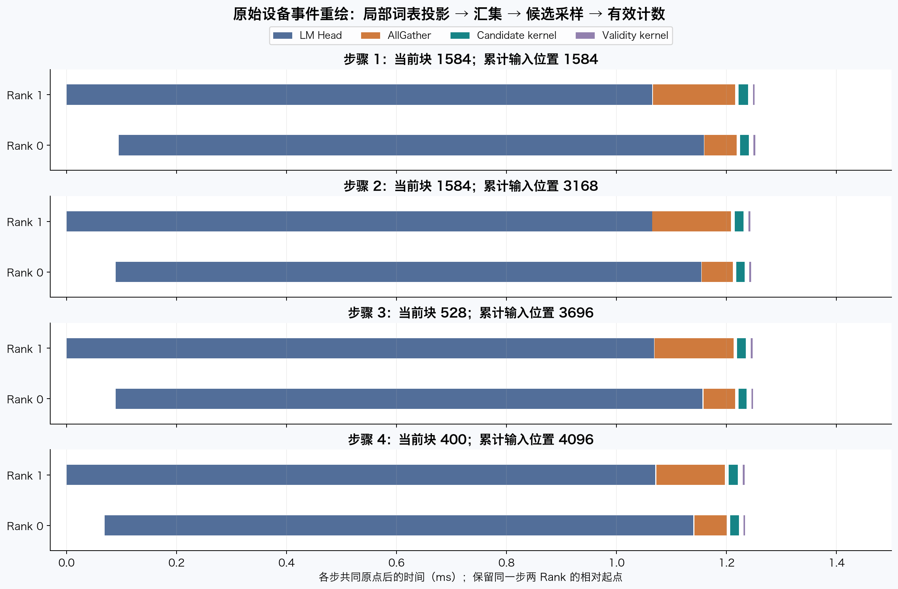
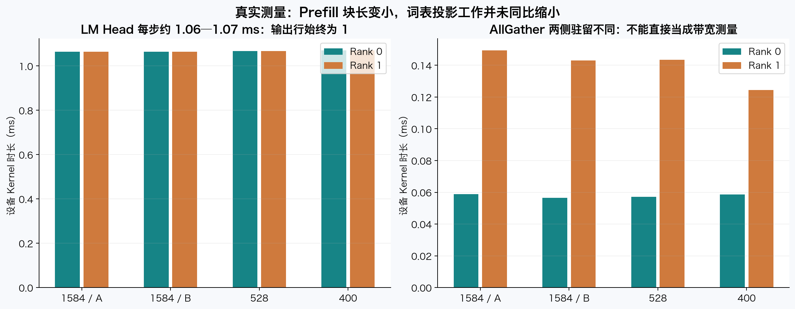
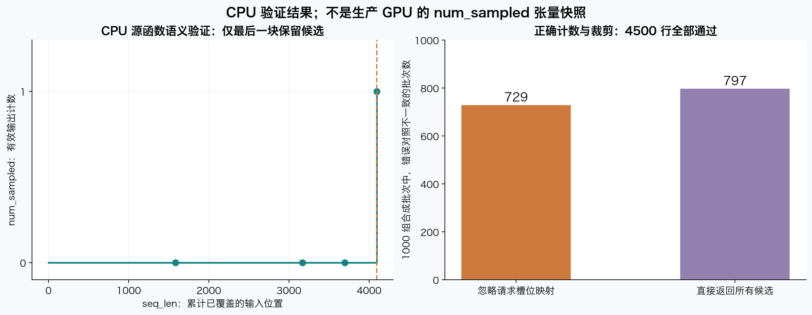

一次 vLLM 0.33.0 的 Qwen3.5-9B 双卡推理里，请求只要求输出一个 Token。每个 Rank 的 Trace 却各出现四次 LM Head 词表投影、四次 AllGather 和四次候选采样 Kernel。客户端最终成功收到一个 Token，首个非空内容到达时间约为 576.80 ms。

**候选采样生成缓冲区，输出还取决于每条请求的有效计数。** 本例前三个 Prefill 块还没有读完输入。按照固定源码的计算规则，这三步的有效输出数均为零，最后一步才得到一个有效 Token。

如果看到采样 Kernel 就开始计算“输出速度”，或者据此把剩余等待归咎于网络，排查方向可能从第一步就偏了。下面从这一个真实请求出发，追到候选槽位、有效计数、异步拷贝和状态更新之间的数据契约。



图：两份 Worker Trace 各记录四次候选采样 Kernel；同一请求的 API usage 记录 completion_tokens=1，客户端记录一次非空内容到达。两类计数的对象不同，不能相除后称为生成速度。

## 一、先把四次采样放回一个请求的执行过程

这个请求输入 4,096 个文本 Token，设置 max_tokens=1、temperature=0、ignore_eos=true，并发为 1。请求成功，usage 中 prompt_tokens 为 4,096、completion_tokens 为 1、total_tokens 为 4,097；客户端记录的首个非空内容到达为 576.798 ms，完成时间为 576.915 ms。这里不是把另一个关闭 profiler 的基线延迟拼到当前 Trace 上，客户端记录与两份 Worker 文件来自同一个采样工作负载。

客户端的到达点还需区分首个网络字节、首个流事件和首个非空内容，三者不必相同。本文采用最后一种口径，避免把没有实际生成文本的事件算成回答开始；与按网络层首字节定义的指标比较时，需要先统一边界。

服务采用 BF16、TP=2，推理栈记录为 vLLM 0.33.0、PyTorch 2.14.0+cu130、CUDA 13.0。两张 RTX 4090 D 各有约 24 GiB 显存，处于同一 NUMA，拓扑标记为 PHB，P2P 读检查双向为 NS。容器 CPU request 为 8、limit 为 16，内存 request 为 24 GiB、limit 为 40 GiB；客体可见 24 个 vCPU。资源快照有助于交代运行环境，并不能证明宿主机完全没有干扰。

运行参数是最大上下文 8,192、最大运行序列数 8、单步 Token 预算 2,048、显存利用率目标 0.90。当前请求实际被拆为 1,584、1,584、528、400 四个 Prefill 块，两侧 Rank 的标注一致。本文使用这一窗口，没有拿后来扩大的上下文上限解释本次行为，也没有进行新的 GPU 采样。

把四块累计起来，输入覆盖位置依次是 1,584、3,168、3,696、4,096。第一块计算结束时，后面仍有 2,512 个已知的输入 Token 等待处理。即使当前块末尾的隐藏状态能够投影出下一个 Token 的分布，它对应的也只是已处理前缀之后的预测，而完整问题还没有读完。后续输入应继续使用请求里已经给定的 Token，不能被这个中间预测替换。

这也是 Prefill 与真正生成阶段的区别。Prefill 推进的是已知输入的模型状态；完成输入后，模型才将选出的新 Token 接到序列后面。张量形状和执行路径可以在两阶段之间复用，业务上“是否已经产生回答”的含义却不能跟着复用。看 Trace 时，必须同时知道当前输入推进到了哪里，以及该请求当前允许交付多少新 Token。

这里的输入由脚本按长度构造有效整数 Token ID，并为请求设置独立 cache salt，目的是固定工作量、减少已有前缀复用对输入推进的影响。它不承担自然语言问答质量评测的职责。复跑时若换成聊天接口，模板、系统提示和特殊 Token 都可能改变实际输入长度，应先用服务端 usage 核对，而不是继续沿用“四千零九十六”这个外部标称值。

两张 GPU 共同执行这一条请求，也不代表有两份独立回答。每个 Rank 各有四次词表相关操作，是两个并行参与者的设备活动；API 的 completion_tokens 则是请求最终生成的逻辑 Token 数。把两侧相同操作相加，再拿八次 Kernel 调用去推断用户应该收到八个 Token，会同时混淆并行维度与有效性维度。

本文的独立样本量是一条带 profiler 的请求，不是八次采样事件，也不是四次独立请求。它足以暴露“候选已经计算、回答尚未有效”的执行结构，却不适合给出所有请求的平均浪费比例。后面讨论局部成本时，也只解释这一窗口，不把一次局部观察外推成服务的普遍性能上限。

## 二、缓冲区里有 Token ID，还需要一个有效长度

先看输出的数据结构。普通非投机路径里，采样器会产生按请求排列的候选 Token ID，并整理成二维张量。当前样本每步只有一条请求，因此能看到一个候选槽位。这回答的是内存里能容纳什么结果，还没有回答该行中有多少内容应该交给后续系统。固定形状的缓冲区通常需要配套的长度或者掩码，候选采样也遵守这个约定。

本文核对的 Runner 在 sample 中，先按 logits_indices 选择隐藏状态，再调用模型的 compute_logits；之后才进入采样器。普通路径先运行候选选择，再调用 get_num_sampled_and_rejected 确定有效数。控制交付的元数据没有因为候选已经算出来而失效。[Runner 采样入口](https://github.com/vllm-project/vllm/blob/4ba787ec9959e566d3b587a796dff07673324da5/vllm/v1/worker/gpu/model_runner.py#L1633)

有效计数 Kernel 的核心条件很短：读取该批次行对应的请求槽位，再读取 seq_len 与该槽位的 prefill_len；如果 seq_len 小于 prefill_len，就把 num_sampled 置为零。prefill_len 是运行时当前采用的 Prefill 完成边界，不能在所有恢复、重算和特殊模型路径中都不加检查地等同于原始字符串长度。本例的完整文本输入边界为 4,096。

这意味着同一个候选数组可以配套不同的有效解释。在前三个输入块之后，按这个条件得到的有效数为零；累计输入达到 4,096 时，普通单 Token 路径才保留一个。本文没有从设备内存直接读出四个 num_sampled 数值：这个 0、0、0、1 序列来自执行进度与固定源码条件的推导，并通过后面的 CPU 源函数语义验证核对；Trace 直接证明的是相关 Kernel 确实运行过。

另一处容易误读的是变量名 num_rejected。在这里，未完成 Prefill 的分支同时把它清零。普通单候选情形下，这个处理与投机解码的拒绝含义不能混为一谈。不能看到前三个候选没有交付，就说模型做了三次投机拒绝，更不能据此计算一个四分之一的接受率。本例没有开启投机解码，也没有候选草稿接受率这一测量。

有效数还会参与序列状态更新。后处理只在 num_sampled 大于零时更新 last_sampled_tokens，并把有效的新 Token 写入 token 历史和相应计数。与此同时，本步已经处理的输入位置仍要正常前进。候选是否成为新输出，与前向有没有完成当前输入计算，是两条相关但不同的状态变化；把它们绑成一个布尔值，会破坏分块推进。

因此，排查时仅打印 sampled_token_ids 往往不够。还应在相同请求、相同步骤上核对 num_sampled、输入边界和请求槽位映射。一个缓冲区里看起来合法的词表 ID，可能位于有效长度之外。用它构造响应，会把运行时原本准备过滤的中间预测泄漏到业务输出中；只看数组元素是否落在词表范围内，检查不到这类错误。



图：按固定提交的普通文本路径绘制，展示概念职责和关键形状。最后一行表示按有效数裁剪；图解的是源码的处理顺序。四步有效数由源码与输入进度推导，并用 CPU 语义对照验证。

### 设备计算结束之后，结果怎样到 CPU

在这条 Runner 路径中，`AsyncOutput` 建立了两道顺序约束。拷贝流先等待主流，使 `sampled_token_ids` 和 `num_sampled` 都在对应计算结束后复制到主机。接着在拷贝流上记录 `copy_event`，`get_output()` 等待它完成，再把每行删到有效长度。源码取的是一次配套的候选与计数，空列表仍然保留批次中的请求位置。 [AsyncOutput 的设备到主机依赖](https://github.com/vllm-project/vllm/blob/4ba787ec9959e566d3b587a796dff07673324da5/vllm/v1/worker/gpu/async_utils.py#L138-L185)

因此有三个独立的观测点：设备计数 Kernel 是否执行，CPU 是否取得有效 Token，客户端什么时候收到非空内容。最后一个点还涉及引擎输出、解码成文本和流式交付。文中的两份 Worker Trace 与客户端结果能对上同一请求；它们未建立共同的跨进程计时轴，无法从这组数据单独读出拷贝等待或网络用时。

## 三、从两份 Trace 追到采样尾部，不能只搜一个名字

真正的复核从 CPU 形状开始。每个 Rank 各找到四次 LM Head 矩阵乘，输入为 [1,4096]，乘法权重为 [4096,124160]，输入类型为 BF16。模型词表宽度为 248,320，TP=2 时这里的本地宽度正好是一半。随后四次 vllm::all_gather 的第一个输入形状均为 [1,124160]，类型也为 BF16，说明它汇集的是本地词表分数，而非长输入的全部隐藏状态。

这个形状还有一层含义：当前块处理 1,584 个位置，不代表要为全部 1,584 行执行词表投影。本例用于采样的隐藏状态只有一行。若把 Transformer 主体的 [1584,4096] 错套到 LM Head 上，会高估这一步的投影工作；反过来，看到 LM Head 只有一行，也不能宣布整个 Prefill 只计算了一个位置。相邻的两个算子可能正在处理不同的有效行集合。

LM Head 和 AllGather 可以通过同一 Trace 内的 External id 关联到 GPU Kernel。两侧各有四个匹配的词表投影 Kernel、四个 NCCL AllGather Kernel。关联时还核对 CPU 提交次序，确认这些尾部操作位于对应模型 execute 的 CPU 范围结束之后，而不是把它们错误裁进模型主体的标注区间。标注名称中的 execute，不能自动解释成整个请求步骤已经完整包含在其中。

采样与有效计数的 Triton Kernel 在这份 Trace 中没有 External id。这里不能人为补造一个编号，再宣称已经完成了算子关联。复核使用各自的 correlation，找到唯一对应的 CUDA Driver launch 事件，并确认它们的提交属于该次词表投影之后、下一次模型步骤之前。CPU/GPU 的两类关联标识各有作用，不能互相代替，更不能跨 Rank 直接比相同编号。

设备时间上，每一组都能看到本地 LM Head 结束后进入 AllGather，随后出现 _gumbel_sample_kernel，再到 _get_num_sampled_and_rejected_kernel。这条完整顺序在四个块、两个 Rank 中都成立。它比“搜到四个采样函数名”更强，因为同时约束了输入形状、提交周期与设备事件次序，降低把其他请求或者初始化工作算进来的风险。



图：从真实事件重绘，四个步骤分别采用该步两 Rank 共同的 LM Head 起点作为原点；保留同一步的两侧相对到达，不比较不同行的绝对起点。绿色只表示候选采样 Kernel，紫色只表示计数 Kernel，它们不是网络发包标记。

Kernel 名称本身还会造成另一个误会。本例请求温度为零，却依然运行名字中带 gumbel 的候选 Kernel。固定源码的 gumbel_noised_argmax 在温度为零时走普通 argmax，非零温度才加入相应噪声。因此名字包含 Gumbel，不足以证明请求采用了随机抽样。要判断采样策略，必须把请求参数、函数分支和实际执行放在一起看。[候选选择实现](https://github.com/vllm-project/vllm/blob/4ba787ec9959e566d3b587a796dff07673324da5/vllm/v1/worker/gpu/sample/gumbel.py#L171)

同理，看见 NCCL AllGather 也不能直接叫作“生成 Token 的跨卡同步”。它在这条路径中的数据对象是词表分数，之后还有候选选择与有效计数。模型主体内的 AllReduce、词表尾部的 AllGather，以及把结果拷回 CPU，是三个不同的数据移动阶段；追瓶颈时应按对象和依赖归类，不能把所有带通信含义的事件合成一段网络耗时。

## 四、局部投影约一毫秒，为何首段仍接近五百八十毫秒

四块的 LM Head 时长非常接近。Rank 0 分别约为 1.064、1.065、1.067、1.070 ms，Rank 1 也约为 1.064 到 1.071 ms。当前块长度从 1,584 缩到 400，这一项没有按比例减少，原因能从形状中直接找到：四步始终只投影一行隐藏状态，本地词表与隐藏维度也没有变化。变化的主要是模型主体处理的当前输入量，而非这里的矩阵规模。

按照一次乘加计两个浮点操作，单个 Rank、单行 LM Head 的算法工作量约为 2×4096×124160，即约 10.17 亿次浮点操作。四次合计约 40.68 亿次。这个数量来自稠密矩阵尺寸，不能等同于硬件实际执行的指令数，更不能仅凭这一个公式反推当前内核一定受哪一级缓存或存储带宽限制。但它足以说明“只要一个输出 Token”仍然需要对本地词表进行实际评分。

AllGather 的两侧时长不同。Rank 0 每步约 0.057 到 0.059 ms，Rank 1 约 0.124 到 0.149 ms；候选采样 Kernel 本体约十几微秒，有效计数约三微秒。两 Rank 词表投影开始时间存在差异，较早到达集合操作的一侧可能包含等待。没有链路流量计数和 transport 细节时，不能把较长的 NCCL 驻留全部解释成该卡传输了更多字节。

| 当前块 | Rank 0 LM Head | Rank 1 LM Head | Rank 0 AllGather | Rank 1 AllGather |
| --- | ---: | ---: | ---: | ---: |
| 1584 / A | 1.064 ms | 1.064 ms | 0.059 ms | 0.149 ms |
| 1584 / B | 1.065 ms | 1.065 ms | 0.057 ms | 0.143 ms |
| 528 | 1.067 ms | 1.068 ms | 0.057 ms | 0.144 ms |
| 400 | 1.070 ms | 1.071 ms | 0.059 ms | 0.124 ms |

表：同一请求、四个步骤的真实设备 Kernel duration，按毫秒舍入。CPU 提交时间、完整采样器的其他辅助操作和异步输出拷贝不包含在这四列中。



图：左图为每次词表投影，右图为对应 AllGather 的设备驻留。所有柱子来自双 Rank Trace，没有以词表大小估算柱高；两侧时间差不能替代带宽测量。

CPU 范围与设备时间甚至会给出相反的直觉。第三块中，Rank 0 的词表矩阵乘 CPU 事件约为 0.102 ms，关联 GPU Kernel 却约为 1.067 ms；紧接着的 AllGather，CPU 事件约为 1.839 ms，关联设备 Kernel 却只有约 0.057 ms。前者提交短而执行长，后者主机范围长而设备驻留短。若直接拿 CPU 排行榜代替 GPU 排行榜，两项的相对成本就会被读反。

这种差异首先要求核对两个事件是否属于同一次调用，然后才能沿运行时和依赖继续追查。CPU 范围可能包含提交、主机等待和其他框架工作，GPU 事件则只覆盖设备上该 Kernel 的执行区间；异步提交还可能让它落在 CPU 范围之外。这里没有把多出来的主机时间直接命名为网络阻塞，也没有将短 CPU 时间解释成“这次计算几乎免费”。

如果有人把前三次未产生有效输出的局部计算全部叫作“首段慢的原因”，还需要做一次覆盖面检查。仅将前三步的 LM Head、AllGather 和候选采样 Kernel 相加，Rank 0 为约 3.414 ms，Rank 1 为约 3.682 ms。相对各自整份窗口的全部 Kernel duration 之和，约为 0.61% 与 0.67%。这不是它们占请求延迟的精确比例，却能提醒我们：局部发现不能自动解释数百毫秒的首段时间。

这个比例的分母是设备事件持续时间之和，没有把 CPU 时间加进去，也没有把两张卡的时间相加。若不同流重叠，duration 之和会重复覆盖同一段墙钟；若存在排队和间隙，它又可能小于整个步骤的首尾跨度。因此不能进一步宣称删掉这些 Kernel，客户端就一定减少同样的毫秒数。执行依赖、CPU 提交和后续通信都可能随改动变化。

客户端约 576.80 ms 的首段覆盖了请求入口、输入处理、四次模型推进、有效结果形成及后续交付。最后一轮尾部局部只占其中一段。客户端记录和设备 Trace 虽来自同一请求，但没有被直接校准到同一时间轴，本文没有在图上把最后一个设备事件与客户端到达之间的空白命名为“网络耗时”。要精确拆开这部分，需要额外的阶段打点与时钟对齐。

只有一个输出 Token 时，客户端的持续输出间隔也没有足够样本。首段与完成时间非常接近，只说明这条固定长度请求在首个非空内容之后很快结束；不能用两者之间约十分之一毫秒的差，计算一个长期稳定的生成吞吐。若需要研究 Decode 节奏，应另设较长输出，并记录每个有效交付事件。把本次请求的倒数完成时间叫作 Token/s，会把输入处理成本也混入输出速率。

所以，看到第一次候选采样时，合理的判断是“该前缀的词表尾部已经执行到这里”，而非“首个回答已经在网络中”。看到有效计数为一，才进一步接近可输出的模型结果；要证明文本已经到用户手里，还必须看响应生成与客户端到达。测量边界逐层推进，才能避免在两个不同时间点之间随意填入一个猜测的瓶颈。

## 五、用原函数语义做对照：为什么槽位映射与裁剪缺一不可

这里最值得验证的不是某个任意 Token ID 的数值，而是“候选数组加有效长度”这个约定是否被下游遵守。本文提取固定提交中有效计数 Kernel 的原函数体，用 CPU 的 load、store、where 适配层执行；随后提取 AsyncOutput.get_output 的原方法，用已经完成的拷贝事件替身和合成候选数组执行。没有编译 Triton，也没有模拟 CUDA 的真实同步性能。

第一组输入直接使用四个累计位置：1,584、3,168、3,696、4,096，Prefill 边界固定为 4,096。每步合成一个候选槽位。原计数函数体得到 0、0、0、1，再由原裁剪方法得到三个空列表和一个保留单个候选的列表。这里候选 ID 是人为指定的哨兵值，用于验证数据是否被保留，不是模型在真实请求里生成的词表结果。

第二组覆盖混合批次。请求槽位中的 Prefill 边界各不相同，当前批次行顺序则随机打乱；同一批里包含尚未结束 Prefill、恰好达到边界和已经越过边界的行。批量大小从一到八，每种一百二十五组，共一千组合成批次、四千五百行。正确的映射和裁剪全部通过逐行检查，说明至少在这组 CPU 语义范围内，结果由请求状态而非行号巧合决定。

再看两个错误对照。第一个省掉请求槽位映射，直接用批次行号访问 Prefill 边界，导致七百二十九个批次与参考不一致。第二个直接返回所有候选，不按有效数裁剪，导致七百九十七个批次不一致。错误对照保留了张量形状和候选 ID 的合法范围，仍会输出错误的有效集合。数据结构能装下结果，不代表它包含的每个位置都可以被消费。



图：实际执行的 CPU 源函数语义验证。左侧四个点按累计位置输入原函数体；右侧为一千组合成批次中的错误对照差异数。它没有读取生产 GPU 张量，也不代表真实服务出现了这些错误。

这个实验也解释了为什么不能只给每条请求保存一个全局布尔变量“在 Prefill”。持续批处理会重排请求，部分请求可能完成输入而另一些仍然没有完成；当前行应先找到对应请求状态，再决定其有效输出量。把某一行的边界错用于另一行，可能让长请求提前输出，也可能让短请求无故等待。单请求、固定槽位的测试容易掩盖这种关联错误。

还有一个容易被忽视的状态约束：空输出不能等于空工作。本步已经完成的输入位置必须累计到模型进度；没有有效候选则不应增加回答长度。若调用方把“没有返回 Token”误解成前向没有执行，可能重复调度已经处理过的输入。反过来，若每次候选计算都增加回答长度，就可能在读完输入前提前满足 max_tokens。正确性需要同时核对输入进度与生成进度。

CPU 验证的价值，是让这条契约可以被明确执行并构造反例。它没有验证 GPU 上的地址计算、流同步、槽位回收或者异步生命周期，更没有确认模型数值与原后端一致。针对生产实现的回归，还应增加请求结束与新请求复用槽位、不同长度混合、恢复后的 Prefill 边界，以及异常取消时的状态清理。不能把这一个语义测试的通过，扩写成整个输出系统已经完整验证。

## 六、工程上怎么改：先确认收益，再守住输出边界

最直接的优化想法，是让未完成 Prefill 的请求不参与词表投影和候选选择。它在计算图上看起来合理：当前块之后的输入已经给定，中间预测不会成为业务输出。但实现时需要改变用于采样的行集合，并同步更新后续各层元数据。只在最后跳过发送，没有消除前面的词表投影；只删除某个 Kernel，又可能让后续读取没有初始化的数据。

在混合批次中，不能因为存在一个未完成 Prefill 的请求，就跳过整批采样。短请求可能已经需要首个回答，Decode 请求也需要继续生成。可选方案是压紧有资格输出的行，维护压紧前后与请求槽位的映射，再把有效结果散回正确位置。这会增加索引、重排和分支成本；当大多数行本来就有效时，额外组织成本未必划算。

压紧行集合还会改变固定形状图的适配条件。某些实现可能更愿意执行一个统一形状的尾部，再通过有效数过滤结果，以减少动态分支与频繁变化的布局。要比较这种组织与提前跳过，就要把索引准备、可能的新图形状和额外同步一起计入。当前 Trace 证明了统一尾部在本例发生过，却没有证明这是开发者选择它的唯一原因；设计动机不能由观察到的结果反推成事实。

跨 Rank 的控制流还必须相容。本例词表分数通过集合通信汇集，如果一个 Rank 判断“无需采样”而跳过 AllGather，另一个 Rank 却继续调用相同集合操作，就可能无法正常完成。应让所有参与者对请求集合、行顺序、词表分片和集合调用序列达成一致。这里的“没有有效业务输出”，绝不意味着某个参与 Rank 可以自行退出当前通信契约。

温度为零还提供另一种候选思路：在满足处理器语义的前提下，各 Rank 先找本地最大值，再交换少量值和索引，有机会避免完整词表汇集。固定源码中确实存在相关接口，但它不证明当前 Runner 已采用该路径，也不意味着可以绕开所有 logits processor。惩罚、约束、logprobs 请求以及数值和并列最大值规则，都需要逐项核对。本文没有实现或测量这种替换。

已有数据给出的排序是：前三步词表尾部的这几项累计只有几毫秒，整条请求首段接近五百八十毫秒。若目标是大幅改善用户首段，应该先解释更大的模型计算、跨 Rank 等待和提交空隙；若服务包含大量更小 Prefill 块，重复尾部工作的累计占比可能上升，那才需要在对应负载里重新测量。优化优先级应由目标工作负载决定，不能用这个单请求比例替所有部署做决定。

验收改动时，除了首段时延，还应保留每请求的最终 completion_tokens、首个有效结果所在步骤、输入推进量和候选有效数。相同请求在改动前后都只生成一个 Token，并不足以证明中间没有重复处理或提前暴露候选；只报告某个采样 Kernel 消失，也不足以证明总延迟下降。应在关闭 profiler 的受控窗口比较性能，再用短 Trace 核对新的执行结构。

如果没有修改运行时，仅仅想把监控看懂，最先可以做的是修正指标命名。Kernel 调用数叫作设备事件计数，候选槽位数叫作候选容量，num_sampled 解释为有效结果数，API usage 解释为请求输出量，客户端非空内容到达解释为交付事件。保留这些区分，才能避免把一次分块推进误画成四次回答，也不会把原本应该过滤的候选当作网络丢失的数据。

一条可靠的排查链应能回答：本步算了哪些输入；哪些隐藏状态被拿去评分；每个 Rank 提供了哪些词表分数；候选如何选择；有效数按哪个请求边界计算；CPU 等待哪一次拷贝；最后到底返回了多少内容。这个顺序把数学、数据结构和业务观察连接起来，比单看一个熟悉的 Kernel 名字，更接近可操作的性能分析。

## 结论

这次请求里，每个 Rank 都运行了四次候选采样，而 API 最终只交付一个 Token。完整证据指向一条清晰的边界：分块输入可以沿相同词表尾部路径执行，候选缓冲区却还需要有效计数；未完成的 Prefill 不应把中间预测写成用户回答。

所以，看到显卡在采样，只能证明某段候选计算已经发生。要解释首个 Token 为什么还没到，还要继续核对输入边界、结果有效性、异步输出与客户端交付。性能优化也应沿这条边界评估覆盖面：先算清能省多少，再保证省掉的不是模型和运行时必须遵守的数据契约。

## 附录：可直接运行的最小 CPU 对照

下面只展示请求槽位映射与有效长度的关系，候选 ID 为合成哨兵值；它不运行模型，也不是上面一千组源函数验证的完整替代。

```python
prefill_len = [4096, 128, 1024]  # 请求状态槽位顺序
idx_mapping = [2, 0, 1]         # 当前批次行 -> 请求槽位
seq_lens = [1024, 2048, 129]    # 各行本步执行后的累计长度
candidates = [[100], [101], [102]]

num_sampled = [
    int(seq_lens[i] >= prefill_len[state_slot])
    for i, state_slot in enumerate(idx_mapping)
]
outputs = [ids[:n] for ids, n in zip(candidates, num_sampled)]
assert num_sampled == [1, 0, 1]
assert outputs == [[100], [], [102]]

# 错误对照：忽略槽位映射，虽然形状不变，结果已经不同。
wrong = [int(s >= p) for s, p in zip(seq_lens, prefill_len)]
assert wrong == [0, 1, 0]
print(num_sampled, outputs, wrong)
```

## 资料来源

- 本文设备数据：一条 4096 输入 / 1 输出、并发 1 的 Qwen3.5-9B 请求，两份 TP=2 Worker Trace 与该窗口的客户端结果。本文进行了离线重算，没有新运行 GPU 实验。
- [vLLM Runner 的采样行选择与候选调用](https://github.com/vllm-project/vllm/blob/4ba787ec9959e566d3b587a796dff07673324da5/vllm/v1/worker/gpu/model_runner.py)：该文件与本次部署归档逐字节一致。
- [同一公开提交的普通采样路径](https://github.com/vllm-project/vllm/blob/4ba787ec9959e566d3b587a796dff07673324da5/vllm/v1/worker/gpu/sample/sampler.py)：候选数组与有效计数的组织。
- [有效计数与请求状态更新](https://github.com/vllm-project/vllm/blob/4ba787ec9959e566d3b587a796dff07673324da5/vllm/v1/worker/gpu/input_batch.py#L517)：Prefill 边界、槽位映射、num_sampled 与后处理。
- [AsyncOutput 的异步拷贝与结果裁剪](https://github.com/vllm-project/vllm/blob/4ba787ec9959e566d3b587a796dff07673324da5/vllm/v1/worker/gpu/async_utils.py#L116)：等待完成后按有效长度裁剪。
- [Gumbel 与温度为零的 argmax 分支](https://github.com/vllm-project/vllm/blob/4ba787ec9959e566d3b587a796dff07673324da5/vllm/v1/worker/gpu/sample/gumbel.py)：Kernel 名称与实际策略的区别。
- [词表投影与跨 TP 汇集](https://github.com/vllm-project/vllm/blob/4ba787ec9959e566d3b587a796dff07673324da5/vllm/model_executor/layers/logits_processor.py)：局部词表分数的生成和汇集。
- [vLLM 分块 Prefill 的官方说明](https://docs.vllm.ai/en/v0.33.0/configuration/optimization/#chunked-prefill)：调度与交互延迟的背景。

同一组 Worker Trace 还可以用于比较 GDN 与全注意力在四块 Prefill 中的设备成本。 [Qwen3.5 Gated DeltaNet Prefill 实测]()
