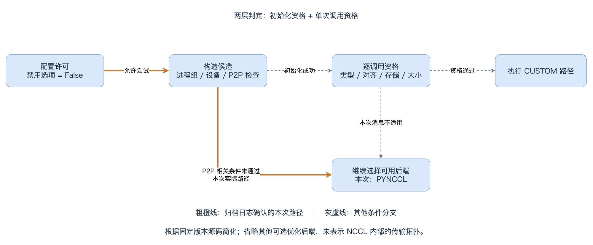
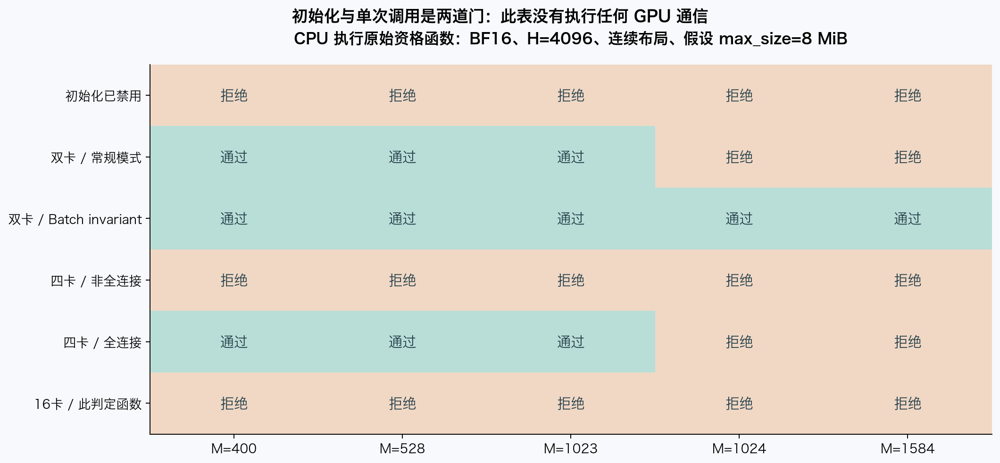
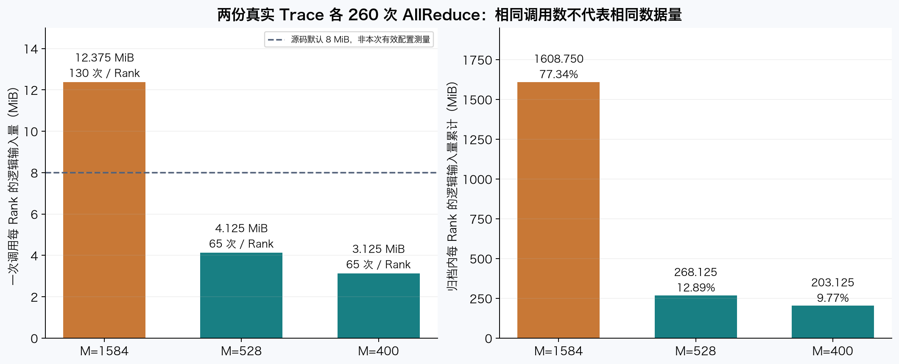
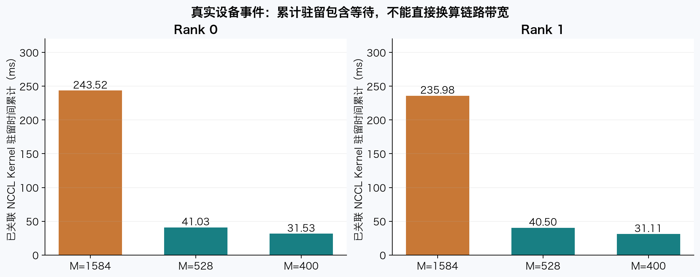

这次检查双卡服务，在同一份启动记录里找到了两行。配置是 `disable_custom_all_reduce=False`，Worker 又打出 “Custom allreduce is disabled”。继续翻，启动后保留的候选是 **PYNCCL**，两个 Rank 的设备轨道都有 NCCL AllReduce Kernel。

我按三个时点核对。Worker 读到配置后有没有尝试建后端，初始化之后有哪些候选，实际收到当前 Tensor 时选了谁。P2P 警告出在初始化阶段。

这次用两份真实 Rank Trace 和启动日志核对执行结果。消息大小、dtype 和存储条件另外用固定版本函数在 CPU 上检查。这里只确认走了哪条路径，当前环境没有 Custom 和 NCCL 的 GPU 性能对照。

## 先对启动日志和两份 Rank Trace {#一先把配置许可可用后端和实际设备事件对上}

先记采样条件。两张 RTX 4090 D，Qwen3.5-9B，BF16、TP=2、vLLM 0.33.0。Trace 的分布式元数据记录 NCCL 2.30.7。两个 Rank 推进同一个请求，样本是 4096 输入 Token、目标输出 1 Token，客户端并发 1。

服务的最大上下文为 8192，最多 8 条运行序列，每轮 Token 预算为 2048。资源声明为两张 GPU、CPU 上限 16 核、主机内存上限 40 GiB；CPU request 为 8 核。采样开启 PyTorch Profiler 的形状记录，未开启堆栈记录。这里使用采样中的算子身份与设备事件，不将 Profiler 窗口混作无采样的线上延迟基线。

拓扑文件将两卡间路径标为 PHB，CPU 与 NUMA 亲和信息均落在同一侧；peer-read 检查显示 NS，也就是该检查未报告可用的对等读取。这些记录能帮助解释为何不能假定存在直接的高速互联，但 PHB 只是拓扑路径标签，不能单独代替 CUDA 访问资格或 NCCL 实际传输路径。

启动配置首先显示没有显式禁止 Custom AllReduce。之后两个 Worker 都输出同一类 P2P 相关禁用警告，通信组的后端选择日志则只列出 PYNCCL。它们对应三个不同事实：配置允许尝试、构造结果未启用、运行时具备另一个可用后端。

最后检查设备执行。在两个原始 Prefill Trace 中，每个 Rank 都有 260 个 `vllm::all_reduce` CPU 调用，以及 260 个通过 External id 对应的 NCCL AllReduce Kernel。它们的核名属于 BF16、Ring 归约路径，算子输入、类型与设备事件能逐项对账。至此，配置与日志里的选择，已经有真实设备执行作补充。

这里不能把两个 Rank 的 260 加起来，宣布模型执行了 520 次独立的逻辑集合通信。它们是在两边共同参与同一组归约。本文分别保留每个 Rank 的事件计数；比较的是两边记录是否相容，而不是把参与者数量当成业务工作量翻倍。

实际输入被分成 1584、1584、528、400 四个块。每个块在每个 Rank 上记录 65 次归约，输入均为 M×4096 的 BF16 Tensor，其中 M 是当前块的有效位置数。这个形状稍后很关键：消息大小取决于归约操作实际收到的 Tensor，而不是简单拿模型隐藏维度再除以 TP。

这份记录没有细分到 NCCL 每个 Channel 使用哪种传输，也没有保留完整的传输调试日志。能够确认的是：Custom 的 P2P 相关初始化资格没有通过，可用后端配置为 PYNCCL，设备上出现了 NCCL 执行。将它进一步命名为某条具体网卡或共享内存通路，需要额外证据。

## 先查后端为什么没有建起来 {#二第一道门在初始化false-只是没有显式禁止}

从 `gpu_worker.py` 找到 Worker 读取的禁用值。vLLM v0.33.0 将它取反后传给 `set_custom_all_reduce`。所以日志里的 False 表示允许尝试。下一步去 CUDA 通信器看具体对象是否成功构造。 [Worker 初始化路径](https://github.com/vllm-project/vllm/blob/4ba787ec9959e566d3b587a796dff07673324da5/vllm/v1/worker/gpu_worker.py#L1706)

CUDA 通信器还检查进程组身份。在该版本里，TP 组可以尝试这些面向张量并行的优化；其他组不会仅因全局允许就自动构造相同后端。一个模型进程可能拥有多个不同职责的通信组，不能从某一条组日志推断所有集合操作都采用相同分派链。

进入 CustomAllreduce 构造时，实例最初处于 disabled 状态。代码依次检查自定义库是否可用、参与规模是否支持、设备与节点条件是否满足，以及相关互联和 P2P 检查。只有通过所需条件，才继续建立这条路径所需的共享缓冲和注册信息。

这种默认关闭的组织方式有明确的正确性意义。跨设备访问不仅需要存在两个 CUDA 设备，还需要地址共享、对等访问和同步协议能够在这些参与进程之间工作。若条件不成立，继续把指针交给假定它可用的设备代码，问题会从“这个优化不可用”升级成错误访问或无法推进。

本次警告定位到 P2P 相关分支：同节点、非 ROCm 的环境在 `_can_p2p` 返回不通过时，保留 disabled 状态并返回。警告文字包含“能力不可用或测试失败”两种可能，不能只凭它进一步断言是某项驱动配置、某个硬件开关或某一条软件缺陷造成的。[初始化检查源码](https://github.com/vllm-project/vllm/blob/4ba787ec9959e566d3b587a796dff07673324da5/vllm/distributed/device_communicators/custom_all_reduce.py#L260)

P2P 检查也不只是一行设备名称匹配。默认辅助路径会检查并缓存 GPU 间访问结果；逻辑设备顺序、可见设备映射与缓存记录共同参与解释。CUDA 提供对等访问的查询与启用机制，但两个设备存在、位于同一个 NUMA 节点，仍不等价于本次进程环境的对等访问已经通过。[GPU 访问检查源码](https://github.com/vllm-project/vllm/blob/4ba787ec9959e566d3b587a796dff07673324da5/vllm/distributed/device_communicators/all_reduce_utils.py#L346)

这也是为什么排查时要保留可见设备映射。Rank 0 表示进程组里的编号，不天然等于整机物理 GPU 0；容器只暴露某个设备子集时，两套编号可能不同。检查一对物理设备的拓扑后，若没有与当前 Rank 的可见序号对应，就可能拿另一对卡的条件来解释当前任务。

另一方面，没有 NVLink 也不是“双卡必然不能使用 Custom”的充分条件。这个版本对双卡与更多卡、全连接与非全连接存在不同检查；双卡仍需满足后续 P2P 条件。应根据相应源码分支判断资格，而不是用“PCIe 机器”四个字替代全部环境检查。

构造过程中使用的 CPU 通信组也容易引起误解。它可以承担控制信息与对象交换，而设备数据由后续自定义实现或 NCCL 路径处理。看到控制组采用非 NCCL 后端，不能据此说模型 Tensor 一定被搬到 CPU 上做了普通算术归约。



图 1：根据固定版本源码绘制的简化流程，粗橙线为归档日志确认的本次路径。省略其他可选优化器，后续可用后端不保证永远只有 PyNccl；这也不是 NCCL 内部的网络拓扑图。

因此，日志建议显式设置禁用参数，主要是在已知环境不适用时避免继续尝试该候选及相关提示。它不会凭空建立 P2P 能力，也不能当成一个保证提高吞吐的修复。本次没有执行改变这个开关的性能对照，不能把警告消失与速度改善画等号。

## 再查哪种 Tensor 能进 Custom {#三第二道门在每次调用小-tensor-和大-tensor-可能走不同分支}

假如后端通过初始化，真正调 `all_reduce` 时还有一轮筛选。先看 disabled 和参与规模，再查 Tensor 的 dtype、字节对齐、存储连续性，最后核对连接条件、模式和消息大小。

在所核对版本中，这条路径接受 FP32、FP16 与 BF16，而不是所有能够参加普通集合通信的类型。它还要求输入字节数为 16 的倍数。这里的 16 指字节，不是 Token 数，也不是矩阵某个维度必须等于 16；不同 dtype 对应的元素数量条件不同。

对本例 BF16、隐藏维度 4096 的输入，单次每 Rank 的逻辑消息字节数为：

```text
输入字节 = M × 4096 × 2
默认 8 MiB 示例、常规模式：输入字节 < 8 × 1024 × 1024
对应整数 M：M < 1024
```

因此，1023 行与 1024 行恰好落在严格边界的两侧。不能把源码里的小于号改读成小于等于，也不能把 8 MiB 当作十进制的 800 万字节。对齐是另一个独立条件：一个小于上限、却不满足 16 字节倍数的输入，仍会被拒绝。

精度变化也会移动这个边界。在相同 H=4096、常规模式和默认大小假设下，若输入改成 FP32，每行字节数翻倍，对应条件会变成 M<512。于是原先 BF16 大小为 4.125 MiB 的 528 行输入，按 FP32 计算就达到 8.25 MiB。这是依据元素宽度的条件估算，不是本轮另测了一组 FP32 性能，也说明不能把针对一种 dtype 的 Token 门槛写成通用常数。

8 MiB 是构造函数的默认参数，不是所有硬件、模式和版本共同的永久上限。源码保留了架构与模式相关处理，Batch Invariant 模式也改变大小判定，并在执行路径里支持分块。本次实际对象已经因 P2P 条件而禁用，不能倒过来声称它曾以某个有效大小配置成功运行。

存储条件同样不能只看 shape。`is_weak_contiguous` 除了接受通常的连续 Tensor，也接受满足其底层单块存储条件的一些非 C 连续布局。例如本地 CPU 验证中的转置视图，普通连续性检查为 False，这个辅助函数却返回 True；带空洞的跨行切片与广播视图则未通过。

这些结果验证的是原始判定规则，不是宣布某个任意视图已经完成了正确 GPU 归约。集合通信参与者仍须对元素顺序和数据含义保持一致，单次输入通过一个存储门槛，并不能替代跨 Rank 的完整正确性契约。

本地对固定源码做了 512 个条件组合检查，覆盖初始化禁用状态、参与规模、连接条件、模式、dtype、大小与视图；另有 32 个受控分派场景。后者只保留 Custom 与 PyNccl 候选，以带标签的返回值检查控制流，没有初始化 CUDA、测试真实 P2P 或执行任何集合算术。

实际结果显示，假设初始化可用、双卡、常规模式、上限 8 MiB，M=1023 可以通过这条资格函数，M=1024 被拒绝；将模式切到相应分支后，大小限制的行为又会变化。只要 disabled 为 True，其他条件再合适也不会使该候选重新可用。



图 2：CPU 控制流验证，表内输入假设为 BF16、H=4096、连续布局、max_size=8 MiB。构造条件用于检查判定函数，不代表当前设备已经具备这些初始化资格，也不表示通过的路径一定更快。

这张表还有一层含义：初始化支持的参与规模列表，不等于某个具体集合操作在所有模式下都接受相同规模。应该继续追到正在使用的函数。把某个类能被构造，误读成它的每项操作都已通过资格检查，也会造成“明明支持，为什么没选中”的困惑。

## 按实际 Prefill 形状统计归约 {#四回到真实负载一半调用承载了超过四分之三的逻辑数据}

我把 CPU 算子记录的形状和对应设备 Kernel 按调用对齐，再按 BF16 算单次输入。每个 Rank 都有三档：1584×4096 做了 130 次，每次 12.375 MiB。528×4096 和 400×4096 各做了 65 次，每次 4.125 MiB 和 3.125 MiB。两份记录的分布一致。

这些不是根据启动预算猜出来的大小。每轮允许调度 2048 个 Token，并不代表每次归约都处理 2048 行；当前请求实际分块后，各块内部的操作接收不同的 M。反过来，客户端只有一个请求，也不意味着归约 Tensor 只有一行：Prefill 同时推进很多输入位置。



图 3：两份 Trace 各记录 260 次归约，三档输入量按 M×4096×BF16 计算。虚线仅表示固定源码构造函数的默认 8 MiB，用于条件分析，未表示本次已禁用对象拥有一个测得的有效上限。累计逻辑输入量不是 PCIe 或网络实测流量。

若只讨论假设初始化成功、常规模式且使用默认上限的资格函数，前两块产生的 130 次较大调用不会通过大小门槛，后两个尾块的 130 次则在大小方面满足条件。只要其他条件一致，同一个推理请求内部就可能跨过候选后端的适用边界，而不是为整条请求永久选择一种实现。

必须把这个假设与本次事实分开。本次对象在 P2P 相关检查阶段便返回禁用，所有大小都不会通过 disabled 这一关。Trace 中三个尺寸都出现 NCCL，首先与这个已记录的初始化结果一致；不能再将小尾块的 NCCL 解释成“它也超过了 8 MiB”，因为数值显然没有超过。

另一项容易算错的是 TP 的含义。张量并行切开部分权重和中间特征，不保证每一个通信缓冲也只有全局隐藏维度的一半。以行并行输出投影为例，各 Rank 对不同输入列计算局部贡献，却都产生完整宽度的 M×H 部分和，归约时需要对这些相同位置求和。

因此，对这里实际收到的 M×4096 Tensor，不能因为 TP=2 就再把 H 除以二。若错误地这么做，1584 行会被算成 6.1875 MiB，看起来落在默认大小门槛以内，进而得到一条错误的“按理应该选 Custom”推论。实际参数中的维度与步长，比这种从并行度反推的简化估算更直接。[行并行输出路径](https://github.com/vllm-project/vllm/blob/4ba787ec9959e566d3b587a796dff07673324da5/vllm/model_executor/layers/linear.py#L1798)

按调用数看，较大一档只占一半；按各操作输入字节累计，它占约 77.34%。每个 Rank 的三档逻辑输入量分别约为 1608.75、268.125、203.125 MiB，合计 2080 MiB。这说明评估一个优化器的覆盖程度时，调用覆盖和数据量覆盖需要分开统计。

这些调用也不是同一负载的 260 次独立重复实验。它们来自一个请求的多个输入块和模型执行位置，可能面对不同的前序依赖与参与者到达状态。因此，本图适合检查调用覆盖和数据量分布，不能把这些内部事件的分位数直接当成服务 P95，更不能用事件数量代替独立请求的样本量。

即便如此，数据量覆盖也不等于时间覆盖。许多很小但频繁的操作，可能主要受到提交与同步影响；较大操作可能更受数据移动影响。要判断某个候选在真实业务里能节省多少，仍需要它与当前路径在相同负载下的执行对照，不能拿“覆盖了多少次”或“覆盖了多少字节”直接乘一个统一加速比。

输入逻辑字节还不是物理传输字节。集合算法、参与者数量、协议与链路路径，会决定实际数据如何分段、多次读写和传递。把两个 Rank 的输入字节直接相加，可以描述参与者缓冲的总逻辑规模，却不能据此宣布测出了整机 PCIe 吞吐或网卡流量。

CPU 控制流测试在一个受控场景里进一步验证了这层区别：其他优化候选为空，初始化可用且小消息符合条件时，原始通信器函数会进入 Custom 分支；相同输入若将对象标为 disabled，则进入 PyNccl。较大消息在常规大小门槛之外时也会继续向后选择。这些结果只证明分派语义，没有比较两种设备实现的数值或速度。

## 沿 PyNccl 追到 NCCL Kernel {#五选中-pynccl-之后tensor-并没有变成-python-消息}

跟进 `PyNcclCommunicator.all_reduce` 后，可以看到传给 NCCL 的实参。输入、输出都是设备指针，还有元素数、dtype、归约操作、通信器和 CUDA stream。设备轨道可以继续找到相应的 NCCL Kernel。 [PyNccl 调用路径](https://github.com/vllm-project/vllm/blob/4ba787ec9959e566d3b587a796dff07673324da5/vllm/distributed/device_communicators/pynccl.py#L273)

默认输出路径还可以分配一个与输入相容的输出 Tensor。函数返回了这个对象，不等于设备已经完成集合通信；工作在指定 CUDA stream 上推进，后续读取必须遵循相应的流和事件依赖。这也是为什么 CPU 包装调用持续时间不能直接代替 GPU 上的归约耗时。

输入与输出的别名关系同样属于接口契约。这个通信器的兜底代码先复制输入，再调用可能原地修改输出的分布式接口，以保持对外行为相容。如果为了减少复制而直接归约输入，其他仍需读取原输入的消费者就可能观察到不同内容。选择新后端或替换包装函数时，既要核对结果值，也要核对是否改写输入、返回哪份存储以及依赖何时完成；本次受控分派测试没有验证这些设备数据语义。

这份归档中，两个 Rank 对应 NCCL Kernel 的累计设备驻留分别约为 316.08 ms 与 307.59 ms。它们覆盖的是本次四个 Prefill 块里已关联到的 260 个事件，没有把 CPU 提交区间再次加进去，也没有将另一个 Rank 的时间加到同一条用户请求上。



图 4：真实 Trace 中的设备事件累计，分消息尺寸显示。驻留时间可能包含参与者之间的等待、协议推进和实际数据处理；本图不是纯传输耗时，不据此计算链路带宽，也没有用它推断 Custom 路径能够节省多少。

即使核名标有 Ring，也只是在识别集合实现的一部分。它没有同时给出每个通信 Channel 使用哪条设备路径、是否经主机缓冲，以及是否涉及网络接口。实际排查应把框架级分派、NCCL 的算法或协议、以及底层传输三层分别记录，而不是从一个名字补出全部执行细节。

类似地，启动阶段出现 Socket 或某个 CPU 控制组，也不足以证明模型的归约载荷全部经过网卡。建立参与者联系与搬运归约 Tensor 是不同职责；要判断后者，应该查看相应通信器、连接与 Channel 的运行证据。本次材料没有提供这一级的完整日志，因此没有把未知路径写成确定的 SHM、Socket 或其他传输。

官方 NCCL 文档将 P2P 与 SHM 作为不同传输机制，并提供各自的控制变量。P2P 指向 GPU 直接访问，SHM 则涉及主机共享内存；这些机制位于 NCCL 内部，不等同于 vLLM 的 CustomAllreduce 类。[NCCL 传输变量说明](https://docs.nvidia.com/deeplearning/nccl/user-guide/docs/env.html#nccl-p2p-disable)

因此，`disable_custom_all_reduce` 和 `NCCL_P2P_DISABLE` 不能互相替代。前者影响框架是否尝试一种自定义集合实现，后者控制 NCCL 自身的一类传输资格。禁用框架候选后仍出现 NCCL Kernel，是正常的可用路径选择；改变 NCCL 的传输设置，也不会自动将已经禁用的框架对象重新初始化。

这里还要区分候选日志与逐调用证据。可用后端日志反映这个通信组具备哪些候选及其配置，Trace 表明设备实际执行了 NCCL。核名本身通常不能进一步区分，是通过 PyNccl 包装还是其他 NCCL 包装接口发起；两者的归属应由上层调用关系与运行配置共同解释。

在固定通信器源码中，如果某个候选不适用，就继续向后选择；PyNccl 不可用或没有返回结果时，还存在 PyTorch 分布式归约的兜底路径。存在兜底体现的是可用性设计，不能反向解读为所有后端始终具有同样的性能或所有环境问题都已经解决。

本次最终能够确认的是选择过程与执行结果互相相容：Custom 没有取得初始化资格，后端配置保留 PyNccl，设备上记录 NCCL。没有一份相同设备、相同请求、成功启用 Custom 的对照，因此本文不报告回退造成了多少性能损失。

## 下次碰到这条日志怎么查 {#六真正的优化顺序是先确认资格再做可比测量}

复盘我会先留同一次启动的 Worker 生效配置、进程组与候选列表，再对对应 Rank 的 P2P 检查和实际调用。启动命令只是输入之一，后面还有框架合并配置和设备初始化。

接着确认触发了哪项资格退出。缺少自定义库、参与规模不支持、互联条件不满足以及 P2P 检查不通过，对应不同的代码位置与处理方向。本次已经定位到 P2P 相关分支，所以不应把排查重点改写成“库一定没安装”，也不需要拿数据类型门槛解释初始化之前的返回。

对于 P2P，还应同时保留设备映射、驱动与运行时信息、拓扑结果及访问测试记录。拓扑说明路径，访问测试说明特定环境里的能力；二者相互补充。当前警告没有进一步区分硬件能力不可用与功能测试失败，归档也没有完整导出检查缓存内容，根因在这一层仍有待额外证据收紧。

源码中的 `VLLM_SKIP_P2P_CHECK` 也不能被简单理解成强制启用。该分支改为信任驱动侧的访问报告，仍然执行相应查询，也没有跳过其他构造前提。它改变了采用哪种资格证据，并没有制造原本不存在的设备访问能力；本次没有修改或运行这个设置。

只有在初始化已成功的条件下，才应继续统计逐调用适用范围。保留实际输入形状、dtype、步长与消息大小，分开看小生成步、大输入块以及图执行填充后的规格。不能只根据客户端并发或最大批次预算，猜测每个归约输入落在哪一档。

随后才进入后端性能对照。需要固定模型、精度、输入输出、有效批次、并行组、设备映射与执行模式；分别确认两种候选实际执行，再比较相同计时边界下的设备行为和请求交付。若一个配置根本未成功启用，所谓两组对照可能实际都跑在同一个后端上。

执行模式也要保留。自定义路径支持图捕获与注册缓冲，在相应预热阶段可能只模拟分配形态，而真实捕获与重放承担设备工作。不能因为某个预热区间没有出现预想 Kernel，就直接判定最终模型执行没用这个后端。当前 Trace 属于实际推理采样，初始化日志则解释其候选状态，两者的时间角色分开记录。

增大大小上限同样不只是放宽一个比较符号。初始化还要准备通信相关的共享、暂存或注册缓冲，大小设置可能影响这些资源；某些模式的执行会将较大的输入分块。参与者必须遵循相容的操作与分块顺序，改变它时需要同时检查正确性、缓冲生命周期和性能，而不能只观察某次判定从 False 变成 True。

CPU 验证在这里的作用，是把可检查的控制逻辑先固定下来。512 组判定和 32 个受控分派场景均已执行通过，能够复核严格大小边界、disabled 的优先级，以及非连续布局不能仅凭 shape 判断。但它们没有调用 NCCL，没有测试 CUDA IPC，也没有测 GPU 正确性或吞吐，不能替代目标环境验收。

若目标是解释当前服务为什么慢，还要继续在设备时间线上看归约是否位于关键路径、参与 Rank 是否同时准备好，以及请求首段和输出节奏怎样变化。后端名称提供了调查入口，不能独自承担瓶颈结论。反过来，解决一条初始化警告，也不保证请求级目标已经改善。

这次已经把 False、P2P 检查后的 disabled、PYNCCL 候选和 NCCL Kernel 串了起来。还缺的是 P2P 更细的失败原因和 NCCL 内部实际用的传输路径，需要额外记录。

## 这份 Trace 能确认的范围 {#结论}

这个案例里，Custom 停在初始化资格，没走到单次消息筛选时才失败。随后走 PyNccl 的设备执行，两份 Trace 都能对上。

下一步先按实际 Rank 映射补 P2P 证据。确认本机能跑 Custom 后，才用相同工作量、相同形状和端到端指标比较性能。

## 资料来源

- 本文真实数据：Qwen3.5-9B 的启动日志、资源配置、PHB 与 peer-read 记录，以及两份原始 Rank Trace；每份 260 个 CPU 归约调用与 260 个对应 NCCL Kernel。图 3、图 4 来自这些归档；图 1 是简化流程，图 2 是单独执行的 CPU 条件验证。
- [vLLM v0.33.0 Worker：配置到自定义归约许可，固定提交 4ba787e](https://github.com/vllm-project/vllm/blob/4ba787ec9959e566d3b587a796dff07673324da5/vllm/v1/worker/gpu_worker.py)
- [相同版本：CustomAllreduce 初始化、逐调用资格与图执行](https://github.com/vllm-project/vllm/blob/4ba787ec9959e566d3b587a796dff07673324da5/vllm/distributed/device_communicators/custom_all_reduce.py)
- [相同版本：CudaCommunicator 后端选择和兜底路径](https://github.com/vllm-project/vllm/blob/4ba787ec9959e566d3b587a796dff07673324da5/vllm/distributed/device_communicators/cuda_communicator.py)
- [相同版本：P2P 检查、缓存及架构相关参数](https://github.com/vllm-project/vllm/blob/4ba787ec9959e566d3b587a796dff07673324da5/vllm/distributed/device_communicators/all_reduce_utils.py)
- [相同版本：is_weak_contiguous 的存储条件](https://github.com/vllm-project/vllm/blob/4ba787ec9959e566d3b587a796dff07673324da5/vllm/distributed/utils.py)
- [相同版本：PyNccl 的 NCCL 调用接口](https://github.com/vllm-project/vllm/blob/4ba787ec9959e566d3b587a796dff07673324da5/vllm/distributed/device_communicators/pynccl.py)
- [NVIDIA NCCL 官方文档：P2P 与共享内存传输的控制范围](https://docs.nvidia.com/deeplearning/nccl/user-guide/docs/env.html#nccl-p2p-disable)
- [CUDA 官方文档：多 GPU 系统编程](https://docs.nvidia.com/cuda/cuda-programming-guide/03-advanced/multi-gpu-systems.html)
