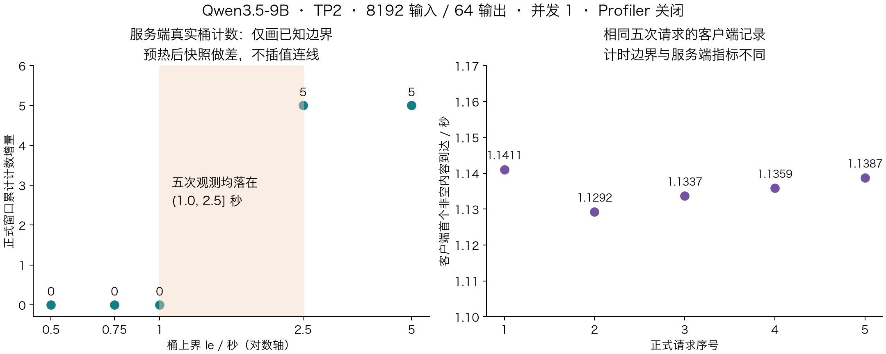
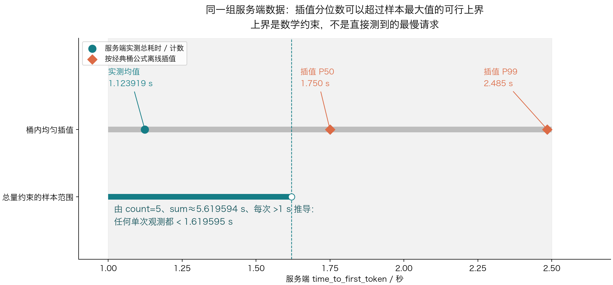

一组 vLLM 实测中，五次服务端首段观测全部落在 1—2.5 秒的桶内。按经典直方图公式离线计算，P99 为 2.485 秒；但结合相同窗口的总耗时，可以证明其中任何一次观测都不到 1.62 秒。差距来自桶内插值，不能直接拿它证明模型发生了两秒多的长尾。

推理监控的难点，有时发生在进入 Profiler 之前：图上的小数位很精细，底层数据却只有一个很宽的区间。下面用原始请求记录和指标快照，复算这个数到底从哪里来。

## 一、先确认比较的是同一批请求

环境为 Qwen3.5-9B、BF16、TP=2，同机两张 RTX 4090 D，运行时为 vLLM 0.33.0、V2 model runner。上下文上限 262144，最大序列数 8，每步 Token 预算 2048。本篇只分析已归档的非 Profiler 基线，不将采集窗口混入业务统计。

核心案例为 8192 输入、64 输出、并发 1，共五轮正式请求，每轮一个。客户端准备好整数 Token 输入，使用独立 cache salt，经过一次预热后开始记录。五次均成功完成，usage 符合指定输入输出长度。

请求使用 HTTP 流式接口，客户端解析 SSE 内容。两张卡共同服务同一 TP2 副本；本篇没有通过隔离干预排除整机其他活动，也不比较不同硬件的快慢。这里需要验证的是已保存的指标能否支持对应结论，即使真实耗时受到系统背景活动影响，桶插值的信息损失仍然可以单独复核。

每个形状都有两份 `/metrics` 快照：预热请求完成、相关计数更新后保存 before，五轮正式请求结束并等待计数更新后保存 after。对完全相同的标签序列做差，才是本文的正式窗口。整个归档包含十三种形状、185 次正式请求；本次复算逐组检查 TTFT count 增量与请求数一致、桶计数单调且没有负增量。

这个检查排除了一个常见错误：直接拿进程启动以来的桶计数，解释眼前这五次请求。累计指标会包含预热和此前负载，必须先确定观察窗口。本文没有连接正在运行的 Prometheus，也没有读取 Grafana 面板；后面的分位数是对已保存桶增量执行明确公式的离线结果。

## 二、指标保存了区间，没有保存五个精确值

实际指标为 `vllm:time_to_first_token_seconds`。vLLM 在该版本的 `PrometheusStatLogger.record()` 中，将 iteration stats 里的首 Token 时间逐次交给 histogram 的 `observe()`；相关桶边界在指标初始化阶段定义。[vLLM 指标实现](https://github.com/vllm-project/vllm/blob/v0.33.0/vllm/v1/metrics/loggers.py#L931)

本窗口的关键增量如下。`le` 表示小于等于该上界的累计计数，并非互斥桶中各自的数量。

```text
le="1.0"   : 0
le="2.5"   : 5
le="5.0"   : 5
count      : 5
sum        : 5.61959433555603 秒
```

因此，五次观测都大于一秒、不超过两点五秒。后续桶仍为五，是累计计数的正常表现，不能把它们相加成更多请求。总耗时除以次数，得到服务端均值约 1.123919 秒。

还要注意 `_sum` 的单位与含义：它是各次首段时长相加，不是这一轮的墙钟时长，也不是 GPU 忙碌时间。并发负载下，多个请求的首段区间可以重叠，累加值完全可能超过实验持续时间。本次只用它约束同一批非负时长，不能进一步拿这个总和推导设备利用率。



图 1：左侧由真实 before/after 指标快照做差得到；右侧为相同五次请求的客户端记录，分别约 1.1411、1.1292、1.1337、1.1359、1.1387 秒。两侧计时边界不同，不能把客户端值替换成服务端逐请求观测。

客户端从开始发送请求计时，到收到首个非空内容为止；服务端指标在内部事件边界统计。网络、前端处理和内容交付都会影响前者。它们接近可以帮助交叉检查量级，却不足以逐项相减。接下来证明插值问题，只使用服务端自身的 bucket、count 和 sum。

## 三、2.485 秒是怎样算出来的

对于普通经典直方图，命中桶内采用线性插值。设分位位置为 q，总观测数为 N，命中桶上下界为 L、U，桶前累计计数为 Cₗ，命中桶累计计数为 Cᵤ，估计式为：

```text
Q̂(q) = L + (U − L) × (q × N − Cₗ) / (Cᵤ − Cₗ)
```

本文核对的是 Prometheus v3.7.3 的 `BucketQuantile()` 普通有限桶分支，并用 Python 复算该公式；没有把它当作本环境正在运行的 Prometheus 版本。[BucketQuantile 源码](https://github.com/prometheus/prometheus/blob/v3.7.3/promql/quantile.go#L108)

代入 q=0.99、N=5、L=1、U=2.5、Cₗ=0、Cᵤ=5，结果就是 `1 + 1.5 × 0.99 = 2.485` 秒。同样的桶还会给出 P50=1.750 秒、P95=2.425 秒。

这些数不对应某一次请求。算法是在桶内缺少位置细节时作均匀分布假设，按分位位置切取区间。它使用桶计数计算这个结果，没有借助 `_sum` 恢复桶内形状。增加显示小数位，不会增加被保存的观测信息。[插值语义](https://prometheus.io/docs/prometheus/latest/querying/functions/#histogram_quantile)

一个容易忽略的结果是：即使把样本量增加很多，只要全部观测仍落在这一桶，公式中的总数就会约掉，P99 仍停在靠近桶上沿的位置。更多请求有助于了解流量分布的稳定性，却不会自动让一个过宽的桶变细。样本稀少和桶分辨率不足，是需要分别处理的两个问题。

现在把总耗时加进来。设五次服务端观测为 x₁ 到 x₅，它们都大于一秒，总和为 5.61959433555603 秒。假设其中一次最大，其余四次即使无限接近一秒，也有：

```text
max(xᵢ) < 5.61959433555603 − 4 × 1
        = 1.61959433555603 秒
```

所以，不只是无法证明有一次达到 2.485 秒：在这些指标相互一致的前提下，任何样本都不可能达到这个数。连插值 P50=1.750 秒，也超过了样本最大值的可行上界。

这个上界只约束窗口内的五个样本，不约束未来请求或服务总体的尾部。也不能把它作为新的精确最大值回填看板：我们知道最慢值到不了哪里，却仍不知道它实际在哪里。把可行范围与点估计分开，是这一步推导真正提供的信息。



图 2：灰色区间为真实观测所在桶；橙色点是公式离线插值结果；绿色范围由真实 count、sum 与桶下界推导。绿色右端是数学上界，不能误读为实际测到的最慢请求。

这不是说引擎算错了每次耗时，而是说明经过有损汇总，再附加桶内分布假设，结果可能偏离样本真实位置。对于这组数据，优先核对分布表示，比立即追查一个“二点四秒慢请求”更合理。

## 四、加上均值，仍然找不回完整长尾

总耗时帮我们缩小了可能范围，却没有恢复五个精确值。以相同总和构造两个数学例子：第一组五个值都取均值，约 1.123919 秒；第二组一个取 1.51 秒，其余四个各取约 1.027399 秒。计算时使用未四舍五入数，两组总和完全相同。

两组的五个观测均落入同一个桶，count、sum、所有桶增量完全一致。若目标是首段不超过 1.5 秒，第一组全部达标，第二组只有四个达标。这两组用于说明信息无法唯一恢复，并非额外运行的 GPU 实验。

因此，修正了 P99 的解释，不等于已经知道服务满足哪一个 SLO。若阈值恰好在已有桶边界，可以用该边界累计数除以总数；阈值落在桶内，精确达标率无法从这个桶单独求出。均值可以增加约束，却不能替代缺失的阈值计数。

生产中还要检查首段分布是否混合了不同工作负载。短输入、长输入、缓存命中和未命中的请求混在一起，即使桶足够细，总体分位数也会受到流量配比变化影响。排查时可用有限的业务类别分别观察；若把每种输入长度或完整提示词都做成标签，又会把维度膨胀问题带入监控系统。

本案例还涉及样本量。五次观测足以复核这段算术、揭示表示误差，不足以描绘生产级 P99。即便额外假设请求独立同分布，五次都没遇到总体最慢百分之一的概率仍约为百分之九十五。这个概率只是数学说明；现有短时顺序请求没有证明该独立性假设成立。

## 五、推理看板该怎样把这个问题补上

第一步是把样本量放到分位曲线旁边。同一查询窗口内，展示 `_count` 的增量或速率及窗口长度。低流量时数值仍然可能被画出来，但读者必须能看到支撑它的观测有多少；不能让一条平滑曲线掩盖只有几个样本的事实。

如果同一窗口里计数没有增加，就没有新的请求分布可供判断。此时空结果、未定义值和零延迟是不同含义，面板不应一律补成零。否则一次没有流量的时段，可能被展示成服务响应突然改善，后续复盘也会误判优化效果。

第二步是审查桶边界。围绕实际服务目标设计观测精度：如果目标是一点五秒，就需要在指标采集端保留这个阈值附近的信息，或者额外记录达标计数。仅修改 Grafana 展示单位，无法给历史数据补出一个新桶。是否能调整 vLLM 当前指标定义，要核对所用版本的采集实现和部署方式。

桶也不是越多越好。每增加一个经典桶，就会为每组标签增加一条时间序列；更多模型、实例和业务分类会放大采集与存储成本。合理做法是围绕告警与容量决策保留必要分辨率，并在变更边界时处理新旧配置并存，避免把不兼容的桶直接合成一个总体分布。

第三步是明确聚合范围。多个服务实例的桶可以按相同 `le` 汇总后再求分位数，前提是桶配置兼容、过滤条件代表同一种服务口径。不要平均各实例的 P99；请求数不同的实例对总体分布贡献不同，分位点本身不具备这种可加性。

在线查询通常应先对每条累计序列使用 `rate()`，再按需要保留的标签与 `le` 汇总，最后调用 `histogram_quantile()`。离线快照相减适用于本次没有重启和计数回退的受控窗口，不能直接替代生产查询中的重启处理与范围估计。

第四步是保留有限的请求级证据。告警附近记录首段时间、输入输出长度、并发、路由和请求关联标识，用来确认慢请求是否真实存在，再按区间补采 trace。不要把每个请求标识放进 Prometheus 标签，以免高基数把监控本身拖垮。

如果只有粗桶而没有逐请求记录，应先把结论写成区间与约束，再决定补什么数据。此时直接打开 GPU profiler，只能研究后续一次执行；它无法还原此前已被直方图丢弃的桶内位置，也无法替一条插值曲线证明历史慢请求。

## 结论：先检查量尺，再解释长尾

这组真实数据给出一个很具体的提醒：P99=2.485 秒是可复算的插值结果，但它不是这五次请求的真实尾部值。相同窗口的服务端总量证据，已经把任何单次观测限制在 1.62 秒以内。

判断推理服务是否变慢，先对齐窗口、样本量、计时边界和桶精度，再结合请求日志定位，最后才用 trace 解释计算与等待。监控数值能够显示到毫秒，不代表它真的测到了毫秒级的分布细节。

资料来源

- [vLLM v0.33.0 指标定义与记录路径](https://github.com/vllm-project/vllm/blob/v0.33.0/vllm/v1/metrics/loggers.py)
- [Prometheus v3.7.3：经典桶分位数实现](https://github.com/prometheus/prometheus/blob/v3.7.3/promql/quantile.go#L108)
- [Prometheus：histogram_quantile 的插值规则](https://prometheus.io/docs/prometheus/latest/querying/functions/#histogram_quantile)
- [Prometheus：直方图、聚合与误差](https://prometheus.io/docs/practices/histograms/)
- 实测依据：十三种负载形状的 185 次正式请求记录及配对指标快照；正文核心案例使用其中 8192 输入、64 输出、并发一的五次正式请求。全部数值由归档文件离线复算。
