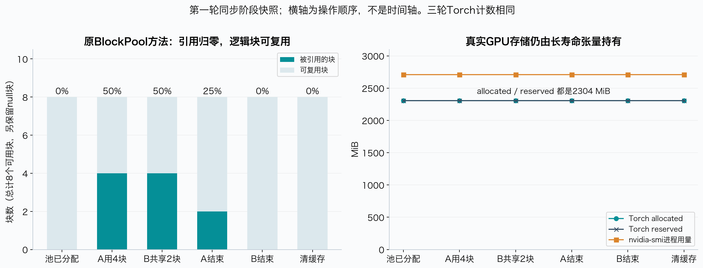
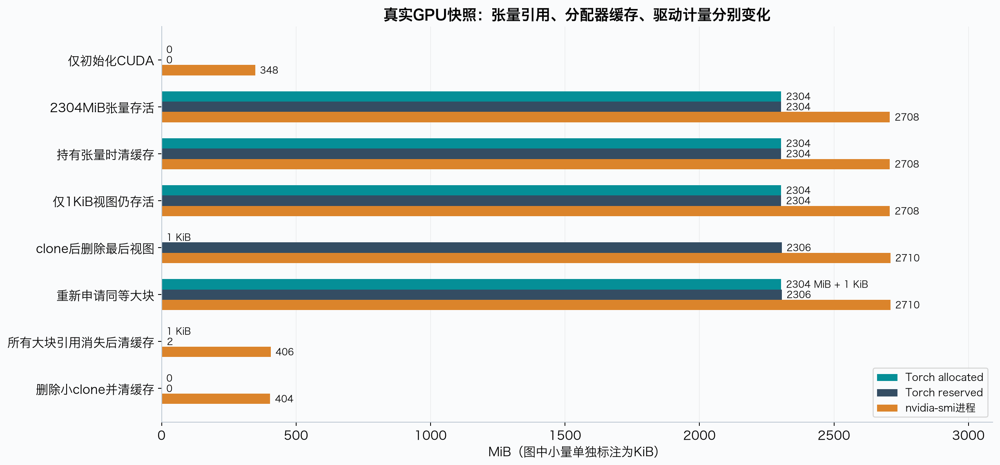
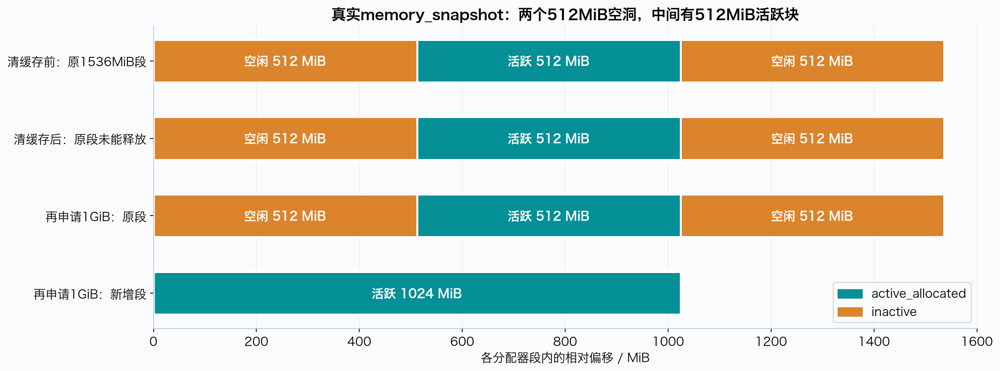

**KV Block 使用率已经降到零，GPU 上的 2304 MiB 张量分配仍然可以完全不动。** 请求结束后的第一笔回收发生在引擎块池；张量存储、PyTorch 分配器缓存和驱动显存，分别有自己的生命周期。把这几层都叫作“显存释放”，会把正常复用误判为泄露，也可能掩盖真正没有归还的引用。

本文固定检查 vLLM v0.33.0 的请求释放与缓存分配源码，并在一张 RTX 4090 D 上完成三轮内存实验。原块池方法负责编号和引用变化，真实 GPU 张量负责承载存储；再用张量视图、缓存重用和段内空洞逐层验证。这个最小程序不加载模型，也不报告推理吞吐，它验证的是支撑推理服务的内存机制。

最值得关注的不是某个工具显示了多少百分比，而是：**这笔空间已经回到了哪一层，下一位使用者是谁，以及还缺什么条件才能继续向下归还。**

## 一、四种“空闲”，对应四个不同的所有者

第一种空闲属于请求。一次生成结束，调度器不再需要该请求的缓存引用，相关块可以减少引用计数。但如果另一个请求共享相同前缀，这些块仍被使用。接口返回完成，与最后一个块引用消失，中间还需要核对共享关系和清理路径。

第二种空闲属于引擎块池。块编号回到可复用队列，新的请求能够申请它；这个动作通常只改元数据。Worker 仍可持有覆盖整个缓存池的张量，之后用同一个块编号写入新的 KV。因此，空闲块增加首先改善的是当前引擎的接纳能力，并不承诺显卡驱动立即获得更多空间。

第三种空闲属于 PyTorch 分配器。最后一个张量存储引用消失后，对应分配可以进入缓存，供本进程后续复用。这时 memory_allocated 可能下降，memory_reserved 仍然保持。保留可复用分配减少了再次向驱动申请的需求，但另一进程看到的可用显存未必同步增加。

第四种空闲才是分配器将可释放的空间归还给驱动。此时 reserved 才有机会下降，驱动侧的显存计量也可能随之变化。上下文、已加载模块和其他库的分配依然有各自的所有者，所以即使两个 PyTorch 指标都为零，也不能要求仍存活的进程在驱动侧立刻归零。

这四层还使用了不同单位。请求和引擎看到的是 Token、块编号与引用；PyTorch 看到的是张量存储和分配器段；驱动看到进程与设备上的显存计量。一个百分之零的块使用率，不能与一个百分之九十的设备显存占用直接相减，因为两者的分母和被管理对象不同。

测试环境为 RTX 4090 D，设备查询总显存 24564 MiB，PyTorch 2.14.1+cu130、CUDA 13.0、驱动 580.173.02、Python 3.12.16。系统呈现二十四个 vCPU，程序 CPU 线程设为一，使用原生 native 分配器；没有设置额外的分配器环境参数，也没有修改设备时钟或功率。

运行前、轮次边界及结束后的离散检查未发现其他计算进程。每轮按同样顺序执行十八个阶段，在同步并回收 Python 垃圾后读取计数和内存快照，三轮共五十四份记录。这些是阶段状态观察，不是延迟实验；不能把两个阶段之间的采样间隔当作内存回收耗时。

为了让字节变化足够明显，程序分配一个 2304 MiB 的 uint8 张量，再把它看作九个等长存储区间。原块池保留一个 null 编号，剩下八个可用。每区间 256 MiB 是本实验放大的观察尺度，不是 vLLM 的真实 KV 页大小；也没有在这些区间内计算真实模型的键和值。

## 二、沿请求释放路径看：回去的是编号和引用

在所检查的 vLLM 版本中，KVCacheManager.free() 把请求标识交给协调器，协调器再调用相应缓存类型管理器。后者移除请求的块记录，按反向顺序将块交给 BlockPool.free_blocks()。这个顺序与缓存复用和淘汰次序有关，不能把调用链中的 free 统一理解为一次底层设备释放。[请求释放入口](https://github.com/vllm-project/vllm/blob/4ba787ec9959e566d3b587a796dff07673324da5/vllm/v1/core/kv_cache_manager.py#L629)

BlockPool 的关键动作是减少引用计数。计数降到零的块才会进入相应空闲队列；仍有共享引用的块继续留在使用状态。有前缀缓存时，带缓存键的空闲块还可以保留内容，直到需要复用空间时再按相应策略淘汰。它们既可能是命中候选，又可能是可回收候选，这两个身份并不冲突。

为检查这段逻辑，程序提取固定提交的四个原始元数据类，提供必要依赖后执行，没有重写引用和队列方法。初始池有九个编号，null 编号不进入可用分母，因此真实可分配数量为八。然后让 A 申请四块，B 共享其中两块，再依次释放 A 和 B。

| 阶段 | 四个相关块的引用计数 | 可复用块 | 块使用率 |
|---|---|---:|---:|
| A申请四块 | 1、1、1、1 | 4 | 50% |
| B共享前两块 | 2、2、1、1 | 4 | 50% |
| A释放引用 | 1、1、0、0 | 6 | 25% |
| B释放引用 | 0、0、0、0 | 8 | 0% |

这组结果说明两个实际排查点。共享请求增加时，引用总数可以增长，但占用的独立块数没有增加；一个请求结束后，独立块数也可能只归还一部分。按请求数估算缓存释放量，会漏掉共享关系，甚至把仍被合法持有的块当成回收异常。

该版本的 get_usage() 按可复用块数计算比例，分母扣除了 null 块。它没有遍历 GPU 张量，也没有计算有效 KV 数据究竟占了多少字节。因此，这个比例更适合解释块池的接纳压力，不是对承载存储中所有字节的逐项盘点。[块引用、空闲队列与使用率源码](https://github.com/vllm-project/vllm/blob/4ba787ec9959e566d3b587a796dff07673324da5/vllm/v1/core/block_pool.py#L790)

另一个 CPU 检查预置了一个缓存键：分配一块、设置键、放入查找表，再释放请求引用。实际结果是引用为零、块使用率为零，但缓存键和查找结果仍在。这里只验证预置元数据的保留，不验证前缀哈希生成或模型命中结果。它足以说明“空闲队列中的块”不必已经清空历史内容。

这种保留还依赖一个正确性条件：当空闲缓存块被重新分配并准备覆盖内容时，旧缓存查找关系必须失效，否则另一个请求可能把已经改写的数据当成旧前缀。该版本启用缓存的分配路径在重新建立使用引用前执行相应淘汰处理。释放、保留命中机会和覆盖前失效，构成不同步骤；只看一条释放日志无法判断完整生命周期是否正确。

GPU 存储位于另一条路径。所检查版本的 allocate_kv_cache() 建立底层分配，再根据配置生成层视图；bind_kv_cache() 将这些张量绑定到 ModelRunner 和前向层上下文。请求释放路径操作的块元数据，与这些长寿命存储对象分别持有，因此释放请求不会自动销毁整套 Worker 缓存。[存储分配与层绑定](https://github.com/vllm-project/vllm/blob/4ba787ec9959e566d3b587a796dff07673324da5/vllm/v1/worker/utils.py#L564)

图 1：第一轮同步快照，横轴为操作顺序。块池方法来自固定源码，GPU 存储由最小实验程序持有；三轮 PyTorch 计数相同。它不是完整 vLLM 服务的请求压测。

从 A 占用、B 共享到双方释放，allocated 和 reserved 都保持 2304 MiB，进程级显存读数保持约 2708 MiB。随后调用 empty_cache，底层张量仍活着，两个 PyTorch 计数继续不变。这个对照直接显示，块池有空闲与张量存储被释放，是两个不同事件。

## 三、只有 1 KiB 的视图，为什么能持有 2304 MiB

接下来保持逻辑块池不变，只操作张量所有权。程序从大张量截取一个 1024 字节视图，删除大张量变量，再检查分配。结果仍是 2304 MiB allocated，而不是一 KiB。因为切片视图共享底层存储，删除一个变量名没有消除其他对象对该存储的持有。[PyTorch 张量视图说明](https://docs.pytorch.org/docs/2.14/tensor_view.html)

这里要同时记录两个大小。视图可见元素数乘元素字节数是一 KiB；其 untyped_storage().nbytes() 仍为 2304 MiB。前者描述这个对象能直接索引的范围，后者描述它关联的存储。用很小的张量形状排除大存储引用，是排查推理缓存和中间结果时一个常见误区。

反过来，汇总多个视图的存储大小时也要去重。若多个层视图共享同一底层分配，把每个视图报告的存储字节都累加，会把同一笔显存算很多遍。应同时保留可见范围、存储归属和共享关系；统计工具可以用同一进程内的存储标识作关联，但不需要把原始地址作为公开指标或监控标签。

生产代码中的持有者也未必是变量名明显的大张量。它可能是某层缓存视图、闭包捕获的对象、诊断结果列表，或等待下游消费的输出。观察 Python 容器本身很小，不能证明它没有间接持有设备存储；而一个对象还可达，也不自动意味着泄露，需要判断它是否仍符合生命周期设计。

此时再调用 empty_cache，allocated 和 reserved 仍不变。分配器不能把正在被张量使用的存储当作空缓存归还，否则现存视图下一次访问就失去有效地址。清缓存没有降低占用，在这个阶段恰好是正确行为，不能仅凭接口调用“无效”就判断 CUDA 出了问题。

然后把一 KiB 视图 clone 成独立张量，再删除原视图。这个动作实际复制了可见的一 KiB 数据，让新对象拥有自己的存储。大分配失去最后的视图引用后，allocated 降为 1024 字节；reserved 却成为 2306 MiB，因为大分配留在缓存，新的小分配还触发了小对象池的段。

这个例子不是建议给所有 KV 层视图加 clone。完整模型依赖既定缓存布局、共享关系和写入语义，复制还会引入额外空间与数据搬运。它只是用最小对照区分“共享存储的别名”和“独立副本”，证明先前的大占用确实可以由一个很小的视图持有。

连续布局也不能证明存储独立。一个切片即使在自身可见范围内连续，仍可以引用更大的底层分配；对已经连续的张量调用 contiguous，可能直接返回原对象。检查时应同时记录形状、步长、存储归属和所有者，不能用“已经连续”代替独立复制的证据。

在排查代码时，至少应把对象生命周期与存储生命周期分开。请求对象消失、某个列表移除元素、一次 gc.collect 完成，分别只能说明相应层的变化。若仍有其他可达对象共享同一存储，就需要继续沿引用关系定位，而不是反复调用垃圾回收，期待它绕过仍然有效的持有者。

还要区分逻辑释放与数据清零。块回到可复用队列、张量释放进入分配器缓存，都不意味着旧内容立刻被逐字节覆盖。本实验的目的不是验证数据擦除；如果平台要求跨租户数据隔离，需要另外核对分配、初始化、有效范围与访问控制，不能把 free 事件当作已经完成了安全擦除。

## 四、张量释放了，分配器为什么还留着显存

在只剩独立小 clone 的阶段，程序重新申请一块同样大小的 2304 MiB 张量。三轮都复用了之前的大分配虚拟地址，reserved 没有再增加。这是实测到的缓存复用，不应推广成任何后续申请都会得到相同地址；分配器还会根据尺寸、流与其他状态选择空间。

删除这次重新申请的张量后，allocated 再次回到一 KiB。随后调用 empty_cache，reserved 从 2306 MiB 降到 2 MiB。小 clone 仍占着这两 MiB 段的一部分；再删除它并清缓存，allocated 和 reserved 才同时归零。

为什么一 KiB 对应两 MiB reserved？当前 native 分配器会把小请求放进较大的缓冲段，降低频繁向驱动申请的成本。可见张量的请求大小、分配器内部块大小和整个段大小因此可能不同。本例的 inactive_split_bytes 在这一阶段约为两 MiB 减一 KiB，记录的是还夹在有活跃分配的拆分段里的空闲部分。

图 2：第一轮阶段快照，三种计量分别显示。allocated 很小时标注一 KiB；驱动读数来自进程级 nvidia-smi。所有阶段均在同步后采样，不表示回收动作的耗时。

这组数据还能纠正“reserved 减 allocated 都是碎片”的说法。大分配已释放、尚未清缓存时，两者相差约 2306 MiB，但 inactive_split_bytes 只有约两 MiB。绝大部分空间是一块可以直接复用的大缓存，不是被活跃分配隔开的细碎空洞；前面的同尺寸重新申请已经实际用上了它。

对当前进程来说，这块缓存已经可用；对其他进程来说，它仍被本进程保留。于是，同一份空间可能同时表现为“本引擎有复用余量”和“显卡外部可用量没有增加”。在多服务共卡场景中，要先明确让谁使用这份空间，再决定是否需要向驱动归还。

还要把引擎页内的空余与分配器段内空洞分开。一个未填满的 KV 页仍由请求占用，页里没有有效 Token 的部分也可能属于整个活跃存储；PyTorch 看不到这些字节在模型语义上是否有用。因此，降低尾页浪费和减少 native 分配器碎片是两类优化，前者不能单靠 inactive_split_bytes 判断。

驱动读数还有另一层边界。第一轮初始化后，进程级读数为 348 MiB；所有张量与缓存释放后为 404 MiB。后两轮的起点、终点都为 404 MiB。我们没有把第一次增加的五十六 MiB 强行归到某个具体模块，只能确认它不在当时 allocated 与 reserved 的统计内。

CUDA 上下文、延迟加载的模块或其他运行库都可能拥有分配，单靠这几个计数不能逐项拆账。保留首次变化以及后续相同边界的稳定结果，比静默扣掉一个“固定上下文常数”更可靠。本次进程退出后，设备查询恢复零占用；这与进程仍存活时的四百余 MiB 是不同生命周期边界。

因此，判断泄露应比较相同工作负载、相同预热阶段和相同生命周期边界下的趋势。一次从冷态变热态的增长不够，三次没有增长也不能证明生产服务永远没有泄露。应继续检查无法回收的引用是否累积、分配记录是否增长，以及增长是否有可解释的容量上限。

## 五、缓存合计有 1 GiB，为什么还要申请新段

前面的完整大缓存可以直接重用，下面再构造一个真实段内空洞对照。仍使用同一 GPU 和 native 分配器，先申请 1536 MiB 后释放到缓存，再从中分配两块各 512 MiB 的张量，最后释放第一块。这个步骤没有请求 OOM，也没有占满显卡。

memory_snapshot 实际记录到一个 1536 MiB 段：前面 512 MiB inactive，中间 512 MiB active_allocated，后面 512 MiB inactive。此时 allocated 为 512 MiB、reserved 为 1536 MiB，inactive_split_bytes 为 1024 MiB。三轮都得到相同的尺寸和状态序列。

两个空洞合计正好一 GiB，但中间有仍然存活的分配。对这次普通 native 段而言，不能把两边当成一个可用的一 GiB 分配块，也不能因为两端空闲，就把整个一千五百三十六 MiB 段交还驱动。empty_cache 后，段几何和 reserved 都没有变化。

接着申请单笔 1024 MiB，分配器新增一个一 GiB 段。结果 allocated 变成 1536 MiB，reserved 变成 2560 MiB，原段的两处空洞仍在。只看“缓存空闲总和”会觉得申请本该原地完成，真实快照则显示了不能合并的结构条件。

图 3：直接依据第一轮 memory_snapshot 的块大小、段内偏移和状态绘制。每一行使用各自段内的相对偏移；不同段不表示物理显存相邻。清缓存前后原段相同，新申请另有一个 1024 MiB 段。

这里的连续性指分配器要交付给一个张量存储的可用地址区间，不能把图解释成物理显存芯片上的连续位置。CUDA 的虚拟地址与物理页映射是另一层问题。本实验证明的是当前分配器段内的分配结构，不是诊断 GPU 的物理显存碎片。

对应运行时报告的 PyTorch Git 提交为 5c48869。其 native 分配器合并路径要求相邻块可合并，活跃或仍有流使用的块会阻止合并；普通段的缓存释放路径也区分完整段与拆分块。它解释了本例为何保留原段，但不能拿来概括所有分配器后端或可扩展段策略。[对应提交的合并与释放路径](https://github.com/pytorch/pytorch/blob/5c4886908584029761b579af026dcfb627c84070/c10/cuda/CUDACachingAllocator.cpp#L3580)

释放中间张量及新增的一 GiB 张量，再同步清缓存后，两项 PyTorch 指标都回到零。这形成了一组完整控制：阻止回收的活跃块存在时，原段留着；该引用消失后，段可以归还。观察与改变的变量对应，才能把现象定位到具体的生命周期条件。

中间块消失以后，相邻空闲区间才具备合并条件。empty_cache 并没有把仍然活跃的张量搬到另一个位置，给一 GiB 申请腾出连续区间。如果要移动活跃存储，就必须维护张量、视图、图捕获和外部组件持有的地址契约，这已经是另一种内存管理机制，不能由一个“清缓存”接口凭空完成。

这个对照没有复现服务 OOM，不能写成“已经证明某次线上 OOM 就由碎片造成”。它证明了总空闲字节不是单笔可分配能力的充分条件。实际 OOM 还可能来自真正的活跃数据、预分配池、临时峰值或其他库；需要在故障窗口保留相同层级的证据，再决定调参方向。

## 六、把这几层证据放回推理服务

排查时，第一组信号是请求与块池状态：当前活跃请求、仍被引用的块、可复用队列、共享引用以及抢占或申请失败。它回答引擎能否继续安排请求。若请求结束后引用长期不回落，应该先沿请求取消、结束和异常清理路径检查，而不是直接调整 CUDA 分配器。

第二组是 Worker 持有的实际缓存存储。预分配字节数、缓存分组、层视图及其所有者应能对应到有效配置。对于混合注意力、状态缓存或共享层，不能只拿请求 Token 数乘一个通用的每 Token 字节数，就断定多出的空间都是泄露；需要按实际布局和共享方式核算。

第三组是同一进程的 allocated、reserved、活跃及等待释放状态、inactive split 和内存快照。若块池空闲但 allocated 很高，先检查长寿命存储是否仍然按设计存在；若 allocated 下降而 reserved 很高，再看缓存能否重用、是否被活跃块拆开。这两种情况的处理对象不同。

也要区分两种申请失败。引擎拿不到足够块编号，可以在已有固定池的元数据层发生，不需要触发新的 CUDA 分配；设备临时张量分配失败，则可能发生在块池仍有很多空闲编号时。前者主要检查缓存预算、请求形状和共享回收，后者还要查权重、激活、工作区与其他设备分配。把两种错误都叫作“KV 没释放”，会把排查方向带偏。

第四组是驱动侧进程和整卡读数。要核对多个 Worker、通信库、图资源和其他服务，避免把整卡总量当成某个 Rank 的 PyTorch 缓存。在多卡模型中，各 Rank 可能有不同的瞬时状态；既要保留单进程证据，也要观察最紧张的一侧，不能用平均值掩盖单卡容量不足。

采取释放动作之前，还要明确目标。如果只是让同一引擎接纳下一批请求，归还块编号往往已经达成目的，频繁向驱动归还再重建存储可能增加冷启动或分配工作。如果要把显存交给另一个服务，则必须让相应存储所有者退出或通过运行时支持的资源释放路径处理，仅减少请求数通常不够。

降低启动时缓存预算，是减少长寿命分配的一种方案，但它会改变可容纳的上下文、并发和抢占压力。需要重新验证在目标延迟下能完成多少任务。把 nvidia-smi 曲线压低，并不自动等于服务成本更优；如果更小的池导致频繁重算，整体资源效率反而可能下降。

清理前缀缓存也应区分两个目的：让旧前缀不再作为命中候选，以及真正释放承载字节。它们不一定由同一个动作完成。对固定存储池，清掉查找关系可以改变后续复用行为，却未必缩小底层分配；若业务需要数据擦除或跨租户移交，还需相应的正确性与隔离流程。

对视图持有造成的大存储驻留，应优先修正所有权和生命周期。只要业务已经不需要旧结果，就不应让诊断列表或回调长期留着它；确需保存小结果时，可以评估复制的容量和执行成本。不能因为最小例子中 clone 有效，就在注意力缓存热路径上无条件增加复制。

对于段内拆分问题，应先保存快照和尺寸分布，再评估分配策略。不同后端、可扩展段、拆分阈值或工作区复用可能改变结果，但它们也有兼容与性能取舍。本实验没有比较这些策略，所以不提供一个声称适合所有服务的环境变量组合，更不把“清缓存没下降”直接改写成调参依据。

将 empty_cache 放到每次请求完成的热路径，也需要单独评估。对应源码会处理部分等待事件并尝试归还缓存，后续执行又可能需要重新申请；这些动作可能改变同步和热态复用条件。本轮只测内存状态，没有测它们的时延或吞吐代价，因此不能给出“每请求清一次能省多少显存、损失多少性能”的通用百分比。

最后，释放发生在异步执行环境中。对象引用已消失，相关存储也可能仍在等待设备或流完成使用；本实验在每个阶段同步，主动排除了这段未完成窗口。线上采样若没有同步，应区分“仍被对象持有”和“等待安全回收”，同时保留事件或流依赖证据，避免把短暂延后当作永久泄露。

完整验证可以沿一条受控请求生命周期进行：先记录稳定空闲状态，执行请求并保留块与存储变化，等待结束和设备工作完成，再回到同一边界比较。共享前缀、取消和异常分别作为对照加入。每次只改变一个关键条件，才能判断是引用没有归还、缓存正常保留，还是底层分配确实无法回收。

## 结论

请求结束后，显存没有立即下降，可以对应几种完全不同的状态：引擎已经获得可复用块，张量仍持有底层存储；张量已释放，分配器保留缓存；或者空闲字节夹在有活跃分配的段中。驱动侧还可能看到 PyTorch 缓存之外的进程资源。

本次三轮 GPU 实验把这些状态逐一拆开，并用固定 vLLM 释放路径解释块池语义。判断释放是否完成，应同时说明“回到了哪一层”和“交给谁复用”。只有层级、所有者和计时边界一致，显存曲线才足以支撑泄露判断或资源回收方案。

## 资料来源

- [vLLM v0.33.0：请求释放入口，固定提交4ba787e](https://github.com/vllm-project/vllm/blob/4ba787ec9959e566d3b587a796dff07673324da5/vllm/v1/core/kv_cache_manager.py#L629)
- [vLLM v0.33.0：缓存协调器释放路径](https://github.com/vllm-project/vllm/blob/4ba787ec9959e566d3b587a796dff07673324da5/vllm/v1/core/kv_cache_coordinator.py#L404)
- [vLLM v0.33.0：单类缓存管理器移除请求块记录](https://github.com/vllm-project/vllm/blob/4ba787ec9959e566d3b587a796dff07673324da5/vllm/v1/core/single_type_kv_cache_manager.py#L591)
- [vLLM v0.33.0：BlockPool的分配、引用和空闲队列](https://github.com/vllm-project/vllm/blob/4ba787ec9959e566d3b587a796dff07673324da5/vllm/v1/core/block_pool.py)
- [vLLM v0.33.0：KV底层存储分配与Worker、层绑定](https://github.com/vllm-project/vllm/blob/4ba787ec9959e566d3b587a796dff07673324da5/vllm/v1/worker/utils.py#L564)
- [PyTorch 2.14：张量视图与共享存储](https://docs.pytorch.org/docs/2.14/tensor_view.html)
- [PyTorch 2.14：CUDA内存管理](https://docs.pytorch.org/docs/2.14/notes/cuda.html#memory-management)
- [PyTorch 2.14：empty_cache接口语义](https://docs.pytorch.org/docs/2.14/generated/torch.cuda.memory.empty_cache.html)
- [对应实际运行时Git提交的native缓存分配器](https://github.com/pytorch/pytorch/blob/5c4886908584029761b579af026dcfb627c84070/c10/cuda/CUDACachingAllocator.cpp)
