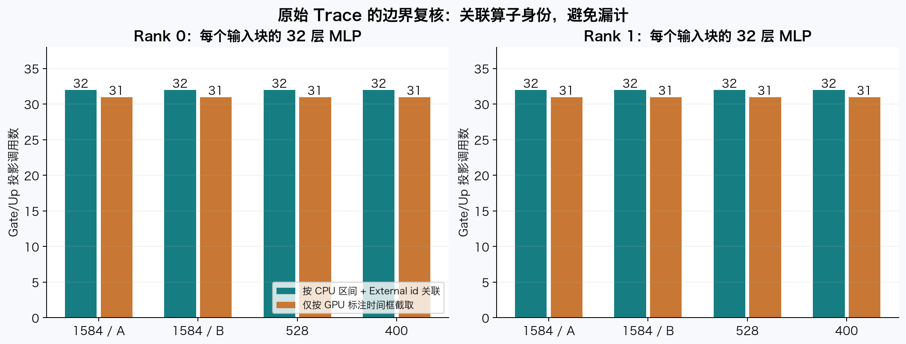
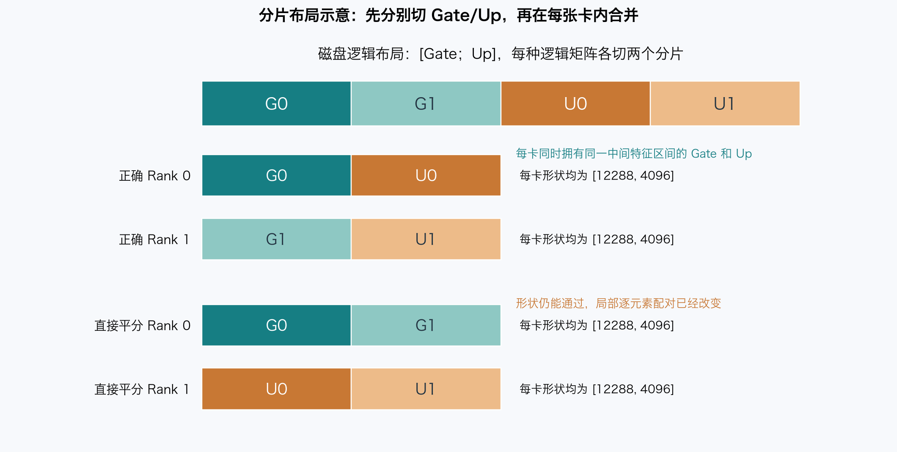
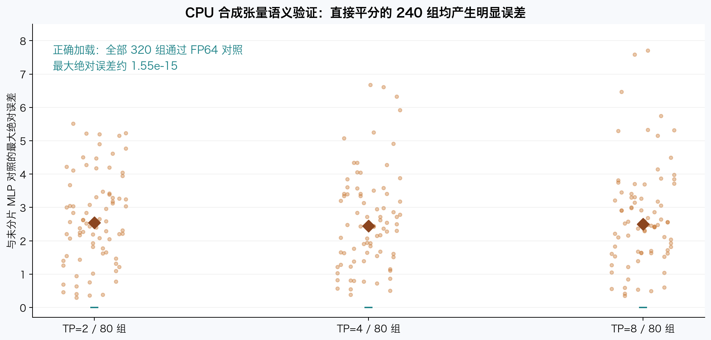
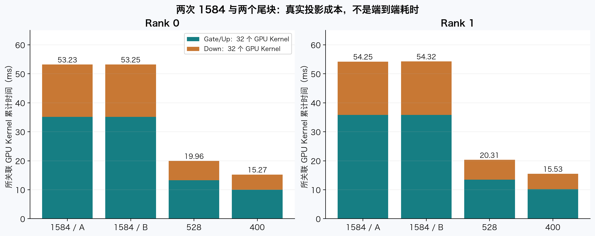

在 Qwen3.5-9B 的双卡 Trace 里，对上两个 Rank 的 Gate/Up 投影，权重形状都是 **12288×4096**。拿完整合并张量直接切成两半，也能得到这个形状。问题在于同一张卡拿到的是哪一段 Gate、哪一段 Up。

排查时我先把本地两份投影的特征位置写出来。门控乘法要求 Gate 和 Up 来自同一段中间特征，才能继续做 Down 和归约。这个条件用 shape 查不出来。

下面用真实双卡 Trace 核对执行形状，沿固定版 vLLM 的加载器查偏移，再用 320 组 CPU 算例对最终结果。CPU 这部分验证布局正确性，跑在卡上的 Trace 用来确认本次执行结构。

## 先在两个 Rank 的 Trace 里找投影 {#一先看真实执行32-层-mlp每层两次主体投影}

先记模型字段。Qwen3.5-9B，隐藏维度 4096，中间维度 12288，32 个语言模型层。取的是 BF16、TP=2、vLLM 0.33.0 的稠密门控 MLP 路径，权重量化和投机解码关闭。

采样服务器有两张 RTX 4090 D。资源配置为两张 GPU、16 核 CPU 上限和 40 GiB 主机内存上限；实际 CPU request 为 8 核。拓扑记录显示两卡之间为 PHB 路径，peer-read 检查显示不支持。它说明不能假定这套服务具备 NVLink 直连，也不能仅凭这个结果断言某次归约一定采用了哪种底层传输实现。

两个 Rank 共同执行同一个请求，各自持有模型分片。本轮输入 4096 Token，在采样里形成两个 1584 的块，以及 528、400 两个尾块，合计仍为 4096。最大上下文限制为 8192，最多 8 条运行序列，每轮 Token 预算为 2048。这里分析的是这四个输入处理步骤，不把它们的时间套到单位置 Decode。

先从 CPU 算子记录中查找 aten::mm，再核对参与矩阵乘法的形状。1584 位置的步骤里，Gate/Up 对应一份 1584×4096 的输入与 4096×12288 的乘法权重；Down 对应 1584×6144 与 6144×4096。两个 Rank 的形状一致，较小输入块只改变第一个维度。

CPU 上记录到矩阵调用，还不能把该段持续时间直接称为 GPU 计算。此次复核通过 External id 将每次调用与设备 Kernel 关联；每个 Rank 的每个步骤，都得到 32 次 Gate/Up 和 32 次 Down。两张卡、四个输入块合计关联到 512 个投影 Kernel。32 与模型层数一致，为形状归类提供了交叉检查。

实际复核还遇到一个边界陷阱。如果仅保留完全落在同名 GPU execute 标注时间框里的事件，每个步骤只得到 31 次 Gate/Up 和 31 次 Down；改按 CPU 执行区间找到提交，再通过身份关联设备事件，才能取得完整的 32 对。事件是否属于同一次提交，不能只靠一条时间框是否包住它来判定。



图 1：两份原始 Trace，各四个 Prefill 块。蓝绿色柱按 CPU 提交区间与 External id 关联，橙色柱只统计完全落在 GPU execute 标注框内的调用；该归档中后者每步少计一对投影。图展示事件计数，不是设备利用率。

这不意味着可以把时间框外的一切都补进来。关联仍要求同一份 Trace、同一个 Rank、对应的算子身份与兼容形状，并检查一次调用匹配到多少 Kernel。某些实现会为一项矩阵操作启动多个 Kernel，不能把一核一调用当成普遍假设；本例所选投影实际是一一对应。

还有一个细节：某些底层矩阵核的长名字里包含 relu 字样，模型配置却是 SiLU 门控。只看一个核名片段，不能独立决定整层的激活语义。本文将矩阵 Kernel 用于确认投影形状与设备时间，把激活的输入布局和计算规则交给对应模型代码与语义验证核对。

因此，接下来要解释的问题很具体：为什么每层只看到一次合并的 Gate/Up 投影，输出宽度却是 12288；以及这一宽度相同的本地权重，究竟应该装入哪些全局行。

## 写下合并前后的张量形状 {#二合并减少了提交次数没有消灭-gate-与-up}

为了后面能看懂偏移，先写出矩阵规格。X 的 M 行各对应一个位置，H 列是隐藏维度。PyTorch 的 Linear 权重按输出特征、输入特征存，Gate 和 Up 各是 I×H。和 X 相乘时用转置，分别产出 M×I。

这两个结果承担不同职责。Gate 经过 SiLU，随后与 Up 逐元素相乘；乘积再经过 Down 投影，回到 M×H。对本文没有 bias 的稠密路径，可以写为：

```text
G = X Wgᵀ，U = X Wuᵀ
Z = SiLU(G) ⊙ U
Y = Z Wdᵀ
Wg、Wu：[I,H]；Wd：[H,I]
```

注意 Gate 与 Up 读取的是同一份 X，而且在彼此之间没有计算依赖。因此可以把 Wg 与 Wu 沿输出特征维堆起来，形成 2I×H 的逻辑合并权重，用一次较宽的矩阵乘法同时生成两份结果。结果的前半仍代表 Gate，后半仍代表 Up，激活阶段按这个约定拆分。

这与把两个任意相邻算子揉在一起不同。Down 依赖门控乘积，不能在 Gate/Up 结果出来之前就按相同方式与它们拼成一次普通线性投影。SiLU 的非线性也阻止我们把整个 MLP 约成一张固定矩阵，直接从 X 一次乘到 Y。

在固定检查的 vLLM v0.33.0 中，Qwen3.5 的稠密分支复用了 Qwen3NextMLP，而后者对应 Qwen2MoeMLP 这个实现类。类名带有 Moe，不意味着当前 9B 的这条路径在做专家路由；需要继续看实际构造分支和成员。这里构造的是 MergedColumnParallelLinear、SiluAndMul 与 RowParallelLinear。[MLP 实现](https://github.com/vllm-project/vllm/blob/4ba787ec9959e566d3b587a796dff07673324da5/vllm/model_executor/models/qwen2_moe.py#L76)

合并层接收两个逻辑输出宽度，而不是只保留一个相加后的整数。这个列表让运行时知道合并参数内部仍有两个分区，加载时每个分区分别进行并行切分。只把列表替换成总宽度，会丢失“从哪份逻辑矩阵选出本地内容”这项信息。

SiluAndMul 的原生参考实现则把最后一维等分，以前半做 SiLU，再与后半逐元素相乘。这意味着本地布局必须是某段 Gate 后接同一段 Up。即使张量总宽度保持不变，交错排列、交换两个半区，或者让两半来自不同特征区间，都可能改变数学含义。[激活参考实现](https://github.com/vllm-project/vllm/blob/4ba787ec9959e566d3b587a796dff07673324da5/vllm/model_executor/layers/activation.py#L116)

权重合并本身也没有减少参数量。两份 I×H 合在一起，仍然包含 2IH 个元素；相同精度下，逻辑权重字节数也相同。可能改变的是调用数量、矩阵形状、调度开销以及核选择，而不是让其中一份投影的乘加消失。

这提供了一个判断优化说法的办法：先问它改变了数学工作量，还是只改变工作如何提交。前者需要核对模型等价性，后者需要核对实际执行形状与性能。一次调用取代两次调用，并不自动意味着该层时间减半。

## 把两半按特征区间摆开 {#三张量并行真正要切的是两份矩阵各自的特征区间}

TP=2 时令 q=I/2。先把 Gate 和 Up 各切成前 q、后 q 个特征。Rank 0 拿两份前半，Rank 1 拿两份后半。这样每张卡做 SiLU 和逐元素乘法时，两边的第 k 列对的是同一个特征，得到本地 M×q。

把完整逻辑布局标成 G₀、G₁、U₀、U₁，就更容易看到区别。磁盘合并参数按 Gate 后接 Up 保存，整体顺序为四段依次排列。正确的本地组合却是 Rank 0 取 G₀ 与 U₀，Rank 1 取 G₁ 与 U₁。它需要分别定位两份矩阵，再从每份矩阵中抽取属于当前 Rank 的部分。

如果把整体合并权重直接按行对半切，Rank 0 会拿到 G₀ 与 G₁，Rank 1 会拿到 U₀ 与 U₁。它们仍然都是 2q×H，正好等于正确本地参数的形状。只检查 shape、元素数量或两个 Rank 的参数总和，都不能识别这个错误。



图 2：按本例维度绘制的逻辑布局示意。G、U 分别表示 Gate 与 Up，数字表示同一中间特征空间中的分区；它不是显存地址截图，也没有表示量化后的物理打包顺序。

在当前模型中，H=4096、I=12288，所以 q=6144。每个 Rank 的正确合并权重为两份 6144×4096，堆起来是 12288×4096。整体参数共有 24576 行，机械对半切也会给出 12288 行。这里“本地合并输出宽度恰好等于全局中间宽度”，是 TP=2 与两份投影组合后的结果，不能误读成没有进行并行切分。

还有一处常见混淆：概念上的 Column Parallel，与存储张量该切哪个轴不是同一句话。对 X 右乘的 H×I 矩阵，输出特征位于列；PyTorch 存储的权重是它的转置 I×H，因此对应输出特征的物理轴是第零维。看到框架调用 narrow 的维度为零，并不说明概念上做了另一种并行。

Down 的分片则与中间特征必须配套。它的全局权重为 H×I，每张卡只需要相应的 H×q 列分片。各 Rank 用自己的 Z 分片得到一个完整宽度的 M×H 部分和，最后把部分和相加，才还原未分片的 Y。这里相加的是两个贡献，不是把两个输出沿隐藏维拼接。

这项安排让非线性留在本地，中间不必先把 Gate 与 Up 全量收齐。它成立的条件是每张卡拥有相匹配的特征对，并且 Down 的输入列选择同一特征区间。若 Gate/Up 改了分片顺序，Down 却沿用旧顺序，后续归约只能相加错误贡献，无法自动把特征身份修回来。

可以同时置换中间特征来构造另一种等价实现，但必须让 Gate、Up 使用相同置换，并对 Down 的输入列作相应变换。这与任意切开一个拼接张量有本质区别：合法的变换需要整个依赖链一起保持坐标关系，而不是某一层的 shape 单独保持不变。

## 跟进加载器，再用 CPU 对结果 {#四沿加载器追偏移并用-320-组-cpu-算例验证}

沿参数名去找加载入口。Qwen3NextModel 将 `gate_proj` 映射到 `gate_up_proj` 的逻辑分区 0，将 `up_proj` 映射到分区 1，Qwen3.5 继承了这段规则。看加载日志时，分区 0、1 指投影身份，Rank 号要另外核对。

再看 MergedColumnParallelLinear 的加载路径。它保留 output_sizes，并先确认每个逻辑宽度都能被 TP 数整除。对于指定逻辑分区的密集权重加载，先求该分区在本地合并参数中的目标偏移和宽度，再交给参数对象，从全局逻辑矩阵里选择当前 Rank 的源区间。目标位置与源位置分别计算，二者不能共用一个含义模糊的 offset。[合并线性层源码](https://github.com/vllm-project/vllm/blob/4ba787ec9959e566d3b587a796dff07673324da5/vllm/model_executor/layers/linear.py#L686)

对两份等宽矩阵，Gate 的本地目标起点为 0，Up 的本地目标起点为 q；两者要加载的本地宽度都为 q。而源矩阵中的起点由 Rank 决定，分别为 r×q。于是 Rank 1 的 Up 加载，是从全局 Up 取后半部分，放到本地合并参数的后半部分，不能直接拿完整合并矩阵的后半部分代替。

代入真实维度，Rank 1 的 Gate 从 Gate 的第 6144 行开始选 6144 行，装到本地第 0 行；Up 从 Up 的第 6144 行开始选相同宽度，装到本地第 6144 行。如果输入来自已经整体合并的 checkpoint，源 Up 的全局位置还要包含前面那 12288 行 Gate。这就是“逻辑分区起点”与“并行分片起点”两级偏移的区别。

固定版本还处理了磁盘上已经合并的参数。此时加载器先按原来的逻辑宽度拆出各段，再逐段交给相同的分片路径；它没有因为看到一张大张量，就抛弃 Gate 与 Up 的分区信息。两份独立参数和一份已合并参数，可以表示相同权重，但必须经过相容的布局解释。

底层参数对象再使用 output_dim 和 tp_rank，分别缩窄目标张量与加载张量，最后检查形状并复制。这个阶段的 shape 检查很有必要，但它保护的是已经选定的两个区间能否相互复制。若上游把逻辑身份传错，大小恰好相等，复制依旧可能成功。因此形状断言无法替代映射规则。[参数分片源码](https://github.com/vllm-project/vllm/blob/4ba787ec9959e566d3b587a796dff07673324da5/vllm/model_executor/parameter.py#L153)

为把这件事从文字变成可复核结果，本地从固定源码中提取密集参数加载、合并参数拆分和原生激活函数体，在 CPU 上执行。参数替身只承载 Tensor、输入输出轴和 Rank 信息；没有建立真实分布式进程组，没有加载完整模型，也没有将该程序的运行时间用于评价 GPU 性能。

算例使用 H=16、I=24，输入位置数分别为 1、4、7、16，TP 取 1、2、4、8；20 个随机种子共形成 320 个组合。权重与输入使用 FP64。基准先用未分片的 Gate、Up、Down 完成完整 MLP，再与各 Rank 的局部贡献之和比较，检验的是输出等价性。

每组还执行了两种正确加载：一条从独立 Gate、Up 参数进入，另一条从已经合并的参数进入。它们最终装入的本地张量逐元素相同，并且与显式构造的对应特征区间相同。这样既检查最终输出，也检查加载后的数据身份，避免某个小输入恰好掩盖错误。

320 组全部通过参考比较，最大绝对误差约为 1.55×10⁻¹⁵。这个小差异与不同矩阵乘法、求和顺序下的浮点舍入相容，不能据此要求 GPU BF16 路径逐比特一致。本地执行环境为 macOS arm64、Python 3.13.12、PyTorch 2.10.0；它与原始双卡采样是两个明确分开的验证环境。

随后换成错误对照：直接把完整合并权重按 Rank 等分，仍按本地前后两半调用同一激活函数，Down 继续使用原来的输入列分片。TP=1 时没有实际分片，这条路径仍能成立；TP 大于 1 的 240 组则全部产生明显误差。最大绝对误差的最小值约为 0.299，跨这些组合的中位数约为 2.483，最大约为 7.708。



图 3：实际执行的 CPU FP64 合成张量验证。每个 TP>1 的分组有 80 个组合，橙点为错误对照相对未分片基准的最大绝对误差，菱形为组内中位数；蓝绿色标记表示正确加载的误差接近零。这些数值不是完整模型的准确率损失。

错误并非单纯来自误差阈值设得太严，而是门控对象变了。Rank 0 在错误布局下把部分 Gate 结果当成 Up 使用，Rank 1 又把部分 Up 结果当成 Gate；SiLU 施加的位置和逐元素配对均已改变。此后即使做完全精确的求和，也是在求错误表达式的和。

这个实验还解释了为什么 TP=1 的正确输出不能单独验收权重转换。没有并行切分时，整体前半是 Gate、后半是 Up，错误方法与正确方法重合。需要至少覆盖一个真正发生分片的配置，并核对中间参数或输出，才能让该类问题显现。

## 从实测 Kernel 看计算账 {#五一次较宽-gemm-的收益应该从哪些账上核算}

回到设备计时，两个 1584 输入块中，Rank 0 的 Gate/Up Kernel 合计分别为 35.14、35.16 ms，Down 两次均约 18.09 ms。Rank 1 对应时长稍长，尾块更短。这里保留了每个块的形状和 Rank，换一种请求形状时重新查耗时。



图 4：每根柱按同一次 CPU 提交关联到的 32 个 Gate/Up 与 32 个 Down 设备事件累计。四个输入块的 M 不同；柱高不是完整步骤跨度，也没有包含注意力、激活、归约和客户端交付。CPU 算子自身的提交耗时未加进柱高。

这张图确认合并投影确实存在，也确认两类投影占用了可测量的设备时间。但本次没有在相同 GPU 条件下切换“分开 Gate/Up”和“合并 Gate/Up”两个实现，所以不能把 35 ms 描述成融合节省了多少，更不能声称这个模块比另一个框架快了多少。

数学运算量可以独立计算。按一次乘加计两个 FLOP，两份 Gate/Up 合计约为 4MHI，Down 约为 2MHI。理想均匀分片到 t 个 Rank 后，每个 Rank 的主体矩阵运算量约为 6MHI/t。合并两份投影只是把相同的乘加放进一张较宽矩阵，公式没有少掉其中一项。

对于本例 1584 个位置、TP=2，每个 Rank 一层 MLP 的矩阵乘加数量级约为 2392 亿 FLOP。它是按稠密矩阵尺寸计算的数学工作量，未计激活、填充或底层指令细节。没有实际存储流量和硬件执行计数，就不能把这个数进一步包装成测得的算力利用率。

可能减少的首先是逻辑提交。如果分开实现且每次矩阵投影各用一个 Kernel，一层需要 Gate、Up、Down 三次矩阵调用；当前布局将前两次合并，变成两次。实际后端可能分裂某次 GEMM，也可能进一步融合其他工作，所以“三变二”是这组结构的调用分析，不是所有实现的设备 Kernel 数承诺。

权重显存也能对账。每个 Rank 的合并 Gate/Up 权重有 4096×12288 个 BF16 元素，约 96 MiB；Down 为 6144×4096，约 48 MiB。一层合计约 144 MiB，32 层的这部分逻辑权重约 4.5 GiB/Rank。该值只覆盖 MLP 张量本体，不是整个模型的占用，也未包含分配器、注意力参数、缓存和工作区。

如果两份投影原本分开存储，它们在同一个 Rank 上的元素总数仍与 96 MiB 相同。因此“Kernel 少了一次”和“权重显存少了一份”不能画等号。某个转换流程若在加载期间同时保留旧权重与新合并张量，临时峰值反而可能增加；是否发生这种复制，需要检查加载器的缓冲生命周期。

激活方面，1584×12288 的本地 Gate/Up 结果约为 37.125 MiB，门控乘积 1584×6144 约为 18.5625 MiB。这是两种逻辑张量的大小，不代表同一时刻一定有两份独立存储，也不能把它们乘上 32 层就当作推理峰值。编译器、工作区复用和释放时点决定实际同时驻留量。

这也说明优化 Kernel 时为什么要追数据布局。后端希望在本地拿到一段 Gate 和对应的一段 Up，沿连续特征维完成门控。若为了简化 checkpoint 分片，改成每卡只持有一种逻辑投影，就会把本来可以本地完成的逐元素操作变成跨卡取数问题。

一种可行的替代方案是先收齐整体投影结果，再恢复 Gate/Up 顺序，完成激活并按 Down 的列分区重新分发。本地程序也用拼接模拟了这种数据恢复，全部组合的输出重新通过 FP64 对照，最大绝对误差约为 2.00×10⁻¹⁵。这里验证了代数可行性，没有真实执行分布式 AllGather。

代价则可以按逻辑数据量估算。在 TP=2 的该形状下，每卡原本持有约 37.125 MiB 的合并投影输出；若全量收齐，需要补入另一半，完整结果约为 74.25 MiB。这个“需补齐多少数据”不是实际链路总流量，后者还取决于集合通信算法、协议及拓扑。

原有 Down 之后需要归约的本地部分和为 1584×4096，BF16 约 12.375 MiB。这个归约仍然存在，额外收齐 Gate/Up 并不会自动替代它。尤其在本例 PHB、peer-read 不支持的环境中，应该对新增通信单独测量，而不是只看简化后的权重读取代码更短。

## 转换器要验到哪一步 {#六从-checkpoint-到运行时哪些契约需要一起验收}

写转换器时先列两条输入路径。磁盘上是独立 Gate、Up，就分别选片后合并。磁盘上已经合并，就按逻辑分区定位，再选本 Rank 的段。跑完把两份本地结果逐项对齐。

如果 checkpoint 已经按某个 TP 数切过，加载器还必须知道它收到的是全局逻辑权重还是本地分片。对已经切过的数据再次应用全局 Rank 偏移，可能越界，也可能在某些尺寸下选中另一段合法数据。由全局参数转换到本地参数的工作，应明确由导出端还是加载端完成，避免两边重复承担或者两边都跳过。

检查方向也要贯穿整个 MLP。Gate/Up 的分片对应输出特征，Down 的分片对应输入特征；它们在权重存储里分别落在不同轴。若导出器统一对所有二维参数沿同一轴切片，就可能让第一项投影正确、第二项投影错误。只抽查一张权重，无法替整个子图验收。

这也解释了为什么参数总字节数和加载成功日志是很弱的正确性信号。本文的错误对照保留了每卡参数数量，局部矩阵乘法都能执行，最终还可以形成形状正确的隐藏状态。服务启动、接口返回甚至短句看起来通顺，均没有自动提供“每段中间特征身份都正确”这项证据。

更强的检查应先落在可定位的边界上：加载完成的本地 Gate 和 Up 是否各来自预期区间，Down 是否取了相应输入列；再比较局部激活以及归约后的层输出。CPU 验证同时核对参数内容与最终 Y，目的就是防止只有一个末端差值，却不知道错误发生在装载、激活还是输出重组。

输入也应覆盖实际发生分片的配置。TP=1 只能验证完整矩阵的运算和合并顺序；TP=2、4、8 会改变源区间、本地目标区间和 Down 的列区间。当前算例对这些配置给出同一数学结果，但并未测试任意不可整除的 I；真实构造路径要求每个逻辑输出宽度满足整除条件，不能用向下取整悄悄丢掉尾部特征。

若引入量化，还会多出一层物理表示。逻辑特征可能经过打包，权重值也可能配有按张量、按通道或按块存储的尺度。把 BF16 场景中的行号原样用于压缩字节数组，不保证仍指向同一组逻辑特征。源码因此保留 packed_dim、打包因子及尺度分片的专门处理。

以一种条件性的四位打包为例：若两个逻辑输出元素压入一个存储单元，并且打包轴恰好是输出轴，那么逻辑偏移与存储偏移之间就需要相应换算；如果打包发生在输入轴，输出轴的换算又不同。只知道“这是四位权重”，不足以决定该如何切片，还必须知道轴与布局。

尺度参数也不一定能像普通权重一样直接拼接。一份合并权重若只保存一个整体尺度，与两份独立投影各有一个尺度，是两种不同的量化契约。转换时应明确保留独立尺度、扩展映射，还是重新量化；不能将某个形状能装进去，当成数值解释已经一致的证明。本次 CPU 实验只执行密集浮点分支，这些量化分支属于源码检查范围。

同样，Sequence Parallel、专家路径或关闭 TP 的构造分支，会改变这里假设的输入与参数分布。本文推导要求同一输入隐藏状态在参与该层的 Rank 上具有相容的意义，并以中间特征分片完成局部门控，再求和恢复输出。换了并行策略，应该先重新写出数据流，不能仅沿用相同类名。

在性能侧，验收则应回到真正改变的变量。要量 Gate/Up 合并的收益，需固定矩阵尺寸、精度、输入布局、并行与设备条件，分别运行两次投影和合并投影，检查输出一致后，再记录设备时间、提交数量及临时存储。本次真实 Trace 只记录了合并路径，因此图中的时间不能替代这项开关对照。

遇到差异也应避免先用框架名字归因。如果加载后的本地权重内容不同，先处理数据契约；如果权重与数值结果一致，再检查 Kernel 选择、矩阵分块、通信和执行排程。错误布局可能跑得很快，正确布局也可能仍有性能瓶颈，这两种问题需要不同的证据。

这份 Trace 确认了运行结构与尺寸，机械平分的错误由 CPU 反例复现。本次没有逐项导出线上 GPU 权重。移植加载器时可以先重跑夹具，再另做实际模型加载和设备验证。

## 最后对一次分片结果 {#结论}

最终检查三处索引。Gate 和 Up 各取同一段中间特征，Down 取与这一段匹配的输入列，最后归约各 Rank 的部分输出。合并张量直接对半切时，shape 能过，但前两步就可能对不上。

如果只改了分片布局，可以先用确定输入比较未分片参考结果与各 Rank 归约结果，再用真实 Trace 确认投影确实走了预期路径。

同一套双卡推理还记录了归约后端的选择。要判断各 Rank 的局部结果通过哪条路径汇合，可以结合启动日志和设备 Trace 查看。[vLLM Custom AllReduce 后端选择]()

## 附录：按逻辑分区取权重 {#附录密集浮点路径的最小索引契约}

下面只展示本例的代数索引。完整复跑程序还执行了固定版本加载函数体、独立与已合并参数两条路径，并核对最终输出；此片段不执行真实集合通信。

```python
q = intermediate_size // tp_size
lo, hi = rank * q, (rank + 1) * q
local_gate_up = torch.cat([Wg[lo:hi], Wu[lo:hi]], dim=0)
local_down = Wd[:, lo:hi]
gate_up = X @ local_gate_up.T
gate, up = gate_up.chunk(2, dim=-1)
partial_y = (torch.nn.functional.silu(gate) * up) @ local_down.T
# 对所有 Rank 的 partial_y 求和，恢复未分片输出。
```

在 QKV 投影里，还要核对每组查询应读取哪份 KV 头。 [Qwen3.5 的 TP 分片与 KV 头复制]()

## 资料来源

- 实测记录：Qwen3.5-9B 的两份原始 Rank Trace，四个 Prefill 块、每卡 128 对 MLP 投影；配置、拓扑与文件指纹随复核材料保存。图 1、图 4 来自这两份真实采样；图 2 是逻辑布局，图 3 是单独执行的 CPU 合成张量验证。
- [vLLM v0.33.0：Qwen3.5 稠密分支及权重映射，固定提交 4ba787e](https://github.com/vllm-project/vllm/blob/4ba787ec9959e566d3b587a796dff07673324da5/vllm/model_executor/models/qwen3_5.py)
- [相同版本：Qwen3Next 的 Gate、Up 参数身份映射](https://github.com/vllm-project/vllm/blob/4ba787ec9959e566d3b587a796dff07673324da5/vllm/model_executor/models/qwen3_next.py)
- [相同版本：MLP 的合并投影、激活和 Down 路径](https://github.com/vllm-project/vllm/blob/4ba787ec9959e566d3b587a796dff07673324da5/vllm/model_executor/models/qwen2_moe.py)
- [相同版本：MergedColumnParallelLinear 与 RowParallelLinear](https://github.com/vllm-project/vllm/blob/4ba787ec9959e566d3b587a796dff07673324da5/vllm/model_executor/layers/linear.py)
- [相同版本：参数对象的列分片与行分片](https://github.com/vllm-project/vllm/blob/4ba787ec9959e566d3b587a796dff07673324da5/vllm/model_executor/parameter.py)
- [相同版本：SiluAndMul 的参考定义](https://github.com/vllm-project/vllm/blob/4ba787ec9959e566d3b587a796dff07673324da5/vllm/model_executor/layers/activation.py)
