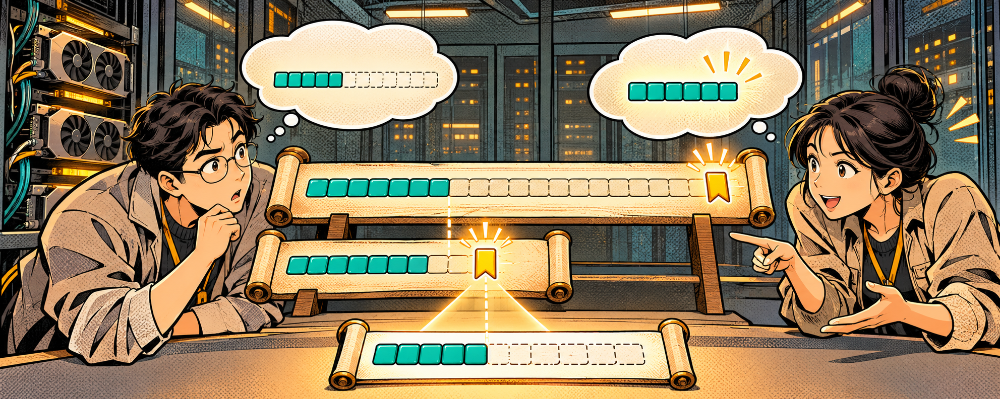
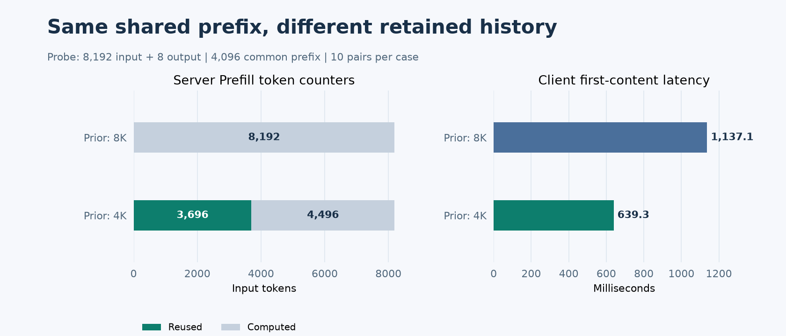
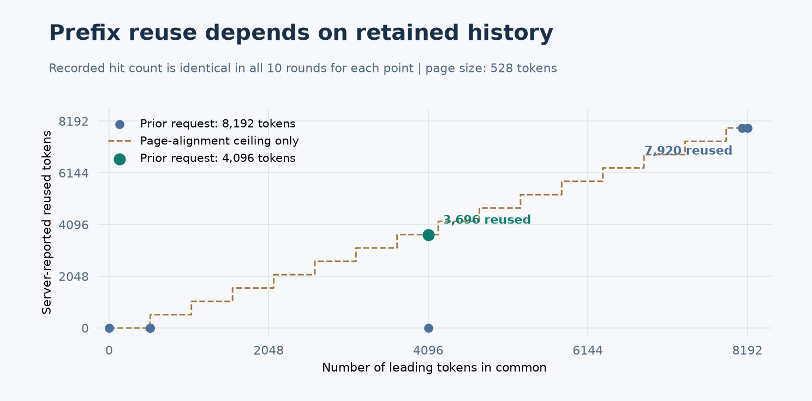

为了查一次 4K 前缀为什么没命中，我留了两份预置请求。第一份跑完 8K，探测时在第 4,097 个位置换一个 Token。第二份在 4K 就结束，再发同形状的探测。两组探测都有相同的 4K 公共前缀，固定 8,192 输入、8 输出，结果分别命中 **0** 和 **3,696**。十轮结果一致，首段中位数为 **1,137 ms** 和 **639 ms**。这些结果来自 Qwen3.5-9B、vLLM 0.33.0 和 align 状态缓存。

图一｜两组探测均为8,192输入、8输出、并发1、4,096个公共前导Token。每组10对预置与探测请求。左图来自逐请求服务端计数器差量，右图为客户端收到首个非空SSE内容的时间中位数。

## 只改上一条请求在哪里结束 {#一两组探测相同前面发生的事不同}

这次拿已有请求记录做回放和源码核对。服务用 BF16、两张 RTX 4090 D 做 TP=2，每步预算 2,048，块长 528。前缀缓存开启，状态缓存是 align，投机解码关闭。原始实验有七种条件，每种十轮，一共 70 对、140 条请求，另有一次预热。

每一轮生成一份长度8,192的Token ID数组，先随机打乱条件顺序。每个条件使用独立缓存盐，预置请求与紧随其后的探测请求共用该盐。这样只允许这一对之间复用，避免前一组条件留下的缓存被下一组探测借用。请求串行执行，发起前核对目标服务running和waiting都为零，并用返回usage检查输入与输出长度。

主对照中的探测输入逐轮完全对应：前4,096个Token与原数组相同，只在下标4,096、即第4,097个位置替换一个Token，其余位置保持不变。区别在预置请求。第一组用完整8K原数组预置，第二组只提交原数组的前4K。两组探测与各自预置都共享相同长度的前缀，但上一条请求曾经推进到哪里不同。

| 预置输入长度 | 探测输入长度 | 公共前缀 | 实际命中 | 实际Prefill重算 |
| ---: | ---: | ---: | ---: | ---: |
| 8,192 | 8,192 | 4,096 | 0 | 8,192 |
| 4,096 | 8,192 | 4,096 | 3,696 | 4,496 |

输入采用Token ID数组，还有一个测量上的好处：公共长度直接由位置确定，避开字符相同、分词却因模板或边界变化而不同的情况。采集脚本在发出前断言差异位置，原始结果则保存对应条件、返回usage、指标前后值和时延。做真实聊天复现时，还应保存最终拼接后的Token序列或其可核验摘要，不能只保留用户输入字符串。

命中来自 `prefix_cache_hits_total` 的差量，重算来自 `request_prefill_kv_computed_tokens_sum`。每条请求前后都检查只有一次成功、输入长度一致、输出恰好8Token，命中加重算等于输入总量。本次API usage没有返回可用的cached_tokens值，因此没有用响应字段代替计数器。

## 4K 在块表里落到哪里 {#二为什么4k最多先落到3696}

先从源码核对块的身份。它包含当前 Token、父块哈希和缓存盐等信息。早期 Token 一改，后续块的历史身份也跟着变。只复制后面一段相同文本，无法跨过前面的分岔。 [vLLM 前缀缓存设计](https://docs.vllm.ai/en/v0.33.0/design/prefix_caching/)

这台服务块长为528。4,096个相同前导位置，按完整块计只覆盖七块，即 **7×528=3,696**。余下400个位置落在尚未匹配为完整块的尾部。探测还需要完成后续输入，总重算量于是为 **8,192−3,696=4,496**。这一步的算术给出页边界约束，还没有保证3,696的位置上所有层都具备可复用状态。

另一个控制组把完整8K原数组原样提交两次，十轮探测均命中 **7,920**，重算272，首段中位数约 **68.8 ms**。这确认在同一实验条件下，前缀缓存确实发生了复用。vLLM的 `get_computed_blocks` 对完整命中还会保留重新计算末端以产生logits的空间，本例最后一个可用完整块边界是15×528=7,920。 [命中长度上限](https://github.com/vllm-project/vllm/blob/v0.33.0/vllm/v1/core/kv_cache_manager.py#L266-L310)

如果只靠完整块数量解释，两个4K公共前缀组应具有相同的对齐上界。实际却是一组零、一组三千多，说明还存在块边界之外的条件。这里需要看模型结构，而不是把输入重复比例直接当成命中比例。

## 追到 GDN 的状态检查点 {#三混合模型还得恢复哪一份状态}

七页是全注意力这边的边界，接下来查另一种状态。Qwen3.5-9B 同时有全注意力和 Gated DeltaNet。前者要读历史位置的 K、V，后者要从对应边界恢复递推状态。两部分都找到了对应历史，模型才能从那里继续。 [官方模型配置](https://huggingface.co/Qwen/Qwen3.5-9B/blob/main/config.json)

vLLM的混合缓存协调器 `find_longest_cache_hit` 会询问不同缓存组，再将可用长度协调到共同能恢复的位置。如果某一组把长度缩短，其他组也要与之对齐。Mamba状态管理器则从可用边界向前查找匹配的状态块。因此，一组缓存能匹配到更长，并不自动意味着整个模型可以从那里继续。 [混合缓存协调](https://github.com/vllm-project/vllm/blob/v0.33.0/vllm/v1/core/kv_cache_coordinator.py#L806-L941) · [状态缓存查找](https://github.com/vllm-project/vllm/blob/v0.33.0/vllm/v1/core/single_type_kv_cache_manager.py#L1470-L1550)

为什么不能拿8K末端的状态直接恢复到4K？递推状态已经吸收了更后面的输入。把它放到第4,097个位置继续计算，会把旧请求后半段的信息也带进去，破坏从公共前缀延续的语义。正确恢复需要该前缀边界对应的状态，或者从更早的有效位置重新计算。最终状态是否存在，与某个中间位置能否作为复用起点，是两个不同的问题。

类似地，缓存管理器要返回能够支持整段后续计算的组合。假如全注意力组在某个边界能找到K/V，但递推组只能恢复更早的位置，整体恢复点也必须向前收缩。源码还会记录较长的共享前缀线索，用于之后的检查点处理；本次没有追踪这些逐组内部结果，所以文章不把某个内部长度当成已采到的数。

保存哪些状态也有策略。该版本 `prefix_cache_retention_interval` 默认是0，保留可达的语义检查点，例如末端回放边界和已识别的共享前缀分岔位置；正值可额外保留周期检查点，None对应更密集的保留。align模式还会回收已跳过的旧状态，在位置表中留下空块。它不会仅仅因为某条请求经过一个边界，就要求每个中间状态永远留存。 [保留策略配置](https://github.com/vllm-project/vllm/blob/v0.33.0/vllm/config/cache.py#L275-L282) · [检查点保留与回收](https://github.com/vllm-project/vllm/blob/v0.33.0/vllm/v1/core/single_type_kv_cache_manager.py#L1550-L1659)

本次保存的启动参数没有覆盖保留间隔，本文按0.33.0默认值解释。8K预置的末端可复用边界在7,920，已经越过随后探测的4K差异点；4K预置的末端边界在3,696，恰好处于该探测的公共前缀内。这个历史变化与实测命中差异、共同恢复的源码规则相符。实验没有逐组转储状态块，也没有切换保留策略做干预，所以没有单独证明某一块状态究竟因回收还是驱逐而缺失。

## 把差异点从输入开头移到末尾 {#四把其他位置的结果放进同一张图}

接着把 8K 预置保持不变，只挪那个不同的 Token。下标 0、527、528、4,096 四处各跑十轮，探测全是 0 命中。挪到 8,128，命中 7,920，首段约 69.0 ms，和完整重复 8K 的对照接近。

图二｜蓝点均先预置8K请求；绿色点先预置4K请求。每个点的命中量在十轮中一致。虚线只是按528个Token对齐计算的页级上界，未检查该位置的状态是否仍存在，不能把它当成实际命中预测。

三组计时可以一起核对。4K公共前缀但8K预置时，服务端Prefill中位数约1,125ms；改为4K预置后约630ms；完整8K原样复用时约57ms。对应客户端首段约1,137、639、69ms。两个主对照在同轮输入上先做差再取中位数，首段差约496ms。服务端指标和客户端首段各自计时，不能直接相减，把余数全解释成网络成本。

命中比例也不能直接变成首段加速比例。跳过前3,696个输入位置后，后续4,496个位置仍要执行模型计算，其中全注意力层的新增query还会使用已缓存的历史K/V。缓存查找、状态恢复和输出交付也有成本。因此这份对照同时保留命中、重算量与Prefill计时，而不是只用一个命中率估算响应时间。换一个模型层结构或不同的分岔位置，剩余Token的成本还会变化。

所有探测只生成8个Token，便于将观察重点放在输入处理；开启流式，首段以客户端收到非空内容为界。输入是合成Token ID，并非真实问答文本，没有用这份结果评价回答质量。十轮足够确认这组命中模式重复出现，还不足以估计线上尾延迟或不同会话混合时的收益。

测试还设置了skip_special_tokens=False，避免只有特殊Token时客户端看不到任何非空内容。这里的首段严格按采集器收到的第一段非空SSE文本计，可能包含特殊Token的文本表示。将数值与真实聊天前端比较时，应使用相同的输出过滤规则，或者单独记录服务端首Token与用户首次可见文字的时间。

本次也没有通过全局清缓存来制造冷态，而是为每对请求换缓存盐。预置请求的命中量逐条均为零，可以核对本对从未借用其他组缓存。指标没有观察到抢占，但抢占与缓存驱逐是两种事件，仅靠前者为零，不能判断整个缓存池从未驱逐过状态。

## 复现时记下请求的顺序 {#五线上为什么值得按历史方式重放}

如果只在实验表里写“公共前缀 4K”，这次差异就解释不清。下次保留预置长度、差异位置、真实 Token 序列、缓存盐和请求顺序，再按同样历史重放。

迁移到多副本平台时，指标也要按模型、engine等标签分开。把多个实例的计数器先求总和，可能把其他请求的缓存命中混进当前探测。当前脚本每次等待计数器落账后核对成功数正好增加一，再检查输入、输出和重算量；若迁移后这个恒等式不成立，就应先解决观测窗口或背景流量问题，暂不据此计算单请求命中。

对于使用混合状态模型的服务，下一轮更有针对性的验证是，在授权的独立实例内固定请求对，逐组记录命中边界、状态保留与驱逐事件，再只改变检查点保留策略。比较命中和首段的同时，还要看常驻显存、状态复制与额外维护成本。更多可恢复位置可能提高复用机会，也会消耗资源，具体取舍不能只凭公共前缀比例决定。

这一轮能够确认的是，请求历史会改变实际复用量。先算整块边界，再查各组共用的可恢复位置。若还要判断是哪一份状态被回收或驱逐，得补逐组记录。

**资料来源**

- [vLLM v0.33.0前缀缓存设计与隔离](https://docs.vllm.ai/en/v0.33.0/design/prefix_caching/)
- [vLLM v0.33.0检查点保留配置](https://github.com/vllm-project/vllm/blob/v0.33.0/vllm/config/cache.py)
- [vLLM混合缓存命中协调器](https://github.com/vllm-project/vllm/blob/v0.33.0/vllm/v1/core/kv_cache_coordinator.py)
- [vLLM递推状态查找与回收](https://github.com/vllm-project/vllm/blob/v0.33.0/vllm/v1/core/single_type_kv_cache_manager.py)
- [Qwen3.5-9B模型配置](https://huggingface.co/Qwen/Qwen3.5-9B/blob/main/config.json)
