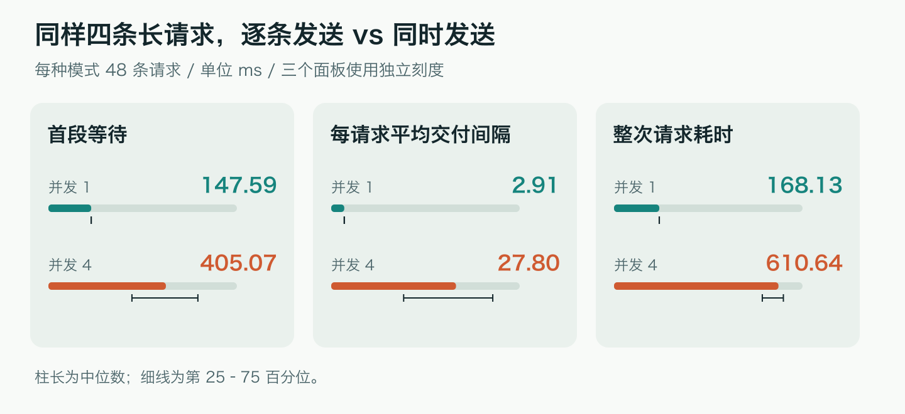
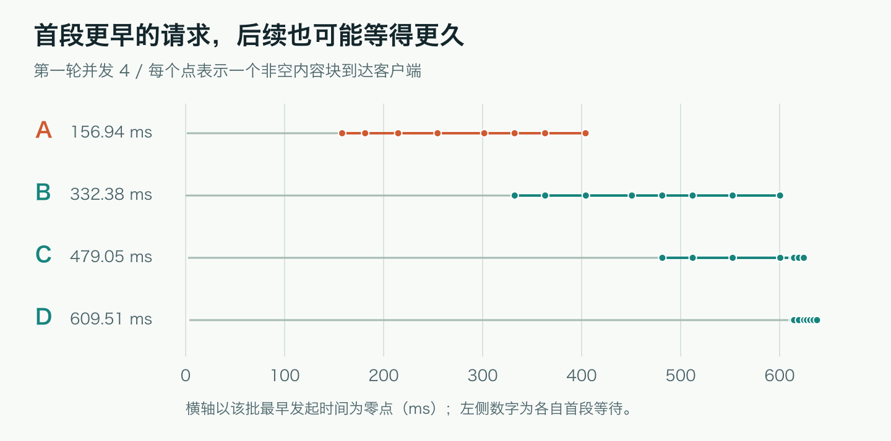
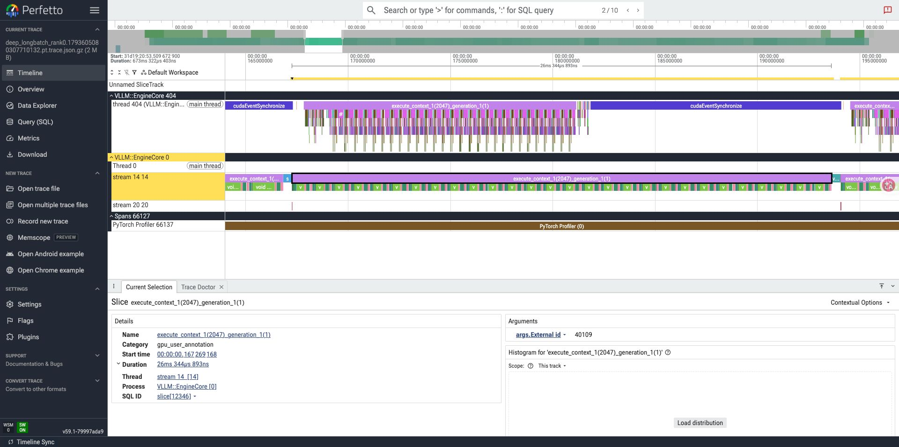

同样四条长请求，逐条发时，每条请求的平均内容交付间隔取中位数是 **2.91 ms**。四条一起发，这个数字变成 **27.80 ms**，约是原来的 9.55 倍。同期，按四条请求算的输出速率中位数只从 **47.58** 升到 **50.11 Token/s**。这组实测里，用户体验的代价有两部分：开口更晚，开口之后也更容易停顿。排查这种问题，得沿着同一条请求分别看首次排队、首段处理和后续交付。

## 一、把输入和输出固定，只改请求到达方式

实验用 Qwen3-0.6B、vLLM 0.32.0 和一张共享的 RTX 4090 D。每轮准备四条不同输入，每条恰好 8192 个输入 Token，实际都生成 8 个输出 Token。并发 1 时等上一条请求结束再发下一条，并发 4 时让四个客户端线程在同一个屏障后发出请求。两种模式复用这一轮的四条输入。这样比较的是同一批计算工作在两种到达方式下的表现，能排除拿短问题对比长文档造成的混杂。

11 月 3 日的正式补测有 12 轮，每轮都测两种模式，交替执行顺序。每种模式各 48 条，总计 96 条，均为 393216 个输入 Token 和 384 个输出 Token。并发组四条请求起发时间的最大跨度是 4.17 ms。每条请求使用独立的缓存盐，服务计数器显示两种模式的前缀命中和抢占增量均为零。正式计时关闭了 Profiler，服务期间没有重启。首尾短请求对照的总耗时中位数相差约 0.10%。这能帮助检查前后漂移，短时的共享卡干扰仍然可能存在。

这里的并发是实际同时发起的请求数。每组发完以后等全部请求完成，再进入下一组。持续到达的新请求会改变队列和批次组成，因此本文的四请求输出速率只描述这次有限批次。生产流量的最大可承载速率需要另测。

两种模式每轮都完成 32 个输出 Token。计算输出速率时，并发 1 的分母是四次单请求批次的计时窗口之和，并发 4 的分母是一个四请求批次的计时窗口。准备输入和线程释放前的时间排除在外。把两种模式各自的批次速率取中位数，约多出 5.3%。这个口径回答的是“完成相同一批工作需要多久”。单请求首段等待则从各自的发起时刻起算，回答的是“每个用户等了多久”。批次进度和用户进度可以同时朝不同方向变化。

## 二、首段慢多少，后面又慢多少

图一｜11 月 3 日客户端实测，每种模式 48 条。柱为请求级中位数，细线为第 25 至第 75 百分位。每项指标独立汇总。

客户端从请求发出计时，解析流式响应，只给带非空文本的内容块打时间戳。首段等待从发出请求算到第一个非空文本块。它包括服务端处理、传输和客户端解析的影响。空内容、角色信息和结束标记不算首段。记录这些规则很重要，否则 SDK 先交付一个空事件，就能让监控误以为用户已经看到内容。

本组每条请求收到了 8 个非空内容块。用末块时间减首块时间，再除以 7，得到这条请求的平均交付间隔。然后对每种模式的 48 条请求取中位数，得到 2.91 ms 和 27.80 ms。通用流式接口里，一个内容块可能包含多个 Token，交付间隔要和引擎内部的 Token 生成间隔分别记录。即使块数与 Token 数一致，传输和解析也可能影响二者的时间差。

首段等待中位数从 147.59 ms 升到 405.07 ms，约为 2.74 倍。整次请求耗时中位数从 168.13 ms 升到 610.64 ms。再把 48 条请求各自的七个相邻间隔摊开，并发 1 的 336 个间隔没有超过 10 ms，并发 4 有 216 个。10 ms 只是这批数据的比较阈值。逐轮看，12 组配对的每请求平均间隔中位数之比都在约 9.50 至 9.63 倍之间。差异在多轮都出现，也能在间隔分布里看到，单看一个最慢请求反而会丢掉这些信息。

抓这些数据时，可以在现有流式客户端的解析回调中保存请求标识、单调时钟下的请求起点、每次非空内容到达和流结束时刻。每个回调只追加时间戳，批次结束再落盘，尽量避免逐块打印干扰读流。复核时同时保存输入输出 Token 数和内容块数。对于只返回一块的请求，可以纳入首段统计，但没有可计算的相邻交付间隔，需要把这个指标留空。对已经开始输出却经常停顿的问题，平均间隔和长间隔数量宜一起报告，前者衡量整体节奏，后者保留短时停顿的信息。

## 三、首段出来了，这条请求还在等什么

图二｜11 月 3 日第一轮并发 4。每个点是一次非空内容块到达，横轴对齐到本批最早发出的请求。左侧数值是各自从发起到首段的耗时。

这轮最早出现内容的 A，首段等了 156.94 ms，随后七个间隔平均 35.13 ms，其中最长一个约 47.16 ms。最晚出现内容的 D，首段等了 609.51 ms，随后七个间隔平均 3.50 ms。把两个请求都算成总耗时，A 更快。把它们画成时间线，A 已经能看到答案，却时不时需要等下一段；D 把大部分等待留在了开头。流式接口因此至少有两个体验指标，首段和后续间隔都得验收。

接着看这次补测自己的服务端计数器。对每种模式累加各正式窗口的直方图增量，再用累计时间增量除以样本数。以并发 4 为例，首次排队时间累计增加 8.3181 秒，计数增加 48，得到每条请求平均 173.29 ms。并发 1 的同一指标约 0.007 ms。与此同时，Prefill 区间均值从 139.01 ms 升到 198.23 ms，Decode 区间均值从 24.13 ms 升到 173.99 ms。首次排队变长解释了进入执行前的一段等待，后续生成区间也显著拉长，所以还得看首次调度之后。

vLLM 0.32.0 的统计代码在收到首次调度事件时记录时间。首次排队从入队量到首次调度，Prefill 从首次调度量到首个 Token，Decode 从首个 Token 量到最后一个 Token。三个区间都是经过时间，后两段可以包含多个调度步之间的等待。不能把 Prefill 的区间均值当成 Attention 算子耗时，也不能拿客户端的请求中位数减服务端的区间均值来估网络延迟。要拆到单条请求，需要能关联同一请求的两侧事件，并使用一致的边界和汇总方式。 [vLLM 0.32.0 请求统计源码](https://github.com/vllm-project/vllm/blob/v0.32.0/vllm/v1/metrics/stats.py)

采集直方图时应把起止快照对准同一服务实例和同一标签集合，并检查成功请求计数、各阶段直方图计数是否与客户端完成量一致。把累计时间除以计数之前，先检查窗口内有没有重启、计数器重置或其他请求混入。这样算出的是窗口里的请求均值。想追到首段最慢的那一条，累计直方图只能给方向，还需要逐请求事件。图二按共同单调时钟画在一起，能看出四条请求何时陆续出首段；其中的点仍然只是客户端收到内容的时刻。

## 四、一个 Decode Token，为什么会和 2047 个输入 Token 同轮执行

图三｜11 月 2 日单独采集的真实 GPU trace，请求形状同为 8192 输入、8 输出、并发 4。选中的设备侧标注跨度约 26.345 ms。

在 Perfetto 里搜索 `execute_context_1(2047)_generation_1(1)`。把光标点到 GPU stream 对应的紫色标注，详情会显示约 26.345 ms。这一步同时调度了一个请求的 2047 个输入 Token，以及另一个请求的 1 个后续生成 Token。26.345 ms 是该设备侧标注覆盖的区间，既不能记成那个 Token 独占的 kernel 时间，也不能拿来对齐第二天补测中 A 的 47.16 ms 停顿。两次采集各自回答一个问题：补测量到了用户等多久，trace 确认同形状的执行中确实有混合步骤。

为什么会有这一步？在 `Scheduler.schedule()` 里，调度器先按 Token 预算处理已经在运行集合中的请求，再尝试从等待集合接入请求。运行集合里既有输入尚未处理完的请求，也有已经开始生成的请求。某个请求本步只需推进一个生成位置，并不意味着本轮只跑这个请求。预算有余量、其他接入条件也满足时，可以同时推进别的请求的输入。GPU worker 的 `annotate_profile()` 会把这两类 Token 的数量分别放进标注，正好能在时间线上认出这种轮次。 [vLLM 0.32.0 调度器](https://github.com/vllm-project/vllm/blob/v0.32.0/vllm/v1/core/sched/scheduler.py) · [GPU worker 标注源码](https://github.com/vllm-project/vllm/blob/v0.32.0/vllm/v1/worker/gpu_worker.py)

对同一个正在生成的请求，从一个 Token 产生到下一个 Token 产生，中间可能要等下一轮被调度，还要等对应执行推进到产出。混合轮里，输入处理的算子工作会和这条请求共同占用设备执行时间。Token 数预算控制这一轮能接多少工作，固定的 Token 数并不对应固定的耗时。长输入块所处的位置、缓存长度和同轮请求形状都能改变计算成本。这给已经开始输出的请求为什么还会停顿提供了一条可以沿 trace 检查的执行路径。当前实验没有隔离每种开销，9.55 倍是并发模式改变后的整体差异。

把这类轮次按标注分类，还能核对 trace 有没有覆盖整批工作。那一轮采样里，CPU 执行标注包含 4 个纯输入步、13 个混合步、7 个纯生成步和 2 个零工作步。输入计数加起来是 32768，正好等于四条请求的输入量。后续生成计数合计 28，因为每条请求的第一个输出来自输入处理结束后的采样，余下才是四乘七。这一步交叉核对能发现截断的采样窗口，也解释了为什么不能把标注里的生成计数直接当成 API 返回的总输出数。

## 五、优化先验收输出节奏，再看吞吐值不值得

这个例子里，先买更多显存的依据较弱。按 28 层、8 个 KV head、每个 head 128 维、BF16 两字节、K 和 V 各一份估算，每 Token 的 KV 主体为 `2 × 28 × 8 × 128 × 2 = 114688` 字节，即 112 KiB。四条 8192 Token 输入约 3.50 GiB，另加短输出和块取整。启动记录的对应 KV 容量约 5.605 GiB，实验也没记录到新增抢占。容量估算和事件计数指向同一个排查顺序：先看混合步和排队，后查 KV 容量不足引发的抢占。即使缓存装得下，仍可能因为工作需要共用设备而等很久。 [Qwen3-0.6B 官方模型配置](https://huggingface.co/Qwen/Qwen3-0.6B/blob/main/config.json)

下一轮可以固定这 12 组输入，保留并发 4，只改一项可用的每步 Token 预算。比较时用关闭 Profiler 的正式数据报告首段等待、每请求交付间隔和四请求输出速率，再用单独的 trace 检查混合步数量、跨度以及长输入被切成了多少轮。更小的预算可能减少某些混合步的输入工作，也可能让长输入经历更多轮才出首段。两项指标可能朝相反方向走，是否值得取决于服务的首段和后续交付目标。 [vLLM 官方 Chunked Prefill 调优文档](https://docs.vllm.ai/en/latest/configuration/optimization/)

看对照结果时还要防止一个错觉：长间隔变少，可能只是请求更久才拿到首段，等它开口时竞争已经结束。第一轮的 D 就展示了这种观测形态。验收时可以先给首段和交付间隔分别设目标，再数两项同时达标的请求。这样即便整批更早完成，也能看出是否有更多用户跨过任一延迟门槛。四请求的有限批次适合找机制，若要设线上限流点，还要用实际的请求长度分布和持续到达方式验证。

如果线上经过网关，还可以为同一请求同时记录引擎出 Token、网关写出和客户端收到三个事件序列。若引擎侧的间隔已经拉长，就回到调度和设备时间线；若引擎稳定而客户端成批收到内容，再查代理缓冲或解析。这组补测可以量化并发影响，也可以指明追查路径。要验证哪项配置能改善它，下一轮要同时看用户看到的首段、内容间隔，以及整批完成速度。只有把这三项放在一起，才知道多出来的吞吐值不值得。
