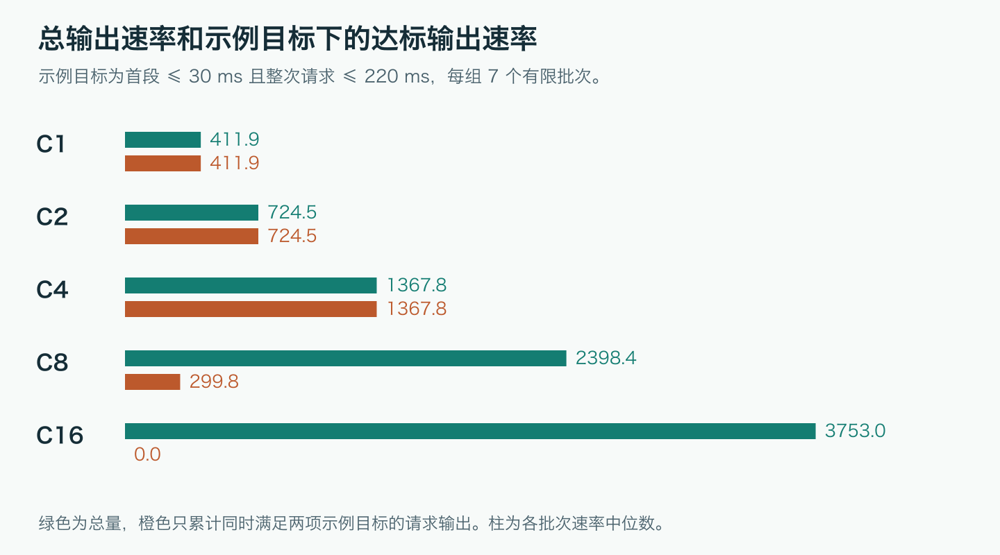
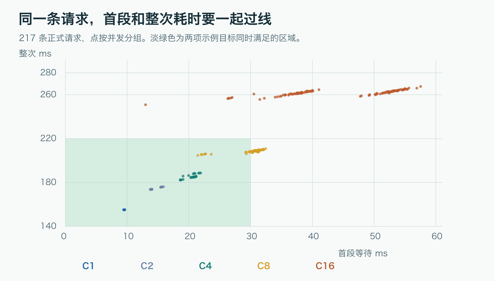

同一份推理压测，并发从 1 加到 16，批次总输出速率中位数从 **411.9** 升到 **3753.0 Token/s**。但若加入一组示例目标：首段等待不超过 **30 ms**，且整次请求不超过 **220 ms**，并发 16 的 **112 条正式请求没有一条同时过线**。这组数据能展示批处理的效率，也能展示效率与延迟之间的取舍。判断线上容量，需要把完成了多少输出和有多少请求按时完成放在一起。

## 一、先说明 3753 的分母是什么

数据采自 11 月 2 日的 Qwen3-0.6B，使用 vLLM 0.32.0、BF16 和共享 RTX 4090 D。每条请求固定 256 Token 输入、实际生成 64 Token，走流式补全接口。并发分别为 1、2、4、8、16，每组预热两个批次，再测七个正式批次，总计 217 条正式请求。各组正式窗口的服务端成功计数与请求数一致，前缀命中和抢占都没有增加。本次从已有请求记录复算，保留了原采集时的负载条件。

一个批次让指定数量的客户端线程发起请求，等待全部结束，再进入下一批。批次计时从提交线程任务开始，包含构造输入、线程启动、屏障等待和请求执行。单条请求则在屏障释放后、发起 HTTP 调用前开始计时。两种分母范围不同，因此批次吞吐量不应被解释为纯 GPU 的处理速度。起始与结束边界写清楚，后续比较才能知道优化了哪个环节。

以并发 16 的第一批为例，实际输出 16 × 64 = 1024 Token，批次用时 275.416 ms。1024 除以 0.275416，约为 3718.01 Token/s。七批各算一次，再取中位数，才得到 3753.05。若想汇报整组时间窗口的平均速率，应将七批输出合计除以七批墙钟时间之和。两种统计各有用途，不能把中位数再乘以时长当成整组输出量。

复核吞吐时，还要区别“整批完成速率”和“各请求速度之和”。同批请求的执行时间重叠，每条又从自己的发起时刻计时。逐条算输出除以该条耗时，再相加，分母并没有统一到同一个批次窗口。本例并发 16 这样相加后，七批结果的中位数约为 3905 Token/s，比批次口径高约 4.1%。两者差异包含起发、收尾和客户端准备边界，拿前者替代后者会悄悄改变性能指标。

## 二、总输出变多，每个用户也可能等得更久

图一｜11 月 2 日实测，每组七个有限批次。柱为批次速率中位数。橙色只累计首段不超过 30 ms、整次不超过 220 ms 的请求输出；阈值用于演示。

并发 1、2、4、8、16 的总输出速率中位数依次约为 412、725、1368、2398、3753 Token/s。与此同时，逐请求首段中位数依次约为 9.58、14.77、20.78、30.73、44.44 ms，整次耗时中位数约为 154.94、174.57、184.94、208.41、261.84 ms。从单请求到并发 16，总处理量提高约 9.11 倍，而用户开始看到内容前的中位等待也提高约 4.64 倍。

这两种变化可以同时发生。批次中有更多请求一起推进，服务每轮可以处理更多生成位置，但每个请求要经历的步骤以及与其他工作共享执行的方式也变了。vLLM 0.32.0 的调度器按请求尚需推进的 Token 进度和本轮预算分配工作，批次组成来自运行集合、等待集合和资源约束。这个机制说明了同时推进多个请求的路径；哪类算子在某个批次里变高效，还要用对应 trace 或实现对照验证。 [vLLM 0.32.0 调度器](https://github.com/vllm-project/vllm/blob/v0.32.0/vllm/v1/core/sched/scheduler.py)

尤其不能把 3753 取倒数后说用户每个 Token 只需约 0.266 ms。这个倒数把所有请求的输出摊到一个总量分母里。同批有多个流，某个用户仍要等自己那条流的下一次内容交付。原始逐请求记录里，并发 16 的每请求平均交付间隔取中位数约 3.439 ms，单请求约 2.306 ms。聚合处理得更划算，与单条流的间隔变短，是两个分别需要实测的判断。

从资源成本看，还要把批次节省和卡时账对应起来。在模型、共享条件和实例数固定时，完成同样数量的输出用时更少，才有机会降低这些请求摊到的设备时间。如果为凑大批次增加了等待，用户延迟预算也会被消耗。若为了扩大批次又加了一张卡，则成本分母同时变化，吞吐上涨也不能独自证明单 Token 成本下降。当前数据保留了相同部署条件，只能先比较这批工作完成效率和请求等待的变化。

## 三、把目标落到每一条请求，再重新累计

图二｜217 条正式请求，每个点同时使用该请求的首段和整次耗时。淡绿色区域对应两项示例目标同时达标，横轴和纵轴分别为毫秒。

取一条请求，首段与整次耗时都过线就记为一，否则记为零。先逐条判断，再把达标请求的输出量加起来，除以这个批次的完整墙钟时间。分母保留完整批次，意味着超目标请求仍消耗的时间也留在账里。若把它们的耗时一并删掉，算出的只是被挑出来的快请求速度，无法描述服务用这段时间真正交付了多少合格工作。

按这组示例阈值，并发 1 是 7 条里 7 条达标，并发 2 是 14 条里 14 条，并发 4 是 28 条里 28 条，并发 8 是 56 条里 13 条，并发 16 是 112 条里零条。对于七个批次分别算达标输出速率后取中位数，结果约为 412、725、1368、300、0 Token/s。并发 8 的总吞吐仍在上涨，但较多请求跨过首段门槛，换一个分子后便能看到这种代价。

这里要特别区分请求达标数和输出量。vLLM 官方基准的 `calculate_metrics()` 会按配置逐请求检查各项延迟目标，全部满足才增加 `good_completed`，再除以测试时长得到 request goodput。本文图一用的是达标请求的输出 Token 数，因此是输出速率口径。本例每条都恰好输出 64 Token，除以 64 可以换成对应请求速率。输出长度不同的时候，这两种指标会给长请求不同的权重。 [vLLM 0.32.0 基准统计实现](https://github.com/vllm-project/vllm/blob/v0.32.0/vllm/benchmarks/serve.py)

统计汇总顺序也会改变展示值。并发 8 七批的达标请求数依次为 1、2、1、1、1、5、2，合计 13。每批都先按自己的墙钟时间求速率，再取中位数，得到约 300 Token/s。若将全部批次视为一个大窗口，则应直接用 13 × 64 除以七批时长总和。拿 13 除以 56 得到的达标率，乘上总吞吐中位数，并不会自动等于前面任何一种速率。报告里写出汇总顺序，原始记录才可以被他人重算。

## 四、两条平均线，不能代替联合达标判断

如果只看并发 8 的整次耗时中位数 208.41 ms，它似乎落在 220 ms 内。但首段中位数已经到 30.73 ms，逐请求联合判断后，仅 13 条满足两项条件。反过来也一样：首段快的请求可能在后续生成中停顿，整次时间超过目标。把两个独立统计值分别打勾，无法知道同一条请求有没有同时过关。图二把每条的两项数据绑定成点，目的就是把这个问题直接画出来。

两项目标本身也需要业务定义。交互问答可能对首段和后续输出节奏分别设目标，离线任务可能更重视整批完成时间。这次的 30 和 220 ms 是分析示例，用来展示改变分子会怎样影响结果，不能据此宣布并发 4 是该服务最优配置。如果放宽目标，或换成长输入，达标分布会改变。做决策时应先确定真实目标，再用同一批原始请求按不同门槛复算，查看结论是否只依赖某个临界值。

样本量也限制了尾部判断。每组只有七批，且每批请求的到达时间被人为集中，同批请求会互相影响。112 条记录提供了可检查的逐请求证据，却不能简单当成 112 个互相独立的环境试验。单请求与并发组使用的是相同输入长度与生成参数，但每条输入 ID 按种子生成，测的是形状控制下的服务行为。它们没有覆盖真实业务的提示词分布与回答质量。

还可以把两项门槛做成一张目标网格。固定这 217 条数据，横向放宽首段门槛，纵向放宽整次耗时门槛，每格重新数两项同时达标的请求。这样只改变验收标准，底层测量保持一致。若并发排序只在很窄的门槛范围成立，就应把它作为对服务目标敏感的结果。真正改变部署配置以后，则需要重新采请求，旧样本上的门槛扫描无法替代新配置实测。

## 五、从批次成绩走到线上容量，还要补什么

当前的客户端会等一批全部结束，才发下一批。线上通常还有新请求持续到达。若完成速度赶不上到达速度，队列会随时间增长，早期请求可能很快，后期请求却越来越慢。一次有限批次即使完成得很好，也没有观察到这种长期积压过程。因此 3753 Token/s 可以作为这次批次吞吐证据，线上可承载的请求到达速率需要另做持续负载验证。

复测时先固定输入输出分布和缓存规则，逐级提高请求到达速率，同时记录实际发出速率、服务完成速率、排队量和延迟分布。客户端如果设并发上限，也要记录请求在客户端等待许可的时间，否则压力会先被客户端挡住，服务端队列可能仍然很短。vLLM 的基准代码分别提供到达速率与并发限制，并记录等待客户端信号量的延迟，正是为了能辨认这两个边界。 [vLLM 请求到达与客户端限流实现](https://github.com/vllm-project/vllm/blob/v0.32.0/vllm/benchmarks/serve.py#L374-L405)

对持续负载，可以用一条直观的守恒关系检查队列。到达请求累计数减去已完成和已失败离开的请求数，应与系统中仍在处理和等待的数量相符，差异还可能来自计数窗口或取消传播。只要这个在途量在稳定输入下持续上涨，当前服务就没有在该窗口跟上到达负载。请求完成曲线看起来很陡，也可能同时伴随积压。把积压趋势与达标吞吐一同验收，才会看到这类状态。

还需要在同一个测试窗口核对完成量。请求已经被客户端发出、服务已接收、成功结束和中途失败，是不同的计数位置。若压测结束就停止计时，但已有请求还没完成，分母和分子会跨窗口。可以明确采用包含排空的整段时长，或者规定稳定窗口后逐请求归属，保留失败与超时记录。输出量也应使用接口实际报告并核对的数值，提前终止的回答不能按最大输出长度记账。

这份原始数据里，增大并发确实提高了有限批次的总输出效率，延迟目标则决定其中多少输出算按时交付。交付报表可以把两条曲线一起保留，再加上持续负载下的队列趋势。这样，扩副本或调整准入时依据的是在目标内完成的请求量，而不只是某一轮批次最大的 Token/s。
