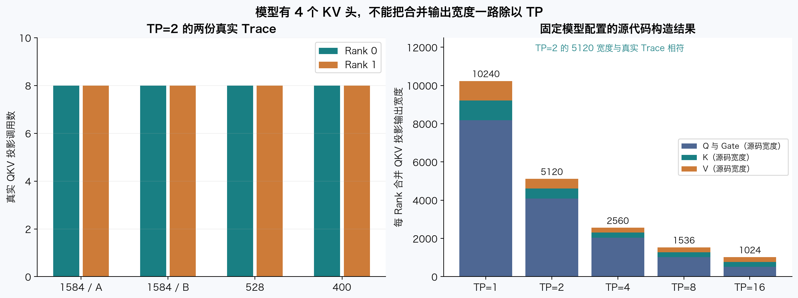
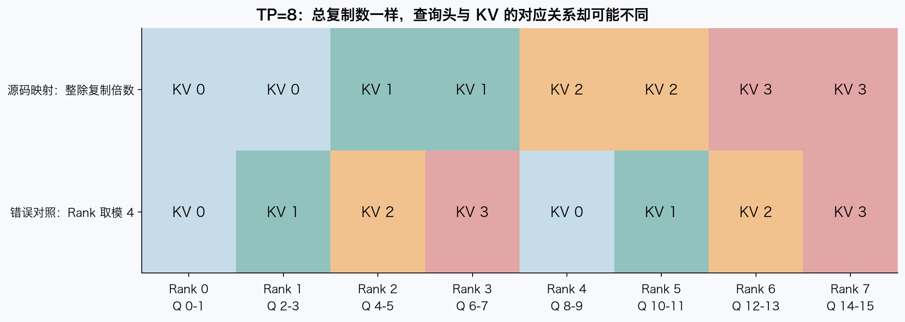
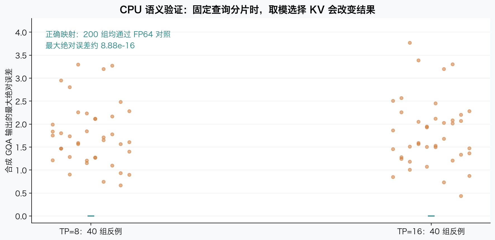
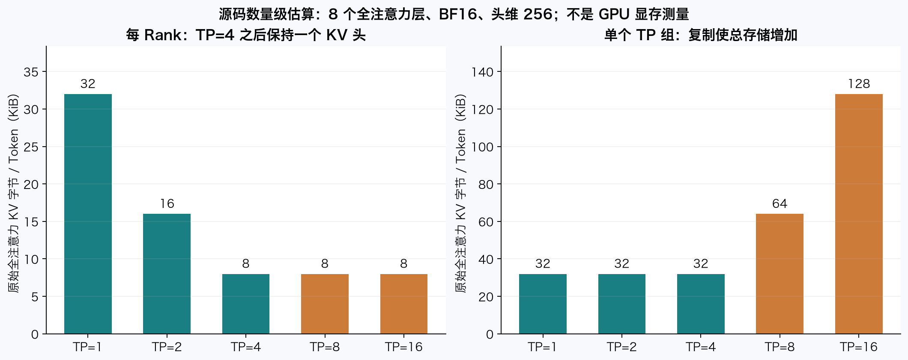

给 Qwen3.5-9B 估算扩卡后的 KV 显存，算到 TP=8 时有一项不能再除以二。这个模型只有四个全注意力 KV 头，TP=4 时每个 Rank 已经只留一个。沿 vLLM 0.33.0 的加载路径继续算，TP=8 仍然是每卡一个，只是每个 KV 头有两份副本。按本例 BF16 和 8 个全注意力层估算，**TP=4 和 TP=8 都是每卡 8 KiB/Token，整组却从 32 增到 64 KiB/Token。**

这份笔记从一次 TP=2 的真实 Trace 找到每卡的投影形状，再用固定版本的源码构造更高 TP 的布局。头映射另外用 CPU 合成张量验证。实际设备采样只有两张 RTX 4090 D，八卡和十六卡的数字是配置推导。


## 先拆 Trace 里的 5120

这次采样是 Qwen3.5-9B、BF16、vLLM 0.33.0、TP=2。单请求实际输入 4096 Token，目标输出 1 Token。部署上限 8192、最多 8 条运行序列、步预算 2048，Decode Context Parallel 为 1。实际 Prefill 分了四步，位置数为 1584、1584、528、400。

两份 Rank Trace 各有 32 次全注意力 QKV 投影，对应每步 8 层。以第一步为例，矩阵是 `1584×4096` 乘 `4096×5120`。按 External id 找卡上的事件，选中的每次投影都对到一个 GPU Kernel。



图 1｜左图来自两份 TP=2 Trace。右图来自源码构造，其中 TP=2 的 5120 宽度有实际执行记录核对。

查模型配置，全注意力有 16 个查询头和 4 个 KV 头，头维 256。TP=2 时每卡分到 8 个查询头、2 个 KV 头，所以 5120 要分四笔记。

| 本地投影 | 宽度 | 用途 |
|---|---:|---|
| Q | 2048 | 当前查询 |
| 输出门控 | 2048 | 注意力输出门控 |
| K | 512 | 历史 K |
| V | 512 | 历史 V |

预算历史缓存时，只拿 K、V 两列。模型还有 24 层 Gated DeltaNet，它们的递推状态单独记账。 [模型配置](https://huggingface.co/Qwen/Qwen3.5-9B/blob/main/config.json) · [注意力投影构造](https://github.com/vllm-project/vllm/blob/4ba787ec9959e566d3b587a796dff07673324da5/vllm/model_executor/models/qwen3_next.py#L280)

## 为什么八个 Rank 要复制四个头

前四张卡还可以用不同的头分担 K、V。TP=1、2、4 时，本地 KV 头数依次是 4、2、1。到 TP=8，16 个查询头仍能分成每卡两个，而每个查询分片要在本地读到它对应的历史。vLLM 的做法是给每个 Rank 留一个完整的 KV 头，并记录每个头的复制倍数。 [QKVParallelLinear 的分片规则](https://github.com/vllm-project/vllm/blob/4ba787ec9959e566d3b587a796dff07673324da5/vllm/model_executor/layers/linear.py#L1066)

把组内 Rank 和来源写成一行，就容易看出加载器要验什么。

```text
TP Rank:         0  1  2  3  4  5  6  7
按复制倍数整除:  0  0  1  1  2  2  3  3
按头数取模:      0  1  2  3  0  1  2  3
```

两种写法都会让每个头出现两次，输出形状也一样。但按固定查询顺序，Rank 0 的查询头 0–1 和 Rank 1 的查询头 2–3 都应该读 KV 头 0。实际加载器在取 K/V 源分片时用组内 Rank 除以复制倍数。 [按 Rank 选择 KV 源分片](https://github.com/vllm-project/vllm/blob/4ba787ec9959e566d3b587a796dff07673324da5/vllm/model_executor/parameter.py#L175)



图 2｜两种映射的副本数一致，查询和历史头的对应关系不同。取模一行是故意构造的 CPU 反例。

这一步用 FP64 合成张量复核过。200 组正确映射都与未切分参考结果一致，最大绝对误差约为 8.88×10⁻¹⁶。用相同查询顺序做 80 组 TP=8／16 取模反例，全部出现明显差异。复核同时跑了独立 Q/K/V 和已合并权重两个加载入口，共核对 1240 次 Rank 权重加载。这里验的是索引与计算语义。



图 3｜CPU 语义验证仅计算缩小后的 GQA 模型片段。结果不能用于推断完整模型质量或多卡性能。

## 按每卡和整组分别记账

原始 K/V 字节的算式如下。F 是全注意力层数，h 是每 Rank 的本地 KV 头数，d 是头维度，b 是单元素字节数，L 是当前已保存的历史长度。

```text
每 Rank 原始 K/V 字节 = 2 × F × h × d × b × L
本例一个本地 KV 头 = 2 × 8 × 256 × 2 = 8192 字节/Token
```

| TP | 每 Rank KV 头数 | 每头复制数 | 每 Rank KiB/Token | 整组 KiB/Token |
|---:|---:|---:|---:|---:|
| 1 | 4 | 1 | 32 | 32 |
| 2 | 2 | 1 | 16 | 32 |
| 4 | 1 | 1 | 8 | 32 |
| 8 | 1 | 2 | 8 | 64 |
| 16 | 1 | 4 | 8 | 128 |

一条 8192 Token 的序列，在 TP=4 与 TP=8 都是每卡 **64 MiB**。放到整组看，四卡合计 **256 MiB**，八卡合计 **512 MiB**。这个预算只计 BF16 全注意力 K/V 内容。显存还要为权重、递推状态、页对齐、工作区和预分配池分别留空间。前缀共享出现后，也要按独立内容来算。 [缓存页规格](https://github.com/vllm-project/vllm/blob/4ba787ec9959e566d3b587a796dff07673324da5/vllm/v1/kv_cache_interface.py#L552) · [KV 块池容量复算]()



图 4｜数字按头映射计算，仅覆盖 8 层全注意力。图中是预算，设备采样只做了 TP=2。

## 扩卡前我会补这三项

1. **先按模型配置算。** 抄下真正的查询头数、KV 头数、头维、dtype 和全注意力层数。分别写出每 Rank 头数、复制倍数和缓存字节，再把权重、GDN 状态与工作区加进显存表。
2. **再查加载映射。** 比较 `Rank // replicas` 选出来的 K/V 与本地查询区间。检查独立 Q/K/V 和合并权重两个入口。Gate/Up 也有类似的分片陷阱。 [Gate/Up 权重分片实测笔记]()
3. **最后在目标 TP 上做负载验证。** 先确认能启动和实际缓存页规格，再测同一请求分布的首段、后续输出间隔和吞吐。比较一个八卡组与两个四卡组时，分别测各组实际留下的缓存预算。四卡组每卡可能装更多权重，两种部署也各有路由和通信成本。

这次能确定的是，在所查的 vLLM 0.33.0 和 Qwen3.5-9B 配置下，**TP 超过 4 后，每卡原始全注意力 KV 不再继续按 TP 缩小**。扩卡是否能改善真实交付，留给目标 TP 的设备测量。

## 资料来源

- [vLLM v0.33.0 固定提交 4ba787e](https://github.com/vllm-project/vllm/tree/4ba787ec9959e566d3b587a796dff07673324da5)
- [Qwen3.5-9B 模型配置](https://huggingface.co/Qwen/Qwen3.5-9B/blob/main/config.json)
- [Grouped-Query Attention 原论文](https://arxiv.org/abs/2305.13245)
